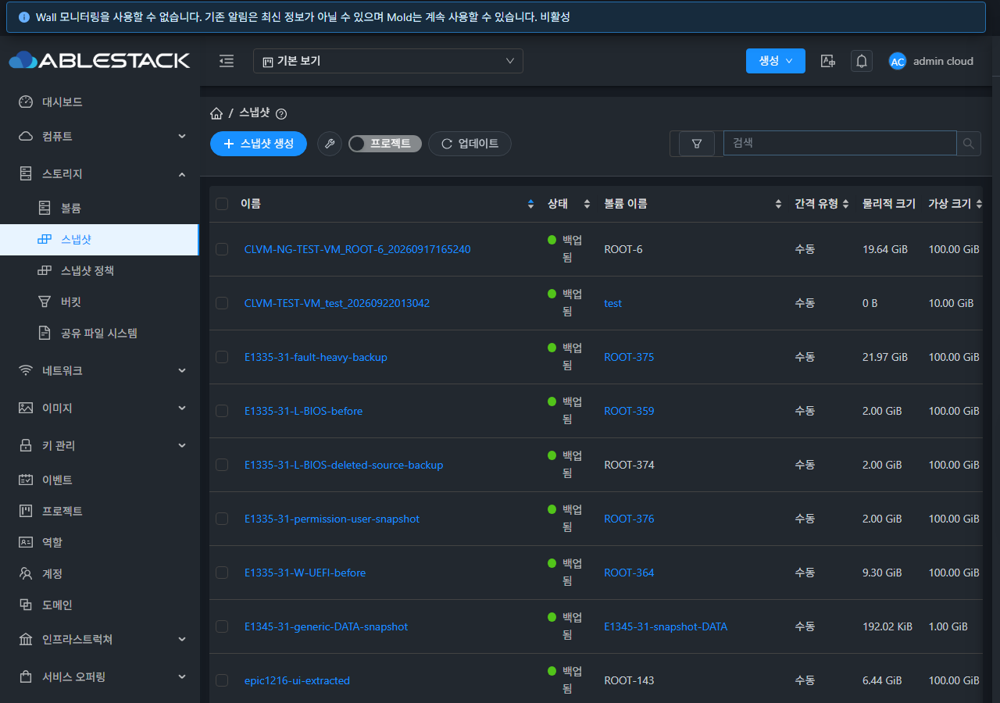
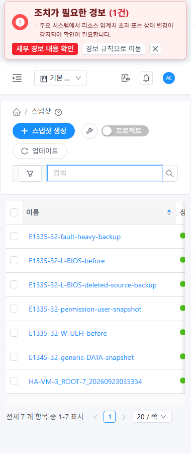

# #1485 스냅샷 목록 표준화 검증

## 결과와 범위

31 GFS2·32 RBD에서 `/snapshot` 목록의 VM 표준 구성, 작업·표·선택·검색·페이지, 크기·한글, 오류·재시도와 라이트/다크 반응형을 API/UI/독립 DB로 검증했다. 공통 ListView를 유지하고 Snapshot 목록에만 배치를 적용했다. [설계](design.ko.md), [소스 해시](source-manifest.json), [기계 검증 요약](evidence-summary.json), [증거 재검증](scripts/verify_evidence.py)을 함께 읽는다.

시작 HEAD는 `c7fc749f8e7d4cd4cfbaedc534b3380b15b1d9ab`, 브랜치는 `dhslove/epic-1473-storage-snapshots`다. 구현 이슈의 완료이며 Epic 전체 완료·병합 또는 전체 Cloud CI 성공을 의미하지 않는다.

## 구현

- 공통 breadcrumb 아래에 생성 텍스트 버튼, 선택 삭제, 보조 복구/프로젝트, 마지막 업데이트를 배치하고 검색은 오른쪽에 둔다. 좁은 화면에서는 줄바꿈한다.
- 생성은 기존 볼륨 선택/생성 및 볼륨 작업 > 스냅샷 생성으로 연결한다. 스냅샷 이름/태그/주기를 볼륨 조건으로 전달하지 않고 실제 소유/Zone 범위를 유지한다. 이 진입 버튼 자체는 POST를 보내지 않는다.
- 기존 VM 공통 표의 middle 크기·선택 개수·열 선택·페이지/페이지 크기·선택 묶음 문맥 메뉴를 사용한다. 행에 키보드 포커스와 Shift+F10을 지원하고 닫기 후 포커스를 복구한다. 조회 도중 닫힌 메뉴는 복구 시 자동으로 다시 나타나지 않는다.
- 물리/가상 크기는 동적 B/KiB/MiB/GiB/TiB/PiB, 0은 `0 B`, 누락/유효하지 않은 값은 `미확인`으로 표시한다. 수동/매시간/매일/매주/매월/내부 주기를 한글로 표시한다. 새 가상 크기 열은 이전 기본 열 선택에 최초 1회 추가한다. 명시적 열 선택은 사용자 및 논리/사본 모드별로 저장하고 공통 열 캐시가 달라져도 숨김 설정을 복원한다.
- #1482·#1483의 서버 정렬·ID 동률 보조키, 검색/URL/소유 범위·페이지 계약을 유지한다. JSON 필드 순서와 관계없이 count를 읽고 부분/중복/길이 불일치 응답을 성공으로 표시하지 않는다.
- 같은 범위 갱신은 행/건수/선택을 유지하고 작업을 잠근다. 일반 장애는 이전 데이터를 유지하며 원인/재시도를 표시한다. 최초 실패는 정상 빈 결과와 다르게 표시하고 성공 건수가 없는 페이지 영역은 숨긴다. 권한 오류와 범위/로그인/역할 전환은 이전 데이터를 지우며 늦은 응답은 무시한다.

새로운 대화상자는 없다. 고급 검색·실제 스냅샷 작업은 기존 VM 표준 MoldDialog와 대상 고정/최신 검증/job 보호를 사용한다. 나머지 상세/탭/대화상자 정리는 #1486–#1488 범위다. StorPool 옵션을 노출하지 않는다.

## API/DB 검증

클러스터별 새 전용 계정 2개, 프로젝트 1개, 1 GiB 볼륨 3개와 스냅샷 26개를 사용했다. 소유자 23개(실제 정책으로 생성한 H/D/W/M 각 1개 포함), 다른 계정 1개, 프로젝트 2개다. 숨김 정책은 생성 후 정상 API로 삭제해 예약 생성을 남기지 않았다.

클러스터별 **30개 API/독립 DB 시나리오**와 **5개 외부 소유 범위 ACL 시나리오**가 통과했다. name/created/virtualsize/intervaltype 양방향 정렬과 ID 보조키, 10/20/50개 페이지의 전체 순서/건수, 기본 24개·프로젝트 포함 26개·특정 프로젝트 2개, 볼륨/계정/수동/주기/태그 검색, 실제 사용자/프로젝트 권한과 빈 결과를 대조했다. 3개 검색 태그의 소유 계정/도메인도 독립 SQL로 확인했다.

실제 DB의 Secondary 크기는 `196624 B`이며 UI는 `192.02 KiB`로 표시한다. 논리 크기는 `1073741824 B` → `1.00 GiB`다. 31의 초기 사본 참조는 26개(Image), 32는 52개(Primary+Image)이며 사본 페이지/건수/식별자를 대조했다.

**사본 물리 크기 제한:** 현재 copy 응답에는 per-copy 물리 크기가 없으며 top-level physicalsize=0은 사본별 측정값이 아니다. UI는 미확인으로 표시한다. per-copy 가상 크기는 DB와 일치했다. 이 변경은 API에 없는 측정값을 UI에서 만들어내거나 사본 API 필드를 추가한 작업이 아니다. 일반 스냅샷의 물리/가상 크기는 API와 DB를 직접 대조했다. 0/누락/1.31 MiB 경계는 집중 테스트 및 명시한 UI 응답 주입으로 확인했다.

## 실환경 UI 검증

두 클러스터에서 실제 VM 목록과 Snapshot 목록의 DOM/구성/스크린샷을 비교했다. 배포된 구현에서 다음을 검증했다.

| 검증 | 31 | 32 |
|---|---|---|
| 생성/선택 삭제/보조/마지막 업데이트와 오른쪽 검색 | PASS | PASS |
| 공통 표 밀도·행/선택 묶음·열 선택·숨김 유지 | PASS | PASS |
| 서버 정렬·전체 페이지·크기 변경·검색/URL 복귀·초기화 | PASS | PASS |
| 개인·전체 프로젝트·특정 프로젝트·다른 사용자 범위 | PASS | PASS |
| API/DB 크기·한글 주기·사본 미확인/행 식별 | PASS | PASS |
| 같은 범위 갱신/503 유지·선택 잠금·재시도 | PASS | PASS |
| 최초 실패·403·불완전 응답·늦은 범위 응답 | PASS | PASS |
| 키보드 문맥 메뉴·Escape 포커스·복구 후 메뉴 닫힘 | PASS | PASS |
| 라이트/다크 390·768·1280px·컴포넌트 비겹침 | PASS | PASS |
| 생성 진입에서 실제 UI 생성 job 완료 | PASS | PASS |
| 목록 선택 2개 실제 삭제와 API/job/DB 종결 | PASS | PASS |

실제 UI에서 전용 스냅샷 1개를 생성하고 목록에서 선택한 2개를 삭제했다. API와 DB에 27개 생성 이력(삭제된 2개는 Destroyed tombstone)·25개 활성 자원으로 대조한 뒤 나머지를 정상 API로 정리했다. UI job 영수증을 async_job과 대조했다. HTTP 503/403, 지연, 누락·0 경계 응답은 실제 요청에 한시적으로 주입한 시험이며 실제 서버 실패/측정 데이터와 구분했다. 인터셉트·뷰포트·검색·테마를 복구하고 임시 검증 탭을 닫았다.

## 집중 검사·배포

WSL ext4 Epic UI에서 **7개 테스트 묶음/120개 PASS**, 변경 파일 no-fix lint PASS, production UI build PASS. 크기/주기·부분 응답/식별자 검증, 최초/같은 범위 실패·권한·늦은 응답, 기존 검색/정렬·문맥 메뉴·스냅샷 작업·자동 갱신을 검사했다. 최종 소스와 빌드 자산의 해시를 보존했다.

사전 검사에서 URL 기본 projectid가 빠진 테스트 설정을 바로잡았고, JSON 필드 순서에 따른 count 읽기와 메뉴 수명·최초 실패 표시와 사용자·논리/사본 모드별 명시적 열 선택 복원 경로를 보완한 뒤 최종 검사를 통과했다. 배포에는 완료된 최종 빌드만 사용했다. 전체 Cloud 빌드·Maven·Actions dispatch·qemu/Agent/SSVM 배포는 수행하지 않았다. 집중 검사 결과는 전체 CI 성공을 뜻하지 않는다.

실제 `/usr/share/cloudstack-management/webapp`의 정적 파일만 교체하고 WEB-INF/META-INF, config, 관리 JAR 및 대용량 파일을 보존했다. 정적 해시, Mold active, `/client/` HTTP 200을 전후 확인했다. 백업은 `/nfs/snapshot-list-1485-20261024-ui-columns-backup`에 남겼다.

## 정리·보존과 후속

태그/스냅샷/볼륨/프로젝트/계정/도메인을 정상 API로 정리했다. 삭제 전 scope hash를 확인했으며 DB 직접 삭제나 강제 정리는 하지 않았다. 활성 API/DB/태그/참조/정책/예약 잔여는 0이다. NFS 스냅샷 파일 27개와 GFS2/RBD 볼륨 3개·RBD trash를 확인해 잔여 0을 검증했다. 정상 tombstone·job·감사 이력은 유지한다.

기존 8종 자원의 안정된 API 투영값과 별도 Windows/WSL FT 작업 트리의 HEAD/status/추적 diff를 보존했다. 원본 운영 데이터나 다른 작업 트리를 reset하지 않았다.

다음은 **#1486 상세 카드·속성·관련 자원 링크 표준화**다. 이후 #1487 탭, #1488 대화상자 최종 정리 뒤 **#1489 통합 회귀를 마지막**에 수행한다. Epic #1473과 PR #1492는 열림/병합 대기다. 태그·생성·삭제 등 이미 완료한 개별 범위와 전체 릴리즈 반영 판단/최종 회귀를 구분한다.

검증 자동화 보정: 열 저장 실패처럼 보인 일부 관측은 필터 메뉴를 닫는 클릭이 가상 크기 항목을 다시 선택한 영향이었다. 메뉴 선택과 페이지 재로드를 분리해 양쪽 클러스터의 표시·숨김, 논리/사본 전환, 사용자별 선택을 최종 확인했다. 해당 초기 관측은 제품 결함이나 최종 실패로 집계하지 않는다. 반응형은 각 탭에 명시적 크기를 적용하고 CSS 뷰포트 및 원본 렌더링 캡처를 함께 확인했다.

배포 단계: 1차 목록 배포에서 오류·지연·권한·실제 UI 생성/삭제와 DB를 대조했다. 열 선택 저장을 보강한 최종 배포에서는 표시/숨김 재로드·논리/사본 전환·표/페이징·라이트/다크·반응형과 정리 후 기본 화면을 재확인했다. 두 단계의 배포 영수증을 보존했다. 최종 120개 집중 테스트는 최종 소스 기준이다. 표 밀도는 숨겨진 너비 측정 행을 제외한 실제 데이터 셀에서 측정했다.
