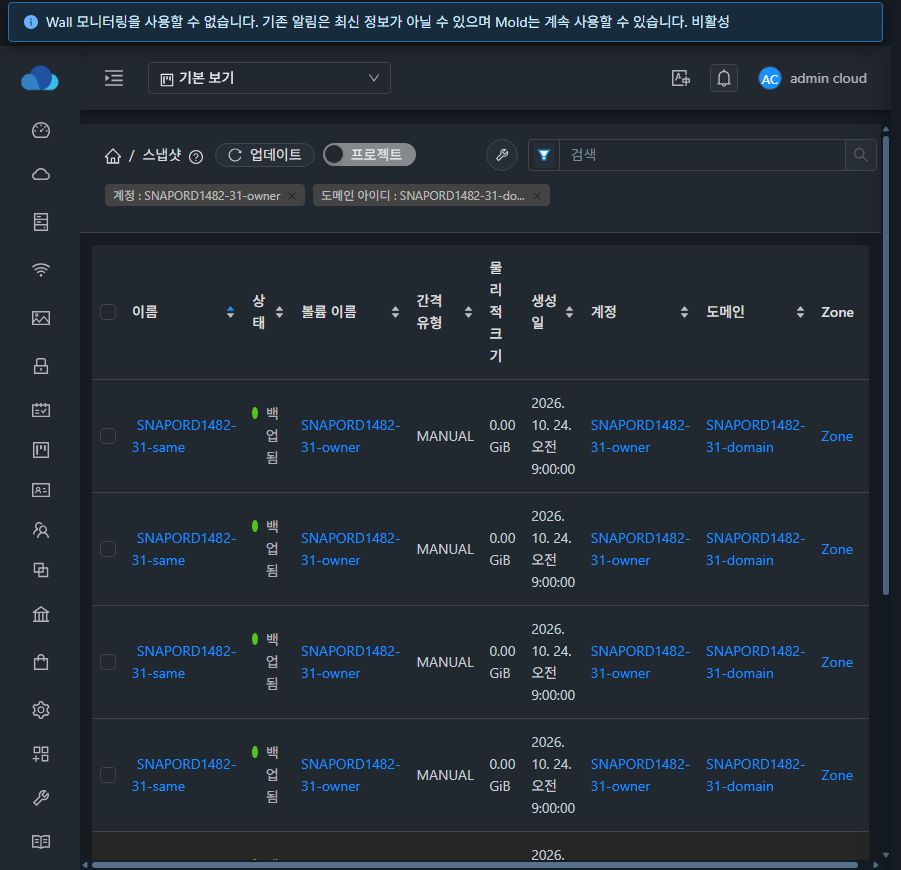

# #1482 스냅샷 전체 목록 서버 정렬 검증 결과

Epic 브랜치 `dhslove/epic-1473-storage-snapshots`에서 서버 정렬·안정적인 보조키·페이지 순서를 구현하고, 31 GFS2 / 32 RBD의 API·실제 UI·DB 대조와 전용 자원 정리를 완료했다. 시작 HEAD는 `613fe7e7def`이며 최종 소스는 `source-sha256.json`, 배포 클래스는 각 클러스터 증거의 `runtime`에 고정했다.

## 변경 결과

- `listSnapshots(sortkey,sortorder)`가 허용한 열로 전체 결과를 정렬한 뒤 페이지를 나눈다. 기본값은 **생성시각 내림차순**, 동률은 **스냅샷 ID를 같은 방향**, 사본 모드는 **사본 식별키 오름차순**을 추가한다.
- 허용 열은 `created/id/name/state/volumename/intervaltype/virtualsize/account/domain/project`다. 계산된 물리/체인 크기·부모 이름과 대표 사본마다 달라지는 Zone 열은 정렬을 제공하지 않는다. 잘못된 API 값은 431로 거부하며 임의 SQL 열을 받지 않는다. intervaltype은 저장된 enum 순서, 문자열/NULL은 DB collation/정렬 규칙을 따른다.
- 검색·ACL 조건을 적용한 SQL에서 논리 모드는 ID별 대표 사본을 결정하고, 사본 모드는 참조별 DISTINCT를 적용한다. 태그 조인 중복을 페이지 전에 제거한다. 상세·태그 보강 뒤에도 처음 선택한 서버 페이지의 순서를 복원한다. 상속된 ID의 테이블 alias와 집계 열의 JDBC label을 명시한다.
- UI는 페이지 내부 정렬 함수를 제거하고 서버 요청만 보낸다. URL·정렬 화살표·API·실제 행 순서를 일치시켰다. 정렬 변경/해제·페이지 크기 변경은 1페이지, 뒤로 가기는 기존 정렬/페이지를 복원한다. 잘못된 URL과 범위를 벗어난 페이지를 보정한다.
- **추가로 발견한 검색 범위 손실을 수정했다.** 키워드 입력 시 계정·도메인이 제거되어 8건이어야 할 결과가 11건으로 넓어졌다. 입력·검색어 비우기가 기존 이름/볼륨/태그/Zone/소유 범위와 정렬을 보존하고 페이지만 초기화한다. 새 고급 검색 항목은 #1483 범위다.

정렬값 없는 기존 호출의 응답 구조·기본 showunique=true·검색/ACL/count는 유지한다. 기존 참조키 중심 기본 순서는 위 생성시각 내림차순 계약으로 바뀐다. 데이터 집합이 변하지 않는 동안의 안정적인 순서를 보장하며, 조회 사이의 생성·삭제를 고정하는 목록 세션/cursor pagination은 추가하지 않았다.

대화상자는 이번 변경 대상이 없다. 기존 VM 공통 MoldDialog와 StorPool 전용 옵션 비노출을 유지한다. 목록의 밀도·도구 모음·크기 단위/enum 표기 등 최종 시각 정리는 #1485에 남긴다.

## 실환경 검증

각 클러스터에 전용 도메인/하위 도메인, 일반 계정·DomainAdmin, 프로젝트, 실제 볼륨 4개와 스냅샷 30개를 생성했다. 주 소유자 24건, 다른 소유자 2건, 하위 도메인 1건, 프로젝트 3건이다. 전용 동일 이름 스냅샷 8개의 DB 생성시각만 같게 조정해 동률을 확실히 만들었다. 운영 자원의 시각·소유 정보는 바꾸지 않았다. DB 원래 값과 조건화 사실은 `tieFixture`에 보존했다.

| 검증 | 31 GFS2 | 32 RBD |
|---|---:|---:|
| 실제 논리 스냅샷 / 사본 | 30 / 30 Secondary | 30 / 60 Primary+Secondary |
| API/DB 시나리오 | 82 PASS | 82 PASS |
| 잘못된 정렬 값 거부 | 6 PASS | 6 PASS |
| 다른 소유자 snapshot/volume/account 조회 | 3 차단 PASS | 3 차단 PASS |
| 기존·시험 데이터 가상 용량 정렬 | 서로 다른 크기 5종, 양방향 PASS | 서로 다른 크기 2종, 양방향 PASS |
| 기본 호출과 명시적 기본 정렬·논리 모드 | PASS | PASS |

82개 시나리오는 모든 허용 열의 양방향, 논리/사본 모드, 기본값, 7건 페이지·마지막/범위 밖 페이지·재조회, 같은 이름/시각, 다중 사본, 키워드/정확한 이름/볼륨/태그 조합, 계정/도메인/재귀/프로젝트/Zone/Primary pool/Image store 범위를 포함한다. 같은 조건의 DB `ROW_NUMBER` oracle과 전체 페이지의 ID/copy.id·count를 대조해 누락/중복 0을 확인했다. 계정+프로젝트 및 Primary+Secondary 저장소 동시 지정도 기존 431 계약을 유지한다.

실제 브라우저에서는 다음을 확인했다. `browser/*.json`에 비밀값을 제외한 요청, 응답 ID, 실제 DOM 순서·화살표·URL·건수를 저장했다.

- 두 클러스터의 관리자·일반 사용자 목록, 주 소유자 24건의 20+4건 페이지와 다른 사용자 2건, 프로젝트 3건이 API/DB와 일치했다. 계정 전환 후 이전 소유자 행이 남지 않았다.
- 이름 양방향 클릭·정렬 해제/기본값·뒤로 가기·페이지 크기 변경, 검색/검색어 비우기와 1페이지 복귀를 확인했다. 최종 배포본의 검색은 양쪽 모두 **계정/도메인 유지 + 8건**, 검색어 비우기는 24건이다.
- 두 클러스터의 7건 페이지 2→3에서 같은 이름·같은 시각 그룹이 페이지 경계를 넘어도 보조 ID 순서가 DB와 일치했다. API 화살표와 표시 순서가 같고 물리 크기/Zone 열에는 잘못된 로컬 정렬 화살표가 없다.
- 31의 page=999 요청은 count=24/행=0을 반환하고 UI는 마지막 유효 page=2/행=4로 이동했다. 잘못된 정렬/음수 페이지/잘못된 페이지 크기 URL도 정상화했다.
- 31에서 이전 name/asc/page2 XHR 응답을 보류하고 state/asc/page1을 먼저 완료한 뒤 이전 응답을 실제 끝까지 전달했다. 최신 목록을 덮어쓰지 않았고 가로채기를 해제했다. 32의 기존 volumeid 직접 링크도 24건으로 동작했다.
- 최종 캡처는 기본 브라우저 뷰포트의 원본 이미지다. 임시 화면 크기 override·가로채기를 해제하고 테스트 탭을 닫았다. 프로젝트 선택을 기본 보기로 복원했다. 사용자 GitHub 탭은 보존했다.

## 검사와 배포

- **Java 25개 PASS:** WSL ext4 Epic clone에서 api `ListSnapshotsCmdTest` 5개 및 server 정렬/사본 계약/DAO 20개. 최종 Maven Checkstyle 위반 0이며 변경 api/server 모듈만 빌드했다.
- **UI 3 suites / 74개 PASS**, 변경 파일 no-fix lint 및 최종 production UI build PASS. 다른 목록/VM 스냅샷과 사본 탭 회귀를 포함한다.
- 관리 JAR의 변경 class 4개와 정적 파일 921개를 각 관리 서버 활성 webapp에 반영하고 모두 SHA256을 확인했다. 다른 JAR entry, WEB-INF/web.xml·META-INF 존재 상태·설정 파일을 보존했다. rollback 백업은 각 관리 서버 `/root/snapshot-order-1482-20261024-management-final` 및 `...-ui-final-backup`에 남겼다.
- 최종 Mold active, `/client/` HTTP 200, 기존 호스트 5개 Up/동일 identity를 확인했다. SSVM/호스트 패키지는 변경하지 않았다.
- 실환경 첫 조회에서 발견한 집계 결과의 DAO 매핑 오류를 수정한 뒤 모든 API/DB 시나리오를 다시 통과했다. 검색 범위 손실 수정 뒤 UI 검사/빌드/배포와 양쪽 검색을 다시 검증했다. 이전 실패·수정 전 결과를 최종 성공으로 계산하지 않았다.

**전체 Cloud 빌드/전체 CI 및 GitHub Actions dispatch는 수행하지 않았다.** 집중 검사·정적 UI 빌드·실환경 검증을 전체 CI 성공으로 표현하지 않는다. 원격 GitHub 체크 상태는 구현 커밋을 게시한 뒤 별도로 확인한다.

## 정리와 보존

각 환경에서 스냅샷 30개·볼륨 4개·프로젝트 1개·계정 4개·도메인 2개, 총 41개 개체를 정상 API로 정리했다. 활성 snapshot/volume/사본 참조/account/domain/project·강제 정리 대기 메타데이터는 모두 0이다. NFS 백업 파일 각각 30개, GFS2/RBD 원본 볼륨 각각 4개 부재, 32의 전용 RBD trash 0을 확인했다. 강제 복구나 수동 DB 종결은 사용하지 않았다.

초기 정리 harness가 비동기 dryrun의 접수 응답을 최종 plan으로 오인한 한 요청은 scopehash 방어로 거부됐다. dryrun job 완료 후 실제 scopehash를 사용하도록 harness를 수정해 정상 정리했다. 제품의 삭제 방어를 해제하지 않았다.

| 기존 운영 API 투영 | 31 보존 건수 | 32 보존 건수 |
|---|---:|---:|
| 볼륨 | 155 | 49 |
| 스냅샷 사본 행 | 23 | 12 |
| VM | 116 | 49 |
| 실행 가능 템플릿 | 11 | 6 |
| 디스크 오퍼링 / Zone / Image store / 프로젝트 | 10 / 1 / 1 / 4 | 6 / 1 / 1 / 2 |

전후 기존 자원 ID와 이름·상태·소유·크기·설정 투영값이 동일하고 시험 API 잔여는 0이다. 삭제 이력/tombstone은 보존한다. Windows/WSL의 별도 FT 작업 트리는 HEAD·status·diff 비교로 변경 없음을 확인했다.

## 완료와 다음 작업

#1482의 여섯 완료 기준을 충족했다. 기존 Epic PR #1492에 포함하며 병합은 수행하지 않는다. Epic #1473, 나머지 미완료 이슈는 유지한다.

다음은 **#1483 스냅샷 볼륨·유형·주기·저장 위치 검색과 URL 연결**이다. 이번 정렬/페이지/키워드 범위 계약과 연결하고 `showunique/locationtype` 조합·후보 조회·URL 복귀를 구현한다. 이후 #1484 태그 비동기 완료 추적, #1485~#1488의 최종 UI 정리를 진행하고, **#1489 통합 회귀는 선행 구현·UI 정리 뒤 마지막으로 수행한다.** 새로 만들거나 변경하는 대화상자는 VM 표준을 적용한다.

독립 증거 검증은 `python scripts/verify.py`로 실행한다. DB fixture 원본에서 모든 API/저장 UI 순서·범위·count를 다시 계산하고 소스/증거 SHA256·최종 검사 로그·정리·운영 보존을 확인한다. `verification.json`은 이 증거 일관성 검사 결과이며 Cloud CI 결과가 아니다.
