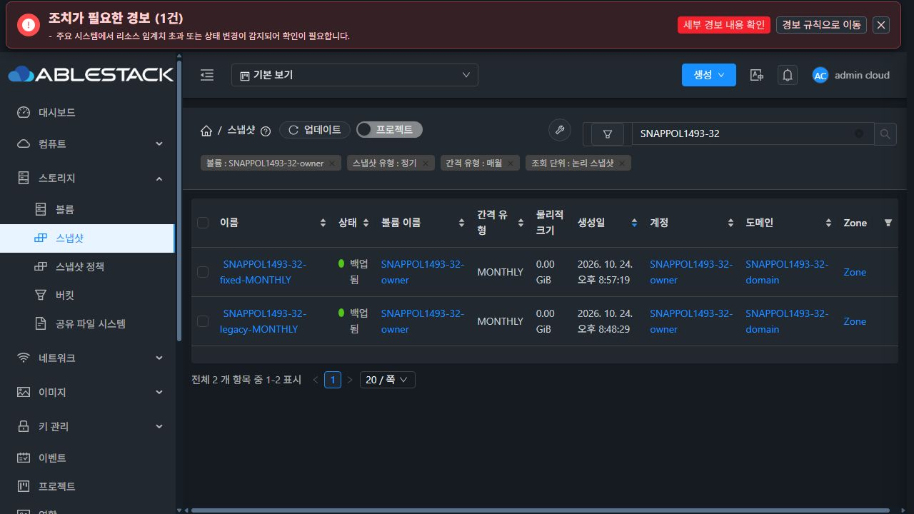

# #1493 정책 ID 충돌·주기 유형·이력 복구 검증

Epic 브랜치 `dhslove/epic-1473-storage-snapshots`, 시작 HEAD `1923328cf7fc`. 변경 소스는 `source-sha256.json`으로 고정한다. 이 보고서는 #1493의 구현·실환경 검증 범위이며 Epic #1473과 PR #1492의 병합은 포함하지 않는다.

## 구현 결과

- 내부 Java 호출 전용 정책 값을 `-1`로 분리했다. 실제 정책 ID 8은 다른 양수 정책과 동일하게 조회하고, 저장 타입 INTERNAL의 ordinal 8은 유지한다. 공개 createSnapshot/createSnapshotBackup은 음수 정책 값을 거부한다.
- 원본 접근 권한 확인 후 정책의 존재·볼륨·계정·도메인·주기를 확인한다. 없는 정책, 삭제 정책, 다른 볼륨/소유자의 정책으로 스냅샷을 할당하지 않는다.
- 정책에 따른 네 주기는 타입 3/4/5/6과 같은 설명으로 저장한다. 수동은 0/MANUAL, 내부 의도는 8/INTERNAL이다. 숨김 snapshot_details에 생성 의도와 정책 ID·UUID·주기를 기록해 정책 삭제 뒤에도 근거를 보존한다.
- 읽기 전용 계획과 명시적인 SHA256 적용을 제공하는 복구 도구를 추가했다. 적용 시 DB 행을 잠그고 생성 job·정책·원본·소유권·세부정보를 다시 대조한다. 드리프트가 있으면 전체 롤백하며, 같은 계획은 중복 반영하지 않는다.

복구는 타입·설명과 숨김 감사 내역만 바꾼다. 이름·시각·사용자 태그로 주기를 추정하지 않는다. 명시적 INTERNAL 의도, 진행 중 작업, 근거 부족/충돌은 이유를 표시하고 건너뛴다. 삭제 정책은 운영자가 출처를 검토한 보존 증거가 필요하다. 정책/생성 job과 보존 근거까지 소실된 이력은 추정 복구할 수 없다. [설계와 실행 절차](design.ko.md)를 따른다.

## 31·32 실환경 결과

| 검증 항목 | 31 GFS2 | 32 RBD |
|---|---:|---:|
| 실제 정책 ID 8의 수정 전 네 주기 | 4개 모두 잘못된 INTERNAL 재현 | 4개 모두 잘못된 INTERNAL 재현 |
| 같은 ID 8의 수정 후 네 주기 | H/D/W/M → 3/4/5/6 PASS | H/D/W/M → 3/4/5/6 PASS |
| 기존 오분류 복구 | 활성 4 + Destroyed 이력 1 | 활성 4 + Destroyed 이력 1 |
| 명시적 내부 의도 / 근거 부족 대조군 | 2개 변경 차단 | 2개 변경 차단 |
| 조회만 수행 / 오래된 계획 / 재실행 | 무변경 / 전체 롤백 / 중복 0 | 무변경 / 전체 롤백 / 중복 0 |
| API·독립 DB 필터·소유권·사본·페이지 | 90 PASS | 90 PASS |
| 관리자 잘못된 정책 요청 / 일반 사용자 생성 ACL | 5 + 3 거부, 미승인 할당 0 | 5 + 3 거부, 미승인 할당 0 |
| maxSnaps=2 / 정책 삭제 / 실제 스케줄러 | PASS | PASS |
| 정리 후 활성 API·DB·실물 잔여 | 0 | 0 |

API로 전용 도메인 1개·일반 계정 2개·1GiB 볼륨 2개를 생성했다. API로 만든 display=false 정책의 관련 스케줄·세부정보·태그가 없고 ID 8이 비어 있음을 확인한 뒤 해당 시험 행의 PK만 8로 고정했다. 전역 AUTO_INCREMENT와 운영 정책은 변경하지 않았다. 네 주기를 각각 실제 ID 8에서 수정 전·후 생성했다. 총 스냅샷 14개와 정책 12개를 사용했다.

새 활성 오분류 4개는 수정 전 실제 backend에서 생성한 자료다. #1483에서 이미 삭제한 원래 오분류 행도 보존 정책 응답과 성공한 생성 job을 대조해 31 HOURLY/32 DAILY로 복구했다. 이 행은 Destroyed 상태를 유지하며 되살리지 않았다. INTERNAL 의도·근거 부족 대조군 2개는 전용 수동 스냅샷의 메타데이터를 조정한 **합성 대조군**이다. 실제 내부 서비스 분류는 Java 검사로, 공개 API에서 내부 값을 선택할 수 없음은 실환경 요청으로 검증했다.

보존 정책 증거 없이 조회할 때는 아직 남아 있는 정책에 연결된 1개만 복구 대상으로 나왔다. 보존 증거를 추가하면 5개가 확인됐다. 적용 전 시험 행의 설명을 바꿔 오래된 계획을 제출하면 첫 UPDATE 전에 전체 롤백됐으며, 원래 설명으로 되돌린 뒤 적용했다. 5개 모두 타입·설명 외 기존 행 필드는 같았고 숨김 감사 내역만 추가됐다. 같은 계획을 다시 제출해도 수정/감사 내역 중복이 없었다. `31/32-history-recovery.json`에 전후 값과 판단 근거를 보존했다.

90개 API/DB 시나리오는 관리자·소유자·다른 소유자, 네 주기 단독/RECURRING 교집합/볼륨 결합, 수동/정기, 논리/사본, 2개씩 페이지 순서를 포함한다. snapshot_view의 독립 SQL 필터·ROW_NUMBER·created/id/copy 순서로 ID 집합·순서·건수를 대조했다. 다른 소유자의 원본 볼륨 직접 조회 8개는 권한 거부가 올바른 결과임을 확인했다. 모든 API 오류를 빈 결과로 취급하지 않는다.

검증 시점의 논리 스냅샷은 각 11개(소유자 9/다른 계정 2), 정기는 8개였다. 사본은 GFS2 11개, RBD 22개이며 소유자 사본은 각각 9/18개였다. 보관 개수 시험에서 HOURLY는 최신 2개만 남았고 수동 1개 및 D/W/M 각 2개는 보존됐다. 정책 삭제 뒤에도 유형 검색과 생성 근거가 유지됐다.

각 클러스터의 실제 HOURLY 정책 8을 활성화하고 전용 스케줄만 만료시켜 원래 5분 poller가 실행하도록 했다. system user 1의 성공한 CreateSnapshotCmd job, 숫자 policyid=8, 실제 스냅샷과 태그 상속을 확인했다. 다음 poll에서 snapshot/job 연결이 해제되고 다음 예약이 등록됐으며, 정책 삭제 후 예약은 0개다. 전역 poll 간격은 바꾸지 않았다.

## 실제 UI

`browser/31-ui.json`, `browser/32-ui.json`에 **13개 시나리오**의 실제 URL·DOM 행과 해당 요청/응답을 보존했다. 31에서는 수정 전 네 주기가 INTERNAL로 표시되는 화면도 기록했다. 수정·복구 후 두 클러스터에서 네 주기 필터와 행 유형/건수가 API에 일치했다. 32의 볼륨 결합 검색은 각 주기 2건이며, 일반 소유자의 DAILY는 복구/신규 2건, 다른 계정의 같은 검색은 0건이다. HOURLY 행은 보관/스케줄 검증 중 정상 교체되므로 각 시점의 화면과 API를 대조했다.

기존 공통 검색 대화상자를 그대로 사용했으며 이번 변경에 새 대화상자나 변경한 UI 소스는 없다. 관리자 기본 보기와 임시 화면 크기를 복원하고 시험 탭을 닫았다. 정리 후 두 UI에서도 시험 검색 결과 0건을 확인했다.

## 검사·배포·보존

- Java **124개 PASS**: api 9개, server 115개. 정책 ID 8의 네 주기, 내부/수동 의도, 정책/소유권/주기 거부, 생성 근거 및 기존 SnapshotManager/Scheduler/검색 회귀를 포함한다. WSL ext4에서 변경 api/server 모듈만 빌드했고 Checkstyle을 통과했다.
- 복구 도구 Python **12개 PASS**. Windows와 WSL에서 검사했다. 실제 DB에서는 읽기 전용·드리프트 롤백·5개 복구·재실행까지 두 환경에서 추가 검증했다. 검사 로그 요약과 SHA256은 `checks.json`에 기록했다.
- 관리 JAR의 변경 클래스 5개만 시험 배포했다. 다른 JAR entry를 보존하고 최종 활성 JAR의 클래스 SHA256을 다시 확인했다. SSVM/호스트/qemu 및 UI 정적 산출물은 변경하지 않았다.
- 31 webapp 15,164개 파일은 전후 해시가 일치했다. 32는 7,519개 작은 파일의 해시와 기존 대용량 이미지 1개의 크기·inode·수정시각이 일치했다. WEB-INF/설정이 보존됐고 각 Mold active, /client/ HTTP 200, 기존 호스트 5개 Up을 확인했다.
- 롤백 백업은 각 관리 서버 `/root/snapshot-policy-1493-20261024-management`에 있다. 클래스 단위 시험 배포 결과이며, 전체 릴리즈 패키지/전체 Cloud CI 검증을 대신하지 않는다. 전체 Cloud 빌드·Actions dispatch는 실행하지 않았다.
- 스냅샷 14개·볼륨 2개·계정 2개·도메인과 정책 12개를 정상 API로 정리했다. 보관 개수로 이미 삭제된 스냅샷의 재삭제도 정상 종료됐다. 상속 시험 태그도 deleteTags API로 삭제했다. 스케줄/정책/활성 참조/강제삭제 잔여/시험 태그는 0이며 각 Secondary 파일 14개와 Primary 볼륨 경로 2개, RBD trash를 확인해 실물 잔여 0이다. 복구 감사 내역과 정상 삭제 이력은 보존한다.
- 기존 운영 자원 8종의 API 투영값과 Windows/WSL의 보호 FT 작업 트리 HEAD·tracked diff·untracked 포함 상태가 시작과 일치했다.

## 시험 도구 사고와 환경 관측

32 배포 전 점검 코드가 기존 `monitoring-vm.qcow2`(29,194,321,920 bytes)를 한 번에 읽으면서 메모리 부족으로 점검 Python 프로세스가 두 번 종료됐다. 실제 커널 OOM 로그로 확인했다. 배포 점검 코드를 작은 파일은 스트리밍 해시, 변경 대상이 아닌 대용량 파일은 메타데이터 대조로 고쳤고 이후 정상 배포·검증했다. 해당 시점 Mold는 active였으며 최종 API 자원 투영값·호스트 상태·런타임 검증도 통과했다. 이 사고를 제품 기능 결함으로 처리하거나 숨기지 않는다.

32에서는 루트 디스크 사용률 90%(가용 약 8.3GiB) 경보도 관측했다. 이번 롤백 백업은 약 265MiB이며 운영 파일을 임의로 삭제하지 않았다. 추가 대규모 배포 전 관리 서버 용량 점검이 필요하다. 이 관측은 #1493의 유형 생성/검색/복구 완료와 구분한다.

## 다음 작업

**#1484 태그 생성·삭제 job 완료 후 갱신과 오류·범위 전환 처리**를 먼저 진행한다. 이후 #1485–#1488의 남은 목록·상세·탭·대화상자 정리를 수행하고 **#1489 통합 회귀는 마지막**에 수행한다. 새로 만들거나 변경하는 대화상자는 가상머신 공통 표준을 따른다. Epic #1473과 PR #1492는 열어 둔다.
