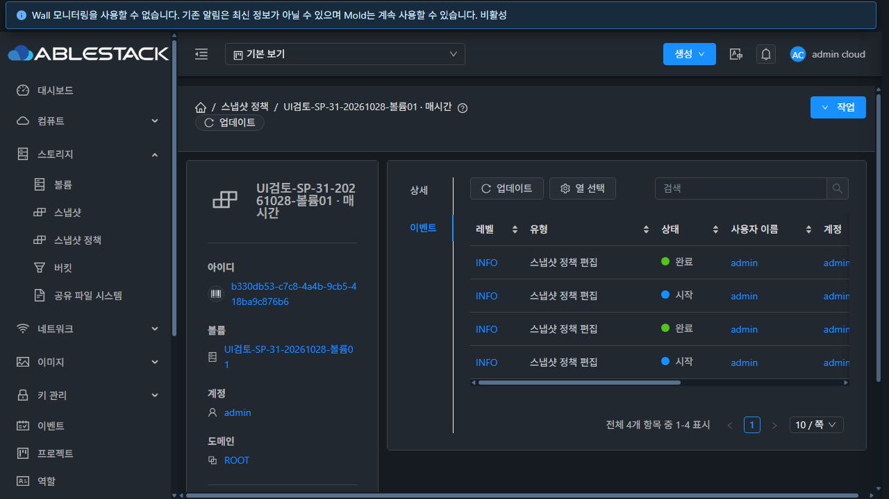
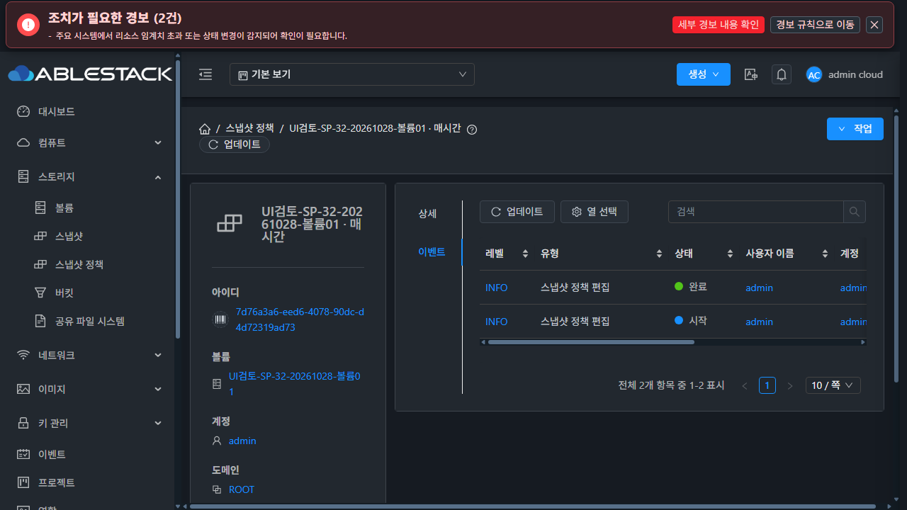
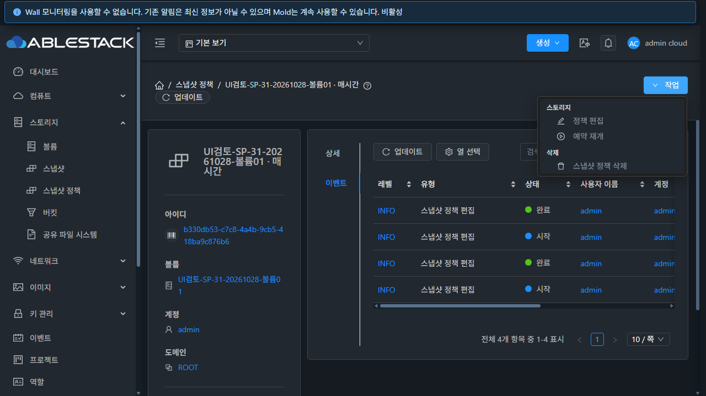
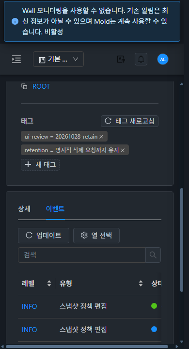

# 스냅샷 정책 상세 탭·작업 버튼 개선 검증

검증일: 2026-10-28 / 소스: `c0671272a0a7f9f1462a6aaa3951f3ce55d1ae21` / 브랜치: `dhslove/epic-1494-snapshot-policies`.

## 요청별 결과

| 요청 | 결과 |
|---|---|
| 정책 이벤트가 있다면 표준 이벤트 탭 추가 | 이벤트 기록 확인. 누락된 API 리소스 연결 수정·공통 이벤트 탭 추가·31/32 배포/검증 완료 |
| 코멘트를 사용할 수 있다면 표준 코멘트 탭 추가 | 현재 정책은 코멘트 API 지원 대상이 아님. 조건에 따라 탭 및 annotation API/DB 확장 없음 |
| 상세 Breadcrumb 작업 버튼 깜빡임 제거 | 같은 정책의 배경 조회 중 버튼 유지, 실제 편집/재개/삭제 잠금 유지·실제 UI 검증 완료 |

## 이벤트 조회와 표준 탭

정책 생성·수정·삭제는 `SNAPSHOTPOLICY.CREATE/UPDATE/DELETE` 이벤트를 기록한다. 수정 전 전체 생성 이벤트는 31번 479건·32번 465건이 조회됐지만 정책 UUID와 `resourcetype=SnapshotPolicy`로 조회하면 양쪽 모두 **431 Invalid resourcetype**였다. `EventTypes`의 정책 연결은 있었고 `ApiCommandResourceType`의 정책 유형만 누락되어 있었다.

enum 마지막에 기존 SnapshotPolicy 엔티티 연결을 추가했다. 기존 enum 순서, listEvents 파라미터·UUID 검증과 계정/도메인/프로젝트 ACL은 유지했다. 다른 정책/원본 볼륨의 이벤트가 섞이지 않도록 UI는 **정책 UUID + SnapshotPolicy**로 조회한다. API 모듈 단독 빌드 결과에서 클래스 한 개만 적용했다.

VM과 같은 공통 `ResourceView`·`EventsTab`을 재사용한다. 상세 다음 이벤트 탭을 표시하고 listEvents 권한으로 표시를 제한한다. 데스크톱/태블릿은 왼쪽 탭, 모바일은 위쪽 탭이며 검색·열 선택·페이지·갱신·오류/재시도도 공통 구현이다. 이번 탭은 **정책 자체의 관리 이벤트**를 보여 준다. 생성된 스냅샷의 별도 작업 이벤트나 전체 스냅샷 생성 이력을 정책 관리 이벤트로 섞지 않는다.

보존된 매시간 정책에서 31번 4건·32번 2건의 `SNAPSHOTPOLICY.UPDATE` 시작/완료 기록을 확인했다. 표시된 이벤트 UUID는 실제 API 결과와 일치한다. 키워드 검색·빈 결과·pagesize=1의 서로 다른 1/2페이지를 확인했고, 볼륨 UUID를 정책 UUID로 잘못 보내거나 없는 정책 UUID를 보냈을 때는 431로 거부되어 전체 목록으로 대체되지 않았다.

- API 수정 전: [31](evidence/31-api-before.json), [32](evidence/32-api-before.json)
- 수정 후 API·검색·페이지·잘못된 ID 검사: [31](evidence/31-api-audit.json), [32](evidence/32-api-audit.json)

## 코멘트 미지원 판정

현재 `AnnotationService.EntityType`에는 SNAPSHOT은 있지만 SNAPSHOT_POLICY/SNAPSHOTPOLICY는 없다. `AddAnnotationCmd`의 허용 유형 검증, `AnnotationManagerImpl`의 엔티티·소유권/역할 검증과 매핑, UI `AnnotationsTab`의 유형 매핑에도 정책은 없다. API `listApis(addAnnotation)` 계약도 정책 유형을 제공하지 않는다.

일반 `listAnnotations(entitytype=SNAPSHOT_POLICY, entityid=정책 UUID)`의 빈 `{}` 응답은 이 유형으로 코멘트를 추가할 수 있다는 뜻이 아니다. 쓰기는 지원 enum 검증을 통과해야 한다. **생성된 스냅샷(SNAPSHOT)과 정책은 다른 개체**이므로 스냅샷/볼륨 코멘트를 정책 코멘트로 연결하지 않았다.

사용자의 “사용할 수 있는 기능이라면” 조건에 따라 코멘트 탭을 추가하지 않았다. 지원하려면 정책용 annotation 유형·유효 엔티티 조회·소유권·역할/프로젝트 ACL·UI 매핑/탭·가시성/삭제 검증을 별도로 구현해야 한다. 이번 변경에는 해당 확장과 DB 변경이 없다. 이전 요청의 정책별 전체 스냅샷 이력 탭/API도 변경하지 않았다.

## 상세 작업 버튼

수정 전에는 갱신 중 visibleDataViewActions가 빈 배열을 반환해 버튼 DOM이 사라졌다. 31번 실제 요청 보류 중 `button=null`로 재현했다. 같은 정책 범위의 성공 데이터가 있고 오류가 없는 배경 조회에서는 버튼을 유지하고 메뉴 항목만 잠근다. 초기 조회·범위 불일치·권한 누락·조회 실패의 차단 및 실제 실행 guard는 유지한다.

| 검사 | 31 GFS2 | 32 RBD |
|---|---|---|
| 다크/라이트 × 1280/768/390px, 조회 전·중·후 버튼 동일 | 6/6 PASS | 6/6 PASS |
| 버튼 색/테두리/글자색/불투명도/좌표/크기·활성 상태 유지 | PASS | PASS |
| 조회 중 실제 작업 메뉴 3개 비활성, 완료 후 다시 활성 | PASS | PASS |
| 갱신 중 이벤트 행·선택 탭 유지 | PASS | PASS |
| 이벤트 검색/빈 결과·설명 열 표시 및 원복·20/10 페이지 크기 | PASS | PASS |
| 이벤트 읽기 실패 주입 시 마지막 정상 행 보존·수동 재시도 | PASS | PASS |
| 상세/이벤트 탭 전환·이벤트 상세 링크 이동·정책 복귀 | PASS | PASS |
| 모바일 실제 위쪽 탭/이벤트 컨텐츠 표시, 두 테마 | PASS | PASS |

버튼은 모든 갱신 단계에서 `rgb(24,144,255)`와 흰 글자를 유지했다. 네트워크 검사는 브라우저에서 조회 요청만 보류/실패시켰으며, 모든 보류를 해제하고 임시 화면 크기를 원복했다. 생성·편집·재개·삭제는 실행하지 않았다. 31번은 자동 재조회 복구도 관찰했으며 수동 재시도 검사는 오류 발생과 버튼 클릭을 한 흐름에서 별도로 수행했다.

공통 탭 탐색 동작에 따라 이벤트 상세에서 뒤로 가면 정책의 기본 상세 탭으로 돌아오며, 이벤트 탭을 다시 선택해 정상 데이터를 확인했다. 이벤트 탭 선택을 뒤로 가기까지 자동 유지하도록 공통 프레임워크 이력을 변경하지는 않았다.

- [12개 화면별 검증](evidence/live-matrix.json), [원본 PNG 크기/CRC/디코딩 검증](evidence/image-validation.json)
- 실제 UI 흐름과 자격증명 없는 요청 요약: [31](evidence/31-ui-flow-proof.json), [32](evidence/32-ui-flow-proof.json)

## 테스트·배포·보존

- UI **60 suites / 900 tests PASS**, 변경 UI/테스트 파일 4개 lint PASS, production UI build PASS. [UI 테스트](evidence/test.log.txt), [lint](evidence/lint.log.txt), [UI build](evidence/build.log.txt).
- WSL ext4에서 변경 Maven 모듈 **api만** 빌드: **5 tests / 0 failures / BUILD SUCCESS**. [API module build](evidence/api-build.log.txt). 전체 Cloud·server 모듈·FTCTL 빌드는 실행하지 않았다.
- 배포 API 클래스: `org/apache/cloudstack/api/ApiCommandResourceType.class`, SHA256 `31c3c82860792bd2e5f3e4df61250b303252c30198f83fce13c9c76217ee9088`. 양쪽 기존 클래스는 unchanged build baseline과 일치했고, 기존 enum 순서는 유지됐다. [API package](evidence/api-package.json).
- 백엔드 반영 시 각 Mold를 한 번 재시작했다. 다른 JAR 엔트리 **31번 204543개·32번 204537개**, 기존 UI 정적 파일·설정·큰 파일·WEB-INF를 보존했다. Mold active, `/client/` 200, 새 PID는 31 **3720809**, 32 **3736392**. [31 runtime](evidence/31-api-runtime.json), [32 runtime](evidence/32-api-runtime.json).
- UI 정적 파일 **931개** 배포, `app.ce659810.js`, SHA256 `a6ca09299c2004929abc94e3f7ee1bdb685439c05c98a97748d3923f0fc505cb`. 배포 manifest 전체 파일 hash 대조 완료. UI 배포 중에는 backend JAR/PID·설정·WEB-INF/META-INF·비UI 파일을 보존했다. [31 UI](evidence/31-ui-deploy.json), [32 UI](evidence/32-ui-deploy.json), [manifest](evidence/ui-manifest.json).
- 백엔드 백업: 31 `/root/snapshot-policy-detail-tabs-20261028-backend/management-before.jar`, 32 `/nfs/snapshot-policy-detail-tabs-20261028-backend/management-before.jar`. UI 백업 경로는 각 UI 배포 증거에 있다.
- 최종 API 재검사에서 클러스터별 **볼륨7·정책24·BackedUp 스냅샷1**의 원래 ID·주요 정책 필드·24개 중지 상태가 동일하다. 명시적 삭제 요청 전까지 그대로 유지한다. 두 클러스터의 전역 secondary 임계값 **0.90**과 관리 PID·HTTP 200도 최종 확인했다. 전역 설정/DB 데이터 수정·기존 파일 삭제는 하지 않았다. [31 보존](evidence/31-retained-check.json), [32 보존](evidence/32-retained-check.json), [31 최종 상태](evidence/31-final-health.json), [32 최종 상태](evidence/32-final-health.json).
- 별도 FT 작업의 Windows tracked 변경3개·WSL 11개와 HEAD/branch/diff를 보존했다. [Windows](evidence/protected-windows-result.json), [WSL](evidence/protected-wsl-result.json).
- 기존 caniuse/asset-size/icon 중복 경고와 Jest forceExit 메시지는 남아 있다. 등록된 전체 Cloud CI 성공으로 보고하지 않는다. PR 생성/병합과 이슈/Epic 상태 변경은 이번 범위에 없다.

검토용 브라우저 두 탭은 다크 테마의 정책 이벤트 탭으로 남겨 두었다. 구현과 이 보고서를 기능 브랜치에 반영한다.
