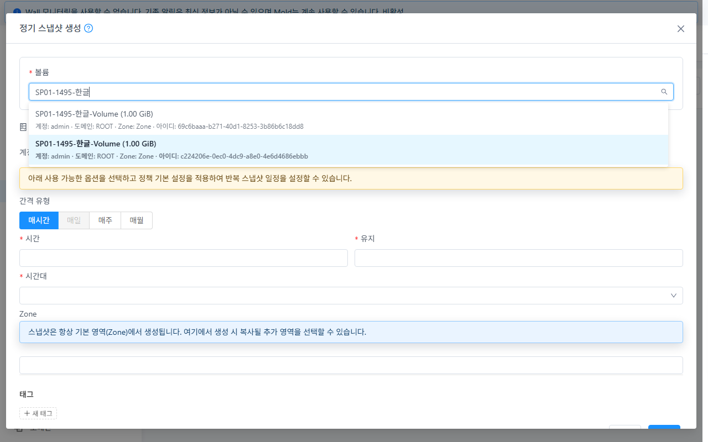
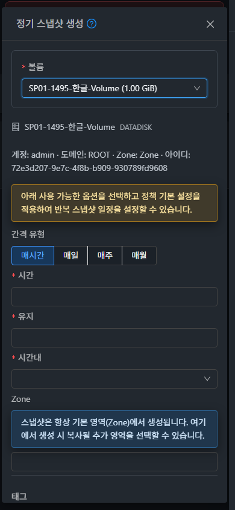

# SP-01 (#1495) 구현 및 실제 클러스터 검증

2026-10-26 KST. 부모 Epic [#1494](https://github.com/ablecloud-team/ablestack-cloud/issues/1494), 구현 이슈 [#1495](https://github.com/ablecloud-team/ablestack-cloud/issues/1495).

**판정: SP-01 완료.** 생성창의 검색 예외를 수정했고 31 GFS2·32 RBD의 API/실제 UI/독립 DB/스토리지 정리 검증을 통과했다. Epic의 다른 결함은 완료로 처리하지 않는다.

## 설계와 변경

- [설계](../../design/snapshot-policy-1494/SP-01.ko.md). 작업 브랜치 `dhslove/epic-1494-snapshot-policies`, 기준 `b71bb69f28cc53342c55e656742c27d9c6f8f8a5`.
- 구현·검사·production UI 빌드 소스: `e0251bd039c` (제품 변경 `38c0caa0209`, 테스트 보강 포함). 이후 보고서 커밋은 UI 소스를 변경하지 않는다.
- AntD 내부 `children`을 읽는 검색을 공개 options/option 슬롯과 명시적 label/value/searchText로 교체했다. 이름·크기, VM, 계정 또는 프로젝트, 도메인, Zone, 전체 UUID로 검색·식별한다. 선택 후에도 식별 정보를 보여주며 UUID를 제출한다.
- 기존 전체 페이지 조회, Ready/KVM 적격성, 오류/재시도, 사용자/프로젝트/언마운트 세대 보호를 유지했다. 잘못된 선택은 이전 대상을 제거한다.
- **UI 표준은 컴퓨트 > 가상머신 메뉴**다. 실제 VM 목록·고급 검색·생성 폼과 비교했다. 새 선택창도 공통 입력 높이 32px, 글자 14px, 모서리 4px, 세로 레이블, 기본/보조 버튼, 테마 토큰을 사용한다. 식별 정보에만 보조 텍스트·줄바꿈을 추가했고 VM 공통 스타일은 변경하지 않았다.

## 검증 결과

| 항목 | 31 GFS2 | 32 RBD | 근거 |
|---|---|---|---|
| 수정 전 검색 예외 재현 | 재현 | 재현 | before-search.jpg / before-console.json |
| 정확/부분/대소문자/한글/없는 이름·지우기 | PASS | PASS | search-results.json |
| UUID·VM 이름·페이지 2 검색 | PASS | PASS | search-results.json, ui-network.json |
| Allocated 항목 제외 / Ready 선택 | PASS | PASS | 실제 목록과 전용 fixture 대조 |
| 동명 볼륨 구분·전체 메뉴 실제 생성 | PASS | PASS | 제출 요청 → API → DB의 동일 UUID |
| 볼륨 상세 실제 생성 | PASS | PASS | 첫 번째 fixture UUID를 그대로 제출, 선택창 없음 |
| 초기 로딩·조회 실패·재시도 | PASS | PASS | 해당 탭 listVolumes XHR에만 503을 주입; 정상 실제 API 재시도 |
| 늦은 A 정책 응답 뒤 B 선택 유지 | PASS | PASS | B 응답 후 A를 반환해도 B UUID 및 기존 DAILY 비활성 유지 |
| 프로젝트 전환 | PASS | PASS | 전용 빈 프로젝트에 이전 관리자 볼륨·생성 폼 미표시 |
| 라이트/다크 × 390/768/1280px | 6/6 PASS | 6/6 PASS | layout-results.json 및 24장 원본 PNG |
| 키보드 선택·확인 버튼 접근 | PASS | PASS | 실제 키보드 선택, 모든 화면 조합에서 Tab으로 확인 버튼 접근 |
| 개선 후 콘솔 TypeError | 0 | 0 | console-after.json |

검색은 총 24개, 응답/범위/상세 경로 안전성은 8개, 화면 조합은 12개다. 이 수치를 단위 테스트나 전체 기능 수로 합산하지 않는다. 화면별 실제 DOM 크기와 PNG의 디코딩 크기를 대조했다. 일반 캡처는 원래 JPEG로 보존하며 PNG로 확장자를 위장하지 않았다. 반응형 검증은 실제 엔진의 지정 뷰포트에서 수행하고 같은 크기의 원본 PNG를 캡처했다.

프로젝트 변경 시 공통 라우트가 이전 요청을 취소하는 실환경 동작을 확인했다. 동일 컴포넌트의 사용자/프로젝트 전환 뒤 늦은 목록 응답과 언마운트 후 응답은 제어된 컴포넌트 검사로도 검증했다. 취소된 실환경 요청을 늦은 응답 전달 성공으로 집계하지 않는다.

## 실제 생성 대상과 DB

두 클러스터에 동일 이름 `SP01-1495-한글-Volume`의 1GiB Ready 볼륨을 두 개씩 생성했다. 보존된 시험 스냅샷을 읽어 복제했으며 기존 VM에는 연결하지 않았다. 32에는 물리 디스크 없는 Allocated 항목 53개를 더 만들어 전체 104개/2페이지를 확보했다. 31은 전체 157개/2페이지였다. 페이지 2의 기존 볼륨은 검색·선택 확인에만 사용했다.

| 클러스터/경로 | 선택 볼륨 UUID | 생성 정책 UUID | 일정 |
|---|---|---|---|
| 31 전체 메뉴 | c224206e-0ec0-4dc9-a8e0-4e6d4686ebbb | 11dc35bf-4fd6-4b51-b758-60ee38a9ce0f | 59:23 |
| 31 볼륨 상세 | 69c6baaa-b271-40d1-8253-3b86b6c18dd8 | c75611dd-2469-4e22-872c-fd81de188997 | 58:23 |
| 32 전체 메뉴 | 72e3d207-9e7c-4f8b-b909-930789fd9608 | 19fb25b8-fe14-4805-8790-a8ea82efcf7d | 59:23 |
| 32 볼륨 상세 | b184c821-b418-4b18-b7a0-628666d8d539 | 1370ce52-0f77-458e-8bb0-6db521aa9991 | 58:23 |

모두 DAILY, Asia/Seoul, 보관 1개. API 응답과 snapshot_policy/snapshot_schedule의 대상·일정·시간대·보관 수·미래 예약이 일치한다. 전체 메뉴에서 생성한 두 건의 다음 예약은 `2026-10-26 14:59:00 UTC`이다. 미래 일정을 사용해 이번 검색 검증에서는 자연 예약 스냅샷을 만들지 않았다. 정책 생성 API는 동기 응답이며 임의의 job 성공을 만들어 붙이지 않았다.

## 검사·빌드·배포

- 실제 AntD Select를 사용하는 신규 회귀 검사와 StorageRelatedTabs/VolumeSnapshotPolicies: **3 suites, 36 tests PASS**.
- `npm run lint -- --no-fix`: PASS. UI production build: PASS. 기존 Browserslist 갱신 안내와 번들 크기 경고는 빌드 실패가 아니다.
- WSL ext4 전용 작업 폴더에서 npm ci/검사/빌드했다. Maven, 전체 Cloud 빌드, Actions 수동 실행, qemu/FTCTL 빌드·배포는 수행하지 않았다. 집중 UI 검증을 전체 Cloud CI 통과로 표시하지 않는다.
- 동일 UI 산출물 SHA256: `3872b455a7eae6637de16f14a556d569193c3c777e08ab41c4eb4992840018d9`. 정적 파일 922개를 manifest의 해시로 확인했다.
- 활성 경로 `/usr/share/cloudstack-management/webapp`에 정적 파일만 갱신했다. WEB-INF/META-INF, config.json/config.js, 관리 JAR, 대용량 서버 파일 및 mold PID(31 `3315398`, 32 `3223335`)를 전후 보존했다. mold active와 `/client/` HTTP 200을 확인했다.
- 양 서버 백업: `/nfs/snapshot-policy-1495-20261026-ui-backup`. index.html을 마지막에 교체했고 기존 정적 파일을 일괄 삭제하지 않았다. 새 검색 마커와 기존 FTCTL 마커도 모두 존재한다.

## 정리와 기존 자원 보존

정책 2개씩 `deleteSnapshotPolicies`, 전용 볼륨 2/55개 `destroyVolume(expunge=true)`, 프로젝트 1개씩 `deleteProject`로 정상 정리했다. 시험 자원의 상태를 SQL로 변경하거나 물리 파일을 수동 삭제하지 않았다.

| 독립 DB/스토리지 | 31 | 32 |
|---|---|---|
| 정책 / 예약 / 활성 볼륨 / 활성 스냅샷 | 모두 0 | 모두 0 |
| 비종결 snapshot_store_ref / 태그 / 활성 프로젝트 / 대기 job | 모두 0 | 모두 0 |
| 물리 Ready 볼륨 | GFS2 파일 2개 부재 | RBD 이미지 2개 부재, trash [] |
| 삭제 이력 | Expunged 2개 | Expunged 2개, removed가 설정된 Allocated 항목의 Destroy 이력 53개 |

기존 볼륨 155→155 / 49→49, VM 116→116 / 49→49, 스냅샷 23→23 / 7→7이다. ID·이름·상태, 볼륨 크기/경로/연결/스토리지, VM hostid 등 선정한 핵심 속성이 일치한다. 동적 통계 전체의 동일성을 주장하지 않는다. 두 정책 메뉴의 최종 UI도 0건이다. 테마·프로젝트 범위·뷰포트·XHR 검증 설정을 복원했다.

기존 Windows/WSL FTCTL 작업 폴더의 HEAD·브랜치·tracked dirty 상태와 diff 해시는 보존했다(각 3/11개). Windows 출력의 CRLF/LF 정규화를 구분해 동일 내용을 대조했다.

## 검증 경계와 다음 이슈

관리자와 전용 프로젝트 범위를 검증했다. 일반 소유자/다른 계정/도메인 관리자/조회 전용의 전체 ACL 행렬, 다중 Zone, DST, 실제 예약 실행/보관 정책 전체 회귀는 SP-13의 범위로 남긴다. 초기 Epic에서 수행한 자연 예약 검증을 이번 변경 후 새 검증으로 재사용하지 않는다.

다음은 **[#1496 SP-02](https://github.com/ablecloud-team/ablestack-cloud/issues/1496)**: 고급 검색의 `listvolumes` 명칭과 `isencrypted` 오용, keyword/페이징·실패/재시도·소유 범위를 고친다. SP-01의 생성창 검색과 다른 공통 SearchView 경로다. 이후 #1498 태그 모델과 #1500 예약 재계산을 우선한다. #1499 편집 UI는 #1500/#1502/#1498이 선행한다. #1497 월 일자 검색과 #1504 성공 알림 문구 등 기존 결함은 이번 범위에서 변경하지 않았다.

## 증거

- [집중 검사](evidence/focused-tests-result.txt), [lint](evidence/lint-result.txt), [production build](evidence/build-result.txt)
- [검색](evidence/search-results.json), [안전성](evidence/safety-results.json), [화면](evidence/layout-results.json), [UI 요청](evidence/ui-network.json), [무결성](evidence/evidence-integrity.json)
- [31 API](evidence/31-policies-final.json), [32 API](evidence/32-policies-final.json), [31 DB](evidence/31-policies-final-db.tsv), [32 DB](evidence/32-policies-final-db.tsv)
- [31 배포](evidence/31-deploy-result.json), [32 배포](evidence/32-deploy-result.json), [자원 보존](evidence/preservation-result.json)
- [31 독립 정리](evidence/31-cleanup-independent.txt), [32 독립 정리](evidence/32-cleanup-independent.txt), [GFS2](evidence/31-primary-after.txt), [RBD](evidence/32-primary-after.json)

