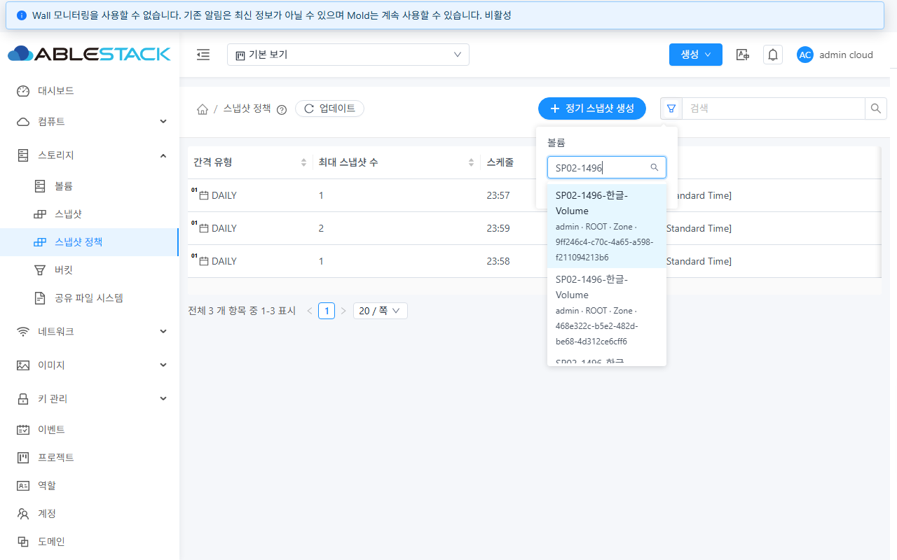
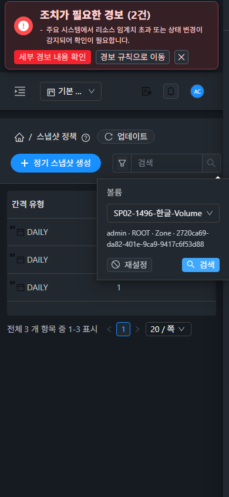

# SP-02 (#1496) 설계·구현 및 API/실제 UI 검증

2026-10-26 KST. 부모 [Epic #1494](https://github.com/ablecloud-team/ablestack-cloud/issues/1494), 구현 [#1496](https://github.com/ablecloud-team/ablestack-cloud/issues/1496).

**판정: SP-02 완료.** 31 GFS2·32 RBD에 동일 최종 UI를 배포하고 고급 검색, 실제 목록 필터, 소유 범위, 오류/재시도 및 공통 화면을 검증했다. Epic은 OPEN으로 유지한다.

## 설계와 구현

- [설계](../../design/snapshot-policy-1494/SP-02.ko.md). 기준 `93a4cd7dec2`, 브랜치 `dhslove/epic-1494-snapshot-policies`. 최종 구현·검사·빌드 소스 **`44b5f0d40cd`**. 보고서 추가 이후에도 UI 소스는 동일하다.
- 잘못된 `listvolumes`/`isencrypted=검색어` 경로를 제거했다. volumeid는 VolumeSearchSelect에서 `listVolumes(listall, keyword, page, pagesize=20)`로 조회한다. 서버 페이징, 더 불러오기/스크롤, 동명 볼륨의 VM·계정/프로젝트·도메인·Zone·전체 UUID 표시를 제공한다. 선택·URL·제출 값은 원래 UUID이다.
- nullable 문자열, count/페이지·중복/명시적 소유 범위 응답을 검사한다. 로딩·실패·접근 불가 선택은 제출을 차단하며 오류와 빈 결과를 구분한다. 검색어가 바뀌면 이전 옵션/응답을 즉시 무효화하고 250ms debounce로 새 조회를 시작한다.
- 로그인·프로젝트·권한·경로·언마운트 세대 보호를 적용한다. URL의 선택은 현재 범위의 ID 조회로 복원하고, 필터 칩도 이름과 원래 UUID를 유지한다.
- `isencrypted`는 옵션 API를 호출하지 않는 boolean switch로 유지한다. URL의 `true`/`false`를 boolean으로 복원해 false가 켜진 상태로 나타나지 않게 했다.
- 첫 실환경 검증에서 URL 복원 시 `route.query`에 meta.params가 직접 섞여 내부 `listall` 칩이 나타나는 문제를 추가 재현했다. 조건을 복사해 복원하도록 수정하고 회귀 검사 후 **다시 빌드·배포한 최종본**으로 아래 흐름을 재검증했다. 초기 배포 결과와 최종 결과를 혼합하지 않았다.

## 가상머신 메뉴 UI 표준

실제 **컴퓨트 > 가상머신 > 고급 검색**과 비교했다. 동일한 세로 폼, AntD 입력 높이 32px/글자 14px/모서리 4px, 재설정 왼쪽·검색 오른쪽 버튼 배치와 테마 토큰을 준수한다. 보조 식별 정보만 12px로 줄바꿈한다. VM 공통 CSS와 툴바를 변경하지 않았다.

라이트/다크 × 390×844 / 768×900 / 1280×800의 **12개 조합**에서 옵션/선택 대상의 수평 넘침, 팝오버/드롭다운 경계, 버튼 배치, Tab으로 검색 버튼 접근을 확인했다. 실제 DOM 뷰포트와 원본 PNG **24장**의 디코딩 크기·SHA256을 대조했다. 일반 캡처는 원래 JPEG로 저장했다.

## 최종 실제 UI/API 결과

| 항목 | 31 GFS2 | 32 RBD |
|---|---|---|
| 수정 전 빈 선택기 / 콘솔 `Unknown API command: listvolumes` | 재현 | 재현 |
| 정확/부분/대소문자/한글/없는 이름 검색 | PASS | PASS |
| 첫 20개 → 40개 추가 조회 / 첫 페이지 밖 이름 검색·선택 | PASS, 전체 158개 | PASS, 전체 54개 |
| 페이지 밖 기존 볼륨 필터 | 해당 UUID / 정책 0건 | 해당 UUID / 정책 0건 |
| 관리자 동명 볼륨 구분 | 3개 구분 | 3개 구분 |
| 두 번째 관리자 볼륨 선택·적용 | 해당 정책 1건, 보관 2 | 해당 정책 1건, 보관 2 |
| URL 재열기 / 선택 지우기 / 칩 해제 / 재설정 | UUID·이름 유지 / 전체 3건 복구 | 동일 |
| 내부 listall이 URL·필터 칩에 추가되지 않음 | PASS | PASS |
| 해당 탭 조회 XHR의 503 → 제출 차단 → 실제 정상 API 재시도 | PASS | PASS |
| 이전 검색 응답을 최신 빈 결과 뒤 반환 | 최신 빈 결과 유지 | 동일 |
| 전용 프로젝트 검색·정책 적용 | 프로젝트 볼륨/정책 1개만 | 동일 |
| 일반 사용자 검색·정책 적용 | 자기 볼륨/정책 1개만 | 동일 |
| 미가입 프로젝트의 일반 사용자 선택 목록 | 미노출 | 미노출 |
| 볼륨 메뉴 isencrypted=true / false | 0건 / 158건 | 0건 / 54건 |
| 암호화 조건 URL 재열기·재설정 | boolean 유지 / 조건 제거 | 동일 |
| 기존 SnapshotSearch 필터·재설정 | 0 → 기존 23개 | 0 → 기존 7개 |
| SP-01 생성창 검색 | 3개, 예외 없음 | 동일 |
| VM 메뉴 검색·재설정 | 0 → 기존 116개 | 0 → 기존 51개 |
| 최종 콘솔 error / TypeError | 0 / 0 | 0 / 0 |

최종 기능 확인 기록은 76건이며 화면 검증 중 수행한 검색 확인도 포함한다. 화면 조합 12개를 별도로 기록했고 이를 단위 테스트 수에 합산하지 않는다. 원본 요청에서 **keyword와 isencrypted가 함께 전달된 사례는 0**이다. 장애 주입은 해당 시험 탭의 XHR만 보류/503 처리했으며 호스트·서버 서비스를 중단하지 않았다. 이후 검증 설정, 관리자 로그인, 기본 보기, 다크 테마와 뷰포트를 복원했다.

일반 사용자 API도 자기 볼륨/정책 각 1개만 반환했다. 다른 계정 볼륨 ID는 0건, 다른 계정 정책은 531, 미가입 프로젝트 조회는 432로 거부됐다. 거부 후 자신의 정상 조회가 계속 성공함을 확인했다. 관리자·일반 사용자·프로젝트 실화면 결과를 단위 검사만으로 대체하지 않았다.

## 전용 자원과 독립 DB 대조

각 클러스터에 동일 이름 `SP02-1496-한글-Volume`의 Ready 1GiB 볼륨 4개(관리자 2, 일반 소유자 1, 프로젝트 1)를 만들었다. 기존 시험 스냅샷을 읽어 복제했고 VM에 연결하지 않았다. 각 볼륨에 DAILY/Asia/Seoul의 미래 정책 1개씩 생성했다. 검색 검증 중 자연 예약 스냅샷은 생성하지 않았다.

| 대상 | 31 UUID | 32 UUID |
|---|---|---|
| 관리자 A 볼륨 | 9ff246c4-c70c-4a65-a598-f211094213b6 | 8fcdf2e8-4ab3-452e-9f48-49a61c88679f |
| 관리자 B 볼륨 | 468e322c-b5e2-482d-be68-4d312ce6cff6 | 2720ca69-da82-401e-9ca9-9417c6f53d88 |
| 관리자 B 정책 | 655894a7-8634-41fa-9d2a-d88c84029b1c | fea718a2-6a2b-4480-b918-ca849fa78743 |
| 일반 소유자 볼륨 | b1091f95-6b87-48b5-9fe3-c6da7abee244 | cc7c2396-4245-4050-9644-d01d4de23e32 |
| 프로젝트 볼륨 | 6c6dc548-5bab-416b-89b3-ff92a0dc0c0c | d32d84b1-eb60-4589-a387-590b9f693831 |

UI URL/실제 요청의 volumeid와 표의 링크 대상, API 정책 ID를 독립 DB의 volume_id·일정·시간대·보관 수 및 미래 예약과 대조했다. 정리 직전에도 **정책 4개씩의 ID·대상·일정·보관 수가 생성 시점과 동일**했다. 검색/필터가 정책을 변경하지 않았다.

## 검사·빌드·배포

- **6 suites / 95 tests PASS**: 실제 AntD 선택기, SearchView/필터 칩, CNI·Affinity·SnapshotSearch·SP-01 회귀. lint와 UI production build PASS. 기존 Browserslist 안내 및 번들 크기 경고는 빌드 실패와 구분한다.
- WSL ext4 전용 작업 폴더에서 실행했다. 전체 Cloud/Maven/Actions dispatch/qemu 빌드는 실행하지 않았고 전체 Cloud CI 통과로 표시하지 않는다.
- 최종 UI 산출물 SHA256: `84aefd4296bd82d223b5cef21b234c8abe734b6ce48dee65c27ea64f42e694ae`. 정적 파일 922개를 manifest로 확인했다.
- 활성 `/usr/share/cloudstack-management/webapp`에 정적 파일만 교체했다. WEB-INF/META-INF, config.json/config.js, 관리 JAR, 대용량 서버 파일 및 PID(31 `3315398`, 32 `3223335`)를 전후 보존했다. mold active 및 `/client/` HTTP 200, 새 선택기와 SP-01/FTCTL 마커를 확인했다.
- 최종 배포 백업은 양 서버 `/nfs/snapshot-policy-1496-20261026-ui-final-backup`이다. 최초 배포 백업 `/nfs/snapshot-policy-1496-20261026-ui-backup`도 보존했다. webapp 루트 일괄 교체/삭제는 하지 않았다.

## 정리·보존

각 클러스터의 정책 4개, 볼륨 4개, 프로젝트 1개, 일반 사용자 계정 1개를 정상 API로 삭제했다. 볼륨은 모두 Expunged이다. 독립 DB의 정책/예약/활성 볼륨/활성 스냅샷/비종결 사본/볼륨·스냅샷 태그/활성 시험 프로젝트·계정/대기 job은 모두 0이다. GFS2 파일 4개 부재, RBD 이미지 4개 부재 및 trash []를 확인했다. SQL 상태 변경이나 물리 파일 수동 삭제로 정리 성공을 만들지 않았다. 임시 로그인 파일도 제거했다.

기존 자원 대조: 31 볼륨 **155→155**, VM **116→116**, 스냅샷 **23→23**; 32 볼륨 **51→51**, VM **51→51**, 스냅샷 **7→7**. 이번 시작 시점의 기준을 사용했으며 SP-01의 예전 32번 49개 기준을 재사용하지 않았다. 각 ID·이름·상태와 볼륨 크기/경로/연결/스토리지, VM hostid 등 선정한 핵심 속성이 일치한다. 동적인 통계 전체의 동일성을 주장하지 않는다.

Windows/WSL의 기존 FTCTL 폴더 HEAD·브랜치·tracked dirty 상태와 diff 해시도 그대로다(3/11개). 작업 폴더는 별도로 유지했다. 마지막 실제 정책 메뉴도 양쪽 모두 0건이다.

## 경계와 다음 작업

관리자·일반 소유자·프로젝트 범위를 검증했다. DomainAdmin/조회 전용 등 전체 역할 행렬, 다중 Zone·DST·자연 예약 전체 회귀는 SP-13에서 수행한다. 실환경 암호화=true 결과가 0인 환경에서 필터/URL 계약을 검증했으며 암호화 볼륨 생성 자체는 검증하지 않았다. SP-03 월 일자 검색, SP-04 태그, 편집·삭제·예약 재계산 등 나머지 하위 결함은 이번 완료에 포함하지 않는다.

다음 권장은 **[#1498(SP-04, P1)](https://github.com/ablecloud-team/ablestack-cloud/issues/1498)**이다. 화면에서 지운 태그가 실제 정책에 저장되는 데이터 불일치를 해결하며 SP-05 편집의 선행 조건이다. [#1497(SP-03, P2)](https://github.com/ablecloud-team/ablestack-cloud/issues/1497) 월 일자 검색은 별도 후속이다. #1500 예약 재계산도 우선 진행하고, #1499 편집 UI는 #1500/#1502/#1498 완료 후 통합한다.

## 증거

- [최종 UI 확인](evidence/ui-checks-final.json), [실제 요청](evidence/ui-network-final.json), [화면](evidence/layout-final-results.json), [이미지 무결성](evidence/evidence-integrity.json), [콘솔](evidence/console-final.json)
- [단위 검사](evidence/focused-tests-result.txt), [lint](evidence/lint-result.txt), [production build](evidence/build-result.txt)
- [31 일반 사용자 API ACL](evidence/31-owner-acl.json), [32 API ACL](evidence/32-owner-acl.json), [31 DB](evidence/31-fixtures-db.tsv), [32 DB](evidence/32-fixtures-db.tsv)
- [31 배포](evidence/31-deploy-final-result.json), [32 배포](evidence/32-deploy-final-result.json), [기존 자원 보존](evidence/preservation-result.json)
- [31 독립 정리](evidence/31-cleanup-independent.txt), [32 독립 정리](evidence/32-cleanup-independent.txt), [GFS2](evidence/31-primary-after.txt), [RBD](evidence/32-primary-after.json)

