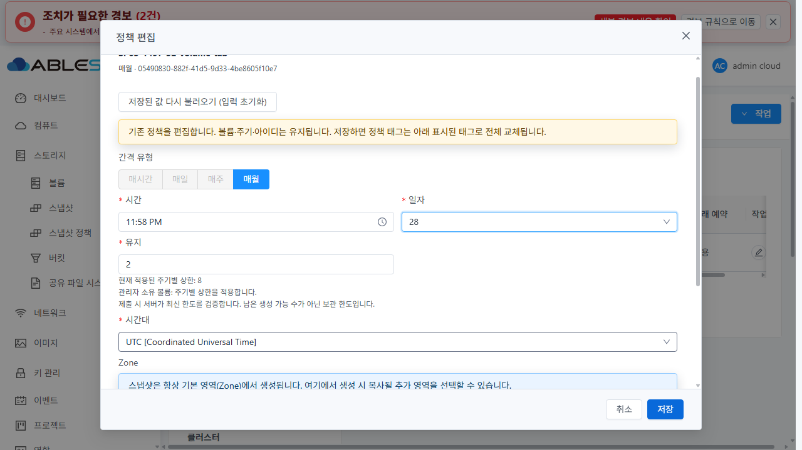
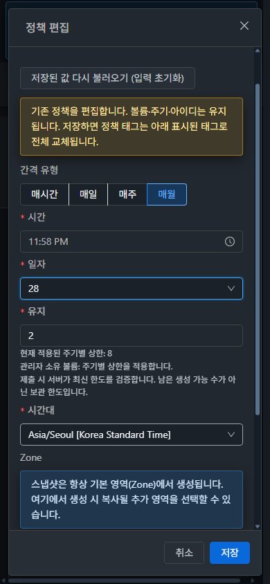

# SP-03 월간 스냅샷 정책 일자 검색 검증

#1497 / Epic #1494. 2026-10-27 KST, 31 GFS2와 32 RBD에서 완료 기준 5개를 확인했다. 브랜치는 `dhslove/epic-1494-snapshot-policies`, 시작 기준은 `a94c23195f4bf31045b79259329dfaa5eb2b4795`, 최종 UI 빌드 소스는 `01abb8ce3d339fb542d900adb06bc93df00cf114`이다. 이 보고서는 SP-03의 완료이며 Epic 전체 완료나 Europa 병합 판정은 아니다.

## 수정과 설계

변경 전 두 클러스터의 정책 생성창에서 매월 일자 `28` 검색으로 `TypeError: t.value.toLowerCase is not a function`을 재현했다. 숫자 옵션에 문자열 메서드를 호출하던 비교를 `String(option.value).includes(String(input ?? ''))`로 바꾸고 없는 옵션은 제외했다. 명시적인 숫자 `value`와 문자열 `label`을 분리해 지원 범위 1~28과 일정 인코딩을 보존했다.

- [설계](../../design/snapshot-policy-1494/SP-03.ko.md)
- [공통 FormSchedule](../../../ui/src/views/storage/FormSchedule.vue)
- [실제 AntD Select를 마운트한 회귀 검사](../../../ui/tests/unit/views/storage/SnapshotPolicyMonthSearch.spec.js)
- [수정 전 예외](evidence/before-ui.json), [31 원본 화면](screenshots/31-before-month-search.jpg), [32 원본 화면](screenshots/32-before-month-search.jpg)

제품 변경은 검색·옵션 바인딩뿐이다. 새 CSS나 대화상자 레이아웃을 추가하지 않았다. 스토리지 FormSchedule의 모든 소비 경로인 정책 메뉴 생성/편집, 볼륨 작업 메뉴 생성/정기스냅샷 탭 편집을 실화면으로 검증했다. 컴퓨트 백업의 동명 FormSchedule은 별도 컴포넌트로, 이번 수정에 포함하지 않았다.

## 집중 검사와 빌드

WSL ext4 `/home/ablecloud/work/dhslove/cloud-snapshot-policy-1494/ui`에서 수행했다.

| 검사 | 결과 | 근거 |
|---|---|---|
| UI 12 suites / 212 tests | PASS | [전체 로그](evidence/ui-test.txt) |
| lint `--no-fix` | PASS | [로그](evidence/ui-lint.txt) |
| production UI build | PASS | [로그](evidence/ui-build.txt) |
| 정적 UI 패키지 931개 파일 | SHA256·배포 검증 PASS | [패키지 정보](evidence/ui-package.json), [manifest](evidence/ui-manifest.json) |

새 검사 10개는 1/9/10/28 검색, 29/없는 문자열의 빈 결과와 지우기 후 복구, 실제 선택·제출, 숫자/문자 옵션값, 누락 옵션을 다룬다. 표시 이름을 `28일`로 바꿔도 숫자 `28` 및 `59:23:28` 제출이 유지됨을 마운트 검사로 확인했다. 실환경의 옵션 label이나 DOM을 인위적으로 변경한 결과로 대체하지 않았다. 기존 네 주기·태그·상한·편집·삭제 검사도 통과했다.

초기 검사에서 테스트의 기대 주기를 `MONTHLY`로 잘못 적은 2건을 기존 API 계약인 `monthly`로 바로잡았다. 위 결과는 수정 후 전체 실행이다. 게시 텍스트 로그는 LF와 줄 끝 공백만 정규화했다. Maven/전체 Cloud CI/Actions dispatch/qemu·FTCTL 빌드는 수행하지 않았다.

## 실제 API와 UI 검증

기존 1GiB 시험 백업을 읽어 클러스터별 DATADISK 2개를 복제했다. 이름은 `SP03-1497-{31|32}-{scheduled|volume-tab}`이며 기존 VM에 연결하거나 게스트 데이터를 쓰지 않았다. [31 시험 자원](evidence/31-fixtures.json), [32 시험 자원](evidence/32-fixtures.json).

각 클러스터의 직접 API 검사는 월간 1일 UTC → 같은 UUID의 28일 Asia/Seoul을 저장하고 다음 예약 UTC를 독립 SQL과 계산식으로 대조했다. 잘못된 `59:23:29` upsert는 431로 거부됐으며 전후 정책·태그·상세·예약이 불변이었다. 직접 API 시험 정책은 UI 시험 전에 정상 삭제했다. [31 API 결과](evidence/31-api-matrix.json), [32 API 결과](evidence/32-api-matrix.json).

아래 8건은 실제 브라우저의 확인/저장 버튼으로 수행했다. 보관 수 2와 `sp03-keep=한글 유지` 태그를 유지했다. 각 단계 직후 새 API 조회와 독립 SQL을 저장했고, 일정·주기·시간대·보관 수·태그·다음 예약 및 편집 전후 UUID를 [자동 대조](evidence/ui-api-db-result.json)했다.

| 클러스터 | 실제 UI 경로 | 저장 일정 | 시간대 | 결과 |
|---|---|---|---|---|
| 31 GFS2 | 정책 메뉴 생성 → 편집 | `59:23:1` → `59:23:28` | UTC | 같은 UUID, PASS |
| 31 GFS2 | 볼륨 작업 생성 → 정기스냅샷 탭 편집 | `58:23:28` → `58:23:1` | Asia/Seoul | 같은 UUID, PASS |
| 32 RBD | 정책 메뉴 생성 → 편집 | `59:23:28` → `59:23:1` | Asia/Seoul | 같은 UUID, PASS |
| 32 RBD | 볼륨 작업 생성 → 정기스냅샷 탭 편집 | `58:23:1` → `58:23:28` | UTC | 같은 UUID, PASS |

원본 단계: [31 생성](evidence/31-root-create.json) / [편집](evidence/31-root-edit.json) / [볼륨 생성](evidence/31-volume-create.json) / [볼륨 편집](evidence/31-volume-edit.json), [32 생성](evidence/32-root-create.json) / [편집](evidence/32-root-edit.json) / [볼륨 생성](evidence/32-volume-create.json) / [볼륨 편집](evidence/32-volume-edit.json).

네 진입점에서 1/9/10/28, 29/없는 문자열, 검색 지우기·복구를 확인했다. 편집 중 검색과 Enter 선택은 저장 요청을 발생시키지 않았고 시간·시간대·보관 수·한글 태그를 유지했다. 취소 후 재열면 저장된 일자로 복원됐다. 생성창도 취소 후 새로 열어 비어 있는 월간 일자를 확인했다. 볼륨 생성창의 매시간/매일/매주/매월 전환도 확인했다.

마지막 독립 관측 구간의 검색·Enter·초안·취소 복원 기록은 [31](evidence/31-ui-final.json), [32](evidence/32-ui-final.json)에 있다. 이 구간의 Runtime 예외와 Enter에 의한 createSnapshotPolicy 호출은 0이었다. 브라우저 관측 프로세스의 30초 제한으로 이전 메모리상의 전체 네트워크 기록이 초기화되어, 8건 전체의 원본 XHR 로그가 보존됐다고 주장하지 않는다. 실제 UI 단계 화면과 각 단계 API/DB 원본, 마지막 관측 기록을 구분했다. 월간 자연 예약 실행·스토리지 백업 완료는 이번 숫자 검색 수정의 검증에 포함하지 않았다.

## 가상머신 UI 표준과 반응형 확인

두 클러스터의 **컴퓨트 > 가상머신 > 편집**을 밝은/어두운 테마로 열어 값을 변경하지 않고 취소했다. [VM 규격 측정](evidence/vm-standard.json)과 원본 화면을 기준으로 동일 AntD 선택기·버튼의 32px 높이/14px 글꼴/4px 테두리 반경, 공통 테마·레이블·작업 순서를 대조했다.

양 클러스터 × 밝은/어두운 테마 × 1280×720/768×900/390×844 × 정책 생성/볼륨 편집 **24개 조합**에서 검색 후 28 선택과 표시를 확인했다. 편집창은 하단 취소→저장을 유지하고 생성창은 기존 본문 스크롤 후 취소→확인에 접근할 수 있었다. 생성창의 작업 영역을 고정 하단으로 새로 설계한 것은 아니다. 배경 볼륨 표의 기존 가로 스크롤을 새 선택기의 넘침으로 집계하지 않았다.

24개 원본 PNG와 생성창 하단 접근 12개 PNG를 보존했다. 구조화 측정 JSON은 마지막 32 밝은 편집창의 3개 너비에 대해 [별도 저장](evidence/responsive-measurements.json)했다. 나머지 조합은 단계 중 경계 검사를 통과한 원본 이미지로 남겼다. 전체 JPEG/PNG는 [포맷·디코딩 치수·SHA256 manifest](evidence/image-manifest.json)로 대조했다. JPEG를 PNG로 이름만 바꾸거나 이미지를 편집하지 않았다.

알려진 목록의 `MONTHLY`/일정 번역과 생성 알림의 “스냅샷이 복제되었습니다” 문구는 #1504 범위다. 기존 32 자원 경보와 Wall 모니터링 비활성 안내를 이번 검색 오류로 판정하지 않았다.

## 배포·정리·보존

UI 소스 `01abb8ce3d3`의 정적 자산 931개만 활성 webapp에 반영했다. WEB-INF/META-INF, 설정 7개, 관리 JAR 전체 SHA256와 실행 PID는 유지됐다. 양쪽 mold active 및 `/client/` HTTP 200을 확인했다. filterDayOfMonth 및 기존 스냅샷/FTCTL 마커도 배포 검사에 포함했다. [31 배포](evidence/31-ui-deploy.json) / [최종](evidence/31-runtime-after.json), [32 배포](evidence/32-ui-deploy.json) / [최종](evidence/32-runtime-after.json).

백업은 31 `/root/snapshot-policy-1497-20261027-ui-01abb8ce3d3-backup`, 32 `/nfs/snapshot-policy-1497-20261027-ui-01abb8ce3d3-backup`에 보존했다. 전역 `secondary.storage.capacity.threshold`는 양쪽 모두 기존 `0.90`이다. [31 설정](evidence/31-global-check.json), [32 설정](evidence/32-global-check.json). 이전 SP-07의 보존 WAL이나 다른 운영 파일을 정리 대상으로 삼지 않았다.

시험 정책과 각 2개 볼륨을 정상 API로 삭제했다. 볼륨은 Expunged 2개씩이며 정책/예약/활성 볼륨/활성 스냅샷/태그/정책 상세/대기 작업은 모두 0이다. 새 스냅샷은 생성되지 않았다. GFS2 실제 파일 2개 및 RBD 이미지 2개/trash의 부재를 독립 확인했다.

- [31 DB 정리](evidence/31-cleanup-check.json), [실제 파일](evidence/31-primary-after-cleanup.json)
- [32 DB 정리](evidence/32-cleanup-check.json), [RBD/trash](evidence/32-primary-after-cleanup.json)
- [31 기존 자원 보존](evidence/31-preservation-result.json), [32 기존 자원 보존](evidence/32-preservation-result.json): VM116/51, 볼륨155/51, 기존 스냅샷23/7 및 Zone/풀/역할의 핵심 속성 불변
- [Windows](evidence/protected-windows-result.json) / [WSL](evidence/protected-wsl-result.json): 별도 dirty FT 작업 3/11개와 HEAD/브랜치/상태/변경 diff 불변

시험 브라우저는 로그아웃 후 닫았고 임시 화면 크기 오버라이드는 해제했다. 게시 증거에 인증 정보는 포함하지 않았다.

## 완료 판정과 후속

#1497의 검색/값 보존/키보드·취소/월간 일정 API·DB/소비 화면 회귀 기준을 충족했다. 관리자·단일 Zone·분리된 DATADISK에서 확인했으며 전체 역할/DST/다중 Zone·다중 노드 장애/자연 예약 통합 회귀를 이번 PASS에 포함하지 않는다.

다음은 **#1503 (SP-09) 스냅샷 정책 전체 목록 서버 정렬과 페이징·URL 상태 일치**다. 20개 초과의 전용 정책, 양방향 전역 정렬과 보조 ID, 검색/페이지/URL 복원, 잘못된 키와 ACL을 API·UI·독립 SQL로 대조해야 한다. 이후 #1504 운영 정보·한글, #1505 선택 삭제·범위 필터, #1506 태그 수명주기, #1507 통합 회귀가 남는다. SP-03 종료 후 Epic 진행은 **8/13**, Epic은 OPEN으로 유지한다.
