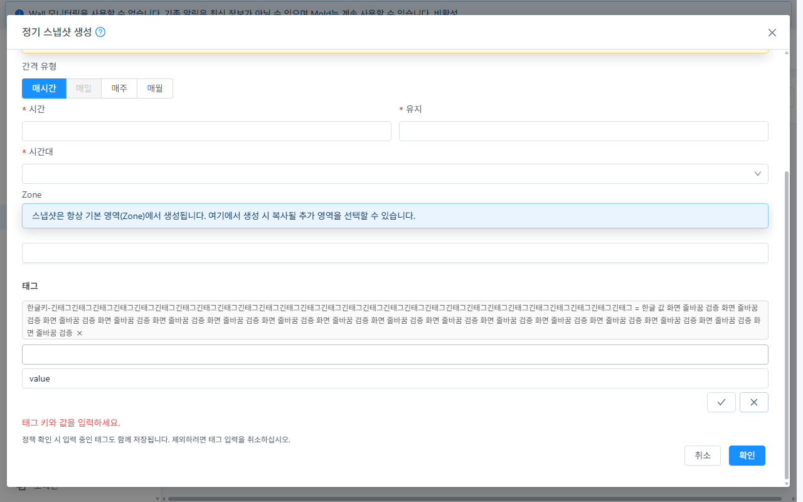
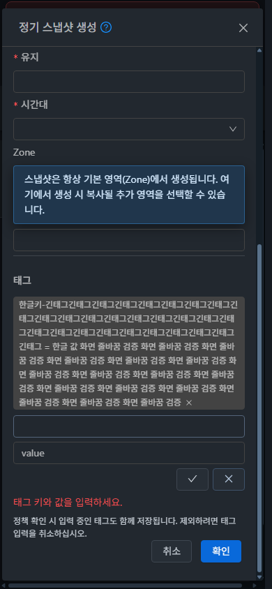

# SP-04 (#1498) 설계·구현 및 실제 API/UI 검증

2026-10-26 KST. [Epic #1494](https://github.com/ablecloud-team/ablestack-cloud/issues/1494) / [SP-04 #1498](https://github.com/ablecloud-team/ablestack-cloud/issues/1498).

**판정: SP-04 완료.** 31 GFS2·32 RBD의 실제 생성 요청, 정책·스냅샷 API, UI, 독립 DB와 스토리지로 태그 계약을 검증했다. Epic과 다른 하위 결함은 OPEN으로 유지한다.

## 설계와 구현

[설계](../../design/snapshot-policy-1494/SP-04.ko.md). 기준 `ccf644c59ae`, 브랜치 `dhslove/epic-1494-snapshot-policies`. 최종 UI 소스·검사·빌드 기준 **`93cdc5a5a19`**. 보고서 변경 이후 UI 소스는 동일하다.

- FormSchedule의 X는 `close.prevent` 후 실제 tags 배열을 제거한다. 안정적인 key를 사용해 인덱스 재사용으로 다른 태그가 숨는 문제도 방지한다.
- 빈 키·공백 값·중복 키를 차단한다. 키의 앞뒤 공백을 제거하고 값은 보존하며, 기존 태그를 조용히 덮어쓰지 않는다. 입력 길이는 VM 태그 입력과 같은 255이다.
- blur는 저장하지 않는다. Enter는 한 번 확정하고 IME 조합 중에는 확정하지 않는다. Escape/취소는 초안을 버리고 추가 버튼으로 초점을 돌린다. 정책 확인 시 유효한 열린 초안은 한 번 확정하고, 잘못된 초안은 제출을 차단한다.
- API 오류 후 일정·태그를 보존하며 재시도한다. 전송 중 편집과 중복 제출을 차단하고, 제출 전 사용자·프로젝트·대상·권한 문맥을 다시 확인한다.
- 생성 초안의 추가/삭제는 로컬 모델 변경이다. 실제 저장은 `createSnapshotPolicy(tags)` 한 요청이며 UI에서 createTags/deleteTags를 호출한 건수는 **0**이다.

## 가상머신 UI 표준

실제 **컴퓨트 > 가상머신** 상세의 ResourceTags와 비교했다. 세로 입력, AntD 입력 높이 **32px / 글자 14px / 모서리 4px**, 확인·취소 아이콘 버튼, dashed 추가 버튼, 6px 간격·줄바꿈과 테마 토큰을 따른다. 하단 정책 취소→확인 순서는 MoldDialogActions를 유지한다. 전역 VM CSS는 변경하지 않았다.

양 클러스터 × 라이트/다크 × **390×844 / 768×900 / 1280×800 = 12개 조합**에서 긴 한글 키/값, 오류 문구, 가로 넘침, 입력 규격, 버튼 순서와 키→값→확인→취소 Tab 이동을 확인했다. 원본 PNG 12장의 실제 디코딩 크기·SHA256을 대조했다. 일반 캡처는 원래 JPEG로 저장했다.

## 실제 UI/API 결과

| 항목 | 31 GFS2 | 32 RBD |
|---|---|---|
| 수정 전 X 삭제 뒤 실제 요청/API에 sp04-remove 잔존 | 재현 | 재현 |
| 빈 키/공백 값·중복 키 거부 / 원래 태그 보존 | PASS | PASS |
| blur 미저장 / Enter 확정 1회 / Escape·취소·X 삭제 | PASS | PASS |
| 삭제·취소 태그 미전송 / 열린 초안 1회 저장 | PASS | PASS |
| 실제 maxsnaps=9의 431 후 일정·태그 보존, 1로 수정해 재시도 | PASS | PASS |
| 볼륨 상세 작업 > 정기 스냅샷에서 모든 태그 제거 후 생성 | 태그 0, DAILY 58:23 | 동일 |
| 볼륨 정기스냅샷 탭 저장값 | 23:58 / Seoul / 보관 1 | 동일 |
| 일반 사용자 자기 볼륨·정책 범위 / 태그 저장 | PASS | PASS |
| createTags 허용·deleteTags 거부 역할의 초안 X 삭제 | 가능, 삭제 API 미호출 | 동일 |
| createTags 거부·deleteTags 허용 역할 | 초안 추가 숨김 | 동일 |
| createSnapshotPolicy 거부 역할 | 생성 작업 숨김, 실제 API 432 | 동일 |
| SP-01 생성 볼륨 선택 / SP-02 고급 검색·재설정 | PASS | PASS |
| 정리 후 실제 정책 목록 | 0건 | 0건 |

최종 실제 UI 확인 기록 **75건**은 재진입·12개 화면 조합·정리 확인을 포함한다. 이를 단위 검사 수에 더하지 않는다. 단위 검사에서 실제 AntD X/키보드와 제출 payload, IME, 동시 검증, 전송 중 변경, 권한·문맥 변경 및 언마운트도 확인했다.

### 권한 경계

VM ResourceTags처럼 createTags가 없으면 태그 입력을 제공하지 않는다. createSnapshotPolicy도 필요하다. 아직 저장하지 않은 초안은 deleteTags가 없어도 취소/삭제할 수 있다. 서버의 `createSnapshotPolicy(tags)` 계약은 별도 createTags 엔드포인트 허용 여부와 독립적이며, 이 UI 제한을 서버 보안 강제라고 주장하지 않는다.

시험 역할은 **기본 User의 252개 규칙을 복제**하고 태그/정책 규칙만 앞에 적용했다. 처음 빈 User 역할로 만든 UI 로그인은 초기 조회 권한 부족으로 자동 로그아웃됐으며, 그 설정 진단은 최종 통과로 집계하지 않았다. 보정 후 실제 로그인과 UI를 재검증했다.

삭제 전용 조건에서는 실제 createTags/정책 생성 API가 432로 거부되고, 다른 계정 정책은 531로 거부됐다. 허용된 deleteTags는 자기 시험 정책의 태그만 정상 삭제했다. 기존 운영 역할·계정은 변경하지 않았다.

## 자연 예약과 실물 증거

각 환경에 전용 Ready 1GiB 볼륨 3개(관리자 예약/볼륨 상세/일반 소유자)를 기존 시험 스냅샷에서 읽어 복제했다. 기존 VM/볼륨에 연결하거나 데이터를 쓰지 않았다. 정책은 실제 UI에서 생성했다.

| 항목 | 31 GFS2 최종 | 32 RBD |
|---|---|---|
| 예약 볼륨 UUID | 3f0f2ab4-cb36-48d6-8ebe-7d1d7f61b2b6 | c418324c-7c33-43f2-a817-c8cf4a169fd4 |
| 최종 정책 UUID | 609e234e-db0f-40dc-962b-02b21d80eb34 | 374fe77f-4ea2-4d81-8bbd-e2716e8af6c1 |
| 예정 UTC / 실제 생성 UTC | 13:28 / 13:29:13 | 13:12 / 13:14:37 |
| 스냅샷 UUID | 828f141d-81b1-403b-b458-abb13695c51d | c5e66710-1122-42e1-a321-399afc5484b9 |
| 자연 예약 job UUID | 979c75cf-0a76-4fe1-b01d-77b8d6b2a0d8 | 8e6dce46-e350-4f55-9aa9-cb365f3ec1c7 |
| job / 현재 API·DB·UI | 1 / BackedUp | 1 / BackedUp |
| 보조 스토리지 파일 | Ready / 존재 / 196624 bytes | 동일 |

두 스냅샷의 실제 API·DB·UI에는 **sp04-keep=한글 태그 유지**, **sp04-pending=입력 중인 태그**만 있었다. X 삭제·취소 태그는 없다. 수동 createSnapshot으로 자연 예약을 대체하지 않았다. 폴링 간격은 300초이다. 완료 job에 들어 있는 초기 snapshot.state=Allocated와 별개로 현재 listSnapshots·DB·실제 UI의 BackedUp을 확인했다.

### 31번의 첫 예약 실패와 환경 보정

첫 정책 f1b449f9-320e-4991-8789-8ad007699780의 22:14:13 KST job은 **530 실패**였다. 관리 로그에 보조 스토리지 total 349.83GB / used 315.42GB / 임계값 90%로 할당 거부가 명시됐다. 이 실행을 통과로 집계하지 않았다.

운영 스냅샷과 임계값은 유지했다. `/nfs`의 기존 **UI 검증·배포 아카이브 36개, 2,070,536,646 bytes**를 `/root/snapshot-ui-archives-20261026-sp04/`로 복사하고 모든 파일 SHA256 일치 후 원본을 이동 정리했다. 운영 secondary·primary·모니터링 디렉터리는 이동하지 않았다. 전후 filesystem used는 338,710,913,024→336,547,971,072 bytes이다. 이전 아카이브와 이번 배포 백업의 원래 경로→새 경로는 [이동 매핑](evidence/31-archive-relocation-summary.json), 서버의 전체 해시 manifest는 해당 폴더 `relocation-manifest.json`에 보존했다.

실패 정책·Allocated 스냅샷은 정상 API로 제거했다. 새 정책을 UI에서 생성하고 위 표의 **별도 자연 예약 성공**을 확인했다. SQL 상태 변경, 서비스 재시작, 용량 임계값 완화로 통과를 만들지 않았다.

## 검사·배포·보존

- **5 suites / 74 tests, lint, UI production build PASS.** WSL ext4 전용 작업 폴더에서 실행했다. 전체 Cloud/Maven/Actions dispatch/qemu 빌드는 수행하지 않았으며 전체 CI 통과로 표시하지 않는다.
- 최종 UI tar SHA256: `adac0519dc29ad3c2aa0c172594a4243c7ef1ed7995dc5ed14c7baf64a0624a7`.
- 양쪽 활성 `/usr/share/cloudstack-management/webapp`의 정적 파일 922개를 manifest로 대조했다. WEB-INF, 설정, 관리 JAR, 대용량 서버 파일 메타데이터와 PID(31 3315398 / 32 3223335)를 보존했다. mold active, `/client/` 200 및 SP-01/02/FTCTL 마커를 확인했다.
- 최종 백업: 31 `/root/snapshot-ui-archives-20261026-sp04/snapshot-policy-1498-20261026-ui-backup`, 32 `/nfs/snapshot-policy-1498-20261026-ui-backup`.
- 기존 자원: 31 볼륨 **155→155**, VM **116→116**, 스냅샷 **23→23**; 32 볼륨 **51→51**, VM **51→51**, 스냅샷 **7→7**. ID/이름/상태·경로/크기/연결/스토리지 및 VM hostid 등 선택 핵심 속성이 동일하다. 동적 통계 전체의 동일성을 주장하지 않는다.
- 기존 Windows/WSL FTCTL 폴더의 HEAD·브랜치·dirty 상태·tracked diff 해시는 그대로다(3/11개 tracked 변경). 별도 작업 폴더를 사용했다.

## 정리와 남은 결함

전용 정책·예약·볼륨 3개씩·성공 스냅샷 1개씩·시험 계정/역할을 정상 API로 정리했다. 실패/재현 정책과 31 실패 스냅샷도 포함해 독립 DB의 **활성 볼륨/정책/예약/활성 스냅샷/비종결 사본/시험 태그/활성 계정·역할·권한/대기 job은 모두 0**이다. 정상 이력인 Destroyed 스냅샷, removed가 설정된 실패 스냅샷과 Expunged 볼륨 tombstone은 유지된다.

GFS2 파일 3개 부재, RBD 이미지 3개 부재·trash [], 양쪽 보조 스토리지 파일 부재를 확인했다. 알려진 **SP-12 #1506**으로 스냅샷 삭제 후 두 태그씩이 남아 정상 deleteTags API로 별도 정리했다. 이를 제품 자동 정리 성공으로 집계하지 않는다.

32번에서 빠르게 스냅샷 상세→정책 목록으로 이동할 때 공통 AutogenView.beforeRouteLeave의 요청 취소가 **ERR_CANCELED / Uncaught (in promise) 1건** 기록됐다. SP-04 태그 편집·제출의 예외와 구분하며, 원본 예외의 CanceledError·스택을 보존해 **SP-13 #1507**의 후속으로 남긴다. 해당 공통 소스는 이번에 변경하지 않았다. 집중 검색 재검증에서는 같은 오류가 다시 발생하지 않았다. 콘솔 전체 0으로 보고하지 않는다.

관리자 로그인·기본 프로젝트 보기·다크 테마와 임시 뷰포트/개발자 설정을 복원했다. 임시 계정 로그인 파일은 제거했다. 전체 역할·프로젝트·다중 Zone·DST·자연 예약 2회 이상 통합 회귀는 SP-13에 남긴다.

## 다음 작업

**다음 권장: [#1500(SP-06, P1)](https://github.com/ablecloud-team/ablestack-cloud/issues/1500)**. 일정·시간대 변경 시 다음 예약 재계산과 실행 중 job 경합 보호가 정책 편집의 선행 조건이다. [#1497(SP-03, P2)](https://github.com/ablecloud-team/ablestack-cloud/issues/1497) 월 일자 검색도 별도 후속으로 남긴다. #1499 편집 UI는 #1500/#1502/#1498 계약을 통합하며, 이후 UI도 가상머신 표준을 유지한다. Epic 전체 완료와 Europa 병합은 별도이다.

## 증거

- [실제 UI 확인](evidence/ui-checks.json), [실제 UI 요청](evidence/ui-network.json), [12개 화면](evidence/layout-results.json), [이미지 무결성](evidence/evidence-integrity.json), [VM 규격](evidence/vm-tag-standard.json)
- [집중 검사](evidence/focused-tests-final.txt), [lint](evidence/lint-final.txt), [UI build](evidence/build-final.txt), [기존 자원 보존](evidence/preservation-result.json)
- [31 자연 예약 API](evidence/31-natural-live.json), [DB/job/태그](evidence/31-natural-live-db.txt), [32 자연 예약 API](evidence/32-natural-live.json), [DB/job/태그](evidence/32-natural-live-db.txt)
- [31 권한](evidence/31-owner-permission-probe.json), [32 권한](evidence/32-owner-permission-probe.json), [콘솔 취소 예외](evidence/32-original-console-error.json)
- [31 정리](evidence/31-cleanup-independent.json), [32 정리](evidence/32-cleanup-independent.json), [31 실물](evidence/31-primary-after.json), [32 실물](evidence/32-primary-after.json), [31 보조 스토리지](evidence/31-secondary-after.json), [32 보조 스토리지](evidence/32-secondary-after.json)

