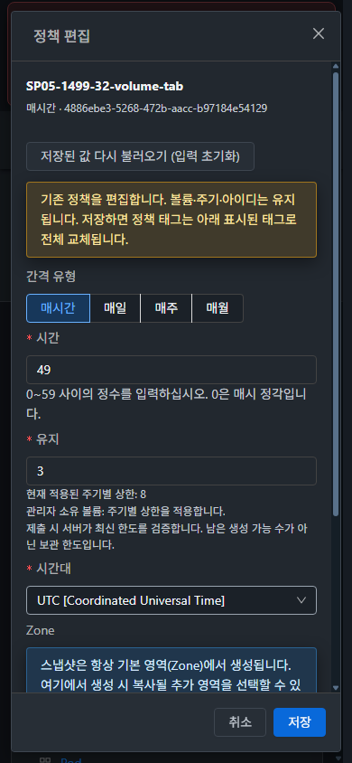

# SP-05 #1499 기존 정책 편집·관리자 예약 중지/재개 구현 및 실환경 검증

**완료 — 2026-10-27 KST.** [#1499](https://github.com/ablecloud-team/ablestack-cloud/issues/1499)의 완료 기준 6개를 검증했다. 브랜치는 `dhslove/epic-1494-snapshot-policies`, 작업 기준은 `3364ed20b88462b0b7fa96d871d7310e8504be1d`이다. 서버 빌드 소스는 `38839857cfd9eac412950c09f142f5361e52ba32`, 최종 UI 빌드 소스는 `673d65787794ce58064342c3ac8ce71b09946817`이다. 이후 변경은 설계·검증 기록이다. Epic #1494는 13개 중 6개 완료이며 계속 OPEN이다. Europa 병합이나 전체 Cloud CI 완료를 의미하지 않는다.

## 설계와 구현

[설계 문서](../../design/snapshot-policy-1494/SP-05.ko.md)

- 정책 전체 목록의 행 작업과 볼륨의 정기스냅샷 탭에서 같은 편집 대화상자를 사용한다. 정책 UUID·볼륨·주기를 고정하고 기존 일정·시간대·보관 수·태그·지원 Zone을 채운다. 네 주기가 모두 등록돼 있어도 편집의 저장 버튼은 유지한다.
- 편집은 `createSnapshotPolicy` 한 요청이다. 기존 태그 전체를 포함하며 선택 삭제·전체 제거·열린 새 태그 초안도 교체 계약에 반영한다. 태그 권한이 없으면 기존 태그를 읽기 전용으로 보존한다. 관리자 편집은 기존 `fordisplay`를 유지해 중지 정책을 편집만으로 재개하지 않는다.
- 선택적인 기존 정책 `id`를 API에 추가했다. 기존 볼륨 upsert 잠금·정책 행 잠금·트랜잭션 안에서 ID를 확인해, 삭제/교체된 정책의 편집이 신규 생성으로 바뀌지 않게 한다. ID 없는 기존 생성 경로는 유지한다.
- 추가 Zone 전체 해제는 `id`와 `clearzoneids=true`로 명시한다. Zone 생략은 보존이며 `zoneids`와 동시 지정은 거부한다. 실제 DAO의 빈 `saveDetails`가 삭제하지 않는 동작을 고려해 Zone 상세만 제거하고 다시 저장한다. 소스 Zone·별도 storage 상세는 보존한다.
- 관리자·API 권한이 있는 경우 예약 중지/재개를 제공한다. 일반 사용자 목록 표시와 미래 예약에 미치는 영향, 기존 스냅샷 보존, 시작된 작업의 계속 실행과 실행 중 삭제 거부를 확인한 뒤 `updateSnapshotPolicy`를 호출한다. 실제 async job 완료와 최신 플래그를 재확인한다.
- 전송/상태 조회가 불명확하면 클라이언트 job UUID를 유지하고 같은 job만 재조회한다. 최신 정책 fingerprint·볼륨 소유 범위·경로·로그인·프로젝트·권한을 재검사하며 저장 중 입력·중복 제출을 막는다. 실패 초안과 태그는 유지한다. 명시적 저장값 재조회는 초안을 초기화한다.
- **컴퓨트 > 가상머신 UI 표준**의 실제 목록/편집창과 비교했다. 공통 MoldDialog·세로 AntD 폼·14px 글꼴·32px 컨트롤/버튼·4px 모서리·테마 토큰·취소→저장 순서를 사용한다. 좁은 화면의 스크롤 본문과 하단 작업 영역을 유지한다.

## 집중 검사·빌드·배포

Windows 원본 FT 작업 트리와 별도로 WSL ext4 전용 체크아웃에서 변경 모듈과 UI를 빌드했다. `/mnt/c`에서 Maven/npm 빌드를 수행하지 않았다.

| 검사 | 결과 | 범위 |
|---|---|---|
| API 모듈 | 3 suites / **9 tests**, install PASS | 선택적 편집 의도·기존 명령/상한 계약 |
| server 모듈 | 7 suites / **209 tests**, package PASS | 편집 ID 경합·Zone 보존/해제·입력·보관·SP-06 Manager/Scheduler 회귀 |
| 최종 UI | 8 suites / **145 tests**, lint·production build PASS | 네 주기 복원·태그·권한/소유/늦은 응답·실패/재시도·중복·메뉴 popup 경로 |

총 **363 tests PASS**. Maven Checkstyle/RAT는 생략했고 전체 Cloud 빌드·Actions dispatch·qemu/FTCTL 빌드는 수행하지 않았다. [검사 결과](evidence/unit-result.json)

서버는 API 클래스 1개와 Manager/내부 클래스 2개, 총 **3 class 파일/2개 클래스 계열**만 관리 JAR에 적용했다. 기존 배포와 기준 소스의 해당 클래스 메서드 바이트코드가 양쪽에서 일치함을 확인했다. 32의 기존 capability 계약은 이번 변경에서 건드리지 않았다. [호환성](evidence/runtime-baseline-compatibility.json) · [패치 manifest](evidence/patch-manifest.json)

동일한 최종 UI **928개 정적 파일**을 양쪽 활성 `/usr/share/cloudstack-management/webapp`에 배포했다. UI archive SHA256은 `12f6efc2c2efa9195f28bc612eae61af6b6f14f6ad13a7950b481c5ee9dbac3e`이다. WEB-INF/META-INF·서버 설정·운영 디스크·기존 FTCTL/SP-01/02/04/08 마커를 보존했다. UI 배포 중 JAR와 서비스 PID도 유지했다.

| 환경 | 최종 PID | 허용 패치 외 JAR 항목 | 최종 상태 |
|---|---|---|---|
| 31 GFS2 | 3512207 | 204,538개 보존 | mold active, `/client/` 200, WEB-INF 존재 |
| 32 RBD | 3477070 | 204,532개 보존 | mold active, `/client/` 200, WEB-INF 존재 |

환경별 서버 설정 7개와 기존 정적 파일/최종 manifest를 대조했다. 32 `monitoring-vm.qcow2`의 크기·inode·mtime도 그대로다. 원본 JAR/정적 파일 백업을 보존했다. 31은 `/root/snapshot-policy-1499-20261027*`, 32는 `/nfs/snapshot-policy-1499-20261027*`에 보관한다.

[31 UI 배포](evidence/31-ui-deploy.json) · [32 UI 배포](evidence/32-ui-deploy.json) · [31 최종 런타임](evidence/31-runtime-final.json) · [32 최종 런타임](evidence/32-runtime-final.json)

## API·실제 UI·독립 SQL 대조

각 클러스터에 전용 1GiB DATADISK 4개(정책 메뉴/볼륨 탭/일반 소유자/프로젝트), 일반 계정 1개와 프로젝트 1개를 만들었다. 기존 시험 백업을 읽어 복제했으며 운영 VM에 연결하거나 쓰기 부하를 가하지 않았다. 기존 기본 역할을 사용했고 시험용 공유 역할은 추가하지 않았다.

| 검증 | 31 GFS2 | 32 RBD | 실제 확인 |
|---|---|---|---|
| 정책 메뉴 네 주기 편집 | PASS | PASS | 기존 값·세 주기 잠금·대상 UUID·저장 노출 |
| 볼륨 탭 네 주기 편집 | PASS | PASS | 같은 공통 편집창, 기존 네 정책 유지 |
| 같은 UUID·일정/TZ/보관 수 | PASS | PASS | 환경당 8개, 총 **16개 실제 UI upsert** |
| 태그 보존/선택 삭제/전체 제거/열린 초안 | PASS | PASS | 시간/일/주/월에 각각 적용, 한 요청의 전체 태그 배열 |
| 중지 정책 편집 | PASS | PASS | `fordisplay=false` 유지, 미래 예약 없음 |
| 관리자 중지/재개·취소 | PASS | PASS | 31 볼륨 탭, 32 정책 메뉴와 볼륨 탭; 실제 job 및 예약 취소/재생성 |
| 일반 소유자·프로젝트 편집 | PASS | PASS | 각 개인/프로젝트 정책 같은 UUID, 관리자 플래그 미전송 |
| 조회 전용 개인/프로젝트 | PASS | PASS | 정책 메뉴 읽기 가능, 편집·관리 작업 없음; 쓰기 API 432 |
| 잘못된 대상·Zone 의도 | PASS | PASS | 잘못된 ID/동시 Zone 지정/ID 없는 명시 해제 431, 전후 무변경 |
| 명시적 Zone 상세 해제 | PASS | PASS | API 응답뿐 아니라 SQL의 저장 상세 0 확인, 소스 Zone 유지 |

UI는 UTC로 변경하고 보관 수를 2→3으로 저장했다. 시간 `55→0`, 일 `03:15→59:23`, 주 `04:16:1→59:23:7`, 월 `05:17:1→59:23:28`의 요청·응답·DB를 대조했다. 32 볼륨 탭 시간 정책은 초기 후보에서 0분·보관 3개로 바뀐 상태였으므로 최종 검사에서 시간대가 Tokyo→UTC로 바뀌고 UUID/태그가 유지되는 것을 확인했다. 월 일자는 키보드로 선택했으며 숫자 검색 #1497을 수정/통과한 것으로 다루지 않는다.

독립 Python zoneinfo 계산과 DB의 다음 실행 UTC가 모든 정책에서 일치했다. 활성 정책은 미래 예약 1개, 중지 정책은 pending 예약 0개다. 표시 플래그로 API에 없는 `active`나 실행 상태를 추정하지 않는다.

[16개 편집 요청·응답](evidence/ui-editing-result.json) · [31 UI/SQL](evidence/31-ui-four-periods.json) · [32 UI/SQL](evidence/32-ui-four-periods.json) · [31 독립 시간 계산](evidence/31-ui-four-periods-next-check.json) · [32 독립 시간 계산](evidence/32-ui-four-periods-next-check.json)

조회 전용 기본 역할은 `listVolumesMetrics`가 없어 기존 볼륨 상세 경로가 대시보드로 돌아간다. 이 역할의 실화면 검증은 접근 가능한 정책 메뉴에서 수행했고, API의 개인/프로젝트 읽기·쓰기 거부도 별도로 확인했다. 편집 가능하지만 태그만 읽기 전용인 경우, 저장 도중 태그 권한 변경과 늦은 소유 응답은 집중 검사로 검증했다.

## 실패·경합·재시도

- 양쪽의 정확한 정책 최신 조회 XHR 한 건에만 503을 주입했다. 조회 중 모든 편집 입력/저장을 잠그고 실패 후 6분·보관 3·태그가 유지됐다. 실패 단계의 쓰기 0개, 정상 재시도의 upsert 1개를 확인했다. 최초 31 주입 패턴이 GET 파라미터 순서와 맞지 않아 5분이 정상 저장된 시도는 진단으로 구분하고, 수정된 패턴으로 다시 검증했다.
- 예약 재개가 수락된 뒤 job 조회 한 건을 503으로 응답했다. job ID를 유지하고 **작업 상태 다시 확인**은 같은 job만 조회했다. `updateSnapshotPolicy`는 환경당 한 번이며 재시도에서 추가 전송하지 않았다. 실제 완료 후 최신 표시 플래그와 새 pending 예약을 대조했다. 중지 취소에서는 쓰기 요청이 없었다.
- 저장 전 최신 확인을 통과한 편집 POST를 보류한 동안 같은 전용 정책을 정상 API로 삭제했다. 원래 POST를 진행하자 양쪽에서 431로 거부했고 7분·보관 3의 초안은 남았다. 삭제된 정책은 다시 생기지 않았고 다른 정책·태그·Zone 상세·예약은 변하지 않았다. 재조회도 삭제 대상으로 거부된다.
- 초기 UI 후보에서 메뉴 작업이 일반 생성 경로로 이동하는 문제를 실제로 발견해 popup 계약을 보완했다. 최종 소스에서는 정책 메뉴 URL을 유지한 채 대상 편집 대화상자가 열리고 저장됐다. 초기 후보의 결과를 최종 통과로 대신하지 않았다.
- 초기 Zone 구현은 빈 상세 목록 저장이 실제 삭제를 수행하지 않는 DAO 동작을 확인한 뒤 수정했다. 최종 API/SQL 명시 해제와 209건 서버 검사를 다시 통과했다.

[UI 안전성 판정](evidence/ui-safety-result.json) · [화면 상태/초안/키보드 기록](evidence/ui-checks.json) · [31 요청 기록](evidence/31-ui-network.json) · [32 요청 기록](evidence/32-ui-network.json)

브라우저 이벤트 버퍼가 오래된 읽기 요청을 일부 생략한 구간이 있으므로 전체 트래픽의 무손실 수집이라고 주장하지 않는다. 위 16개 최종 편집과 명시한 장애/중지·재개/실행 중 변경의 실제 요청·응답, 별도 API/SQL/스토리지 판정을 보존했다.

## 자연 예약·실행 중 변경·완료

운영 폴링 주기 300초를 유지했다. 전용 볼륨의 자연 예약이 생성한 Allocated 스냅샷/수락된 job을 관찰하기 위해 해당 스냅샷 행만 90초 watchdog 안에서 잠시 잠갔다. 정책/예약/작업 상태를 SQL로 만들거나 고치지 않았다. UI 일정 편집→중지→재개 뒤 동일한 job/snapshot/원래 예정 시각을 확인하고 실행 중 삭제 431을 검증한 후 명시적으로 잠금을 해제했다. 이 관찰은 **작업 수락/Allocated 단계**이며 저장소 복사 중간의 강제 장애 시험은 아니다.

| 환경 | 자연 예약 스냅샷 UUID | 수락된 job UUID | 생성 UTC | 최신 다음 예약 UTC |
|---|---|---|---|---|
| 31 | `c9e19d58-c567-4e7e-87ba-6f9c26199dd7` | `24ea6c7d-a6c9-4337-ab38-9d8c6f2d3d56` | 2026-10-26 22:46:20 | 2026-10-26 23:01:00 |
| 32 | `6de20b2d-68d8-453f-972c-b02f5153ed05` | `fb26e276-9729-4b0a-9ea7-bd4713a4f738` | 2026-10-26 22:52:29 | 2026-10-26 23:07:00 |

행 잠금은 각각 43.726초/29.605초에 명시 해제됐다. 양쪽 `queryAsyncJobResult=1`, DB job 결과 0, API/실제 볼륨 스냅샷 탭 **BackedUp**, 보조 저장소 Ready 파일 196,624바이트와 유지한 두 태그의 상속을 확인했다. 완료 직후 job 참조가 남는 시점과 다음 폴러가 최신 다음 예약으로 정리하는 시점을 구분해 기다렸다. 수동 `createSnapshot`으로 자연 실행을 대신하지 않았다.

[자연 실행 통합 판정](evidence/natural-result.json) · [31 실행 중 참조](evidence/31-natural-running-check.json) · [32 실행 중 참조](evidence/32-natural-running-check.json) · [31 완료 화면](evidence/31-natural-backed-up.jpg) · [32 완료 화면](evidence/32-natural-backed-up.jpg)

## UI 표준·화면·정리

실제 VM 목록/편집창의 다크와 라이트 기준을 저장했다. 두 클러스터 × 라이트/다크 × 390/768/1280px × 편집/예약 중지의 **24개 화면**에서 문서 가로 넘침 0, 대화상자 경계와 하단 버튼의 화면 내 배치를 검증했다. 390px에서 태그 영역까지 이동하고 취소→저장 키보드 이동, 저장 버튼 초점과 Escape 취소를 확인했다. 원본 PNG/JPEG **47개**의 포맷·디코딩 치수·SHA256을 검증했다. 후보 이미지 한 장은 명칭에 candidate를 표시했다.

[VM 기준](evidence/vm-standard.json) · [24개 배치 측정](evidence/layouts.json) · [원본 이미지 판정](evidence/image-dimensions.json)

조회 전용 로그인 시 양쪽에서 `Error fetching GUI theme: s`가 각 1회 기록됐다. 공통 `guiTheme.js` 호출은 이번 변경 파일이 아니며 정책 읽기/쓰기 권한 판정과 최종 테마 화면은 위와 같이 확인했다. 관찰한 uncaught TypeError는 0이지만 **전체 콘솔 오류 0으로 보고하지 않는다**. GUI 테마 조회/전체 역할 ACL의 원인 확인은 #1507 통합 회귀에 남긴다. [콘솔 기록](evidence/console-errors.json)

전용 정책 10개씩(삭제 경합 1개 포함), 볼륨 4개씩, 자연 스냅샷 1개씩, 프로젝트/일반 계정 1개씩을 정상 API로 정리했다. 알려진 #1506 태그 자동 정리의 성공으로 확대하지 않도록 생성 스냅샷 태그는 명시적 deleteTags로 정리했다. 공유 기본 역할과 글로벌 설정은 보존했다.

| 독립 정리 판정 | 31 | 32 |
|---|---|---|
| 활성 시험 볼륨/스냅샷·정책·예약·비종결 사본 | 모두 0 | 모두 0 |
| 태그·정책 상세·시험 계정·계정 제한·프로젝트 | 모두 0 | 모두 0 |
| 스냅샷/볼륨·정책 관리·계정/프로젝트 대기 job | 모두 0 | 모두 0 |
| 볼륨 이력 / 스냅샷 이력 | Expunged 4 / Destroyed 1 | Expunged 4 / Destroyed 1 |
| 원본 스토리지/보조 파일 | GFS2 파일 4개·보조 파일 부재 | RBD 이미지 4개·fixture trash·보조 파일 부재 |
| 기존 운영 자원 | 볼륨155 / VM116 / 스냅샷23 / 역할11 | 볼륨51 / VM51 / 스냅샷7 / 역할10 |

기존 Zone·풀·VM·볼륨·스냅샷·역할의 식별/상태/소유/경로 등 핵심 속성이 전후 일치했다. Windows/WSL 별도 FT 작업 트리의 HEAD·브랜치·상태·tracked diff가 그대로이며 기존 tracked 변경 3개/11개를 보존했다. 브라우저 테마 다크·기본 범위·1280×720·XHR/viewport 설정을 복원하고 시험 세션을 로그아웃/임시 탭을 닫았다. 생성 계정 비밀번호 파일은 시험 후 제거했다.

[31 정리 SQL](evidence/31-cleanup-independent.json) · [32 정리 SQL](evidence/32-cleanup-independent.json) · [31 기존 자원 보존](evidence/31-preservation-result.json) · [32 기존 자원 보존](evidence/32-preservation-result.json) · [Windows 보존](evidence/protected-windows-result.json) · [WSL 보존](evidence/protected-wsl-result.json)

## 후속 작업

다음 권장은 **[#1501 (SP-07, P1)](https://github.com/ablecloud-team/ablestack-cloud/issues/1501)**이다. 정책 메뉴와 볼륨 탭의 삭제 대상 요약·명시적 확인·최신 존재/권한·실패 재시도·중복 제출·취소/초점을 통일한다. SP-05 대화상자와 서버의 실행 중 삭제 거부 계약을 재사용한다.

[#1497 월 일자 검색](https://github.com/ablecloud-team/ablestack-cloud/issues/1497), #1503 정렬/페이지, #1504 운영 정보/문구, #1505 일괄 작업/필터, #1506 태그 자동 정리와 [#1507 통합 판정](https://github.com/ablecloud-team/ablestack-cloud/issues/1507)은 OPEN이다. 단일 Zone·분리된 DATADISK에서 검증했으며 다중 Zone 실복사, 실환경 DST, 전체 역할/도메인 관리자, 다중 관리 노드 장애와 전송 중 프로세스 강제 종료는 전체 통합 회귀 범위다. 이후 UI도 가상머신 표준을 유지한다.
