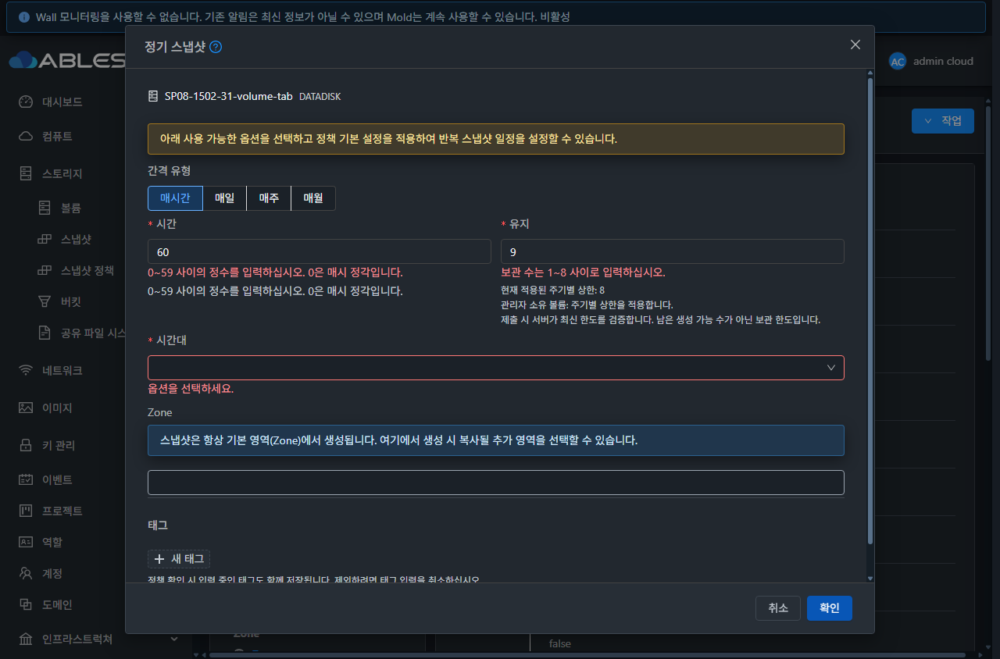

# SP-08 #1502 일정·정수·보관 한도 구현 및 실환경 검증

**SP-08 완료 — 2026-10-27 KST.** [#1502](https://github.com/ablecloud-team/ablestack-cloud/issues/1502)의 완료 기준 5개를 충족했다. 부모 [Epic #1494](https://github.com/ablecloud-team/ablestack-cloud/issues/1494)는 OPEN이다. 작업 브랜치는 `dhslove/epic-1494-snapshot-policies`이다. 서버 빌드 소스는 `4e41e7b70fb`, 최종 UI 빌드 소스는 `416128e440773e5c827e319bc2786a685a99eddc`이며 이후 변경은 설계/검증 기록이다.

## 구현과 설계

[설계 문서](../../design/snapshot-policy-1494/SP-08.ko.md)

- 서버는 정책·태그·예약을 쓰기 전에 일정 형식과 범위를 검사한다. HOURLY `0/00~59`, DAILY 분 0~59/시 0~23, WEEKLY 요일 1(일)~7(토), MONTHLY 일자 1~28을 허용한다. 음수·소수·공백·누락·추가 요소·overflow와 지원하지 않는 주기는 거부한다.
- 보관 수는 정수 1 이상, 실제 적용 중인 주기별 상한 이하로 검사한다. 계정/프로젝트·도메인 제한과 관리자 **소유자** 예외를 유지한다. 오류에는 필드와 허용 범위를 표시하고 Java Volume 객체 전체를 노출하지 않는다.
- `listCapabilities.capability.snapshotpolicymax`에 네 주기의 **런타임 적용 값**을 추가했다. 재시작 전 DB 설정을 적용 상한으로 오인하지 않는다.
- 공통 `storage/FormSchedule.vue`는 00분을 0으로 전송하고 잘못된 입력을 blur에서 자동 보정하지 않는다. 정수·상한 오류, 현재 주기 상한, 검증된 소유 범위의 한도, 확인 불가/재시도 및 서버 최종 검증 안내를 제공한다. API 응답의 소유 범위를 재확인하며 고정 8이나 임의의 무제한으로 대체하지 않는다.
- 오류와 한도 재조회 후 입력/태그 초안을 보존한다. 조회 중 제출, 늦은 응답 및 권한/대상 전환을 보호한다. 정책 메뉴와 볼륨 상세의 공통 생성 경로를 적용했다. 별도 `compute/backup/FormSchedule.vue`는 변경하지 않았다.

## 집중 검사 및 빌드

Cloud 변경 모듈 `api`, `server`만 WSL ext4 전용 체크아웃에서 Maven으로 빌드했다. UI도 같은 ext4 체크아웃에서 검사·빌드했다. Windows/WSL의 기존 FT 작업 트리에서 빌드하지 않았다.

| 구분 | 결과 | 검증 범위 |
|---|---|---|
| API 모듈 | 8 tests / 0 실패·오류·생략, install PASS | applied metadata, 생성 명령, 정책 intent |
| server 모듈 | 204 tests / 0 실패·오류·생략, package PASS | 입력 경계 77, 보관 3, 기존 Manager/Scheduler/SP-06 회귀 124 |
| 32 compatibility API | 8 tests / 0 실패·오류·생략, package PASS | 기존 capability 계약 보존 overlay |
| UI 6 suites | 110 tests PASS | 실제 AntD 입력의 0/blur/정수/필수 표시, 한도·범위·실패/늦은 응답, 태그/볼륨 검색/Zone/공통 소비 경로 |
| UI lint | PASS | `vue-cli-service lint --no-fix` |
| UI production build | PASS | `NODE_OPTIONS=--openssl-legacy-provider npm run build` |

[검사 클래스·결과·원본 로그 SHA256](evidence/focused-test-summary.json). Maven Checkstyle/RAT는 생략했다. UI의 기존 중복 icon 등록 경고와 오래된 Browserslist 데이터 안내는 남는다. 전체 Cloud 빌드·GitHub Actions dispatch·qemu/FTCTL 빌드는 수행하지 않았다. 이 결과를 전체 Cloud CI 성공으로 확대하지 않는다.

## 31 GFS2 · 32 RBD API/DB 검증

양쪽 모두 기존 정책이 0건인 상태에서 시작했다. 전용 1GiB DATADISK 3개씩(관리자 생성 경로 2개, 일반 소유자 1개)과 일반 계정 1개씩만 사용했다. 기존 백업을 읽어 복제했으며 운영 VM에 연결하거나 데이터를 쓰지 않았다.

| 검증 | 31 | 32 | 근거 |
|---|---|---|---|
| 적용 상한 3 / 일별 비활성 0 | PASS | PASS | [31](evidence/31-capabilities-applied.json), [32](evidence/32-capabilities-applied.json); 기존 capability 필드/값 모두 보존 |
| 비활성 포함 잘못된 요청 41건씩 | PASS | PASS | [31](evidence/31-invalid-small.json), [32](evidence/32-invalid-small.json) |
| 원래 설정 8/8 복구, 재시작 전 적용 값 3/0 유지 | PASS | PASS | [31](evidence/31-configuration-restored-pending-restart.json), [32](evidence/32-configuration-restored-pending-restart.json) |
| 재시작 후 실제 적용 상한 8/8 | PASS | PASS | [31](evidence/31-configuration-restored-applied.json), [32](evidence/32-configuration-restored-applied.json) |
| 허용 경계 9건씩 / 같은 주기 UUID 유지 | PASS | PASS | `0`, `00`, `59`, `0:0`, `59:23`, `0:0:1`, `59:23:7`, `0:0:1`, `59:23:28` |
| 복구 후 잘못된 요청 40건씩 | PASS | PASS | [31 matrix](evidence/31-matrix.json), [32 matrix](evidence/32-matrix.json) |
| 모든 거부 전후 정책·태그·상세·다음 예약 동일 | PASS | PASS | 각 요청 직전/직후 독립 SQL 결과 비교. 총 81건씩 400/431, Volume 객체 오류 없음 |

유효한 upsert는 같은 UUID를 유지했다. 태그를 포함한 기존 API 전체 교체 계약에 따라 미변경 태그를 함께 제출했다. [최종 API/DB 대조 31](evidence/31-matrix-complete.json) · [32](evidence/32-matrix-complete.json). 이 비교 시점에는 시험 정책의 미래 예약을 정상 API로 중지해 예약 0건이다. 유효 입력 생성 당시의 실제 예약은 [UI 네 주기 생성 31](evidence/31-ui-four-periods.json) · [32](evidence/32-ui-four-periods.json)에 남겼다.

## 실제 브라우저 UI 검증

최종 배포본을 새로 로드하고 폼 입력·클릭으로 제출했다. API를 직접 호출한 결과로 실제 UI 성공을 대신하지 않았다. [UI 상태 20건](evidence/final-ui-checks.json), [검증 항목](evidence/ui-assertions.json), 인증 정보를 제외한 [31 네트워크](evidence/31-ui-network.json) · [32 네트워크](evidence/32-ui-network.json)를 연결한다.

- 31 볼륨 경로와 32 정책 메뉴에서 `60/-1/1.5`분은 값이 그대로 유지되고 inline 오류가 표시되며 정책 API를 호출하지 않았다. 32의 보관 수 `0/-1/1.5/4(상한3)`도 제출 전에 차단했다. 필수 시간·보관·시간대 표시는 VM 폼과 같은 방식이다.
- 00분 입력/blur 후 0이 유지되고 `schedule=0`으로 실제 생성됐다. 최종 UI 양쪽에서 `59`, 일별 `59:23`, 토요일 `59:23:7`, 매월 28일 `59:23:28`을 생성해 HTTP 200·정책 API·독립 DB와 대조했다. 월 일자 선택은 옵션/키보드로 수행했다. 검색 입력 결함 #1497을 수정했다고 주장하지 않는다.
- 일별 적용 상한 0에서 보관 1의 제출을 UI가 차단했다. 복구 후 같은 주기의 상한 8을 표시하고 실제 8 생성에 성공했다.
- 32의 해당 `listCapabilities` XHR만 일시적으로 503 응답으로 바꿨다. “확인 불가”를 표시하며, 보관 4 제출은 실제 서버가 431로 거부했다. 00분·보관 4·한글 태그가 유지됐고, 정상 재조회로 상한 3을 복구한 뒤 3으로 수정해 생성했다. 임시 XHR 제어는 즉시 해제했다. 31 초기 후보에서도 같은 흐름을 확인했지만 최종 증거의 대표는 최종 32 배포본이다.
- 31에서 **관리자 호출자 + 일반 소유자 볼륨**의 한도 2를 읽었다. 조회 뒤 계정 한도를 1로 변경하면 기존 폼의 2를 서버가 431로 거부했고 45분/보관 2를 보존했다. 1로 수정해 정상 생성했다. 관리자 호출자라는 이유로 일반 소유자의 한도를 우회하지 않는다.
- 32 일반 사용자 로그인에서 계정 한도 2를 확인했다. 도메인 요청이 자기 계정 범위로 치환된 응답을 도메인 제한으로 오인하지 않고 “확인 불가”로 표시했다. 3은 UI에서 차단했다. 관리자 API로 한도를 변경한 뒤 일반 사용자 세션이 만료되어 재로그인했으며, 갱신된 1에서 2 차단/1 생성에 성공했다. 이 세션 만료를 SP-08 서버 검증 성공으로 계산하지 않았다.

00분 확인 뒤 전용 정책을 삭제하고 59분을 **신규 생성**한 시험이다. 기존 정책 편집 UI나 편집 성공을 삭제/재생성으로 대신한 시험이 아니며, 편집 UI는 #1499에서 구현한다. 스케줄러 자연 실행을 기다리지 않고 시험 정책을 중지했으므로 이 변경의 자연 스냅샷 실행 PASS로 보고하지 않는다.

## 가상머신 UI 표준 및 화면 증거

실제 **컴퓨트 > 가상머신** 목록과 기존 VM의 편집창을 열어 스타일을 읽고 취소했다. VM 수정은 제출하지 않았다. [VM 기준 스타일](evidence/vm-standard-styles.json)과 [12개 뷰](evidence/viewport-validation.json)를 대조했다.

- 같은 시스템 폰트, 14px 레이블, 32px 버튼, 4px 모서리와 공통 테마 색상을 사용한다. 새 보조 설명은 12px이며 필수/오류/간격·세로 폼·하단 취소→확인 흐름은 공통 AntD/Mold 대화상자를 유지한다. 전역 VM CSS 변경은 없다.
- 라이트/다크 × 390×844, 768×1024, 1280×844 × 두 클러스터 **12개 조합**에서 폼/새 안내의 가로 넘침 0, 필수 표시 3개, 고정 하단 버튼 순서와 규격을 확인했다. 모바일에서 본문을 스크롤해 태그 입력에 접근했다.
- 원본 PNG/JPEG 21개를 디코딩했고 확장자·실제 포맷·치수와 SHA256을 검증했다. [이미지 무결성](evidence/image-integrity.json). 뷰포트 override와 임시 XHR 제어를 해제하고 원래 다크/1280×720으로 복원했다. 시험 로그인은 로그아웃하고 시험 탭만 닫았다.

[31 모바일](evidence/31-light-390.png) · [32 태블릿](evidence/32-dark-768.png) · [모바일 태그 스크롤](evidence/31-dark-390-tag-scroll.png) · [32 일반 계정 생성](evidence/32-owner-created.jpg)

## 배포 및 보존

관리 서비스의 기존 fat JAR에서 허용한 클래스 계열 5개만 갱신했다. 모듈 JAR로 fat JAR 전체를 교체하지 않았다. UI는 활성 `/usr/share/cloudstack-management/webapp`의 정적 파일 922개만 갱신했다. WEB-INF/META-INF·설정·JAR·기존 FTCTL 마커를 보존했다.

32의 두 API 클래스는 기준 소스에 이미 존재하는 `userdatamaxlength`가 없는 레거시 구현이었다. 첫 후보의 응답 대조가 이 별도 필드 추가를 탐지했다. 32에서 기존 capability 계약을 보존하도록 두 API 소스에만 [compatibility overlay](evidence/compat32-source.patch)를 적용해 API 모듈 8 tests/package를 다시 통과시켰고, 원래 소스는 즉시 복원했다. 브랜치에서는 기존 userdata 기능을 유지한다. **32의 초기 API 클래스 바이트코드가 기준 브랜치와 동일했다고 보고하지 않는다.** [초기 비교](evidence/runtime-baseline-compatibility.json), [31 클래스 manifest](evidence/patch-manifest.json), [32 클래스 manifest](evidence/patch-manifest-32.json).

| 최종 런타임 | 31 | 32 |
|---|---|---|
| mold / client / WEB-INF | active / 200 / 보존 | active / 200 / 보존 |
| 검증된 정적 파일 / 설정 파일 | 922 / 7개 불변 | 922 / 7개 불변 |
| 허용 변경 외 JAR 항목 불변 | 204,536 | 204,530 |
| JAR SHA256 | `7828daf05219d1a6710fec27e27723869d0d975d55993a8dc34c9774e1f93bf2` | `a68ef25fe66823f3b557e6258648c664160457962fcfeb89e48698aedee26e3a` |

[31 최종 런타임](evidence/31-runtime-final.json) · [32 최종 런타임](evidence/32-runtime-final.json) · [UI 배포 31](evidence/31-ui-deploy.json) · [32](evidence/32-ui-deploy.json) · [최종 UI 패키지](evidence/ui-package.json).

31 원본 백업은 `/root/snapshot-policy-1502-20261027/management-before.jar`, 정적 최초 백업은 `/root/snapshot-policy-1502-20261027-ui-backup`이다. 32의 이번 작업 백업/초기 stage만 SHA256을 모두 확인한 뒤 `/nfs/snapshot-policy-1502-20261027-preserved/`로 보존 이동하고 원래 경로에 symlink를 유지했다. 루트 가용 공간은 2.9→4.1GB가 됐다. 최종 32 정적 백업은 `/nfs/snapshot-policy-1502-20261027-ui-final-backup`이다. [이동 기록](evidence/32-backups-preserved.json). 운영 디스크나 다른 작업 백업은 정리하지 않았다. 32 webapp의 기존 `monitoring-vm.qcow2` 크기·inode·mtime도 그대로다.

## 정리 및 완료 판정

전용 자원은 정상 API로 삭제/expunge했다. 양쪽 모두 시험 볼륨 3개가 Expunged이며 활성 볼륨·스냅샷·정책·예약·사본·태그·상세·계정·계정 제한·대기 작업이 **0**이다. 스냅샷 자연 생성은 없었다. 31 GFS2 파일 3개 부재, 32 RBD 이미지 3개 부재와 trash/fixtureTrash 모두 빈 배열, 보조 파일 잔여 0이다.

[정리 DB 31](evidence/31-cleanup-independent.json) · [32](evidence/32-cleanup-independent.json) · [GFS2](evidence/31-primary-after.json) · [RBD](evidence/32-primary-after.json) · [보조 31](evidence/31-secondary-after.json) · [32](evidence/32-secondary-after.json).

기존 31 볼륨155/VM116/스냅샷23, 32 볼륨51/VM51/스냅샷7 및 주요 속성과 스토리지 풀 상태가 전후 일치했다. [운영 자원 대조](evidence/preservation-result.json). Windows/WSL 별도 dirty FT 작업 트리의 HEAD·브랜치·status·tracked diff도 불변이다. [Windows](evidence/protected-windows-result.json) · [WSL](evidence/protected-wsl-result.json). 인증 정보·시험 로그인 파일은 증거에 포함하지 않았다.

실환경은 관리자/일반 사용자·단일 Zone·DATADISK·기존 기본 역할이다. 프로젝트/조회 전용 역할 전체 행렬, DST, 임의 시간대 변경, 실행 중 장애/자연 예약 전체 회귀는 이번 실환경 범위에 포함하지 않았으며 관련 순수 로직·기존 SP-06 집중 검사를 구분한다. 월 일자 검색 #1497, 삭제 #1501, 운영 문구 #1504 및 통합 판정 #1507은 계속 OPEN이다.

**다음 권장: #1499(SP-05, P1)** 기존 정책 편집·관리자 예약 중지/재개 UI. 선행 #1498/#1500이 CLOSED이고 이번 #1502가 완료되어 착수 조건이 충족됐다. 기존 값 로드·UUID 유지 upsert·태그 보존·지원 Zone·중지/재개의 미래 예약 영향과 실행 중 보호를 두 UI 경로에 연결하고 가상머신 UI 표준을 유지한다. #1501(SP-07, P1) 삭제 안전 흐름은 독립 우선 후속, #1497(SP-03, P2) 월 일자 검색은 별도 후속이다. Epic은 총 13개 중 5개 완료이며 전체 완료·Europa 병합 판정은 아니다.
