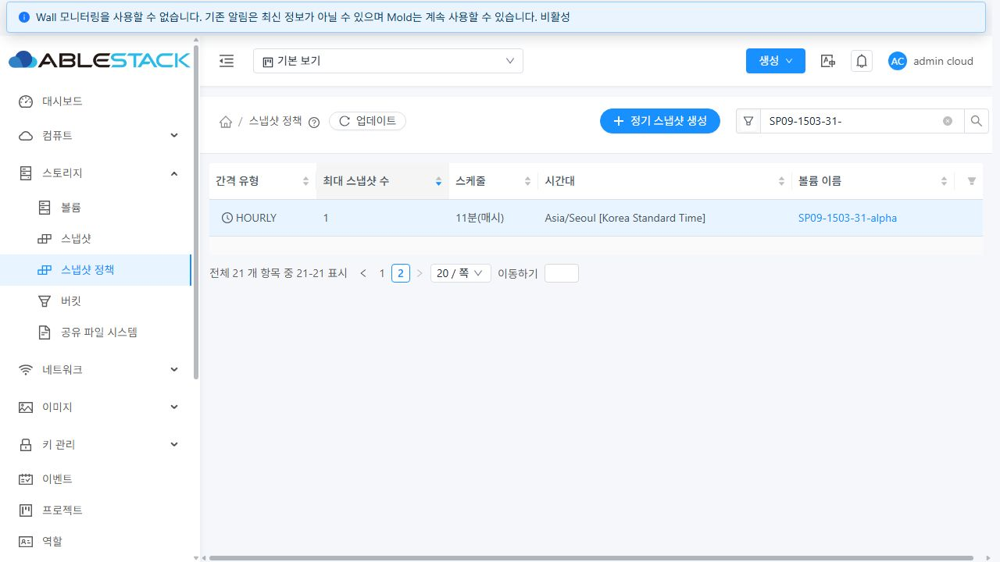
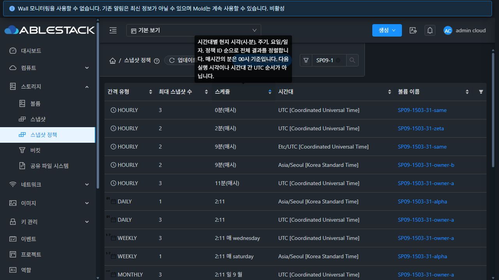

# SP-09 스냅샷 정책 서버 정렬·페이지·URL 검증

#1503 / Epic #1494. 2026-10-27 KST에 31 GFS2·32 RBD에서 완료 기준 5개를 검증했다. 작업 브랜치는 `dhslove/epic-1494-snapshot-policies`, 시작 기준은 `625484329bb5fcdfa537aa65786674a04ce1855c`이다. 서버 빌드 소스는 `ccbe4fac70079298f2bdb1fd92fcf2e84a106518`, 최종 UI 빌드 소스는 `479e35fe8bcc0454783f01b7cf023fd3d28a1274`이다.

## 변경 내용

변경 전에는 서버가 ID 내림차순으로 페이지를 나누고 UI가 현재 페이지 안에서만 정렬했다. 두 환경에 각각 정책 32개를 준비해 실제 UI에서 보존 수 내림차순을 선택하자 1페이지 끝의 1 다음에 2페이지의 2가 나타났다. 직접 API에 `sortkey=maxsnaps&sortorder=asc`를 전달해도 ID 순서가 유지됐다. [31 수정 전 API](evidence/31-before-api-sort.json) / [UI](evidence/31-before-ui.json), [32 API](evidence/32-before-api-sort.json) / [UI](evidence/32-before-ui.json).

`listSnapshotPolicies`에 `sortkey`/`sortorder`를 추가하고, 기존 ACL·볼륨/ID/키워드 조건 안에서 전체 결과를 정렬한 다음 LIMIT를 적용했다. UI는 서버 정렬을 요청하고 응답 순서를 그대로 표시한다. 검색·정렬·페이지 크기 변경은 첫 페이지로 이동하며, URL을 기준으로 선택 상태와 페이지를 복원한다. 마지막 페이지가 비면 실제 count로 마지막 유효 페이지를 계산한다.

집중 검사에서는 응답 배열 키가 count보다 앞에 있을 때 전체 건수를 0으로 읽는 공통 목록 문제도 확인했다. 배열 키를 찾기 전에 count를 읽도록 보완했다. 실제 클러스터에서 이 키 순서가 항상 발생했다고 주장하지 않으며, 두 가지 응답 순서에 대한 방어를 추가한 것이다. 최초 UI 검사 2건 실패는 이 수정 후 아래 전체 재실행에서 해소됐다.

- [설계](../../design/snapshot-policy-1494/SP-09.ko.md)
- [API 매개변수](../../../api/src/main/java/org/apache/cloudstack/api/command/user/snapshot/ListSnapshotPoliciesCmd.java)
- [고정 SQL 정렬 목록](../../../server/src/main/java/com/cloud/storage/snapshot/SnapshotPolicyListOrdering.java), [기존 ACL 조회 연결](../../../server/src/main/java/com/cloud/storage/snapshot/SnapshotManagerImpl.java)
- [UI URL·정렬 계약](../../../ui/src/utils/snapshotPolicyList.js), [공통 목록 연결](../../../ui/src/views/AutogenView.vue)

| 키 | 정렬 의미 |
|---|---|
| id | 내부 숫자 정책 ID. 생략 시 기존과 같은 내림차순 |
| intervaltype | HOURLY=0, DAILY=1, WEEKLY=2, MONTHLY=3 |
| maxsnaps | 정수 보존 수 |
| timezone / volumename | DB collation 기준 문자열 순서 |
| schedule | 현지 시·분 → 주기 → 주간 요일/월간 일자 → ID. 매시간의 분은 00시 기준 |

모든 동률은 같은 방향의 정책 ID로 구분한다. 일정은 원시 `분:시[:일]` 문자열의 사전식 정렬이나 다음 실행 시각/시간대 간 UTC 순서를 의미하지 않는다. 실제 한국어 툴팁에도 이 차이를 표시했다. 알 수 없는 API 키/방향은 고정 허용 목록에서 431로 거부하며, URL의 잘못된 정렬·페이지는 안전한 기본값으로 정규화한다.

## 집중 검사와 빌드

WSL ext4 `/home/ablecloud/work/dhslove/cloud-snapshot-policy-1494`에서 변경 모듈만 빌드했다.

| 항목 | 결과 | 증거 |
|---|---|---|
| Maven api 3 suites / 10 tests, install | PASS | [로그](evidence/api-test.txt) |
| Maven server 7 suites / 158 tests, package | PASS | [로그](evidence/server-test.txt) |
| UI 17 suites / 312 tests | PASS | [로그](evidence/ui-test.txt) |
| UI lint / production build | PASS | [lint](evidence/ui-lint.txt), [build](evidence/ui-build.txt) |
| 집중 검사 합계 | **480 tests** | [집계](evidence/qualification-summary.json) |

서버 검사는 허용 키/방향·기본값·일정 숫자 정렬·보조 ID·페이징과 실제 SnapshotManager 조회 연결을 확인했다. UI 검사는 API에 정렬을 전달하는 실제 fetch 경로, 서버 순서/count 유지, 캐시된 스키마의 화살표 갱신, URL 정규화, 검색/크기/삭제 후 보정, 503/권한 실패 및 늦은 응답 보호를 다뤘다. 기존 스냅샷·정책 생성/편집/삭제·공통 목록도 회귀했다.

게시 텍스트 로그는 LF와 줄 끝 공백만 정규화했다. 기존 Vue stub 경고·Browserslist/번들 경고는 로그에 남겼다. Checkstyle/RAT는 생략했고 전체 Cloud 빌드/CI, Actions dispatch, qemu·FTCTL 빌드는 수행하지 않았다.

## 실제 API·독립 SQL 검증

클러스터마다 기존 1GiB 시험 백업을 읽어 전용 DATADISK 8개와 일반 사용자 계정 2개를 만들었다. 관리자 볼륨 6개, 두 소유자 볼륨 각 1개에 네 주기를 등록해 **32개 정책**을 준비했다. 이름 중복 `same`, 대소문자 `alpha/Alpha`, 한글 이름, 같은 보존 수와 시각을 포함했다. 시험 중 자연 예약이 발생하지 않도록 `fordisplay=false`로 등록했으며 서비스 재시작 뒤에도 예약/스냅샷은 0이었다. 기존 VM에 연결하거나 게스트 데이터를 쓰지 않았다. [31 자원](evidence/31-fixtures.json), [32 자원](evidence/32-fixtures.json).

각 클러스터에서 다음 **47개 시나리오와 잘못된 정렬 입력 12개**를 확인했다. [31 전체 결과](evidence/31-api-matrix.json), [32 전체 결과](evidence/32-api-matrix.json).

- 6개 허용 키 × 두 방향: 페이지 크기 7로 전체 32개를 조회하고 첫 페이지를 반복했다. 별도의 SQL ORDER BY 결과와 모든 UUID가 일치했고 중복/누락이 없었다. 기본 20개와 50개 크기도 대조했다.
- 일정의 독립 SQL은 시와 분을 별도 숫자 열로 정렬했다. 제품의 `시*60+분` 표현식을 그대로 복사한 검사로 대체하지 않았다. 볼륨명 중복과 보존 수 동률이 페이지 경계를 넘어도 ID 순서가 안정적이었다.
- 이름/한글/없는 검색, 관리자 계정·도메인 필터의 count와 결과가 일치했다.
- 두 일반 사용자 모두 모든 키/방향에서 자기 정책 4개만 조회했다. 다른 소유자 볼륨은 권한 오류 531로 거부됐고 다른 정책 ID 조회는 빈 결과였다. 정렬을 ACL 우회로 사용할 수 없었다.
- 빈 키·잘못된 키·실제 SQL 열 이름·SQL 형태 문자열·잘못된 방향은 431이었다. 전후 독립 SQL의 정책·순서·예약/스냅샷은 불변이었다.

일반 사용자 볼륨 거부의 531은 기존 Cloud 권한 오류 코드다. 로그인 실패로 집계하지 않았다. API 원문과 UI 정상/거부 상태는 별도 기록했다.

## 실제 브라우저 검증

[31 UI·API 관측 기록](evidence/31-ui-results.json), [32 기록](evidence/32-ui-results.json)에 클러스터별 55개 확인/관측 항목이 있다. 이 수치는 메타데이터 기록도 포함하며 단위 테스트 개수에 합산하지 않았다.

| 실제 조작 | 양쪽 결과 |
|---|---|
| 보존 수/주기/일정/시간대/볼륨명 헤더 × 두 방향 × 두 페이지 | 총 40개 페이지 비교. DOM UUID·API 응답 순서/count·독립 SQL 일치 |
| 정렬 바꾸기/정렬 해제 | page=1, 기본 id-desc 복원, 기존 조건 유지 |
| 2페이지 새로고침·뒤로/앞으로 가기 | URL·페이지·정렬·행 복원 |
| same/alpha/한글/없는 검색·검색 지우기 | page=1, 정렬 유지, 8/8/4/0/32건 일치 |
| 20→50 및 이력으로 20개 2페이지 복원 | 크기 변경은 1페이지, 이력의 페이지/크기/행 복원 |
| 실제 고급 볼륨 선택·정렬·재설정 | 선택 UUID/4건과 정렬 중 범위 유지, 해제 후 전체 32건 |
| 잘못된 URL 정렬·페이지 | API 호출 전 정규화, 기존 볼륨 범위 유지 |
| 일반 소유자 실제 로그인 | 자기 정책 4건만 표시·정렬, 다른 소유자 볼륨은 0행/오류, 자기 목록 복구 |
| 관리자 재로그인 | 일반 사용자 범위를 재사용하지 않고 관리자 20건으로 복귀 |
| VM 목록·검색 / 볼륨 정책 탭 | VM 검색 1건·원래 목록 복구, 기존 네 주기의 정책 UUID와 기본 ID 내림차순 유지 |

마지막 페이지는 API로 **관리자 시험 정책 11개만** 정리해 32→21건으로 만든 뒤 검증했다. 기본 크기 20의 2페이지에 남은 한 정책을 UI 확인창에서 실제 삭제했다. 21→20건과 page 2→1을 확인했으며 keyword/q·maxsnaps-desc·pagesize=20을 유지했다. API 축소를 UI 일괄 삭제 구현으로 집계하지 않았다. [31 축소 기준](evidence/31-ui-prune.json) / [삭제 후 SQL](evidence/31-after-ui-delete.json), [32 기준](evidence/32-ui-prune.json) / [삭제 후 SQL](evidence/32-after-ui-delete.json).

조회 오류는 해당 탭의 `listSnapshotPolicies` XHR에만 합성 503을 주입했다. 31은 기존 행/URL을 유지한 오류 화면과 수동 재시도를 확인했다. 32는 오류 표시 후 자동 재조회가 빠르게 복구돼 503 2건과 정상 200/동일 URL·행의 복구를 기록했다. 32의 수동 재시도 완료로 확대하지 않았다. 시험용 가로채기는 해제했다. [31 오류 화면](screenshots/31-read503-preserved.jpg).

31의 새로고침 한 구간은 자산 prefetch로 관측 버퍼가 넘쳤다. 복원된 URL/DOM을 확인하고 새 관측 구간에서 같은 페이지를 UI 업데이트로 다시 조회해 API/DB와 대조했다. 모든 reload 원본 네트워크 이벤트가 연속 보존됐다고 주장하지 않는다. 저장된 검증 동작의 Runtime exception은 양쪽 0이지만, 이를 모든 콘솔/모든 HTTP 오류 0으로 확대하지 않는다. 예상한 431/531/503은 위와 같이 구분했다.

## 가상머신 UI 표준과 화면 크기

두 클러스터의 컴퓨트 > 가상머신 목록을 밝은/어두운 테마로 직접 열어 [31 기준](evidence/31-vm-standard.json), [32 기준](evidence/32-vm-standard.json)을 기록했다. 정책 목록은 같은 공통 표·검색·페이지 컨트롤과 정렬 화살표를 사용한다. VM의 메인 작업 버튼 32px/14px·둥근 형태, 업데이트 버튼 24px·둥근 형태와 실제 측정값이 일치했다. 새로운 CSS나 툴바 레이아웃은 추가하지 않았다.

두 클러스터 × 밝은/어두운 테마 × 1280×720/768×900/390×844 **12개 뷰**에서 행 순서를 유지하고 표/작업 버튼의 규격, 내부 스크롤과 하단 페이지 컨트롤 접근을 확인했다. 각 뷰의 상단과 페이지 영역을 원본 PNG 두 장씩 저장했다. 가로 스크롤 표와 긴 문자열 줄바꿈은 공통 목록 동작으로 남겼으며 모바일 목록 전체를 새로 설계한 것은 아니다. [실측](evidence/responsive.json).

원본 JPEG 39개와 PNG 24개, 총 **63개**의 시그니처·디코딩 치수·SHA256을 [manifest](evidence/image-manifest.json)로 확인했다. PNG 24개의 치수는 실제 뷰 측정값과도 일치했다. 이미지를 편집하거나 JPEG의 확장자를 PNG로 바꾸지 않았다.

현재 목록의 영어 주기/요일·원시 일정 표시와 일부 알림 문구, 정책 상세/운영 정보는 #1504의 후속 범위다. 기존 32 자원 경보와 Wall 비활성 안내를 이번 정렬 오류로 판정하지 않았다.

## 배포·정리·보존

배포 전 관리 JAR의 기존 클래스와 기준 빌드 바이트코드를 대조했다. SnapshotManager의 정렬 조회 외 메서드 **151개**와 기존 API 메서드 **5개**는 양쪽 모두 불변이었다. [바이트코드 비교](evidence/runtime-baseline-compatibility.json).

허용 클래스 계열의 **5개 항목**만 반영했다. 실제 분류는 신규 2개, 변경 2개, 바이트가 같은 기존 내부 클래스 1개다. [31 분류](evidence/31-class-change-summary.json), [32 분류](evidence/32-class-change-summary.json), [패치 manifest](evidence/patch-manifest.json). 최종 런타임 검사의 `backendChangedClasses` 값은 이 5개 manifest 항목 수이며 서로 다른 바이트의 개수는 위 분류를 따른다.

관리 서비스를 재시작해 새 API를 로드했다. 이후 정적 UI 931개만 갱신했으며 UI 배포는 새 JAR/PID를 유지했다. 다른 JAR 항목 **204,538/204,532개**, WEB-INF/META-INF, 설정 7개씩과 32 운영 디스크 메타데이터, 기존 FTCTL 마커를 보존했다. 양쪽 mold active와 `/client/` HTTP 200이다. [31 서버 배포](evidence/31-deploy.json) / [UI](evidence/31-ui-deploy.json) / [최종](evidence/31-runtime-after.json), [32 서버](evidence/32-deploy.json) / [UI](evidence/32-ui-deploy.json) / [최종](evidence/32-runtime-after.json).

백업은 31 `/root/snapshot-policy-1503-20261027-backend/management-before.jar`, 32 `/nfs/snapshot-policy-1503-20261027-backend/management-before.jar`와 각각의 `snapshot-policy-1503-20261027-ui-479e35fe8bc-backup`에 보존했다. 전역 `secondary.storage.capacity.threshold`는 양쪽 모두 기존 **0.90**이다. [31 설정](evidence/31-global-check.json), [32 설정](evidence/32-global-check.json).

정책 32개씩의 전체 수명주기와 볼륨 8개/일반 계정 2개씩을 정상 API로 정리했다. 활성 정책·예약·볼륨·스냅샷·태그·정책 상세·계정·사용자·대기 볼륨/스냅샷/계정 job은 모두 0이다. 볼륨의 Expunged 이력 8개씩은 보존한다. 새 스냅샷은 생성되지 않았다. GFS2 파일 8개와 RBD 이미지 8개/trash의 부재도 독립 확인했다.

- [31 정리](evidence/31-cleanup-check.json) / [실제 파일](evidence/31-primary-after-cleanup.json)
- [32 정리](evidence/32-cleanup-check.json) / [RBD/trash](evidence/32-primary-after-cleanup.json)
- [31 기존 자원](evidence/31-preservation-result.json), [32 기존 자원](evidence/32-preservation-result.json): VM116/51, 볼륨155/51, 기존 스냅샷23/7 및 Zone/풀/역할의 핵심 속성 불변
- [Windows](evidence/protected-windows-result.json) / [WSL](evidence/protected-wsl-result.json): 별도 dirty FT 작업 3/11개와 HEAD·브랜치·상태·변경 diff 불변

검증용 브라우저는 0건 화면을 확인하고 로그아웃·종료했다. 화면 크기와 XHR 가로채기를 해제했으며 게시 증거에 인증 정보는 포함하지 않았다.

## 완료 판정과 다음 작업

허용 필드의 안정적인 전체 정렬, 20개 초과 페이징/검색/count, URL 복원/삭제 후 보정, 잘못된 정렬 입력/ACL, 양쪽 실제 UI/API·독립 SQL 및 공통 목록 회귀를 충족했다. 자연 예약 실행, 전체 역할/프로젝트 행렬, DST, 다중 Zone 및 다중 노드 장애 통합 회귀는 이번 정렬 검증에 포함하지 않는다. 전체 Epic 완료나 Europa 병합 판정도 아니다.

다음은 **#1504 (SP-10) 정책 목록·상세의 운영 정보와 한글·공통 UI 정합성 개선**이다. 네 주기/일정/알림의 한글 통일, 상세 진입과 메타데이터, 실제 조회에 근거한 다음 예약·최근 job/실패 상태와 ACL을 설계·구현해야 한다. 이후 #1505 선택 삭제·소유 범위, #1506 태그 수명주기, #1507 통합 회귀가 남는다. SP-09 종료 후 Epic은 **9/13 완료·OPEN**으로 유지한다.
