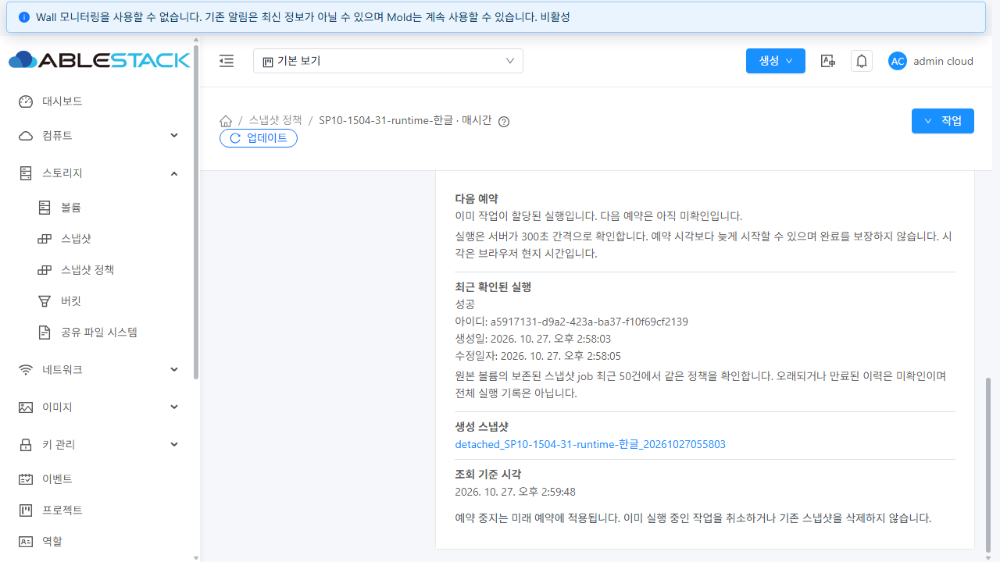

# SP-10 정책 운영 정보·한글·공통 UI 검증

2026-10-27 KST · 대상 [#1504](https://github.com/ablecloud-team/ablestack-cloud/issues/1504), 부모 [#1494](https://github.com/ablecloud-team/ablestack-cloud/issues/1494). 작업 브랜치 `dhslove/epic-1494-snapshot-policies`.

**완료 기준 6개를 충족했다.** 31 GFS2와 32 RBD에 반영하고 실제 API·브라우저·독립 SQL·스토리지로 검증했다. 정책 상세 진입, 공통 한글 표시, 소유·예약 상태, 실제 최근 실행과 생성 스냅샷 연결을 추가했다. 각 환경의 시험 자원은 정상 API로 정리했고 기존 자원과 전역 임계값 0.90을 보존했다. 전체 Cloud 빌드 및 Europa 병합은 수행하지 않았다.

## 설계와 구현

[설계 문서](../../design/snapshot-policy-1494/SP-10.ko.md)에 조회 계약과 실패·권한·이력 보존 한계를 명시했다.

- 목록과 볼륨 탭의 주기 링크에서 정책 상세로 진입한다. 네 주기·시간·요일·월간 일자를 하나의 포매터로 표시하고 등록/변경/중지/재개 알림을 통일했다.
- 상세는 VM 메뉴의 `ResourceView`/`ResourceLayout`, `InfoCard`, `resource-details-list`/작은 `a-list`와 공통 작업·업데이트·재시도를 재사용한다. 볼륨·Zone·스토리지·태그·계정/도메인/프로젝트 및 예약 상태를 표시한다.
- `listSnapshotPolicies(includepolicycontext=true)`는 정책과 현재 원본 볼륨의 ACL·소유자 일치를 재확인한 버전 1 운영 정보를 제공한다. 기본값 false로 기존 목록의 비용을 유지한다. 모든 권한 있는 독자에게 `schedulingenabled`를 제공하며 기존 `fordisplay`는 관리자 전용이다.
- 다음 예약은 미할당 예약 행에서만 읽는다. 할당된 실행, 중지, 미확인을 구분하고 관측 시각과 실제 폴링 간격 300초를 표시한다. 예약 시각을 실행/완료 보장으로 설명하지 않는다.
- 최근 실행은 소유자·CreateSnapshot 명령·자원 종류·원본 볼륨으로 제한한 최근 50개 보존 job 후보에서 복호화된 인자의 정확한 정책/볼륨 ID를 확인한다. 완료 job의 논리 삭제 행도 포함한다. 원문 인자·결과·경로·자격증명은 응답하지 않는다.
- 생성 스냅샷은 현재 같은 소유자/볼륨의 삭제되지 않은 자원만 연결한다. 삭제 후에도 보존 job 상태는 유지하되 링크를 제거한다. 링크 존재는 물리 백업 복사본의 준비 상태를 보증하지 않는다.
- 직접 URL의 UUID·건수·정책/볼륨/프로젝트·계약 버전을 확인한다. 같은 범위의 실패·불완전 응답은 마지막 성공 데이터를 보존하고 변경 작업을 차단한다. 미존재/권한 상실/범위 전환에서는 데이터를 제거하고, 늦은 응답을 버린다.
- 실제로 중지 정책도 권한 있는 일반 사용자에게 조회되므로 확인창은 미래 예약 중지/재개를 설명한다. 실행 중 작업 취소·기존 스냅샷 삭제나 즉시 실행으로 안내하지 않는다.

실제 서버의 암호화 job 인자와 완료 job의 `removed` 시각 때문에 이력이 누락되는 문제를 검증 중 발견했다. SQL 인자 문자열 검색을 제거하고 모델 복호화 접근자 및 `searchIncludingRemoved`로 수정한 뒤 동일한 실패 job을 재시작·중지·스냅샷 삭제 이후까지 다시 확인했다. DB 스키마 변경은 없다.

## 완료 기준과 증거

| 완료 기준 | 31 GFS2 | 32 RBD | 증거 |
|---|---|---|---|
| 네 주기·요일/월간·목록/상세/볼륨 탭 및 작업 알림 | PASS | PASS | [31 UI](evidence/31-ui-results.json), [32 UI](evidence/32-ui-results.json) |
| 상세 진입·직접 URL·미존재·소유 범위 전환 | PASS | PASS | 같은 UI 기록의 URL/프로젝트/늦은 응답 검사 |
| Zone·스토리지·태그·소유자·중지 의미와 API/DB 일치 | PASS | PASS | [31 최종 API](evidence/31-final-api-matrix.json), [32 최종 API](evidence/32-final-api-matrix.json) |
| 실제 다음 예약·최근 job/실패·폴링/미확인·ACL | PASS | PASS | 아래 자연 실행 및 권한 증거 |
| 실패/불완전/늦은 응답 보존·재시도 | PASS | PASS | 실제 상세 요청 503/불완전 200 주입, 지연 요청 해제 및 수동/자동 재시도 기록 |
| VM 공통 형식·키보드·두 테마·세 너비 | PASS | PASS | [반응형 요약](evidence/responsive-summary.json), [이미지 무결성](evidence/image-integrity.json) |

각 환경에 전용 볼륨 5개, 일반 계정 2개, 프로젝트 1개와 정책 12개를 사용했다. 초기 API 행렬은 각 17개 검사, 최종 메타데이터 행렬은 각 12개 정책을 독립 SQL과 대조했다. 실제 UI에서 생성/편집, 같은 UUID 및 태그 보존, 보관 수 2→3, 예약 중지/재개와 async jobstatus=1을 확인했다.

Root Admin, 일반 소유자, 일반 프로젝트 구성원, 기존 기본 Read-Only User 역할로 각각 실제 로그인했다. 일반 소유자는 자기 메타데이터를 읽으며 관리자 플래그/예약 중지·재개는 노출되지 않는다. 타 소유 정책 및 비구성원 프로젝트는 거부된다. 읽기 전용 소유자는 상세만 읽고 변경 UI가 없으며 삭제 API는 432로 거부됐다. [31 읽기 전용 API](evidence/31-readonly-api.json), [32 읽기 전용 API](evidence/32-readonly-api.json).

UI 관측은 최종 유효 검사 **31번 61/61, 32번 58/58 PASS**다. 31번 1개와 32번 4개의 이전 관측은 프로젝트 비동기 이동 전 URL 샘플링 또는 에뮬레이션 높이 밖 휠 좌표의 시험 도구 문제였다. 올바른 대기/좌표로 재검증했으며 이전 기록은 `supersededHarnessObservations`로 구분했다. 캡처 요청은 116/106개이며 각 4개 관측 공백이 있다. 로그인·자산 prefetch 버퍼 구간을 포함한 모든 네트워크의 연속 보존이나 전체 콘솔/HTTP 오류 0을 주장하지 않는다. 실제 변경 요청과 최종 재시도는 별도 증거에 보존했다.

## 실제 자연 예약: 성공 → 실패 → 복구

아래는 모두 스케줄러가 실제 실행한 job이다. 시간을 맞추기 위해 DB 실행 상태를 조작하지 않았다. 표의 시간은 UTC이며 UI는 브라우저 현지 시간으로 표시한다.

| 환경 | 단계 | job UUID | 생성 → 수정 UTC | 결과 / 생성 스냅샷 UUID |
|---|---|---|---|---|
| 31 | 첫 실행 | `339e5df5-f31d-4615-9768-e72edf0fd277` | 05:28:56 → 05:28:58 | 성공 / `502e0b52-256d-4a7f-a354-d3eec087b587` |
| 32 | 첫 실행 | `1be5b397-dd61-42e3-90b9-24c002ebf9ea` | 05:29:18 → 05:29:23 | 성공 / `e3f8f269-c4d2-4bfe-b7ab-7f820647ab46` |
| 31 | 통제 실패 | `c2b5b7ff-57c1-4ee1-bba9-a7ca8fd3c8b9` | 05:38:56 → 05:39:28 | 실패 530 / `8b808bc1-752c-4fba-815c-a9df4ce75709` |
| 32 | 통제 실패 | `9f8aff4a-6f41-42e4-8ed9-ccd0d3dabfd9` | 05:34:18 → 05:35:01 | 실패 530 / `bab5f008-8942-4102-8e18-5e1b296e081f` |
| 31 | 복구 실행 | `a5917131-d9a2-423a-ba37-f10f69cf2139` | 05:58:03 → 05:58:05 | 성공/BackedUp / `861639fa-1f47-46de-86c9-6f7744ba6df8` |
| 32 | 복구 실행 | `d049a06f-e1d2-4bb9-9433-1c7afe0a031f` | 05:58:25 → 05:58:30 | 성공/BackedUp / `f52377be-f1ff-48eb-a45c-4f4bf38e7b14` |

실패 주입은 **전용 시험 원본 이미지 하나만** 임시 이름 변경했고 480초 복구 watchdog을 설치했다. GFS2는 inode/크기/mtime, RBD는 이미지 ID/크기가 복구 전후 같았다. 기존 운영 이미지에는 적용하지 않았다. 실제 실패를 관측한 뒤 원복하고 복구 예약의 BackedUp까지 확인했다. 임시 이미지 별칭/보호 타이머는 남지 않았다.

- 첫 성공: [31](evidence/31-natural-success.json) / [32](evidence/32-natural-success.json)
- 실패와 원복: [31](evidence/31-fault-result.json) / [32](evidence/32-fault-result.json)
- 최종 서버 재시작·예약 제거 후 같은 실패 이력: [31](evidence/31-retained-failure-after-final.json) / [32](evidence/32-retained-failure-after-final.json)
- 실패 스냅샷 정상 삭제 후 같은 job 유지·링크 제거: [31](evidence/31-deleted-failed-history.json) / [32](evidence/32-deleted-failed-history.json)
- 복구 자연 실행: [31](evidence/31-natural-recovery-success.json) / [32](evidence/32-natural-recovery-success.json)

생성 스냅샷 링크는 실제 키보드로 열어 상세 진입을 확인했다. 아래 화면은 31번 복구 성공을 표시하는 실제 상세다.

## VM UI 표준과 화면 검증

실제 컴퓨트 > 가상머신 목록/상세를 양쪽 환경에서 대조했다. 공통 상세 메타데이터는 14px이며 다크 카드 배경은 RGB(34,40,47)이다. VM 목록의 메인 버튼 32px/14px, 업데이트 24px/14px 및 둥근 형태를 확인했고 이번 상세는 기존 공통 버튼·카드·메타데이터를 재사용한다.

양쪽 × 라이트/다크 × **390×844 / 768×900 / 1280×720**의 12개 뷰에서 메타데이터/운영 정보 24개 화면을 캡처했다. 공개 PNG 54개의 실제 포맷·치수·SHA256을 기록했고 반응형 화면은 DOM viewport와 디코딩한 PNG 치수가 정확히 일치한다. 새 상세 필드 가로 넘침은 0이고 job UUID/태그/링크가 줄바꿈된다. 공통 main 영역의 기존 스크롤바까지 없다고 확대하지 않는다. 패널 크기로 잘린 native JPEG는 이 보고서의 viewport 증거에 포함하지 않았다.

## 집중 검사와 배포 근거

[검사 요약](evidence/build-summary.json): WSL rocky ext4에서 변경 Maven 모듈만 빌드했다. **API 11 + server 171 + UI 214 = 396 tests PASS**, UI 13 suites, lint 및 production build PASS. Checkstyle/RAT는 생략했고 전체 Cloud 빌드·GitHub Actions dispatch는 수행하지 않았다. 집중 검사와 등록 GitHub checks는 구분한다.

- 최종 server 빌드 소스: `40097830e95` (운영 이력 수정은 `7dee7ee2b6b`, 이후 server 변경은 검사 수정).
- UI 컴파일 소스: `0d8a365e1e0a53db32aab411aacbc2caa3ae203e`.
- 최종 정적 ko/en 문구 소스: `876c07a8a30ec53dbd8214a5f05b97564c3bf385`. locale loader가 별도 JSON을 읽으므로 최종 패키지는 해당 두 locale만 교체하고 다른 932개 파일은 컴파일 결과와 동일하다. 해당 소스로 webpack을 다시 빌드했다고 주장하지 않는다.
- [UI 패키지](evidence/ui-package.json): 934개 파일, SHA256 `962b938d9de0d5189ddce113237ba89c7f49fdd35849e6254b1bcc95556a0547`.
- [서버 패치](evidence/patch-manifest.json): 8개 class 항목/6개 class 계열, manifest SHA256 `387425d6814c6b684ffe4e68448ecfce21645bbb3171463565ce1d6a10f3c9ec`. 기존 비관련 메서드/내부 class 호환성은 [초기](evidence/runtime-baseline-compatibility.json), [최종 수정](evidence/runtime-baseline-compatibility-rev1.json), [내부 class](evidence/inner-class-compatibility.json)에서 대조했다.

| 최종 런타임 | 31 | 32 |
|---|---|---|
| 관리 JAR SHA256 | `5905e58b954e86f79a975b6bd422e79f7cc7e4e7b589b23fe1e8ed3923db57f4` | `7e71fcc87d79d29dee692b1d684881984e12d17fa91aa12bac270572bac42e98` |
| 비관련 JAR 항목 보존 | 204,536개 | 204,530개 |
| 최종 PID | 3554783 | 3533163 |
| mold / client HTTP | active / 200 | active / 200 |

[31 런타임](evidence/31-runtime-after.json), [32 런타임](evidence/32-runtime-after.json), [31 UI 배포](evidence/31-ui-deploy.json), [32 UI 배포](evidence/32-ui-deploy.json). 활성 `/usr/share/cloudstack-management/webapp`의 정적 파일만 반영했다. WEB-INF/META-INF·설정 7개·FTCTL 마커를 보존했으며 UI 배포는 관리 JAR/PID를 변경하지 않았다. 롤백 백업은 31 `/root/snapshot-policy-1504-20261027-*`, 32 `/nfs/snapshot-policy-1504-20261027-*`에 보존했다.

## 정리와 기존 데이터 보존

각 환경의 정책 12개·볼륨 5개·계정 2개·프로젝트 1개 및 생성 스냅샷 3건(성공 2/실패 1)을 정상 API로 정리했다. 실패 스냅샷은 이력 검증 단계에서 먼저 삭제했다. 아직 열린 #1506의 태그 수명주기 문제 때문에 복구 스냅샷의 시험 태그 **각 1개를 명시적으로 제거**한 뒤 삭제했다. 이번 작업에서 자동 태그 정리를 구현한 것으로 보지 않는다.

- 활성 시험 볼륨/정책/예약/스냅샷/태그/정책 상세/계정/사용자/프로젝트, 대기 job 및 비종료 스냅샷 참조 **모두 0**: [31 정리](evidence/31-cleanup.json)/[카운트](evidence/31-cleanup-check.json), [32 정리](evidence/32-cleanup.json)/[카운트](evidence/32-cleanup-check.json). Destroyed/Error 등 종료 이력은 정상 보존될 수 있다.
- GFS2 원본 파일 5개, RBD 이미지 5개/trash, 두 성공 백업의 보조 스토리지 파일을 삭제 전 참조로 독립 재확인했다. 잔여 **0**: [31 원본](evidence/31-primary-after-cleanup.json)/[보조](evidence/31-secondary-after-cleanup.json), [32 원본](evidence/32-primary-after-cleanup.json)/[보조](evidence/32-secondary-after-cleanup.json).
- 장애 별칭·타이머 정리: [31](evidence/31-fault-cleanup.json), [32](evidence/32-fault-cleanup.json).
- 기존 API 자원 6개 그룹의 식별자/핵심 상태는 전후 동일하다. 31 VM116/볼륨155/스냅샷23, 32 VM51/볼륨51/스냅샷7 및 기존 역할·Zone·스토리지를 보존했다: [31](evidence/31-preservation-result.json), [32](evidence/32-preservation-result.json). 모든 운영 파일의 내용 전체를 해시 대조한 주장과 구분한다.
- `secondary.storage.capacity.threshold=0.90` 불변: [31](evidence/31-global-check.json), [32](evidence/32-global-check.json). 기존 WAL 등 운영 파일을 변경하지 않았다.
- 원래 Windows/WSL FT 작업의 tracked dirty 3/11개 및 HEAD·브랜치·diff는 불변: [Windows](evidence/protected-windows-result.json), [WSL](evidence/protected-wsl-result.json).
- 시험 브라우저 세션을 로그아웃·닫고 원래 Epic 탭을 보존했다. viewport/theme/요청 주입을 복원했다: [브라우저 정리](evidence/browser-cleanup.json). 생성 계정 로그인 파일 4개씩을 지우고 임시 도구·원격 배포 도구의 알려진 인증 문자열을 제거했다: [인증 정보 정리](evidence/credential-cleanup.json).

## 한계와 다음 작업

최근 실행은 원본 볼륨의 보존 스냅샷 job 후보 50개 안에서 확인한 이력이다. 다른 주기의 실행이 많거나 물리 이력 보존 기간이 끝나면 미확인일 수 있으며 영구 감사 로그가 아니다. 전체 역할/도메인 조합, DST·다중 Zone·다중 관리 노드 경합 및 물리 job 만료 통합 회귀는 #1507에서 이어간다.

다음은 **[#1505 SP-11](https://github.com/ablecloud-team/ablestack-cloud/issues/1505)**이다. 캡처한 ID 집합의 선택 삭제·최신 검증과 원자성/부분 실패 계약, 계정/도메인/프로젝트/ID/관리자 플래그 필터의 실제 지원 범위·URL/count/ACL 및 다중 페이지 선택·삭제 후 복귀를 설계·검증한다. 현재 root의 일부 프로젝트 조회 조합이 필터를 기대대로 제한하지 않는 관측도 해당 API 계약에서 다시 확인해야 한다. 미지원 필터를 임의로 UI에 연결하지 않는다. 이후 #1506 태그 수명주기, #1507 통합 회귀를 진행한다. SP-10 종료 시 Epic은 **10/13 완료, OPEN**이며 PR 생성/Europa 병합은 이번 요청 범위에서 수행하지 않았다.
