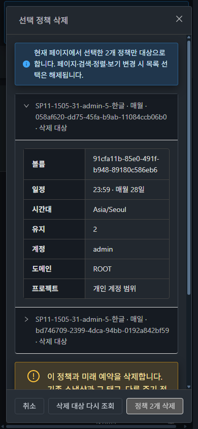
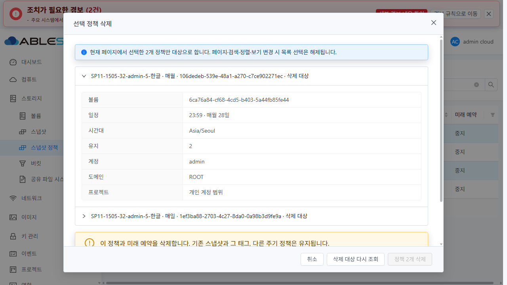

# SP-11 선택 삭제·소유 범위 검색 구현 및 실환경 검증

[#1505](https://github.com/ablecloud-team/ablestack-cloud/issues/1505)의 집중 범위를 완료했다. 31 GFS2와 32 RBD에 구현을 반영하고 실제 관리자·일반 사용자·도메인 관리자 로그인, API/브라우저/SQL/job/스토리지 대조를 수행했다. 작업 브랜치는 `dhslove/epic-1494-snapshot-policies`이며 전체 Cloud 빌드·PR 생성·Europa 병합은 수행하지 않았다. 시험은 2026-10-27~28 KST, 최종 보고일은 **2026-10-28 KST**다.

## 구현과 API 계약

[설계](../../design/snapshot-policy-1494/SP-11.ko.md)에 포함·제외 기준과 부분 실패 계약을 기록했다.

- 공통 목록 체크박스와 선택 작업을 연결했다. 선택은 **현재 페이지**에만 유지하고 페이지·크기·정렬·검색·보안 범위 변경 시 해제한다. 대화창을 열 때 ID 집합을 고정하며 최신 정책·볼륨·소유 범위·일정·태그를 제출 직전 다시 대조한다. 확인 해제/변경 감지/권한 상실/중복 제출에는 삭제하지 않는다.
- VM 메뉴의 공통 고급 검색 팝오버·세로 폼·AntD 입력, 목록 선택 작업과 MoldDialog를 사용했다. UUID 정확 일치, 볼륨, 관리자/도메인 관리자의 도메인·계정·하위 도메인 포함, root의 미래 예약 필터와 공통 프로젝트 선택기를 연결했다.
- `listSnapshotPolicies`의 nullable `fordisplay` 조건과 `ignoreproject`를 실제 서버 검색에 적용했다. 생략 시 사용/중지 모두를 반환하며, 개인 ID 조회도 프로젝트 정책을 배제한다. `ignoreproject+projectid`, 프로젝트+소유자 필터 등 모순은 431로 거부한다.
- DomainAdmin의 `projectid=-1`은 자기 도메인·하위 도메인 안의 개인/프로젝트 합집합을 반환한다. 일반 사용자는 본인+구성원 프로젝트, root는 전체를 유지한다. root 외 `fordisplay` 입력은 기존 API 프레임워크가 무시한다. UI는 해당 컨트롤과 권한 없는 URL을 차단하며, 이 경우를 API HTTP 거부로 잘못 보고하지 않는다.
- 실제 XHR에서 공통 인터셉터가 `ignoreproject`를 제거하는 문제를 발견해 **정책 조회에만** 전송을 허용했다. root 계정 후보 API가 하위 도메인까지 반환하는 특성에 맞춰 정확한 도메인 후보만 표시하고 원본 페이지 진행과 후보 수를 분리했다. 성공한 빈 API `{}`도 삭제/검색 후 페이지 1로 복귀한다.
- `deleteSnapshotPolicies(ids)`는 전체 ID/볼륨/ACL을 사전 검사한 뒤 **정책별로 커밋**한다. 뒤쪽의 실행 중 job 오류로 앞쪽 삭제가 취소되는 원자성을 보장하지 않는다. UI는 한 번의 ids 요청 후 캡처한 ID만 조회한다. 정상 응답+부재만 성공이며, 오류/응답 유실+부재는 미확인으로 유지한다. 남은 대상만 최신 조회와 새 확인 후 재시도한다.

주기·Zone·내부 active·customid·태그 검색은 제외했다. 현재 조회 API가 지원하지 않는 조건을 임의 전송하지 않는다. 미래 예약 `fordisplay`와 내부 active를 혼용하지 않는다. 이번 변경은 검색 계약·선택 삭제이며 자연 예약 전체 회귀는 SP-13에서 판정한다.

## 빌드와 집중 검사

WSL ext4 전용 clone `/home/ablecloud/work/dhslove/cloud-snapshot-policy-1494`에서 변경 Maven 모듈만 빌드했다.

| 검사 | 최종 결과 | 근거 |
|---|---|---|
| API 변경 모듈 | 12 PASS, install 성공 | [로그](evidence/api-test.txt) |
| server 변경 모듈 | 182 PASS, package 성공 | [로그](evidence/server-test.txt) |
| UI 집중·관련 회귀 | 18 suites / 288 PASS | [로그](evidence/ui-test.txt) |
| UI lint / production build | PASS / PASS | [lint](evidence/ui-lint.txt), [build](evidence/ui-build.txt) |

총 **482개 자동 검사**다. API nullable flag/ACL·프로젝트/상충 필터, 실제 삭제 사전 검증·정책별 실패 계약, 선택 대상 고정·오류/응답 유실·재시도·권한 전환·늦은 응답·페이지 복귀·요청 인터셉터를 포함한다. 잘못된 입력의 예상 오류 출력은 실제 브라우저 오류와 구분한다. Checkstyle/RAT를 건너뛴 변경 모듈 검사이며 전체 Cloud CI 성공을 뜻하지 않는다.

최종 backend 소스는 `198fc04b7fadd55fc07b972e30ec4c30b980ebb5`, UI 소스는 `6fa5e07f3c3f73784a214d329e519cd7c99daf5f`다. 후속 문서 커밋은 실행 소스를 바꾸지 않는다.

## 실제 API·UI 행렬

각 환경에 1GiB Ready DATADISK 10개, 중지 정책 40개, 계정 3개, 부모/자식 도메인 2개, 프로젝트 1개를 준비했다. 기존 시험 백업을 읽어 복제했으며 기존 운영 VM/볼륨에 연결하지 않았다.

| 항목 | 31 GFS2 | 32 RBD | 확인 내용 |
|---|---|---|---|
| API 소유·역할·ID·프로젝트·예약 상태 | PASS | PASS | 각 30개 사례, API/SQL 대조 |
| 삭제 사전 검증 | PASS | PASS | 본인+타인, 본인+없는 UUID 모두 거부, 정책/예약/태그 불변 |
| root 고급 검색 | PASS | PASS | 정확 도메인 8/하위 포함 12/계정 4, 예약 사용 1/중지, UUID·볼륨·URL 복원 |
| 개인/전체/지정 프로젝트 | PASS | PASS | 실제 공통 범위 전환, 개인 범위 프로젝트 UUID 0건/지정 프로젝트 같은 UUID 1건 |
| DomainAdmin UI | PASS | PASS | 개인 도메인 12/프로젝트 포함 16/지정 프로젝트 4, root 전용 필터 비노출 |
| 일반 사용자 UI | PASS | PASS | 개인 4/구성원 프로젝트 포함 8, 프로젝트 4, 프로젝트 정책 2개 실제 선택 삭제 |
| 금지 URL/초기화 | PASS | PASS | 일반 사용자 fordisplay URL은 빈 목록+권한 안내, 검색 초기화 후 본인 4건 복구 |
| 실제 부분 실패/재시도 | PASS | PASS | 아래 실제 job 실행 중 431, 남은 ID만 새 확인 후 재시도 |
| 실제 성공 응답 유실 | PASS | PASS | 서버 HTTP 200 뒤 해당 XHR만 503 주입, 미확인 2/성공 0 유지, 재확인에 재삭제 없음 |
| 최신 변경 감지 | PASS | 자동 검사·공통 구현 | 31 확인창 이후 API flag 변경을 제출 직전 감지, 확인 해제·재조회 요구 |
| 기본 20개 초과/선택/삭제 후 복귀 | PASS | PASS | 30개에서 페이지 변경 시 선택 해제, 2페이지 10개 삭제 후 조건 유지·1페이지 20개 |
| 라이트·다크/키보드/화면 너비 | PASS | PASS | 각 테마 × 390/768/1280px × 검색/삭제 = 총 24화면 |

API 40개 초기 행렬에서 root 개인 36/전체 40/프로젝트 4, DomainAdmin 개인 12/전체 16, 일반 사용자 개인 4/전체 8이었다. UI 숫자는 해당 시험 전 삭제를 반영한 시점의 값이다. 서로 다른 시점의 count를 같은 인벤토리로 비교하지 않는다.

[31 API](evidence/31-api-final.json) / [32 API](evidence/32-api-final.json), [31 사전 검증](evidence/31-delete-prevalidation.json) / [32](evidence/32-delete-prevalidation.json), [31 실제 UI/XHR](evidence/31-ui-results.json) / [32](evidence/32-ui-results.json), [31 소유 검색 화면](evidence/31-owner-filter-final.png) / [32](evidence/32-owner-filter-final.png).

UI 관측의 `preFix`·실패 입력/조기 관측 진단은 최종 PASS로 집계하지 않았다. 존재하지 않는 UUID의 431은 성공한 빈 페이지 증거가 아니다. 최종 빈 결과 시험은 유효한 키워드의 HTTP 200 `{}`와 실제 page=1 복귀로 별도 확인했다. 요청 버퍼의 `gaps`와 후보 응답의 신원/범위 필드 투영을 기록했다. 모든 요청을 연속 수집했다거나 공통 콘솔 오류가 0이라고 주장하지 않는다.

## 삭제 영향·부분 실패·응답 유실

admin-4의 매월 정책으로 `createSnapshot(policyid)` 백업을 만든 뒤 실제 UI에서 매월/매일 두 정책만 선택 삭제했다. 31 `a231c7ff-3078-45ec-840a-58eab67a5186`, 32 `4e820281-818b-4feb-94b3-957691b3526b`는 그대로 BackedUp이며 스냅샷/사본/태그 DB 행과 보조 파일 196,624바이트의 SHA256이 보존됐다. 다른 매주/매시간 정책 2개도 유지됐다. 이 백업은 자연 예약 성공으로 집계하지 않는다. 32의 최초 job 응답은 Allocated였으며 fresh API/독립 DB에서 BackedUp을 확인했다.

[31 보존 대조](evidence/31-bulk-preservation.json) / [32](evidence/32-bulk-preservation.json), [31 보조 파일 전](evidence/31-secondary-before-policy-delete.json)·[후](evidence/31-secondary-after-policy-delete.json), [32 전](evidence/32-secondary-before-policy-delete.json)·[후](evidence/32-secondary-after-policy-delete.json).

부분 실패는 전용 admin-3 원본만 잠시 이름 변경하고 480초 복원 watchdog을 둔 실제 자연 예약 job으로 검증했다. 운영 원본은 건드리지 않았다. 매주 ID를 앞에, 실행 중 매시간 ID를 뒤에 두었다.

| 환경 | 실행 중 job UUID | 첫 요청과 후속 결과 |
|---|---|---|
| 31 | `2ae74fd4-9ce8-4922-923c-d3fdfc18c4a2` | 매주 삭제 커밋 → 매시간 431 → UI 성공 0/존재 1/미확인 1 → job 실패·원본 복원 → 매시간 ID만 재확인 후 삭제 |
| 32 | `2226a2a8-f39c-4de0-96ca-3e2113153186` | 같은 순서와 결과. job terminal 530 및 원본 RBD id/size 복원 확인 |

GFS2 inode/size/mtime, RBD id/size가 복원 전후 일치했다. 대화창 준비 중 busy 구간을 놓친 선행 시도는 부분 실패 PASS로 사용하지 않았다. [31 실제 431 뒤 상태](evidence/31-after-partial-bulk.json) / [32](evidence/32-after-partial-bulk.json), [31 job·복원](evidence/31-fault-result.json) / [32](evidence/32-fault-result.json).

응답 유실 시험은 admin-2의 실제 성공한 삭제 응답만 개발용 XHR 주입으로 503으로 바꿨다. 대상 두 개는 실제로 없지만 UI는 **성공 0 / 남음 0 / 미확인 2**를 유지한다. 결과 재확인은 읽기만 수행하며 새 삭제 POST를 보내지 않았다. 주입 중 지연된 조회를 해제했고 최종 요청 주입은 모두 제거했다. [31](evidence/31-lost-response.json) / [32](evidence/32-lost-response.json), [31 화면](evidence/31-bulk-lost-response.png) / [32](evidence/32-bulk-lost-response.png).

## VM UI 표준과 화면 증거

실제 VM 메뉴의 공통 검색 입력/버튼과 정책 메뉴를 대조했다: [31 기준](evidence/31-vm-standard.json), [32 기준](evidence/32-vm-standard.json). 별도 디자인 체계를 만들지 않고 동일 공통 클래스·14px 글자·AntD 표준 입력·MoldDialog의 요약/접기/푸터/스크롤을 사용했다. 좁은 화면에서 긴 UUID/볼륨명을 줄바꿈하고 대화창 본문을 스크롤한다. 기존 공통 목록의 가로 스크롤과 운영 경보는 유지된다.

[24화면 DOM 규격](evidence/visual-matrix.json)과 [PNG 서명·실제 viewport/디코딩 크기](evidence/image-integrity.json)를 대조했고 신규 검색 폼·대화창의 scrollWidth 초과는 없었다. 키보드 Enter/Space/취소와 선택·확인 초기화를 검증했다. UI 자동화의 실제 표시 범위를 벗어난 좌표 입력과 비동기 애니메이션 중 관측은 제품 오류로 판정하지 않았다.

## 배포·런타임 보존

최종 UI 정적 파일 931개의 SHA를 실제 `/usr/share/cloudstack-management/webapp`에서 검증했다. 서버측 WEB-INF/META-INF·config와 큰 비UI 파일을 보존했다. JAR은 아래 **3개 main class**만 반영했고 내부 BackupSnapshotTask 및 다른 모든 ZIP entry는 보존했다. javap 비교에서 관련 없는 메서드 332개와 내부 클래스 비교를 통과했다. DB 스키마 변경은 없다.

| 환경 | 최종 JAR SHA256 | PID | 다른 JAR entry |
|---|---|---|---|
| 31 | `ce51eb9fd24746261479a5ed5938bfd61dfc2462671167bbfcb607dfcaaada6b` | 3610060 | 204,541 불변 |
| 32 | `0c0f296dfed432fccfa1a5fc2f2eed60f7d1f9ec06fb5f9f2270f4de3d32ef0c` | 3586351 | 204,535 불변 |

변경 class는 ListSnapshotPoliciesCmd, DeleteSnapshotPoliciesCmd, SnapshotManagerImpl이다. 최종 UI는 실제 브라우저에서 `app.bae8440f.js`를 로드했다. 배포 tgz SHA256은 `326e5a2c8148ce5f4eab7e8f66b46324ab1957715156b2e6fc602084a12c9a16`다. 양쪽 mold active, `/client/` 200, 설정·FT 마커를 확인했다. 32 `monitoring-vm.qcow2`의 size/inode/mtime도 불변이다.

[31 최종 런타임](evidence/31-runtime-after.json) / [32](evidence/32-runtime-after.json), [클래스 manifest](evidence/patch-manifest.json), [호환 비교](evidence/runtime-baseline-compatibility.json), [내부 클래스](evidence/inner-class-compatibility.json), [31 UI 배포](evidence/31-ui-deploy.json) / [32](evidence/32-ui-deploy.json). 초기 UI 배포 검증기의 메시지 키 오타는 검증기만 정정했다. 최종 빌드 배포는 정정된 정상 검증기로 모두 통과했다.

## 31 용량 확보와 최종 정리

31의 첫 시험 백업이 기존 보조 스토리지 90% 초과로 실패했다. 사용자 지시에 따라 `secondary.storage.capacity.threshold=0.90`을 양쪽 모두 유지했다. 이전 SP-07에서 확인한 Prometheus WAL 상태와 닫힌 파일/열린 FD를 다시 확인하고, 오래된 닫힌 WAL 20개(00000620~00000639)를 **root 파일시스템에 복사·해시/메타데이터 검증 후 원래 숫자 경로를 심볼릭 링크로 보존**했다. Prometheus 3.5.1의 숫자 segment 경로 열기 동작은 [해당 버전 소스](https://github.com/prometheus/prometheus/blob/v3.5.1/tsdb/wlog/wlog.go)로 확인했다.

보존 경로 **`/var/lib/ablestack-space-preserved/sp11-1505-20261027/prometheus-wal`는 현재 WAL 경로의 링크 대상이므로 유지해야 한다.** 내용 2,254,798,848바이트를 삭제하지 않고 NFS 약 2.10GiB를 확보했다. Prometheus PID 2491742·ready 200·고정 최근/3일 전 up 조회 각 50개가 유지됐고 최종 20파일 SHA/소유자/모드/mtime, 새 수집 sample age 15.7초를 확인했다. 최종 NFS 사용률 89.66%다. 서비스 재시작·retention/전역 임계값 변경은 하지 않았다. [보존 manifest](evidence/31-space-preservation.json), [최종 검증](evidence/31-space-final.json).

각 환경의 정책 40개는 UI 18개+최종 정상 API 22개로 정리했다. 생성된 스냅샷 이력 4개씩, 볼륨 10개, 계정 3개, 프로젝트 1개, 도메인 2개도 정상 API로 정리했다. #1506이 아직 열려 있으므로 시험 스냅샷 태그 **각 1개를 명시적으로 deleteTags 후 삭제**했다. 자동 태그 정리를 구현했다고 집계하지 않는다.

- 활성 볼륨/정책/예약/스냅샷/태그/정책 상세/계정/사용자/프로젝트/프로젝트 계정/도메인, 대기 job, 비종료 스냅샷 사본 **모두 0**. 볼륨 10개씩 Expunged: [31 카운트](evidence/31-cleanup-check.json), [32](evidence/32-cleanup-check.json), [31 정상 정리](evidence/31-cleanup.json), [32](evidence/32-cleanup.json).
- GFS2 원본 파일 10개와 RBD 이미지 10개·trash **잔여 0**. 삭제 전 존재한 보조 파일을 기존 참조 경로로 독립 재확인해 31 1개/32 2개 모두 없음: [31 원본](evidence/31-primary-after-cleanup.json)·[보조](evidence/31-secondary-after-cleanup.json), [32 원본](evidence/32-primary-after-cleanup.json)·[보조](evidence/32-secondary-after-cleanup.json).
- 장애용 별칭/복원 타이머 **잔여 0**: [31](evidence/31-fault-cleanup.json), [32](evidence/32-fault-cleanup.json). Destroyed 등 종료 이력은 보존한다.
- 기존 Zone·풀·VM·볼륨·스냅샷·역할의 ID와 주요 속성 동일: [31 보존](evidence/31-preservation-result.json), [32](evidence/32-preservation-result.json). 비교 범위를 파일 전체 무변경으로 확대하지 않는다.
- 기존 dirty FT 작업의 HEAD/브랜치/status/diff hash 보존: [Windows 3개 변경](evidence/protected-windows-result.json), [WSL 11개 변경](evidence/protected-wsl-result.json).
- 시험 세션 로그아웃·자체 탭 종료, 원래 Epic 탭과 테마 보존, viewport/요청 주입 해제: [브라우저 정리](evidence/browser-cleanup.json). 생성 로그인 파일 WSL 6개/Windows 4개 삭제, 임시 도구의 알려진 인증 문자열 제거: [인증 정리](evidence/credential-cleanup.json).

정리 후 기록 단계의 보조 스크립트 이름 충돌과 기존 프로젝트 포함 여부가 다른 인벤토리 비교를 수정했다. 삭제를 반복하지 않고 동일 범위로 독립 재조회해 위 결과를 확정했다.

## 종료 범위와 다음 작업

SP-11의 완료 기준 5개를 충족했다. 다음은 **[#1506 SP-12: 정책 생성 스냅샷 삭제·보관 초과 정리의 태그 수명주기](https://github.com/ablecloud-team/ablestack-cloud/issues/1506)**다. 실제 자원 삭제 때만 태그를 종결하며 부분 사본 삭제·실패·멱등 재시도에서는 남은 논리 자원을 보존해야 한다. 이번 명시적 태그 삭제는 그 자동 정리를 대신하지 않는다.

이후 [#1507 SP-13 통합 회귀](https://github.com/ablecloud-team/ablestack-cloud/issues/1507)에서 전체 주기·자연 예약 2회·초과 보관 자동 정리·조회 전용을 포함한 역할 조합·공통 취소/테마 후속을 통합 판정한다. 추가 Zone 실제 복사·암호화·전체 DST 조합과 전체 Cloud CI는 이번 SP-11 PASS로 확대하지 않는다. SP-11 종료 후 Epic #1494는 **11/13 완료, OPEN**이며 SP-12·13을 남긴다.
