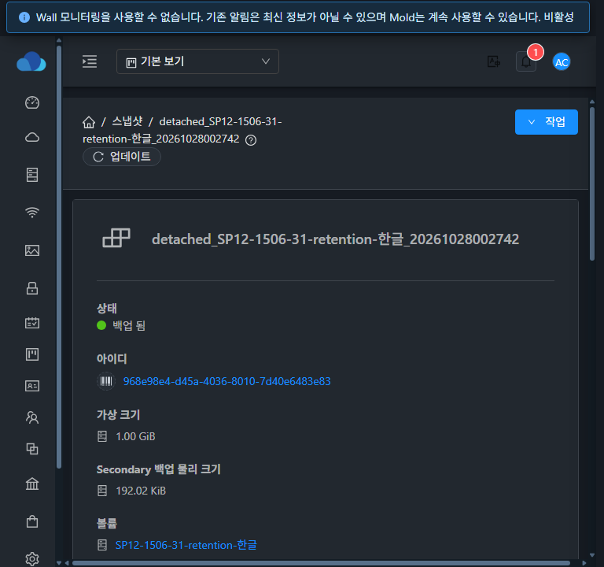
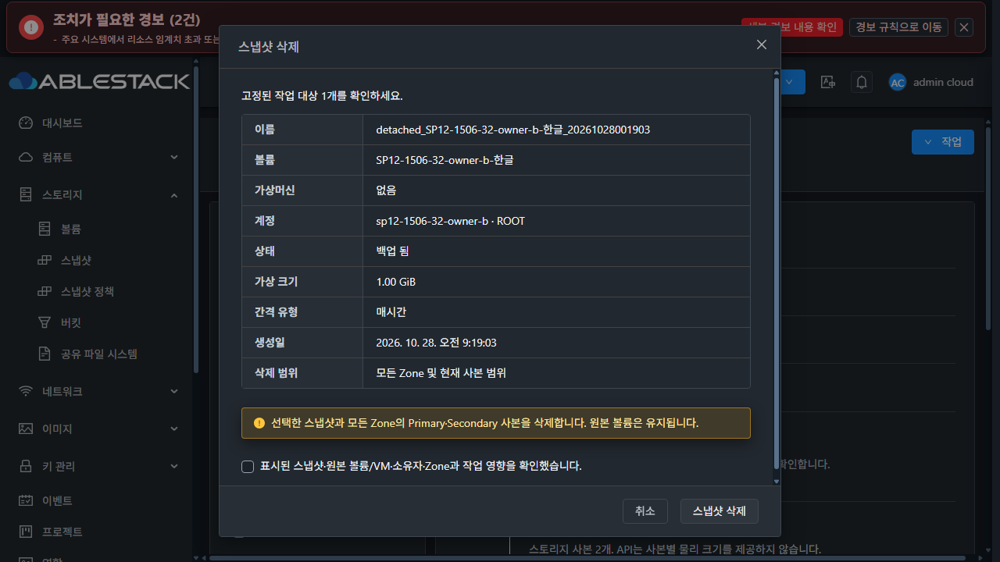

# SP-12 스냅샷 태그 수명주기 구현·실환경 검증

[#1506](https://github.com/ablecloud-team/ablestack-cloud/issues/1506)의 집중 범위를 완료했다. 2026-10-28 KST에 31 GFS2와 32 RBD에서 수정 전 재현, 수정 반영, 실제 UI/API/job/DB/스토리지 검증과 정상 정리를 수행했다. 작업 브랜치는 `dhslove/epic-1494-snapshot-policies`다.

## 원인·설계·구현

정상 스냅샷 삭제 전략은 마지막 논리 스냅샷을 `Destroyed`로 update한다. 태그 정리가 있던 `SnapshotDao.remove`를 거치지 않아 정책 생성 스냅샷에도 태그가 남았다. 양쪽 실제 UI에서 각각 전용 정책 백업을 삭제해 **Destroyed + 태그 1행 잔여**를 다시 확인했다. 이 잔여를 수동으로 지우지 않고 수정 후 재시도 검증에 사용했다.

[SP-12 설계](../../design/snapshot-policy-1494/SP-12.ko.md)에 따라 공통 삭제 경로에 종결 태그 정리를 추가했다.

- 정상 삭제·보관 상한 초과 정리·이미 종료된 자원의 권한 확인된 재시도에 같은 루틴을 적용한다. 최신 논리 스냅샷이 Destroyed/removed이고 **전체 Zone·전체 사본**이 Destroyed/Hidden이며 강제 정리 pending/unmapped 기록이 없어야 한다.
- 부분 Zone 성공, 물리 실패·미확인 사본, 강제 DB 정리만 된 상태에는 태그를 보존한다. Hidden은 자식 체인 때문에 물리 기반을 보존하는 논리 종료 상태이며 활성 스냅샷과 구분한다.
- 정확한 숫자 ID와 `ResourceObjectType.Snapshot`으로만 제거한 뒤 재조회한다. 태그가 남으면 완료로 보고하지 않고 같은 삭제의 재시도가 가능하다. 정책만 삭제하거나 Primary만 보관 정리할 때는 기존 스냅샷 태그를 지우지 않는다.
- Snapshot의 `createTags`는 삭제와 같은 `snapshot-delete-ID` 잠금을 사용한다. 다중 대상은 고유 숫자 ID 오름차순으로 잠그고 트랜잭션 종료·예외·시간 초과에 해제한다. ACL 확인 후 종료된 스냅샷의 새 태그 추가를 거부해 삭제 뒤 태그 재생성을 막는다. 다른 타입과 명시적 `deleteTags` 계약은 유지한다.

변경은 server의 `SnapshotManagerImpl`, `TaggedResourceManagerImpl` 및 후자의 생성 태그 transaction 내부 클래스다. API 매개변수·DB 스키마 변경은 없다. 기존 VM 공통 목록·MoldDialog·태그 편집 UI를 유지했고 UI 소스나 정적 파일은 변경하지 않았다.

## 변경 모듈 검사와 배포

WSL ext4 `/home/ablecloud/work/dhslove/cloud-snapshot-policy-1494`에서 **server 모듈만 package**했다. [최종 로그](evidence/server-test.txt)는 **148 PASS / 실패·오류·skip 0**이다. 태그 종결 14개, 태그 생성/잠금 12개와 강제 삭제의 완료·실패 재시도·다중 Zone 3개를 추가했고 기존 삭제·보관·계정 정리·보관 상한·정책 일괄 삭제·조회 문맥을 회귀했다. Checkstyle/RAT는 생략했다. 전체 Cloud CI·GitHub Actions dispatch·qemu/FTCTL 빌드는 수행하지 않았다.

구현 `a2e98c5ca0d`, 배포 소스 `388fa05d02e`, 최종 검사 소스 `b4fe893857c`다. 후속 검사 커밋의 **main class 3개가 배포본과 SHA256 동일**함을 [재확인](evidence/final-build-runtime-source.json)했다. [javap 비교](evidence/runtime-baseline-compatibility.json)에서 양쪽 관련 없는 메서드 총 **342개**가 동일하며 다른 내부 클래스는 원본 entry를 보존했다. [패치 manifest](evidence/patch-manifest.json)의 ZIP SHA256은 `93dc728680db2da86f89cf3e8d9470ec77b9820c1c29af3711e9b566fd9742e8`다.

| 환경 | 최종 JAR SHA256 | PID | 다른 JAR entry / UI·서버 정적 파일 |
|---|---|---|---|
| 31 | `0c3114032fd7add2e605baa84790caaf8a9faaf70876d5bd1c4b3670d53bc95d` | 3668627 | 204,541 entry / 16,103 파일 불변 |
| 32 | `00aa755abd72b6176d1547e9c12cd782f25bd773aa08645aac38db0e0cd24844` | 3646999 | 204,535 entry / 8,479 파일 불변 |

관리 설정 7개씩, WEB-INF/META-INF, 기존 UI와 32의 큰 비UI 파일 metadata를 보존했다. 양쪽 mold active 및 `/client/` 200을 확인했다. [31 최종 런타임](evidence/31-runtime-after.json), [32](evidence/32-runtime-after.json). 복구 JAR은 31 `/root/snapshot-policy-1506-20261028-backend/management-before.jar`, 32 `/nfs/snapshot-policy-1506-20261028-backend/management-before.jar`에 유지한다.

## 실제 API·UI 검증

각 환경에 Ready 1GiB DATADISK **6개**, 중지 정책 **6개**, 일반 사용자 **2개**, 프로젝트 **1개**를 만들었다. 기존 시험 백업을 읽어 복제했으며 운영 VM/볼륨에 연결하지 않았다. 시험 중 생성된 스냅샷은 최종 **7개씩**이다.

| 항목 | 31 GFS2 | 32 RBD | 실제 대조 |
|---|---|---|---|
| 수정 전 일반 UI 삭제 | 재현 | 재현 | Destroyed인데 Snapshot 태그 1행 잔여 |
| 수정 후 기존 종료 자원 재시도 | PASS | PASS | 동일 deleteSnapshot 2회, 수동 태그 후처리 없이 0행 |
| 종료 후 새 태그 추가 | 거부 | 거부 | root 및 실제 일반 소유자의 API 요청 |
| 일반 사용자 태그 UI | PASS | PASS | 한글 태그 추가·X 삭제, 다른 태그 보존·새로고침 |
| 명시적 deleteTags·ACL | PASS | PASS | 개인/구성원 프로젝트 허용, 다른 소유자의 스냅샷 삭제·태그 추가/삭제 거부 |
| 정책만 실제 UI 삭제 | PASS | PASS | 개인·프로젝트의 스냅샷/태그/참조·보조 파일 SHA 보존 |
| 실제 일반 UI 스냅샷 삭제 | PASS | PASS | 일반 소유자·프로젝트 구성원·root, job 성공·태그 0행 |
| 실제 물리 삭제 실패·재시도 | PASS | PASS | 아래 immutable 시험, 530 때 태그 유지·복원 뒤 자동 정리 |
| 실제 자연 예약 2회·maxsnaps=1 | PASS | PASS | 아래 system job·태그 상속·이전 자원 자동 종결 |
| 사본 일부만 정리 | 집중 검사 | 실제 UI 보관 PASS | 32 Primary만 제거, Secondary·논리 스냅샷·태그 보존 |
| 다중 Zone·강제 DB 정리 경계 | 집중 검사 | 집중 검사 | 2-Zone 부분 성공, 다른 사본·pending/unmapped 보존 |
| VM 공통 UI/테마·너비·키보드 | PASS | PASS | 12화면, 취소·Escape·Space/Enter |

두 환경은 단일 Zone이다. 실제 추가 Zone 삭제를 수행한 것으로 확대하지 않는다. 다중 Zone의 분기는 집중 검사, 사본 일부 제거는 실제 RBD 보관, 물리 실패는 양쪽 실제 삭제로 구분했다. 잠금의 순서·실패 해제·생성/삭제 경합 계약은 집중 검사로 확인했으며 실환경 동시 부하 시험을 했다고 주장하지 않는다.

[31 수정 전 SQL](evidence/31-baseline-after-ui-delete.json) / [32](evidence/32-baseline-after-ui-delete.json), [31 종료 자원 재시도](evidence/31-historic-retry.json) / [32](evidence/32-historic-retry.json), [31 ACL](evidence/31-acl.json) / [32](evidence/32-acl.json), [31 최종 API](evidence/31-final-api.json) / [32](evidence/32-final-api.json).

[31 정책 삭제 보존](evidence/31-policy-delete-preservation.json) / [32](evidence/32-policy-delete-preservation.json)은 개인·프로젝트 대상만 비교한다. 시험 중 다른 자연 예약이 진행돼 전체 DB를 무변경으로 비교하지 않는다. 명시적 태그 삭제 기능 검사에서는 별도로 추가한 키만 제거했다. **종료 태그를 지우는 수동 deleteTags 후처리는 하지 않았다.**

## 물리 실패와 사본 일부 제거

전용 failure 백업 파일 1개씩에만 immutable 속성을 설정해 실제 unlink를 거부시켰다. 사전 SHA/inode/size/mtime을 저장하고 480초 자동 복원 타이머를 등록했다. 운영 파일·마운트·전역 설정은 건드리지 않았다.

| 환경 | 시험 스냅샷 UUID | 실제 실패 job UUID |
|---|---|---|
| 31 | `3acf5493-1077-491d-b461-07fbe8bd5f59` | `ab03e2f4-279d-4fec-89ac-73268906e5d3` |
| 32 | `1f3d29e7-1e73-429e-8cce-57fb30b7e2d7` | `f1b0d7ce-3015-444e-9602-7b378f1fe340` |

둘 다 실제 UI 요청의 jobstatus=2 / 530 `Failed to delete snapshot chain.`을 확인했다. 논리 스냅샷은 BackedUp, 태그 1행과 사본이 유지됐다. 이 실패에서는 Primary 일부 성공을 관측하지 않았으며 부분 사본 성공으로 집계하지 않는다. immutable을 해제하고 파일 내용·metadata를 재확인한 뒤 **같은 UI 삭제**를 재시도해 Destroyed/태그 0행이 됐다. [31 수명주기 대조](evidence/31-physical-lifecycle.json) / [32](evidence/32-physical-lifecycle.json), [31 복원](evidence/31-physical-failure-restored.json) / [32](evidence/32-physical-failure-restored.json), [31 UI](evidence/31-ui-results.json) / [32](evidence/32-ui-results.json).

별도로 32의 두 번째 자연 스냅샷을 UI **스냅샷 보관**으로 처리했다. Primary 참조와 해당 RBD native snapshot만 없어지고 Secondary Ready·논리 BackedUp·태그 행 및 보조 파일 SHA가 동일했다. [부분 사본 보존 대조](evidence/32-partial-copy-preservation.json), [실제 화면](evidence/32-partial-primary-archive-tag-retained.png). 이 동작을 전체 스냅샷 삭제로 혼동하지 않았다.

## 실제 자연 예약과 보관 상한 초과

retention 볼륨의 동일 HOURLY 정책을 **UTC 다음 분, maxsnaps=1**로 API 설정해 자연 실행을 기다렸다. 첫 성공 뒤 같은 정책의 일정을 다시 조정해 두 번째 자연 실행을 기다렸다. 이 볼륨에 `createSnapshot` API를 직접 호출하지 않았다. 두 job 모두 **user_id=1 / CreateSnapshotCmd / jobstatus=1**이다. 정책 태그 `sp12-natural=1506-자연-보관1`이 스케줄러를 통해 전달됐다.

| 환경 | 첫 자연 스냅샷 → 보관 초과로 Destroyed | 두 번째 → BackedUp 유지 |
|---|---|---|
| 31 | `cb399ff3-c602-4879-bb2a-79ed84a1da52` | `968e98e4-d45a-4036-8010-7d40e6483e83` |
| 32 | `56ddef0a-d340-4185-b052-d0dd7c2682f0` | `9f2488e1-83df-4ce8-b797-75278aab6f3a` |

첫 스냅샷의 태그는 자동 0행, 최신 태그는 1행이며 UI 목록에는 최신 1건만 표시됐다. 이전 보조 파일은 없고 최신 파일만 있었다. 32에서는 이전 RBD native snapshot 부재·최신 존재도 확인했다(이후 별도 보관 시험에서 최신 Primary만 정상 제거). [31 자연 예약·태그](evidence/31-natural-retention.json) / [32](evidence/32-natural-retention.json), [31 system job](evidence/31-natural-job-proof.json) / [32](evidence/32-natural-job-proof.json), [31 실물](evidence/31-retention-physical.json) / [32](evidence/32-retention-physical.json).

32의 두 번째 snapshot은 BackedUp이 태그 저장·job 종료보다 먼저 관측돼 최초 검증 스크립트가 조기 판정했다. 추가 스냅샷을 만들지 않고 **같은 두 번째 자원**의 terminal job·fresh API/SQL 태그를 재조회해 통과를 확정했다. 이후 관측 조건도 terminal job과 태그까지 기다리도록 보완했다. 상태 문자열만으로 성공을 확정하지 않았다. 두 번 완료 뒤 정책은 정상 중지하고 예약 0을 확인했다.

## UI 표준·증거 범위

실제 **컴퓨트 > 가상머신** 메뉴를 열어 공통 14px 글자·입력/버튼 규격과 비교했다: [31 기준](evidence/31-vm-standard.json), [32 기준](evidence/32-vm-standard.json). 기존 MoldDialog의 대상 요약·영향 안내·명시적 확인·고정 헤더/푸터·본문 스크롤을 유지했다. 31·32 × 라이트/다크 × 390/768/1280px의 **12개 삭제창**에서 신규 가로 overflow가 없었고 취소·Escape는 자원을 보존하며 Space 확인 후 Enter 삭제가 정상 동작했다.

[12화면 DOM/규격](evidence/visual-matrix.json), [PNG 서명·실제 viewport·디코딩 크기](evidence/image-integrity.json). 공통 프로젝트 선택기는 개인 보기 전환 후 대시보드 이동이 완료된 다음 검증을 이어갔다. 전환 완료 전에 자동화가 먼저 이동한 조회 실패는 태그 삭제 결함으로 분류하지 않았다.

UI 요청 관측은 [31](evidence/31-ui-results.json) / [32](evidence/32-ui-results.json)에 저장했다. 제한된 버퍼와 `gaps`, 후보 응답의 필드 투영을 명시했다. 관리서버 재시작 시점인 09:17 KST에 기존 UI 세션에서 공통 minified `s` 오류가 두 건씩 관측됐다: [31](evidence/31-console.json), [32](evidence/32-console.json). 이후 새 로그인으로 본문 검증을 수행했다. 전체 콘솔 오류 0이나 모든 UI 조합의 통합 회귀로 확대하지 않는다.

## 최종 정상 정리·보존

각 환경의 정책 6개(개인·프로젝트 2개 UI + 최종 API 4개), 스냅샷 7건, 볼륨 6개, 계정 2개, 프로젝트 1개를 정상 제품/API로 정리했다. 종료 이력은 보존한다. 마지막 자연 스냅샷 삭제도 새 태그 종결 경로를 통과했으며 **수동 Snapshot 태그 후처리 0건**이다.

- 활성 볼륨/정책/예약/스냅샷/태그/정책 상세/계정/사용자/프로젝트/프로젝트 계정, 대기 job, 비종료 사본 **모두 0**. 볼륨 6개씩 Expunged: [31 정리](evidence/31-cleanup.json)·[독립 카운트](evidence/31-cleanup-check.json), [32 정리](evidence/32-cleanup.json)·[카운트](evidence/32-cleanup-check.json).
- GFS2 원본 파일 6개와 RBD 이미지 6개·해당 trash 잔여 **0**. 삭제 전 DB의 보조 사본 경로 7개씩을 독립 재검사해 모두 부재: [31 Primary](evidence/31-primary-after-cleanup.json)·[Secondary](evidence/31-secondary-after-cleanup.json), [32 Primary](evidence/32-primary-after-cleanup.json)·[Secondary](evidence/32-secondary-after-cleanup.json).
- immutable은 삭제 재시도 전에 내용/metadata 검증 후 복원했다. 시험 파일과 활성 복원 타이머 **잔여 0**: [31](evidence/31-fault-final.json), [32](evidence/32-fault-final.json).
- 기존 Zone/스토리지 풀/VM/볼륨/스냅샷/역할의 ID와 주요 속성 동일: [31 보존](evidence/31-preservation-result.json) (1/1/124/162/24/11), [32](evidence/32-preservation-result.json) (1/1/55/54/8/10). 파일 전체 무변경을 뜻하지 않는다.
- 기존 dirty FT 작업의 HEAD/브랜치/status/tracked diff hash 동일: [Windows 3개 변경](evidence/protected-windows-result.json), [WSL 11개 변경](evidence/protected-wsl-result.json).
- 세션 로그아웃·자체 탭 종료, 원래 Epic 탭/다크 테마 보존, 임시 viewport·요청 주입 해제: [브라우저 정리](evidence/browser-cleanup.json). 생성 로그인 파일 WSL 4개/Windows 2개 삭제 및 임시/원격 배포 도구의 알려진 인증 문자열 제거: [인증 정리](evidence/credential-cleanup.json).

전역 `secondary.storage.capacity.threshold=0.90`은 양쪽 모두 유지했다: [31](evidence/31-global-check.json), [32](evidence/32-global-check.json). 이번 작업에서 추가 WAL 이동·설정 변경은 없었다. 기존 SP-11 WAL 보존 링크/대상 20파일의 SHA/metadata, Prometheus PID 2491742·ready 200·과거 조회 각 50개와 새 수집을 확인했다: [보존 검증](evidence/31-preserved-space-final.json). **`/var/lib/ablestack-space-preserved/sp11-1505-20261027/prometheus-wal`은 계속 링크 대상이므로 유지한다.** 종료 측정 NFS 사용률은 **89.986%**로 여유가 작다. 다음 자연 예약 통합 시험 전 용량을 다시 확인하고 기존 내용을 보존하며 공간을 확보해야 한다.

## 종료와 다음 이슈

SP-12 완료 기준 5개를 충족했다. 다음은 **[#1507(SP-13) 31·32 통합 회귀와 Epic 완료 판정](https://github.com/ablecloud-team/ablestack-cloud/issues/1507)**이다. 현재 통합 HEAD에서 전체 생성/편집/중지·재개/단일·선택 삭제, 실제 자연 예약·maxsnaps·태그 종결, 조회 전용 포함 ACL, 경계/DST·오류/늦은 응답·공통 취소/테마 후속을 종합 검증한다. 31 공간 점검·확보를 먼저 수행하며 미지원 추가 Zone/암호화 등 실환경 조건은 명시적으로 구분한다.

SP-12 종료 후 Epic #1494는 **12/13 완료·OPEN**, 남은 하위 이슈는 #1507이다. 이번 집중 결과를 통합 회귀 전체나 전체 Cloud CI 완료로 대체하지 않는다. PR 생성·Europa 병합은 수행하지 않았다.
