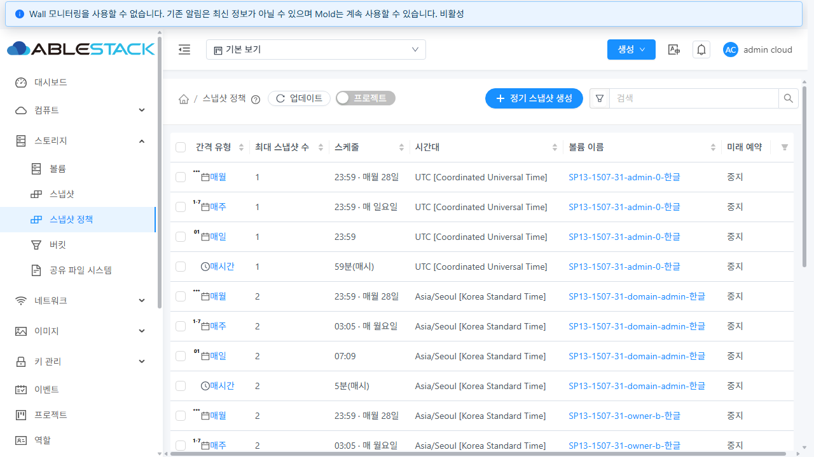
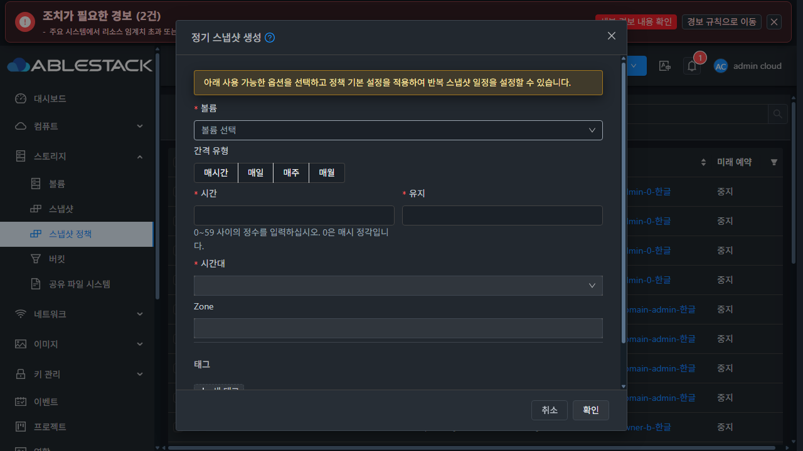

# SP-13 #1507 통합 회귀와 Epic #1494 완료 판정

**판정: 31 GFS2·32 RBD의 지원 환경에서 SP-01~13 통합 검증 완료 — 2026-10-28 KST.** 사용자가 지정한 UI 네 항목을 구현했고, 실제 API·브라우저·job·DB·스토리지와 정상 정리를 대조했다. 전체 Cloud CI, 다중 관리 노드 장애 전환, 추가 Zone 실물 시험을 완료했다는 뜻은 아니다.

작업 저장소는 `dhslove/ablestack-cloud`, 브랜치는 `dhslove/epic-1494-snapshot-policies`다. 최종 UI 소스는 **`b89ae1b35f45fa3e96548abec6f71cdbdddcedf0`**, 배포 서버 클래스 소스는 **`63314d20c489ab21b04049b502cb3698a2e1eb62`**다. 두 커밋 사이의 서버 소스 변경은 없다. [설계](../../design/snapshot-policy-1494/SP-13.ko.md) · [기계 판정 요약](evidence/qualification-summary.json) · [실제 UI 189개 확인 기록](evidence/ui-final-checks.json).

## 요청한 UI 표준 적용

기준은 `컴퓨트 > 가상머신`의 공통 `AutogenView`·`ListView`·`ResourceLayout`·`ResourceView`·`InfoCard`·`MoldDialog`다. 기존 VM은 읽기 전용으로 비교했다.

| 요청 | 구현 및 실제 확인 |
|---|---|
| Breadcrumb 배치 수정 | 공통 경로·도움말·업데이트·프로젝트 영역과 우측 생성/검색 영역을 사용한다. 검색 컨트롤의 공통 table-cell 스타일을 적용해 생성 버튼 아래로 내려가던 배치를 수정했다. |
| 볼륨 선택 별도 단계 제거 | 처음부터 볼륨·주기·시간·보관 수·시간대·Zone·태그를 한 폼에 표시한다. 볼륨은 첫 필드이며 별도 다음 단계가 없다. 유효한 볼륨과 관련 조회가 확정되기 전 제출은 비활성이다. 볼륨 변경/창 재열기는 이전 초안을 초기화한다. 볼륨 탭에서는 고정된 볼륨 문맥을 유지한다. |
| 생성창 폭 개선 | 표준 `md=720px`; 390px 화면에서는 366px. 공통 헤더·스크롤 본문·하단 작업 영역을 사용한다. 편집은 기존 표준 `lg=960px`을 유지하며 좁은 화면에 맞춘다. |
| 전체 정책 UI 감사 | 목록·검색 popover·Breadcrumb·정보 카드·상세 탭·볼륨 정기스냅샷 탭·생성/편집/중지/삭제 창을 대조했다. 상세 탭은 390px에서 위쪽, 768/1280px에서 왼쪽이다. 표 내부 가로 스크롤과 페이지 넘침을 구분했다. |

최종 배포본에서 **2개 클러스터 × 2개 테마 × 3개 폭(390/768/1280) × 8개 화면 = 96개** PNG와 DOM/geometry JSON을 저장했다. 모든 이미지의 PNG 서명·CRC·압축 해제·실제 크기(각 폭 × 720)·최종 app 해시·테마·페이지/대화상자 넘침을 검사했다. 검색 popover도 폭 변경 후 다시 열어 화면 안에 있는지 확인했다. [이미지 manifest](evidence/image-integrity.json).

실제 VM/정책의 주 작업 버튼은 높이 32px·글자 14px·반경 32px, 업데이트는 24px·14px·24px로 같다: [31](evidence/31-terminal-vm-policy-standard.json), [32](evidence/32-terminal-vm-policy-standard.json). 편집 취소 후 작업 버튼 포커스와 생성 Escape 후 생성 버튼 포커스도 확인했다.

## 통합 중 재현하고 수정한 결함

| 결함 | 최종 동작과 근거 |
|---|---|
| 없는 시간대가 GMT로 저장됨 | `Bad/Timezone` 등은 저장 전 431. 정상 Java ID·기존 별칭·유효한 GMT 오프셋은 유지한다. [API 31](evidence/31-boundaries-and-edit.json) / [32](evidence/32-boundaries-and-edit.json), 서버 시간대 검사 5개. |
| 일반 소유자 편집이 Root의 중지 상태를 해제함 | 볼륨·정책 잠금 안에서 기존 display 값을 보존한다. Root 명시적 변경/내부 복사 계약은 유지한다. 개인 max5·프로젝트 max4 UI 편집 뒤에도 미래 예약 false: [31](evidence/31-snapshot-preserve-before.json) / [32](evidence/32-snapshot-preserve-before.json). |
| 화면 이동 중 계정/아이콘 조회의 미처리 취소·오류 | 장식 조회 Promise를 종결하고 경로·자원·사용자·프로젝트·unmount/generation을 검사한다. 실제 지연 listAccounts 503을 이동 후 전달하고 빠른 왕복 4회를 수행했다. [31](evidence/31-ui-network-final-icon-cancel-and-rapid-navigation.json) / [32](evidence/32-ui-network-final-icon-cancel-and-rapid-navigation.json). |
| 역할 발견 이전 테마 API 호출 | 권한 발견 Promise를 기다린다. ReadOnly의 금지된 listGuiThemes 호출 없이 정적 테마로 정상 표시한다. [31](evidence/31-ui-network-latest-readonly-guards-and-theme.json) / [32](evidence/32-ui-network-latest-readonly-guards-and-theme.json). |
| 로그아웃 직후 정책 재조회와 401 | 정책 권한 해제 시 읽기·기존 generation을 차단한다. 최종 로그아웃 후 잘못된 정책 요청을 보내지 않는다. [31](evidence/31-ui-network-terminal-final-logout.json) / [32](evidence/32-ui-network-terminal-final-logout.json). |
| ReadOnly 볼륨 링크가 대시보드로 이동 | 목적지 UI의 listVolumesMetrics 권한으로 링크를 제한하고 허용된 링크의 프로젝트 범위를 유지한다. 금지된 목록 URL로 이동할 때도 상세 모드가 남지 않는다. [역할 UI 기록](evidence/ui-final-checks.json). |
| 저장 응답 유실 후 재조회가 이전 값으로 폼을 생성 | 편집 초안을 해제하고 최신 정책·볼륨 조회 완료 후 폼을 마운트한다. 최종 b89에서 실제 서버 저장 3→4, 응답 유실, 명시적 재조회 4·동일 UUID·자동 재저장 없음: [31](evidence/31-ui-network-latest-response-loss-and-reload.json) / [32](evidence/32-ui-network-latest-response-loss-and-reload.json). |
| 상세 단일 삭제 후 삭제 UUID 431 및 상세 화면 잔류 | 확인된 삭제 ID를 wrapper가 전달하고 해당 상세 재조회만 생략한다. 닫힘 scope 확인 후 프로젝트·볼륨·검색·정렬·크기를 보존한 목록 1페이지로 복귀한다. 삭제 ID/상세 탭 쿼리는 제거한다. 최종 양쪽 실제 삭제에서 오류 없음: [31](evidence/31-ui-network-terminal-single-policy-delete.json) / [32](evidence/32-ui-network-terminal-single-policy-delete.json). |

Java의 미지원 ID에 대한 GMT fallback은 [공식 TimeZone 문서](https://docs.oracle.com/en/java/javase/17/docs/api/java.base/java/util/TimeZone.html)의 계약이다. 시간대를 저장 전에 검증하며 DB 스키마/API 매개변수는 변경하지 않았다.

구현 커밋은 `6f8e5faf4c8` → `2d4cac50643` → `b0c143a7339` → `de4835a16f0` → `63314d20c48` → `f705cc6497b` → `b89ae1b35f4`다. 초기 UI 기능 행렬은 633, 재조회 수정·4주기 재생성/역할 재검사는 f705, 최종 96개 화면·단일 삭제·응답 유실 재조회·정렬 표본·VM 비교·정리 UI는 b89다. 모든 이전 시험이 마지막 bundle에서 수행됐다고 합산하지 않는다. 각 확인의 시간과 소스는 `ui-final-checks.json`에 기록했다.

## 공간 확보를 먼저 수행

31 전역 `secondary.storage.capacity.threshold`는 처음부터 끝까지 **0.90**이다. 자연 예약 전에 현재 쓰거나 열고 있지 않은 오래된 숫자 WAL **00000640~00000679 40개**를 별도 root 파일시스템에 내용·SHA256·소유자·모드·mtime 그대로 보존하고 원래 숫자 경로를 연결했다. **4,520,869,888바이트(약 4.21GiB)**를 확보했다. NFS 사용량은 338,198,937,600 → 333,678,067,712바이트였다. [보존 manifest](evidence/space-preservation.json).

최종 40파일의 해시/metadata/연결 경로를 다시 검사했다. Prometheus PID **2491742** 동일, ready HTTP200, 고정 최근/3일 전 쿼리 각 50 series, 새 수집 sample age 약 0.024초, NFS 사용률 **88.94%**다. [최종 검증](evidence/31-prometheus-final.json), [31 전역값](evidence/31-global-check.json) / [32](evidence/32-global-check.json).

`/var/lib/ablestack-space-preserved/sp13-1507-20261028/prometheus-wal`과 기존 SP-07/SP-11 보존 경로는 활성 WAL 연결 대상이다. **시험 잔여물이 아니며 유지해야 한다.** 보존은 기존 WAL 손상의 복구를 뜻하지 않는다. SP-07에서 기록한 모니터링 WAL 정비는 별도 운영 후속이다.

## 실제 API·UI·DB 통합 행렬

클러스터마다 기존 시험 백업을 읽어 Ready 1GiB detached DATADISK 10개, 정책 40개, 일반 소유자 2명·도메인 관리자 1명, 도메인 2개와 프로젝트 1개를 준비했다. 기존 VM에 연결하거나 운영 볼륨에 데이터를 쓰지 않았다.

| 검증 | 31 GFS2 | 32 RBD | 근거 |
|---|---|---|---|
| 네 주기 생성·동일 UUID 편집·Root 중지/재개·볼륨 탭 편집 | PASS | PASS | [31 생성](evidence/31-final-created.json) / [32](evidence/32-final-created.json), [UI/API 대조 31](evidence/31-ui-flows-api-proof.json) / [32](evidence/32-ui-flows-api-proof.json) |
| Root/소유자/다른 계정/도메인 관리자/프로젝트 ACL | 30건 PASS | 30건 PASS | [31](evidence/31-api-final.json) / [32](evidence/32-api-final.json) |
| 경계 입력·기존 ID 편집·시간대·Root 표시 상태 | 18건 PASS | 18건 PASS | [31](evidence/31-boundaries-and-edit.json) / [32](evidence/32-boundaries-and-edit.json) |
| ReadOnly 직접 쓰기 3종 | 432/531 거부 | 432/531 거부 | [31](evidence/31-readonly-api.json) / [32](evidence/32-readonly-api.json) |
| 서버 전역 정렬·동률 ID·검색·건수·소유권 | 47건 + 잘못된 입력 12건 PASS | 동일 | [31](evidence/31-api-sort-matrix.json) / [32](evidence/32-api-sort-matrix.json) |
| 실제 UI 5열 × 양방향 × 2페이지 | 20페이지 대조 | 20페이지 대조 | [당시 독립 SQL oracle 31](evidence/31-api-sort-matrix-40-page-reference.json) / [32](evidence/32-api-sort-matrix-40-page-reference.json), [UI 기록](evidence/ui-final-checks.json) |
| 검색/20↔50/URL 재로드 | PASS | PASS | 소유자 검색 4개, 지우기·페이지1, 전체36개와 크기/정렬/2페이지 복원 |
| 최종 b89 정렬 재검사 | maxsnaps 양방향 × 2페이지 PASS | 동일 | [31](evidence/31-ui-network-terminal-sort-and-navigation.json) / [32](evidence/32-ui-network-terminal-sort-and-navigation.json) |

UI에서는 도메인 관리자 재귀 12개·정확한 도메인 8개·프로젝트 포함 16개를 확인했다. 일반 소유자와 프로젝트 회원은 각각 허용된 4개를 편집하고 다른 소유자 상세는 거부됐다. ReadOnly는 4개를 읽고 생성/선택 쓰기/이동 불가능한 볼륨 링크를 표시하지 않았다. 개인/프로젝트 편집은 관리자의 중지를 그대로 보존했다.

00/59분, 1/28일과 일요일 경계는 실제 API/브라우저 입력으로 확인했다. 29일 검색은 선택 없음, 28일 숫자 입력/Enter·23:59 입력은 정상, minute60/max0는 POST 없이 초안을 유지했다. 새 태그 Escape 취소·창 취소/재열기 초기화·생성 Escape 포커스 복원도 검사했다. VolumeSelect의 탐색용 Ctrl+Enter가 첫 후보를 선택한 관측은 제품 실패로 계산하지 않았다. 해당 관측에서는 저장 0회였고 취소/재열기 후 초기화됐다.

## 자연 예약·보관 수·태그·사본 종결

최종 서버 배포 이후 실제 스케줄러가 각각 **2회** 실행됐다. `CreateSnapshotCmd` job의 **user_id=1, job_status=1, result_code=0**을 독립 확인했다. 이 볼륨의 직접 `createSnapshot` API 호출은 **0회**다. 실제 시각과 폴링 간격을 유지하고 정책 일정을 정상 API로 재조정했다. 서버 시계·스냅샷 상태를 DB로 조작하지 않았다.

| 환경 | 첫 자연 스냅샷 | 두 번째 자연 스냅샷 |
|---|---|---|
| 31 | `23cf957c-6585-4730-9205-58787cfc3d4c` | `5ad0468b-e0d6-42a9-a74f-f18d99c66396` |
| 32 | `fc52c1de-b390-492a-8919-01b1c3dbbff7` | `d2452a4a-1bcd-4ba3-814c-4e97205cbae8` |

[자연 job 31](evidence/31-natural-job-proof.json) / [32](evidence/32-natural-job-proof.json), [실행/DB/파일 31](evidence/31-natural-retention.json) / [32](evidence/32-natural-retention.json).

정책 태그 `sp13-natural=1507-자연-보관1`이 실제 스냅샷으로 전달됐다. `maxsnaps=1`에서 이전 스냅샷 Destroyed·태그0, 최신 BackedUp·태그 유지와 사본을 확인했다. job/태그 완료 전 BackedUp만으로 통과시키지 않았다. 이전 서버 단계의 자연 실행 4회씩은 진단 이력이며 위 두 실행이 최종 서버의 판정 근거다.

정책 삭제 뒤 예약은 사라지고 이미 생성한 스냅샷·태그 행 ID·Secondary 파일 SHA는 유지됐다: [31](evidence/31-snapshot-preserve-policy-deleted.json) / [32](evidence/32-snapshot-preserve-policy-deleted.json). 31의 원래 정책 삭제는 f705에서 후속 상세 재조회 431을 발견한 시험이었다. b89에서는 같은 볼륨의 새 중지 정책을 다시 실제 UI로 삭제해 목록 복귀까지 확인했다. 원래 자연 스냅샷은 두 삭제 사이에도 동일했다.

32는 실제 UI 보관으로 Primary RBD 스냅샷만 제거했다. native 개수 **1→0**, 논리 BackedUp·태그 행 ID·Secondary SHA는 유지됐다: [보관](evidence/32-snapshot-preserve-archived.json), [이전 native](evidence/32-native-before-archive.json), [이후](evidence/32-native-after-archive.json). 이는 같은 Zone의 부분 사본 제거 검증이다.

최종 b89의 전체 스냅샷 삭제 UI는 양쪽 모두 논리 Destroyed·태그0·모든 참조 Destroyed로 끝났다: [31](evidence/31-snapshot-preserve-snapshot-deleted.json) / [32](evidence/32-snapshot-preserve-snapshot-deleted.json). 삭제/보관 네트워크의 POST 네 번은 **dryrun 3회 + 실제 명령 1회**로 구분한다. 볼륨 정리 전에 확인한 알려진 NFS 백업 파일 **6개씩 모두 부재**이므로 보관 수 자동 정리와 마지막 UI 삭제의 물리 종결도 확인됐다: [31](evidence/31-secondary-before-cleanup-zero.json) / [32](evidence/32-secondary-before-cleanup-zero.json).

## 실패·늦은 응답·실행 중 변경

- 실제 브라우저 XHR의 초기/갱신 응답을 각각 503으로 주입했다. 초기에는 빈 상태+재시도, 갱신에는 마지막 성공 20개 보존+재시도를 확인했다. [31 초기](evidence/31-ui-network-final-injected-initial-503.json) / [갱신](evidence/31-ui-network-final-injected-refresh-503.json), [32 초기](evidence/32-ui-network-final-injected-initial-503.json) / [갱신](evidence/32-ui-network-final-injected-refresh-503.json).
- 서버 저장 HTTP200 후 브라우저 응답만 잃게 했다. 초안을 유지하고 자동 재제출하지 않았다. 명시적 재조회가 최신 보관 수 4로 초기화되는 최종 b89 재검사도 통과했다.
- 소유자 A의 지연 응답을 B의 4개 목록 뒤 전달해도 B를 덮지 않았다. 장식 계정 조회 503/취소와 빠른 화면 이동도 미처리 Promise를 만들지 않았다. 최종 b89 이동 Runtime 예외0: [31](evidence/31-terminal-runtime.json) / [32](evidence/32-terminal-runtime.json). 제한된 관측 구간이며 전체 세션의 모든 콘솔 오류0으로 확대하지 않는다.
- 전용 admin-3 이미지 경로만 잠시 숨겨 실제 자연 작업 실패 관찰 시간을 확보했다. watchdog/finally 복원을 사용하고 GFS2 inode·크기·mtime 또는 RBD image ID·크기를 다시 대조했다. 세 번째 조정 시도에서 실제 UI의 실행 중 선택 삭제·중지·편집을 관찰했다. 첫 시도는 시간 창 문제로 중단/복원, 두 번째는 실제 실패·복원은 됐으나 UI 실행 중 구간을 놓쳐 통합 PASS로 계산하지 않았다.
- 고정된 4개 삭제 대상 중 유휴 3개는 요청 성공 후 부재, 실행 중 1개는 431로 남았다. UI는 **확인된 삭제0·성공/부재이나 미확인3·남음1**을 구분해 전체 성공으로 표현하지 않았다. Root 중지 시 양쪽 모두 job0인 예약/job 참조를 보존했다. 보관 수3 편집은 중지를 유지했다. 편집 DB 캡처는 **32 job0, 31은 이미 job2**였으므로 양쪽 편집 캡처가 모두 실행 중이었다고 주장하지 않는다.
- 최종 실제 실패 job은 31 `17e071ba-d299-4756-afeb-c31a52b5a7e8`, 32 `15b8b77f-e5e1-4e18-839c-fd42d3c1045d`, 모두 530이었다. 이미지 복원 후 새 확인으로 남은1개만 정상 UI 재시도해 정책/예약0. [통합 증명 31](evidence/31-busy-integration-proof.json) / [32](evidence/32-busy-integration-proof.json).

SP-06의 실제 동시 upsert/갱신·삭제 및 pending 예약 관리 서비스 재시작 근거는 [선행 보고서](../snapshot-policy-sp06-1500-20261027/README.ko.md)에 보존돼 있다. 그 스케줄러 계약 검사를 이번 286개에 포함해 다시 실행했다. SP-13에서는 최종 서버의 자연 실행·중지/변경·실제 실패·재시도를 새로 검증했다. 다중 관리 노드 failover나 물리 job 만료 부하를 새로 실행한 것으로 확대하지 않는다.

## 검사·배포의 정확한 범위

| 검사 | 최종 결과 |
|---|---|
| 변경 server 모듈 Maven package | **286 tests, 실패/오류/skip0, BUILD SUCCESS** |
| UI 집중 회귀 | **56 suites / 828 tests PASS** |
| SP-13 변경 JS/Vue 전체 lint | **27파일 PASS**, 자동 수정 없음 |
| 최종 production UI build | PASS, 기존 asset/entrypoint 크기 경고 |
| 실제 API·UI·DB·스토리지 | 위 행렬/실행/사본/정리 PASS |

합계 **1114개 집중 검사**다. 중간 반복 실행은 더하지 않았다. [검사 출력 발췌](evidence/focused-checks.txt), [lint 범위](evidence/lint-scope.json). Jest는 기존 아이콘 중복 경고와 `--forceExit`를 사용한다. Checkstyle/RAT는 server 명령에서 생략했다. 게시된 최종 구현 HEAD의 등록 check-run/status/workflow run은 각각 **0**이며 CI 성공을 뜻하지 않는다. 기존 PR도 없다. [GitHub 확인](evidence/github-before-close-audit.json).

빌드/검사는 WSL ext4 전용 clone `/home/ablecloud/work/dhslove/cloud-snapshot-policy-1494`에서 수행했다. 전체 reactor·Cloud Actions full build·qemu/FTCTL 빌드/배포는 수행하지 않았다. 관리 JAR은 최종 server의 관련 런타임 기준을 비교한 뒤 클래스 **2개만** 교체했다. 그 외 JAR entry **204542/204536개**를 보존했다. [patch manifest](evidence/patch-manifest.json), [기준 호환성](evidence/runtime-baseline-compatibility.json), [31 배포](evidence/31-deploy.json) / [32](evidence/32-deploy.json).

최종 UI는 정적 **931파일**, `app.8516507f.js`다. app SHA256은 `86c65a25014113d21d0fa8c7035cbf319cc2c39cbc41b756b31902fd35f35353`, UI archive SHA256은 `43fa936e2e23cb530149a6783cc7ab114bf9955c064f8e5e66eec7e816c9e8c1`이다. WEB-INF·기존 META-INF 상태·설정7개·JAR/PID·32의 대형 비UI 디스크·FTCTL 기존 마커와 rollback 사본을 보존했다. [31 UI 배포](evidence/31-ui-deploy.json) / [32](evidence/32-ui-deploy.json), [package](evidence/ui-package.json).

| 최종 런타임 | 31 | 32 |
|---|---|---|
| 관리 PID | 3688598 | 3668072 |
| JAR SHA256 | `36d9b46d1bf37092c7424a7b811a5acb9cc797b0bedc26fe52735856bc279c28` | `2c4cc158c79ed512eb8d7512b43c70884c02e97793e0bcef25c9a431c0f97065` |
| mold / client / WEB-INF | active / HTTP200 / 존재 | 동일 |

[31 최종 상태](evidence/31-final-health.json) / [32](evidence/32-final-health.json). PR 생성·Europa 병합은 이번 요청에 포함하지 않았다. 브랜치 구현/테스트 클러스터 반영 상태와 upstream 병합을 구분한다.

## 정상 정리와 기존 작업 보존

각 클러스터의 남은 정책 **35개**, 오류 스냅샷 **2개**, 볼륨 **10개**, 계정 **3개**, 프로젝트 **1개**, 도메인 **2개**를 정상 API로 정리했다. 앞서 UI/보관 수 처리된 것을 포함한 스냅샷 이력 8개는 모두 Destroyed다. **수동 deleteTags 호출0**이며 DB 상태 직접 수정·강제 태그 후처리 없이 끝났다. [31 정리](evidence/31-cleanup.json) / [32](evidence/32-cleanup.json), [전체 정책 목록0 31](evidence/31-catalogue-final.json) / [32](evidence/32-catalogue-final.json).

독립 SQL의 활성 볼륨/정책/예약/스냅샷/태그/정책 상세/계정/사용자/프로젝트/프로젝트계정/도메인, 정책·스냅샷·계정·프로젝트·도메인·시험 사용자 미완료 job, 비종결 참조가 **모두0**이다. 볼륨10개씩은 Expunged 이력만 남았다: [31](evidence/31-cleanup-check.json), [32](evidence/32-cleanup-check.json).

알려진 NFS 파일6개씩, GFS2의 전용 UUID/이름 제한 검색, RBD 이미지·trash·전용 이미지 소속 native snapshot, 활성 복원 타이머의 잔여0을 확인했다. 전역 스토리지를 무제한 삭제/검색한 것이 아니다. [31 실물](evidence/31-storage-zero.json) / [32](evidence/32-storage-zero.json). 실제 UI도 마지막 업데이트 후 정책 전체0: [31](evidence/31-terminal-cleanup-empty-list.png) / [32](evidence/32-terminal-cleanup-empty-list.png).

기존 Zone/풀/VM/볼륨/스냅샷/역할의 ID와 주요 안정 속성은 동일했다. 각각 **1/1/124/162/24/11**, **1/1/55/54/8/10**개를 대조했다. 파일 전체의 무변경을 의미하지 않는다. [31](evidence/31-preservation-result.json) / [32](evidence/32-preservation-result.json).

별도 FT 작업 트리는 HEAD·브랜치·status·tracked diff hash 동일: [Windows dirty3](evidence/protected-windows-result.json), [WSL dirty11](evidence/protected-wsl-result.json). 시험 세션은 로그아웃하고 자체 탭2개를 닫았으며 원래 Epic 탭과 원래 다크 테마를 보존했다. 브라우저 메모리를 초기화하고 임시 로그인 파일과 로컬/원격 시험 도구의 인증 정보를 제거했다. [정리 기록](evidence/credential-browser-cleanup.json). 보존 WAL·JAR/정적 rollback 사본은 유지한다.

## 환경 판정과 Epic 종료 기준

| 조건 | 판정 |
|---|---|
| 단일 Zone의 지원 GFS2/RBD 경로 | 실제 API/UI/job/DB/파일 검증 완료 |
| 추가 Zone 실물 복사/삭제 | **시험 불가: 양쪽 Zone1개.** 다중 Zone/미매핑/강제 분기는 집중 검사이며 실제 다중 Zone 성공으로 표시하지 않는다. |
| 암호화 볼륨 예약 | **백엔드 지원 범위 밖**, 양쪽 암호화 볼륨/오퍼링0. UI가 지원하지 않는 경로를 성공으로 표시하지 않는다. |
| DST/만료·알 수 없는 job/다중 후보 | 스케줄러 계약 집중 검사. 실제 시계/물리 만료를 조작하지 않았다. |
| 재시작/경합 | SP-06 실제 근거 + 현 HEAD 집중 회귀, SP-13 최종 서버 자연/실패/실행 중 변경 재검사. 다중 관리 노드 failover는 시험하지 않았다. |
| 오류 주입 | 503·응답 유실·늦은 응답은 브라우저 XHR 주입으로 명시. 실행 중 job 실패는 실제 시험 이미지 경로 제어. |
| 네트워크/콘솔 범위 | 버퍼/재로드 간격이 있는 구간 기록. 모든 요청의 연속 캡처나 전체 세션 오류0을 주장하지 않는다. |

[31 환경 판정](evidence/31-capability-summary.json), [32](evidence/32-capability-summary.json). 지원 환경의 미완료 필수 결함은 남지 않았다. SP-04 요청 취소·SP-05 테마/ReadOnly 링크·SP-12 공간/태그 인계를 이번 회귀로 종결한다. #1495~#1506의 각 집중 보고서는 이 저장소에 보존하고 #1507의 통합 증거와 함께 판정한다.

**Epic 종료 범위는 위 지원 환경의 구현과 검증이다.** 이슈/하위 이슈 완료와 PR/Europa 병합·전체 Cloud CI는 별개다. 다음 개발 단계는 현재 브랜치의 통합 PR 검토/병합이며, 추가 Zone·암호화 지원 확대나 Prometheus WAL 복구는 별도 범위로 계획한다.
