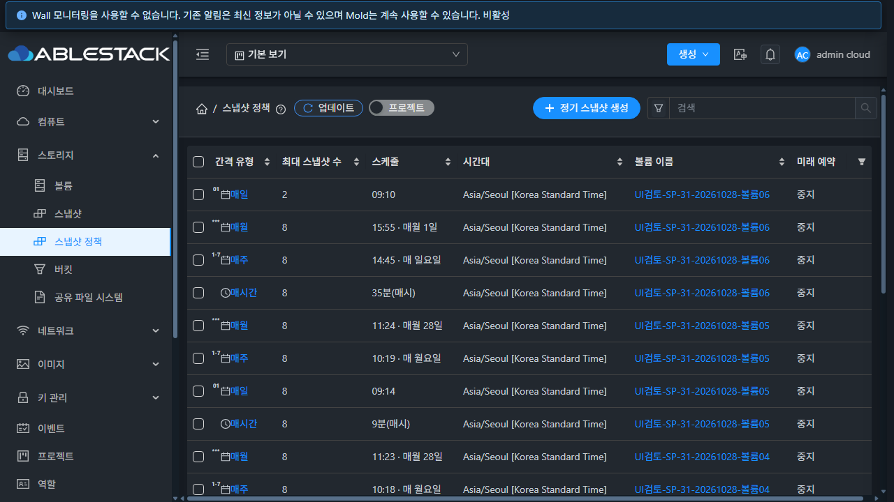
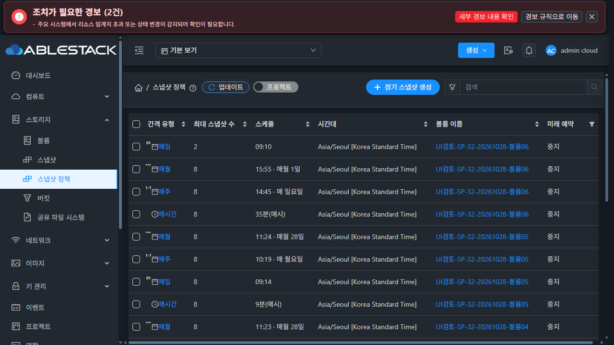

# 스냅샷 정책 UI 추가 개선 및 실클러스터 검증

검증일: 2026-10-28 / 브랜치: `dhslove/epic-1494-snapshot-policies`

## 요청별 결과

| 요청 | 결과 |
|---|---|
| 갱신 중 Breadcrumb 생성 버튼 깜빡임 | 수정·31/32 배포·실제 UI 검증 완료 |
| 간격 아이콘 일부 검정색 | 숫자 장식과 SVG 모두 currentColor 적용·두 테마 검증 완료 |
| 정책 상세 스냅샷 탭 | 정확한 정책별 전체 목록은 API 변경 필요. 사용자 조건에 따라 탭/API/서버/DB 수정 없음 |

## 구현

이전 배포에서는 행과 열 배치는 유지했지만, 배경 목록 조회 중 생성 버튼까지 disabled로 바뀌어 파란색과 회색을 오가는 현상이 남았다. 생성은 독립된 볼륨 조회에서 시작하므로 같은 목록 범위의 성공 데이터와 API 권한이 있고 조회/검색 오류가 없을 때 생성창 열기를 계속 허용한다. 기존 행 편집·삭제·선택 guard 및 생성창 자체의 볼륨/정책 재조회·제출 검증은 유지했다. 초기 로딩·범위 불일치·권한 누락·오류 상태를 단위 테스트로 확인했다.

`ListView.vue`의 정책 목록 전용 클래스 아래에서 `custom-icon:before`와 SVG path에 currentColor를 적용했다. 가상머신 메뉴와 같은 공통 Breadcrumb·목록·MoldDialog 및 테마 색상을 사용하며, 버튼 순서/크기·탭 구조·다른 메뉴 아이콘은 변경하지 않았다. 기존 매일 시간 선택 dropdown 개선도 배포 bundle에 유지된다.

소스 커밋: `07e2520ff13389382f0b433dafc7451472b843a5`.

## 실제 UI 검증

두 클러스터에서 실제 `listSnapshotPolicies` XHR을 DevTools로 보류한 뒤 갱신 전·중·후 DOM과 화면을 비교했다. 보류 요청은 모두 재개하고 임시 네트워크/화면 크기 설정을 해제했다. UI 작업은 저장 없이 취소했다.

| 검사 | 31 GFS2 | 32 RBD |
|---|---|---|
| 다크·라이트 × 1280/768/390px | 6/6 PASS | 6/6 PASS |
| 생성 버튼 배경·테두리·글자색·불투명도·크기·좌표 불변 | PASS | PASS |
| 기존 목록 행·열 좌표 유지 및 행 선택 잠금 | PASS | PASS |
| 간격 숫자 장식·SVG 색이 주변 글자색과 같음 | PASS | PASS |
| 선택된 행이 있는 갱신 상태의 생성 버튼 유지 | PASS | PASS |
| 조회 중 생성창 열기 → 별도 listVolumes → 빈 볼륨 선택 | PASS | PASS |
| 늦은 목록 응답 이후에도 선택 볼륨 유지 → 취소 | PASS | PASS |
| 기존 최근 스냅샷 링크 클릭 → 정확한 스냅샷 상세 이동 | PASS | PASS |

버튼은 모든 갱신 단계에서 파란색 `rgb(24,144,255)`와 흰 글자를 유지했다. 다크 간격 아이콘은 `rgb(197,204,212)`, 라이트는 `rgb(75,85,99)`로 주변 글자색과 일치했다. 수정 전에는 조회 중 버튼이 회색/disabled로 전환되고 아이콘 장식과 SVG가 검정색이었다.

화면 폭 변경 직후 반응형 레이아웃 전환 중 좌표를 비교한 초기 검증 도구 시도가 실패했다. 화면 폭이 적용된 뒤 각 검사를 분리 실행한 최종 12개 사례는 모두 통과했다. 이는 갱신 안정성·색상 검증이며 기존 좁은 화면의 표 줄바꿈 구조를 새로 개편한 것은 아니다.

- [전체 12개 사례](evidence/live-matrix.json), [PNG 원본 크기·CRC·디코딩 검증](evidence/image-validation.json)
- [31 생성창 독립 조회](evidence/31-create-during-refresh-proof.json), [32 생성창 독립 조회](evidence/32-create-during-refresh-proof.json)

## 스냅샷 탭을 추가하지 않은 이유

수정하지 않은 양쪽 실제 API의 `listApis` 계약과 `listSnapshots(includesnapshotcontext=true)` 응답, 정책 context 및 서버 소스를 함께 확인했다.

1. `listSnapshots`에는 volumeid/intervaltype 등은 있지만 policyid/snapshotpolicyid 필터가 없다. SnapshotResponse와 snapshotcontext에도 생성 정책 UUID가 없다.
2. `listSnapshotPolicies(includepolicycontext=true)`는 보존된 해당 볼륨의 최근 scheduler job 후보 50건 안에서 일치한 최신 job 한 건만 반환한다. 서버 내부의 복호화한 policyid/volumeid 확인 결과 전체를 조회할 API는 없다. 일반 AsyncJobResponse도 그 원본 인자를 제공하지 않는다.
3. 볼륨+주기 필터는 정책 A 삭제 후 같은 볼륨/주기로 만든 정책 B에 A의 남은 스냅샷을 섞어 표시할 수 있다. 수정/복사 가능한 태그도 생성 계보가 아니다.

따라서 정확한 “이 정책이 생성한 스냅샷” 탭에는 정책 UUID에 대한 신뢰 가능한 연결과 조회/권한 계약 확장이 필요하다. 요청대로 이번에는 **탭·API·서버·DB를 수정하지 않았다**. 볼륨 스냅샷 목록을 정책 결과로 오인하게 하는 대체 탭도 만들지 않았다.

기존 상세의 `생성 스냅샷` 링크는 최신 한 건에 한해 이미 제공된다. 두 자연 스냅샷 정책에서 실제 링크 클릭으로 아래 상세에 이동함을 확인했다. 전체 이력 탭과는 범위가 다르며, job 만료/후보 제한 때문에 모든 오래된 이력 표시를 보장하지 않는다.

| 클러스터 | 정책 UUID | 기존 링크로 확인한 스냅샷 UUID |
|---|---|---|
| 31 | b330db53-c7c8-4a4b-9cb5-418ba9c876b6 | 887af746-5c20-4d95-8ce4-356604b482fe |
| 32 | 7d76a3a6-eed6-4078-90dc-d4d72319ad73 | 445f9035-5812-4dbb-b9ef-c8113663f517 |

- 실제 API: [31](evidence/31-api-tab-audit.json), [32](evidence/32-api-tab-audit.json)
- 기존 링크 이동 증거: [31](evidence/31-latest-snapshot-opened.json), [32](evidence/32-latest-snapshot-opened.json)
- 검토 소스: `ListSnapshotsCmd.java`, `SnapshotResponse.java`, `SnapshotOperationContext.java`, `SnapshotPolicyContext.java`, `QueryManagerImpl.java`, `SnapshotPolicyDetails.vue`.

## 테스트·배포·보존

- WSL ext4 전용 기능 clone에서 UI 56 suites / **832 tests PASS**, 변경 파일 3개 lint PASS, production UI build PASS. [test](evidence/test.log), [lint](evidence/lint.log), [build](evidence/build.log).
- 기존 caniuse/asset-size/icon 중복 경고와 Jest forceExit 메시지는 남아 있다. 전체 Cloud CI·Maven·FTCTL 빌드는 실행하지 않았다. PR 생성/병합 및 이슈/Epic 상태 변경도 이번 범위에 없다.
- 정적 파일 931개만 배포. `app.ba681e4b.js`, SHA256 `8a402da4c14e3442ec38c3857cc8f5787a87921e11ef211ff2946eac3aa7b73a`. 배포 manifest와 실제 파일 hash를 대조했다. [package](evidence/ui-package.json), [manifest](evidence/ui-manifest.json).
- WEB-INF/META-INF·설정·JAR·management PID와 비UI 파일을 보존했다. 31/32 모두 Mold active, `/client/` HTTP 200. [31 배포](evidence/31-ui-deploy.json), [32 배포](evidence/32-ui-deploy.json).
- 백업: 31 `/root/snapshot-policy-ui-polish-20261028-ui-07e2520ff13-backup`, 32 `/nfs/snapshot-policy-ui-polish-20261028-ui-07e2520ff13-backup`.
- 사용자 요청대로 **각 클러스터의 볼륨 7·정책 24·BackedUp 스냅샷 1을 보존**했다. 원래 ID·주요 정책 필드·24개 중지 상태 모두 동일하며 신규 생성/수정/삭제는 하지 않았다. 명시적 삭제 요청 전까지 유지한다. [31](evidence/31-retained-check.json), [32](evidence/32-retained-check.json).
- 전역 스토리지 임계값 및 기존 데이터/파일은 변경하지 않았다. 기존 별도 FT 작업의 Windows tracked 변경 3개·WSL 11개와 HEAD/branch/diff를 보존했다. [Windows](evidence/protected-windows-result.json), [WSL](evidence/protected-wsl-result.json).

검토용 브라우저 두 탭은 정책 목록과 기존 다크 테마로 복원했다. 최종 구현·보고서가 있는 기능 브랜치를 origin에 반영한다.
