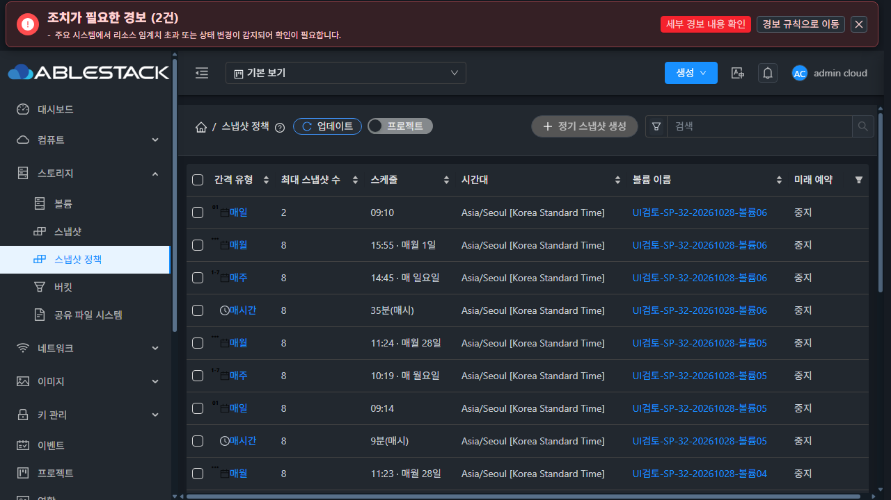
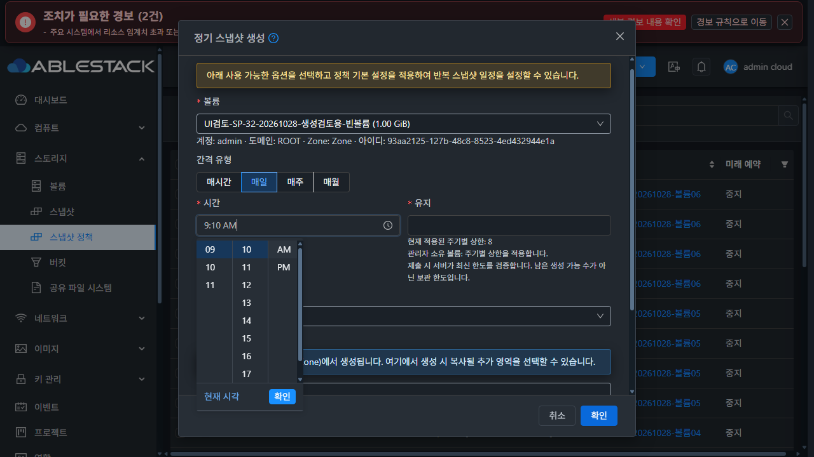

# 스냅샷 정책 후속 UI 수정·배포·보존 데이터

**2026-10-28 KST 완료.** 목록 갱신의 흔들림과 정기스냅샷 시간 선택기의 다크 테마 가독성을 수정해 31 GFS2·32 RBD에 반영했다. 사용자가 명시적으로 삭제를 요청하기 전까지 아래 검토 데이터를 유지한다. [설계](../../design/snapshot-policy-1494/UI-review-20261028.ko.md) · [판정 요약](evidence/qualification-summary.json).

## 수정한 동작

목록은 같은 범위를 재조회할 때 기존 행을 보존했지만, 최신 조회 대기 중 작업 정의를 숨기면서 **선택 열과 생성 버튼을 제거**했다. 양쪽 실제 요청을 보류해 재현했다. 31에서는 첫 데이터 열이 32px 이동했고, 32의 20개 행에서는 체크박스 21개가 0개로 바뀌었다. [이전 31](evidence/31-before-refresh-layout.json) / [32](evidence/32-before-refresh-layout.json).

선택 열의 표시 가능 여부를 실제 API 권한과 정적 작업 정의로 판단하고, 같은 범위의 성공 데이터가 있으면 Breadcrumb 작업 배치를 유지한다. 재조회와 갱신 실패 중에는 작업을 비활성화한다. 행 작업의 최신 조회 guard와 다른 사용자·프로젝트·검색 범위/권한 변경 시 데이터 폐기는 유지했다. VM 공통 목록 구조를 바꾸지 않았다.

실제 요청 보류 전·중·후 **행 ID·열 좌표/폭·버튼 좌표/폭·체크박스 개수**가 같았다. 기존 20개 행, 선택 열 21개를 유지하고 대기 중 쓰기를 차단했다. 표 불투명도 **1**, blur 클래스 **0**으로 본문을 흐리거나 비우지 않았다. 선택 행/선택 삭제 버튼이 있는 상태도 양쪽에서 통과했다. [시각 증명](evidence/visual-refresh-proof.json), [선택 상태 31](evidence/31-selected-row-refresh.json) / [32](evidence/32-selected-row-refresh.json).

시간 선택기는 대화상자 밖 body portal에 렌더링되어 기존 폼 스타일을 받지 못했다. 양쪽에서 배경 `rgb(39,46,54)` 위에 옵션 글자가 `rgba(0,0,0,0.65)`인 것을 확인했다. 전용 `snapshot-policy-time-dropdown`에 VM 공통 테마 토큰을 적용하고 AntD 기본 선택자보다 우선하도록 범위를 한정했다. 일반·선택·hover·비활성 옵션/테두리/현재 시각 링크를 처리하며 다른 메뉴의 시간/날짜 선택기에는 적용하지 않는다. [이전 31](evidence/31-before-time-colors.json) / [32](evidence/32-before-time-colors.json).

최종 다크 옵션 글자는 `rgb(240,243,246)`, 라이트는 `rgb(31,41,55)`다. 실제 computed 색상으로 계산한 활성 옵션의 최소 대비는 **다크 10.90:1 / 라이트 13.11:1**이다. 선택/hover 상태와 매일·매주·매월 선택을 확인했다. 이 대비 수치는 시간 드롭다운 옵션에 한정한다.

## 실제 UI 및 집중 검사

| 확인 | 결과 |
|---|---|
| 31·32 × 라이트/다크 × 실제 390/768/1280px | **12조합 PASS** |
| 각 조합 목록 갱신 + 매일 시간 선택기 | **24개 기본 화면** |
| 매주·매월 다크 시간 선택기 | 양쪽 **4개 추가 화면 PASS** |
| 선택한 행/선택 삭제 작업이 있는 상태의 갱신 | 양쪽 PASS, 배치 유지·쓰기 비활성화 |
| 실제 UI로 매일 09:10 / Asia/Seoul / 보관2 생성 | 양쪽 POST1회 및 API/정책 대조 PASS |
| 최종 목록 페이지 탐색 | 각 전체24개, 첫 페이지20개·둘째4개 PASS |
| UI 집중 회귀 | **56 suites / 830 tests PASS** |
| 변경 JS/Vue·검사 코드 lint | **3파일 PASS**, 자동 수정 없음 |
| 최종 production UI build | PASS, 기존 asset/entrypoint 크기 경고 |

[이미지·viewport·대비 판정](evidence/viewport-image-integrity.json), [전체 PNG 검증](evidence/all-image-integrity.json), [실제 생성 요청 31](evidence/31-ui-daily-create.json) / [32](evidence/32-ui-daily-create.json), [페이지 검증](evidence/final-ui-retained.json), [집중 검사 발췌](evidence/focused-checks.txt).

기본 이미지의 실제 DOM viewport와 PNG의 서명·CRC·압축 해제·decoded 크기를 대조했다. 브라우저 공통 viewport 설정이 적용되지 않은 초기 관측은 사용하지 않고 탭의 실제 폭을 적용해 재검증했다. 503 데이터 보존·재시도 및 권한/범위 변경 시 작업 폐기는 추가한 집중 검사에 포함한다. 별도 단일 503 주입은 자동 복구가 관측되어 실패 상태의 실환경 PASS 근거로 사용하지 않았다. 표에 적은 실제 요청 보류 검증과 구분한다.

## 삭제하지 않고 남긴 데이터

**각 클러스터에 볼륨7개·정책24개·실제 자연 예약 스냅샷1개를 유지한다.** 기존 시험 백업을 읽어 전용 1GiB DATADISK를 만들었으며 운영 VM에 연결하거나 기존 볼륨에 데이터를 쓰지 않았다. 소유자는 `admin / ROOT`다.

| 환경 | 목록에서 찾을 접두어 | 생성 시험용 빈 볼륨 UUID | 유지한 자연 스냅샷 UUID |
|---|---|---|---|
| 31 GFS2 | `UI검토-SP-31-20261028` | `8119a223-1e3f-4bc8-b784-c4f2a1a7a48d` | `887af746-5c20-4d95-8ce4-356604b482fe` |
| 32 RBD | `UI검토-SP-32-20261028` | `93aa2125-127b-48c8-8523-4ed432944e1a` | `445f9035-5812-4dbb-b9ef-c8113663f517` |

- `볼륨01`~`볼륨06`: 네 주기 정책을 각4개씩 등록해 목록·정렬·페이지·상세·편집·예약 상태·볼륨 탭을 검토할 수 있다. 보관 수는 기본8, UI에서 생성한 매일 정책은2다.
- `생성검토용-빈볼륨`: 정책이 없다. 생성창에서 모든 간격 유형을 선택할 수 있도록 별도로 유지한다. 화면 확인만 할 때는 취소하면 된다.
- 볼륨/정책/스냅샷에는 `ui-review=20261028-retain`, `retention=명시적 삭제 요청까지 유지` 태그가 있다.
- 자연 예약 후 **정책24개 모두 미래 예약을 중지**했다. 보관 수 초과 정리가 검토 스냅샷을 자동 교체하지 않도록 했으며, 데이터와 정책 자체는 그대로 남아 있다. 필요하면 사용자가 중지/재개 UI를 시험할 수 있다.
- 시험용 볼륨·정책·스냅샷과 태그를 삭제하지 않았다. **명시적인 사용자 삭제 지시 전에는 후속 작업에서도 정리하지 않는다.**

전체 UUID·주기·일정·태그·볼륨/스냅샷 목록: [31 보존 manifest](evidence/31-retained-data.json) / [32](evidence/32-retained-data.json). 검토용 Mold 탭2개를 남기고 요청 주입·시험 viewport는 해제했다. [브라우저 인계](evidence/browser-handoff.json).

자연 실행은 직접 createSnapshot 호출로 대신하지 않았다. DB에서 두 스냅샷의 `CreateSnapshotCmd` job을 **user_id=1, job_status=1, result_code=0**으로 확인했다. 정책24개·enabled0·예약0도 대조했다. [31](evidence/31-runtime-retention.json) / [32](evidence/32-runtime-retention.json).

준비 도구가 이미 있는 볼륨 태그를 다시 추가한 요청은 각1회 530으로 거부됐다. 기존 태그를 지우지 않고 존재 조회 후 부족한 항목만 추가하도록 도구를 수정했으며 최종7개 볼륨의 보존 태그를 확인했다. 이 이력은 제품 UI 결함이나 자연 스냅샷 실패로 집계하지 않는다.

## 배포·범위·기존 작업 보존

구현은 `457d58090a9`와 `42f37107270`, 최종 배포 소스는 **`42f3710727073b2956815840eb9eb18abe5ec921`**이다. 830개 검사는 457의 JS/Vue로 실행했고 42는 LESS 선택자 우선순위만 변경했다. 최종 production build와 실제 UI 검증은 42에서 수행했다.

빌드는 WSL ext4 전용 clone에서 수행했다. `server`/DB/FTCTL 소스와 JAR은 변경하지 않았고 전체 Cloud CI·Maven·qemu 빌드를 실행하지 않았다. 코드/증적은 `dhslove/epic-1494-snapshot-policies`에 게시하며 PR/Europa 병합은 별도다.

정적 파일 **931개**, `app.7b6d9f14.js`를 양쪽 활성 webapp에 배포했다. app SHA256은 `02302c911bcdd362479f9d382174e0b5ce0cbb3e6b14bfb30d16be4a4b1de90a`, archive SHA256은 `394c0d5f05dd4606233ad0b8df138fcb5e6e56f16a04d1a9e37165e7cac921d4`다. WEB-INF/META-INF 상태·기존 설정·JAR·배포 전 PID·32 대형 비UI 디스크·기존 FTCTL 마커를 보존했다. 서비스는 active, `/client/` HTTP200이다. 배포 전후 PID는 각각 **31:3688598 / 32:3720525**로 같다. [31 배포](evidence/31-ui-deploy.json) / [32](evidence/32-ui-deploy.json), [package](evidence/ui-package.json).

기존 dirty FT의 HEAD·브랜치·status·tracked diff hash는 같다: [Windows3](evidence/protected-windows-result.json), [WSL11](evidence/protected-wsl-result.json). 전역 임계값은 **0.90 유지**, 이번 작업에서 WAL 보존 파일을 이동/삭제하지 않았다. 종료 측정 NFS 사용률은 31 **88.95%**, 32 **28.05%**다. [31 설정](evidence/31-threshold.json) / [32](evidence/32-threshold.json).

기존 자원 대조에서는 32의 볼륨51·스냅샷7·VM51 주요 속성이 같았다. 31에서는 시험 시간 중 기존 `tj-win2025-1`이 Stopped→Running, 해당 `ROOT-771`이 Allocated→Ready로 바뀐 것을 관측했다. 이번 UI 작업에서는 해당 VM/볼륨의 시작·배포 명령을 보내지 않았으며 그대로 보존했다. **31의 전체 인벤토리가 무변경이라고 판정하지 않았다.** [31 대조](evidence/31-preservation.json) / [32](evidence/32-preservation.json).
