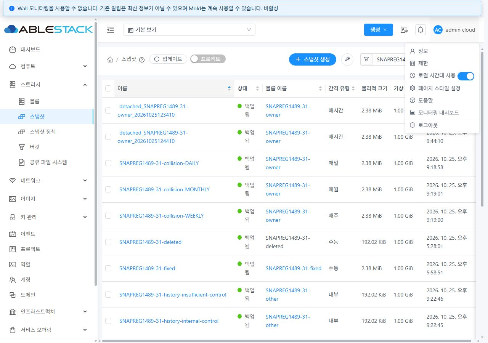

# #1489 스냅샷 통합 회귀 최종 보고

> 병합 전 추가 검토에서 삭제 계정의 내부 수량 재계산/사용량 이벤트 및 강제 복구를 보완하고, 사용자 요청의 사본 Zone 왼쪽 정렬을 수정했다. 최종 서버 집중 233개, UI 정렬 12개 조합·양쪽 재시험/정리 결과는 [병합 전 검토 보고서](merge-review.ko.md)에 있다.

**판정: PASS. 31 GFS2·32 RBD의 통합 기능·권한·장애·실물·최종 정리를 확인했다.**

Epic 브랜치 `dhslove/epic-1473-storage-snapshots`, PR #1492의 결과다. 통합 회귀 시작 기준은 `d7e0d6810849c0a389e66af7d899d6b79df842da`, 직전 진행 보고 기준은 `25a372bc83b2ced1e03d7da83b921997c379c634`다. 기존 하위 이슈의 완료를 이번 통합 시험으로 대신하지 않았다. #1474–#1488·#1493의 선행 구현과 새 전용 `SNAPREG1489-31/32` 자원을 대조했다.

## 발견 문제와 최종 보완

1. **계정 삭제 시 중복 사용량 기록:** 개별 스냅샷 삭제 → 볼륨 삭제 → 계정 삭제에서 `SNAPSHOT.DELETE`가 2건이었다. 계정 정리가 개별 스냅샷 삭제의 잠금·실물 종료·사용량 처리 경로를 공유한다. 의존 사본·미확인 정리가 있으면 디렉터리를 먼저 지우지 않는다. 다른 Zone 저장소도 확인한다. 전용 대조 시험의 이벤트는 양쪽 모두 2 → 1이다.
2. **절대 경로 삭제의 NFS 실물 잔여:** KVM과 SSVM의 마운트 UUID 계산식 차이로 DB/job 성공 뒤 파일이 남았다. 저장소 URL에서 계산한 KVM UUID가 일치할 때만 SSVM export로 변환한다. 정확한 파일과 동반 파일만 처리하며 경로 이탈·심볼릭 링크·다른 export·공유 디렉터리를 거부한다. 새 Running DATA 일반 삭제는 양쪽 API·DB·NFS 결과가 일치한다.
3. **종료 참조·행 누락의 관리자 복구:** 과거 Destroyed 참조의 경로도 진단한다. 이미 같은 DB 값을 다시 기록하지 않아도 종결로 인정하고, 종료된 NFS 사본의 상태 전이를 재생하지 않는다. 행이 없으면 보존 감사의 스냅샷·볼륨·저장소·경로를 검증해 실물 정리를 재시도한다. 불명확한 주소는 실물 완료로 표시하지 않는다. 강제 정리 미확인 감사는 최종 0이다.
4. **32 Running 연결의 Agent 원인 은폐:** 실제 원인은 기존 `Gfs2VolumeAllocation` 의존 클래스 누락이었다. 세 호스트에 필요한 기존 클래스를 반영하고 VM/FTCTL 보존 후 같은 연결이 성공했다. 서버는 Attach 응답과 디스크 정보를 검사하며 원래 Agent 오류를 전달한다.
5. **보관 검증의 경로 계약:** Agent가 검증한 백업 파일의 export 상대 경로를 반환하고 엔진은 그 정확한 파일만 대조한다. 누락 참조의 한글/영문 상태도 제공한다.
6. **Primary-only 용량 오표시:** Secondary가 없는데 Primary의 물리 크기를 ‘Secondary 백업 물리 크기’로 표시했다. Ready Image 사본이 확인될 때만 백업 물리 크기를 표시한다. 실제 RBD Primary만 남긴 시험에서 새 UI는 ‘미확인’으로 표시했고 이어 제품 강제 정리로 삭제했다.
7. **삭제 계정 수량 재계산 예외:** 계정은 정리 콜백 전에 숨겨지므로 공개 수량 재계산 API가 계정을 찾지 못했다. REMOVED 계정의 최종 카운터 처리는 계정 정리에 맡기고 활성 계정 재시도만 재계산한다. 31·32의 실제 background 재시도에서 일반 계정 정리가 종료됐다.
8. **삭제 프로젝트 내부 계정 정리 예외:** Kubernetes 연동이 삭제된 프로젝트를 조회하다 null 예외를 내고 도메인 삭제를 막았다. 정리에서는 보존된 프로젝트 이력으로 계정을 찾고 멤버십을 다시 만들지 않는다. 양쪽 프로젝트 내부 계정의 `cleanup_needed=0`, 도메인 정상 API 삭제를 확인했다.

공통 탭의 오래된 권한 fixture와 timeout 기대값도 실제 계약으로 갱신했다. UI 대화상자는 기존 VM 공통 MoldDialog를 유지하며 StorPool 전용 옵션을 노출하지 않는다.

## API·UI·DB·실물 통합 결과

| 검증 | 31 GFS2 | 32 RBD | 주요 증거 |
|---|---|---|---|
| ROOT/DATA × QCOW2/RAW 템플릿 | 형식·1/100GiB·전체 가상 데이터 동일 | 동일 | `*-resume-image-comparisons.json` |
| ROOT 템플릿 VM 부팅 | QCOW2/RAW 모두 게스트 OS·루트 FS 확인 | 동일 | `*-root-boot-*-guest.json` |
| 다운로드 | 확장자·이미지 형식·가상 용량·HTTP 200/206·전체 파일 해시 일치 | 동일 | `*-download-*-verified.json` |
| 복원 크기/오퍼링 | 기본·1GiB 명시·고정 오퍼링 상속, 2GiB 요청 거부 | 동일 | `*-pattern-verify-restore-*.json`, `*-restore-size-rejected.json` |
| 실제 원본 되돌리기 | 3c/c3 변경 → UI 복원 → 5a/a5·전체 해시 일치 | 동일 | `*-pattern-verify-owner.json` |
| 원본 삭제 후 새 볼륨 복구 | 원본 삭제 → 새 볼륨 실체화 → 전체 해시 일치 | 동일 | `*-pattern-verify-restore-orphan.json` |
| Secondary 외부 손실 후 보관/강제 정리 | NFS 절대 경로·행 누락 복구 확인 | 실제 RBD Primary만 유지 → UI 보관 재생성, 별도 시험 UI 강제 Primary 삭제 | `32-loss-archive-oracle.json`, `32-primary-force-oracle.json` |
| 다중 Zone/스토리지 | 전용 추가 Zone 2개·실제 전송·전체 데이터 일치 | 동일, UI 제출·부분 실패/재시도 포함 | `*-copy-*-physical.json` |
| 부분 실패/재시도/동시성 | 목적지 b만 읽기 전용 → a 성공/b 실패 → b 재시도 성공 | 동일 | `*-copy-partial-result.json`, `32-copy-partial-job-detail.jpg` |
| 동일 복사 동시 제출 | 한 요청 성공/한 요청 상태 변동 거부·Ready 사본 1개 | 동일 | `*-copy-concurrent.json` |
| 정책 ID 8 | 실제 H/D/W/M 생성 유형·검색 일치 | 동일 | `*-policy-collision-after.json` |
| 오분류 이력 복구 | 검토 계획·drift 거부/rollback·4건 복구·멱등·대조군 보존 | 동일 | `*-policy-history-recovery.json` |
| 실제 스케줄러/최대 보관 | 3회 실행·maxsnaps=2·최초 사본 DB/파일 제거 | 동일 | `*-scheduler-retention.json` |
| 서버 정렬/검색/페이지 | 독립 SQL 순서·동률 보조키·건수·페이지·태그/유형/위치/소유 범위 일치 | 동일 | `*-order-api-db.json`, `*-search-api-db.json` |
| 권한 | 관리자/소유자/타인/도메인 관리자/조회 전용/제한 역할/프로젝트 경계 | 동일 | `*-acl-*.json`, UI matrix 및 범위 전환 증거 |
| 태그 UI | 실제 생성·삭제 job 후 갱신, 단일 XHR 실패/지연·재시도·범위 전환 | 동일 | `*-tag-scope-transition.json` |
| 최신 상태/중복 제출 | 대화상자 이후 VM Running → 제출 차단·Revert job 0 | 동일 | `*-ui-safety-db-oracle.json` |
| 접수 응답 유실 | 실제 createVolume HTTP 200 뒤 응답만 차단 → 제출 잠금 → 기존 job 자동 재조회·볼륨 1개·전체 해시 일치 | 동일 | `*-ui-lost-response.json`, `*-ui-safety-db-oracle.json` |

DATA 원본·변경 복원·일반/고정/명시 크기·원본 삭제 후 복구·응답 유실 UI 생성 볼륨의 1GiB 전체 디코딩 SHA-256:

`7e95e6f5cd1446eb003c8d4c006f9d7fb286ec9550851dde1430a23f206e7f7f`.

RAW ROOT 다운로드는 100GiB 전체 HTTP 스트림의 SHA-256을 원본과 비교했다. 100GiB 다운로드 사본을 디스크에 새로 저장하지 않았다. ROOT/DATA 템플릿은 파일 길이만 비교하지 않고 `qemu-img compare`로 전체 가상 데이터를 대조했다.

## VM 표준 UI·브라우저 검증

31/32 × 라이트/다크 × 390/768/1280px의 **12개 조합, 156개 화면과 72개 대화상자**를 실제 브라우저 viewport로 확인했다. VM 목록 기준, 스냅샷 목록/breadcrumb/고급 검색, 상세/Zone/이벤트/코멘트와 상세 작업 6종(볼륨 생성·복원·템플릿·다운로드·보관·삭제)을 확인했다. body 클래스와 실제 배경/문자 색으로 테마 적용을 확인했고 폭·겹침·헤더/푸터·초점/Tab 순환·Escape·취소 복귀를 점검했다. 전체 페이지가 아닌 표 내부 가로 스크롤을 허용한다.

실제 복사·잔여 복구·작업 상세는 기능 제출 및 오류/재시도 시험에서 추가 확인했다. #1488의 12종/144개 화면 증거와 현재 변경 범위를 함께 대조했다. StorPool 옵션은 노출하지 않는다.

재사용 브라우저 연결과 viewport/theme 측정 문제는 새 시험 탭·실제 viewport 제어·최초 페이지 준비 확인으로 해결했다. 검증용 통신 차단은 해제했다. Windows 네이티브 Chrome 연결은 URL 식별에 대한 자동 승인 검토에 차단됐으므로 OS 클립보드 바이트의 자동 검증으로 집계하지 않았다. **사용자가 31·32에서 실제 복사·붙여넣기 후 ‘31·32 모두 UUID 일치 확인’으로 응답해 마지막 수동 항목을 통과했다.** `os-clipboard-human-confirmation.json`에 수행 주체를 명시했다.

## 최종 정리·보존

정상 API로 스냅샷/태그, VM expunge/템플릿/볼륨, 프로젝트/계정/도메인/역할/오퍼링과 전용 Agent/스토어/Zone을 정리했다. 계정 정리 예외는 코드 수정 후 제품 background 재시도로 종결했다. `account.cleanup.interval`은 대기 대상이 전용 계정뿐임을 확인한 뒤 60초로 잠시 조정했고, **86400초 복구 및 최종 관리 서버 재시작**으로 원래 실행 주기를 복원했다.

| 최종 검사 | 31 | 32 |
|---|---:|---:|
| 활성 VM/볼륨/스냅샷/템플릿 | 모두 0 | 모두 0 |
| 활성 프로젝트/계정/도메인/역할/오퍼링/Zone/스토어/전용 호스트 | 모두 0 | 모두 0 |
| 정책/예약/스냅샷 태그 | 모두 0 | 모두 0 |
| 비종결 참조/job·강제 미확인 감사·계정 cleanup_needed | 모두 0 | 모두 0 |
| NFS·Primary·템플릿 캐시·RBD trash·libvirt 시험 잔여 | 0 | 0 |
| 다운로드 URL 접근 | 4종 모두 거부 | 4종 모두 거부 |
| 보유 스냅샷 이력 행 | 30개 보존 | 27개 보존 |

Destroyed 스냅샷의 removed=NULL, 삭제 오퍼링의 Inactive 상태는 정상 tombstone으로 구분한다. 의도적으로 행을 없앤 누락 복구 fault는 행 보존 수에 포함하지 않는다. 삭제 이력과 사용량 이벤트를 지우지 않았다. SQL/파일 삭제로 제품 정리 성공을 만들지 않았다. SQL은 합성 결함/유효 RAW/정책 ID 충돌 준비와 읽기 대조에만 사용했고, 수동 파일 삭제는 별도로 기록한 손실 주입 또는 시험 harness 백업/다운로드 scratch 제거다.

기존 운영 8종의 UUID/주요 속성과 추가 템플릿·프로젝트를 시작 기준과 대조했다. 기본 스냅샷 사본 행은 31=23·32=12, 볼륨은 155·49, 실행 가능 템플릿은 11·6으로 보존됐다. 원래 SSVM 프로세스/네트워크/인증서, WEB-INF/META-INF/config/관리 JAR의 비대상 항목, 기존 Windows/WSL FT 작업의 HEAD·status·diff 해시를 보존했다. 배포 rollback 사본은 관리 서버에 유지한다.

## 빌드·배포·CI의 범위

- WSL ext4에서 변경 Maven 모듈만 검사했다. 최종 서버 집중 **230개**, 프로젝트 계정 정리 **13개**가 모두 통과했다. 기존 엔진 57개·NFS 30개·KVM 48개 결과도 해당 변경 범위의 근거다.
- 스냅샷 UI **31스위트/472개**, Summary/공통 탭 집중 **2스위트/13개**, 변경 UI lint와 production UI build가 통과했다. 두 UI 실행은 일부 중복이므로 합산하지 않는다.
- 앞선 넓은 UI 실행은 221스위트 중 7스위트/22개 실패였다. 이 중 공통 탭 2개는 fixture/timeout 기대값을 갱신해 통과했다. VM NIC·AutoScale·게스트 IP·템플릿 ROOT·OAuth·Wall의 나머지 6스위트/20개는 시작 기준 소스에서도 실패한 범위 밖 항목이다. 전체 UI 재실행/전체 CI 통과로 보고하지 않는다.
- 동일 정적 UI 922개 파일 해시를 양쪽에 확인했다. 관리 core r6, Kubernetes 정리 조회 메서드 한 개 r7, SSVM의 필요한 메서드와 KVM 누락 기존 의존 클래스만 선택 반영했다. 각 배포는 백업과 비대상 메서드/JAR 항목 보존 증거를 가진다.
- 최종 Mold active, `/client/` HTTP 200, WEB-INF 보존을 확인했다. 전체 Cloud GitHub Actions 빌드는 요청받지 않아 시작하지 않았다. qemu/FTCTL 소스·패키지는 변경하거나 빌드하지 않았다.

다중 Zone 전송은 기존 SSVM 내부의 전용 TLS Agent 프로세스와 독립 NFS 하위 경로를 이용했다. 실제 파일과 실패를 검증했지만 새 SSVM VM/독립 NAS 전체 프로비저닝·성능 검증을 의미하지 않는다. 유효 RAW 조합은 전용 백업을 변환하고 그 파일 길이에 맞는 메타데이터를 준비했다. 31 Secondary 용량 임계치로 거부된 초기 정책 시도는 환경 실패로 기록했고 전용 시험 자원만 먼저 정리해 여유를 확보한 뒤 성공했다. 존재하지 않는 실제 부모 체인의 양성 UI는 선행 #1486의 명시적 응답 주입 증거로 한정한다.

공개 `evidence/`의 인증 값·다운로드 접근 URL을 제거했고 `manifest.json`에 SHA-256을 기록했다. API 원문/fixture registry/실행 원장은 비공개 WSL `/home/ablecloud/work/snapshot-regression-1489-20261025`에 있다. PR #1492는 갱신하며 병합은 별도 작업이다.
