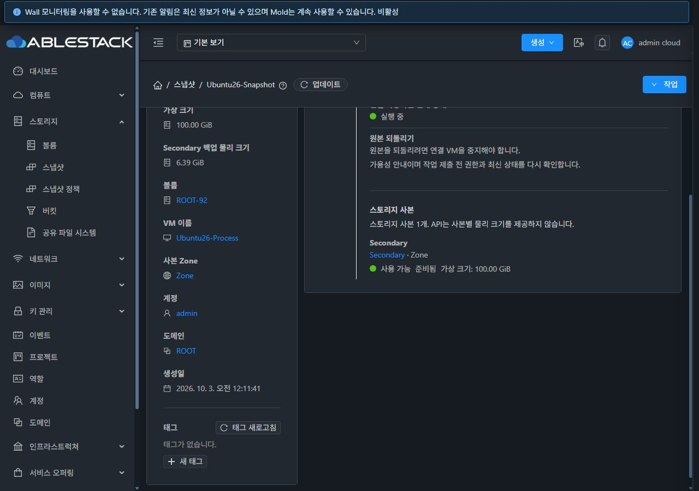
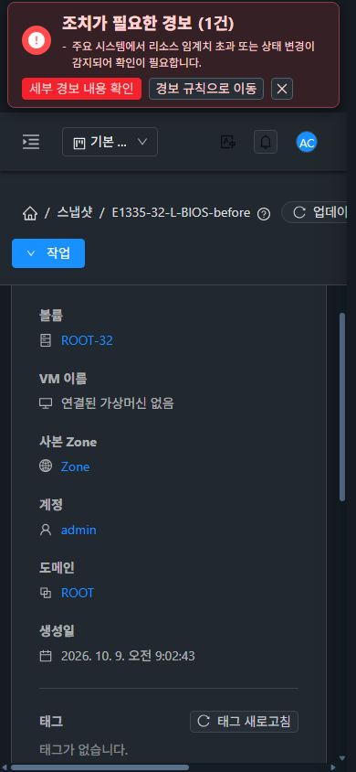

# PR #1492 병합 전 검토·추가 보완

검토 시작 HEAD `8d7ceefd4bae4c5ee5c254c332d91df1ad7264ba`, 기준 Europa `a7543feb62a728a5a806283b1e0e6134a7305260`.

실제 Git diff 4,524개 경로 중 검증 문서를 제외한 167개 경로를 분류했다. source diff에서 API 권한/요청 UUID 중복 방지, 삭제·보관 잠금/진단 revision, 실물 경로 검증, 데이터 형식/용량 계약, 서버 정렬/소유 범위와 UI 공통 컴포넌트·비동기 컨텍스트를 검토했다. 등록된 미해결 review thread는 없었다.

## 발견·보완

- 스냅샷을 남긴 계정을 직접 삭제하면 내부 삭제의 공개 수량 재계산이 숨겨진 계정을 찾지 못했다. 31·32 실제 시험에서 파일/볼륨은 삭제되지만 SNAPSHOT.DELETE 이벤트가 0건으로 재현됐다. 삭제된 계정의 관리자 강제 복구도 같은 수량 예외로 실패했다.
- 계정 이력으로 현재 상태를 확인해 활성 계정만 공개 수량 재계산을 수행한다. 삭제 계정의 카운터 제거는 계정 정리에 맡긴다. 일반 삭제·보관·강제 복구에 같은 처리를 적용했다. 새 삭제 이벤트 누락을 예방하며 과거 이력을 임의로 보정하지 않는다.
- 사용자 추가 요청: 상세 ‘사본 Zone’이 가운데로 밀렸다. 공통 필드 스타일을 뒤에서 읽어 align-items:center가 적용되는 CSS 우선순위 문제였다. 스냅샷 Zone 영역의 선택자 우선순위와 text-align:left만 보완했다. 다른 필드/VM 공통 스타일은 변경하지 않는다.

## 검증

- WSL ext4 변경 server 모듈 집중 233개/오류 0. 실제 이벤트 발행과 삭제/누락 계정의 강제 실물 복구를 검증하는 회귀를 추가했다.
- 31·32 각각 새 전용 계정/볼륨/스냅샷을 준비해 스냅샷을 남긴 계정 직접 삭제를 재시험했다. 삭제 완료 사용량 이벤트 1건, 계정 cleanup_needed=0, 스냅샷/참조 종료 및 원본 볼륨 실물 제거를 확인했다.
- 삭제된 소유자 스냅샷의 관리자 강제 진단/실행은 dbcleanupcomplete=true, physicalcleanupcomplete=true, pendingcleanup=0으로 종료됐다.
- Summary 집중 6개와 UI lint 통과. production UI build 및 양쪽 922개 정적 자산 해시/서버 디렉터리 보존을 확인했다. 31·32 × 라이트/다크 × 390/768/1280px 12개 화면에서 align-items:flex-start와 text-align:left, 볼륨/Zone 값 시작 좌표 차이 0px를 확인했다. 변경 전 두 환경의 오프셋은 약 79.94px였다.
- 추가 시험 계정·볼륨·스냅샷·도메인·비종결 참조/job·미확인 감사의 활성 잔여 0, NFS/GFS2/RBD/trash 부재를 확인했다. SQL/수동 파일 정리로 제품 성공을 만들지 않았다. 구성 변경은 없고 account.cleanup.interval=86400을 유지한다.

전체 Cloud 빌드는 시작하지 않았다. 기존 통합 회귀의 UI/이미지/권한/정책/데이터 증거와 이번 변경의 집중 검사·실환경 결과를 구분한다. 전체 UI/Cloud CI 성공을 의미하지 않는다.

최종 판정: 발견 결함을 보완하고 집중 검사·31/32 실제 재시험·정리를 통과했으므로 병합 가능하다. 실제 병합은 최신 base/head/검사 상태를 다시 읽고 검토한 HEAD만 지정한다. PR #1492, #1489 및 Epic #1473의 보고서/상태를 갱신한다.

