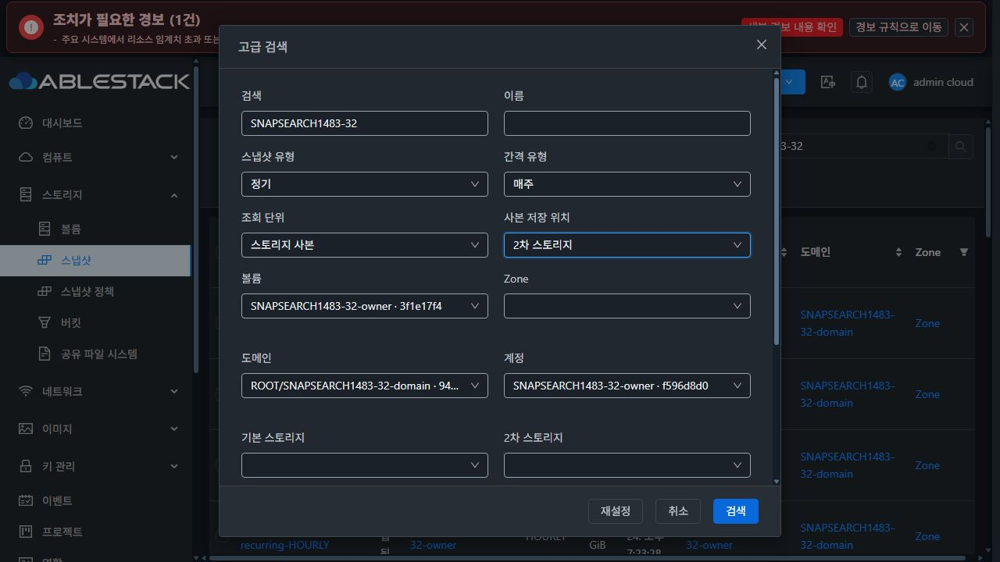
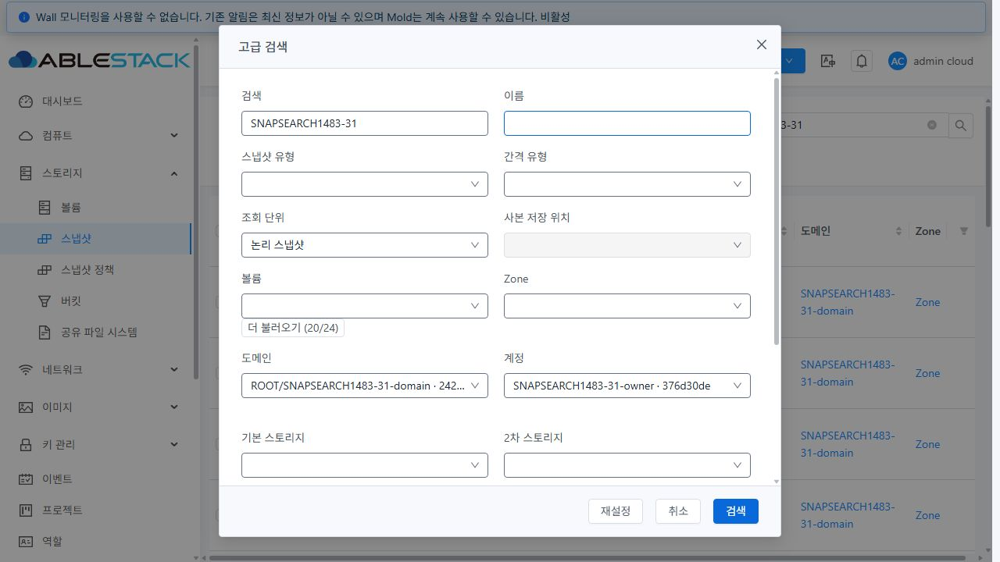

# #1483 스냅샷 검색·URL 상태 연결 검증

Epic 브랜치 `dhslove/epic-1473-storage-snapshots`, 시작 HEAD `d1f3a3f6b10b`. 변경 소스와 검사 대상은 `source-sha256.json`으로 고정한다. 최종 배포·정리 결과는 아래 증거와 각 환경 JSON에 기록했다.

## 구현

- 볼륨 UUID, 수동/정기 유형, 매시간/매일/매주/매월, 논리 스냅샷/스토리지 사본, Primary/Secondary 위치를 고급 검색에 연결했다. 기존 이름·키워드·태그·Zone·계정/도메인·재귀·프로젝트·저장소 조건을 함께 유지한다.
- **API 주기 필터 결함을 수정했다.** `intervaltype`은 볼륨 지정 없이도 적용하며 RECURRING과 교집합을 취한다. MANUAL+주기, 잘못된 유형/주기는 431로 거부한다. 기존 기본 유형 제외 규칙은 유지한다.
- 위치는 사본 모드에서 선택한다. 논리 모드 전환은 위치를 해제하고, 지원하지 않는 URL 조합은 설명과 함께 조회를 막는다. 상태 필터, 충돌하는 저장소, 계정+프로젝트, 불완전/중복 키 태그, 권한상 미지원 저장소 조건을 무시한 넓은 조회로 바꾸지 않는다. API의 기존 showunique=true에서 locationtype 무시 동작은 호환성을 유지한다.
- 사본 모드는 copy.id 단위의 행·건수·페이지이며 위치/저장소 열을 기본 표시한다. 체크박스·삭제 등 목록 작업을 제공하지 않고 상세 진입으로 안내한다. 제한 응답에서 저장소 이름이 없으면 확인 불가로 표시한다.
- 조건 적용/제거/초기화는 1페이지로 돌아가고 정렬·페이지 크기·현재 프로젝트를 유지한다. 키워드 변경/비우기는 나머지 조건을 유지한다. 뒤로 가기·직접 링크·범위 밖 페이지 보정을 연결했다. 삭제된 원본 볼륨의 UUID도 조건과 대화상자에 유지한다.
- 기본 보기는 UI URL의 `projectid=0`, 전체 프로젝트는 `-1`, 특정 프로젝트는 UUID로 구분한다. **0은 API에 전달하지 않는다.** 전역 프로젝트 선택은 URL에 한 번만 동기화하며 URL에서 조건을 삭제하지 않는다. 기본 보기 복귀도 이전 프로젝트를 복원한다. 늦은 프로젝트 조회는 현재 경로·사용자·세션·전역 범위가 달라지면 적용하지 않는다.
- 후보는 서버 검색·20건씩 추가 조회·오류/재시도·권한 및 응답 범위 검사를 제공한다. 볼륨 후보는 소유 범위/Zone을 전달하고 생성시각 동률은 ID DESC로 고정했다. 계정 후보는 listall=false로 요청해 서버의 강제 하위 도메인 재귀를 피했다. 볼륨은 저장 경로 대신 이름, 도메인은 계층 경로로 표시한다.

## 대화상자 표준

VM 공통 `MoldDialog` md(720px)와 `snapshot-standard-dialog` 테마 규칙, 세로 폼, 공통 고정 푸터(재설정/취소/검색)를 사용한다. 행 간격 16px·열 간격 20px, 600px 이하 한 열이다. 오류/후보 안내는 필드 높이에 포함되고 고정 검정 글자를 추가하지 않는다. 상세 정보 요약을 중복 표시하지 않는다. StorPool 전용 복제 옵션은 추가하지 않았다. 목록/상세/탭의 최종 시각 정리는 #1485–#1488 범위다.

## API·독립 DB 검증

각 클러스터에 전용 도메인/하위 도메인·일반 계정/DomainAdmin·프로젝트·1GiB 볼륨 28개를 만들었다. 수동 스냅샷 31개와 실제 정책으로 만든 4개 주기 스냅샷을 검증했다. 삭제 원본 볼륨 1개는 검색 전에 정상 API로 삭제했다. 후보용 소유 볼륨 24개만 생성시각을 같게 조정해 20+4건 경계를 만들었고 원래 시각과 변경 범위를 기록했다. 운영 자원 시각은 변경하지 않았다.

| 검증 | 31 GFS2 | 32 RBD |
|---|---:|---:|
| 활성 논리 스냅샷 | 35 | 35 |
| 수동 / 각 H·D·W·M 주기 | 31 / 각각 1 | 31 / 각각 1 |
| 최종 활성 Primary / Secondary 사본 | 0 / 35 | 34 / 35 |
| API·DB 필터/ACL/페이지 시나리오 | 82 PASS | 82 PASS |
| 잘못된 유형·주기 조합 거부 | 5 PASS | 5 PASS |
| 후보 조회 시나리오 | 9 PASS | 9 PASS |
| 다른 소유자 snapshot/volume/account 조회 | 3 차단 PASS | 3 차단 PASS |

`snapshot_view`의 독립 SQL 조건·ROW_NUMBER 중복 제거·created/id/copy 보조 순서로 모든 API 페이지의 UUID/copy.id와 count를 대조했다. 유형과 주기 교집합, 볼륨 유무, 삭제 원본, 논리/사본·위치·저장소, 키워드/태그 OR 조합, Zone/계정/도메인/재귀/프로젝트, 빈 결과·마지막/범위 밖 페이지를 포함한다. 후보는 관리자·일반 사용자·DomainAdmin·프로젝트의 ID 집합과 20+4 페이지, 동률 재조회, 정확한 계정 도메인을 대조했다.

수정 전 실제 호출에서 DAILY 단독은 35건, RECURRING+DAILY는 가용 정기 타입 전체 3건을 반환했다. 시험 정책 1건의 타입 오분류는 아래 #1493으로 분리하고 새 정책으로 올바른 fixture를 만든 뒤 최종 전체 시나리오를 재검증했다. RBD 삭제 원본의 Primary 참조는 정상 정리돼 최종 69개 사본이며 Secondary 1개로 해당 원본의 스냅샷을 조회한다. 정리 이전 시점의 70개를 최종 건수로 계산하지 않았다.

## 실제 UI 검증

두 클러스터의 실제 브라우저에서 조작하고 비밀값을 제거한 요청/응답·URL·DOM 행을 `browser/*-ui.json`에 기록했다. 초기 검증과 최종 수정 후 재검증을 구분한다.

- 볼륨 후보 20+4건과 서버 검색, 볼륨/유형/주기/위치 적용, 삭제 원본 UUID 직접 링크가 동작했다. 31의 볼륨+DAILY와 32의 볼륨+WEEKLY+Secondary는 각각 1건이다. 수동/논리 모드 전환의 의존 필드 해제는 집중 UI 컴포넌트 시험에 포함했다.
- 32의 주기·볼륨·Zone·Image store·태그 조합도 1건이며, 키워드 변경으로 0건이 돼도 나머지 조건을 유지하고 뒤로 가면 1건과 조건 전체를 복원했다. 중복 태그 키는 안내와 함께 검색을 막았다.
- 주 소유자 29건의 20+9건 페이지와 page=999의 마지막 페이지 보정, RBD 주 소유자 사본 57건의 20+20+17건을 확인했다. 사본 모드의 체크박스는 0개이고 실제 DOM 행 키가 copy.id와 일치했다.
- 일반 사용자/다른 소유자 전환에서는 각각 자기 스냅샷 29/2건과 볼륨 후보 24/1건만 표시됐다. 잘못된 위치/조회 단위 및 제한 사용자의 저장소 URL은 오류를 표시하고 snapshot 조회를 보내지 않았다.
- 후보 503은 빈 후보와 구분하고 검색을 막았으며 재시도 후 복구됐다. 최종 32의 403은 이전 볼륨 선택을 해제하고 검색을 막았고 재시도 후 정상화됐다. 이전 owner 볼륨 응답을 보류하고 other 결과 1건을 먼저 받은 뒤 이전 24건을 실제 전달해도 화면 후보는 other 1건을 유지했다.
- 최종 31/32에서 프로젝트 UUID URL은 전역 선택과 3건을 안정적으로 유지했다. 31의 초기화는 프로젝트·name/asc·50건 크기를 유지했다. 뒤로 가면 projectid=0과 이전 검색/소유 범위를 복원했다. 31 전체 프로젝트 스위치는 URL의 -1/0과 35/32건을 함께 전환했다. UI 전용 0이 실제 API 요청에 들어가지 않음을 확인했다.
- 최종 관리자 볼륨 후보는 저장 경로 대신 이름을 표시했고, 계정 후보는 listall=false로 정확한 도메인 3건을 반환했다. 초기 계정 후보 재귀 오류와 프로젝트 URL/전역 선택 반복을 수정한 뒤 해당 경로를 최종 배포에서 다시 통과했다.
- 최종 라이트/다크 대화상자는 720px, 행/열 간격 16/20px, 필드 간 겹침 0이다. 390px 화면은 대화상자 366px·한 열·고정 푸터이며 겹침 0이다. 라이트 라벨은 rgb(75,85,99)/흰 배경, 다크 라벨은 rgb(197,204,212), 입력은 rgb(240,243,246)로 읽을 수 있었다. 데스크톱 원본 캡처와 실제 DOM 측정값을 함께 보존했다. 모바일은 DOM 측정으로 검증했으며 캡처는 사용하지 않았다.

시험 중 변경한 테마는 원래 다크 모드로 복원하고 기본 보기/전체 프로젝트 해제, 뷰포트 override와 XHR 가로채기 해제 후 임시 탭을 닫았다.

## 검사·배포·정리

- Java **31개 PASS**: api 5개 및 server 26개. WSL ext4 Epic clone에서 변경 api/server 모듈만 빌드했고 Maven Checkstyle을 통과했다.
- UI **6 suites / 95개 PASS**(`checks.json`의 실제 검사 로그 요약), 변경 파일 no-fix lint PASS. 볼륨 후보·실패/권한·늦은 응답·프로젝트 동기화·검색/초기화·사본 키/선택·기존 정렬·사본 탭과 공통 목록을 포함한다.

- 최종 production UI build PASS. 관리 JAR의 변경 class 3개와 활성 webapp 정적 파일 921개를 각 서버에서 SHA256으로 대조했다. 다른 JAR entry, WEB-INF/META-INF와 설정 파일을 보존했다. 각 Mold active, /client/ HTTP 200, 기존 호스트 5개 Up을 확인했다. 변경한 서버 코드의 전체 배포 산출물 대신 class 단위 시험 배포를 사용했다.
- 롤백 백업은 각 관리 서버 `/root/snapshot-search-1483-20261024-management-final`, `/root/snapshot-search-1483-20261024-ui-final2-backup`에 남겼다. 최초 UI 시험본 이전 백업 `...-ui-final-backup`도 보존했다. webapp 루트/서버 디렉터리를 교체하거나 삭제하지 않았다.
- 각 환경에서 정상 API 정리 70개 동작으로 최종 스냅샷 35개·볼륨 28개(검색 전에 삭제한 원본 포함)·프로젝트·계정 4개·도메인 2개를 정리했다. 별도 타입 오분류 시험 스냅샷 1개는 교체 전에 이미 정상 삭제했다. 정책은 생성 후 삭제해 활성 0개다. 강제 복구나 직접 DB 삭제는 사용하지 않았다.
- 활성 API·DB의 스냅샷/볼륨/참조/계정/도메인/프로젝트/정책/강제삭제 잔여는 모두 0이다. 각 환경 NFS 파일 36개·Primary 볼륨 경로 28개를 확인해 남은 실물 0, RBD 시험 이미지 및 trash 0을 확인했다. 기존 자원의 API 투영값도 일치했다.
- Windows와 WSL의 보호 FT 작업 트리는 시작 HEAD·기존 tracked diff·untracked 포함 상태가 일치했다. 작업은 격리한 Epic 작업 트리/WSL ext4 clone에서만 수행했다. 증거 검증기는 동일 소스 커밋에서 `python docs/validation/snapshot-search-1483-20261024/verify_evidence.py`로 실행한다.

## 후속 작업

실제 정책 ID와 `Snapshot.INTERNAL_POLICY_ID=8` 충돌로 주기 스냅샷이 INTERNAL로 저장되는 생성 경로 결함을 **#1493**에 등록하고 Epic 하위 이슈와 #1489 회귀 판단 항목에 연결했다. 잘못 분류된 전용 스냅샷은 정상 삭제 후 올바른 새 정책으로 다시 만들었고, 운영 데이터 타입은 변경하지 않았다. 검색은 저장된 타입에 일치한다. 이 결함의 생성/이력 복구까지 이번 검색 완료로 처리하지 않는다.

다음 권장 순서는 **#1493 정책 ID 충돌 → #1484 태그 job 완료 추적 → #1485–#1488 UI 정리 → #1489 최종 통합 회귀**다. Epic #1473과 PR #1492는 열어 두며 이번 요청에는 병합을 포함하지 않는다. 전체 Cloud 빌드·전체 CI·Actions dispatch·qemu/FTCTL 빌드는 실행하지 않았다. 집중 검사와 실환경 결과는 전체 CI 성공을 뜻하지 않는다.
