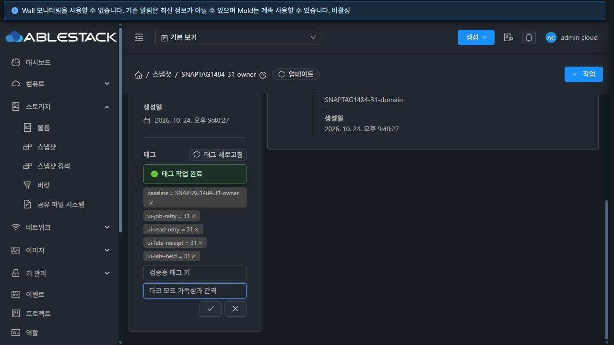
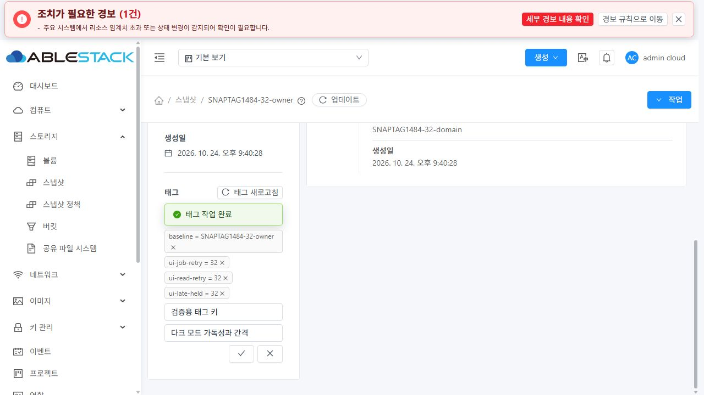

# #1484 태그 완료 갱신·오류·소유 범위 검증

## 결과와 범위

31 GFS2와 32 RBD에서 스냅샷 및 공통 VM 태그의 API/UI/job/DB 정합성을 검증했다. 태그 생성·삭제는 job 완료 뒤 자동 갱신하고 실제 실패 사유, 명시적 재시도, 읽기 전용 재조회와 범위 격리를 제공한다. 전용 자원은 정상 API로 정리했고 활성 잔여는 0이다. Epic 브랜치의 이슈 구현 범위 검증이며 Epic 전체 완료·병합·전체 Cloud CI를 의미하지 않는다.

[설계와 상태/접수 제한](design.ko.md), [재검증 도구](scripts/verify_evidence.py), [소스 해시](source-manifest.json), [기계 검증 요약](evidence-summary.json)을 함께 읽는다. 원본 시작점은 `6290859f3a5253ca46a0d8e0064f8b87d281beba`다. 모든 테스트는 새 `SNAPTAG1484-31/32` 전용 자원으로 수행했다.

## 수정 전 증거

31에서 기존 UI로 baseline 태그를 중복 추가했다. createTags 접수 후 즉시 listTags만 수행했고 job 조회가 없었으며 입력창이 닫히고 오류가 표시되지 않았다. 독립 DB에서 해당 job `755070fe-bedf-4c62-bd37-46e462e6a4ec`의 status=2를 확인했다. 32의 기존 초기 재현은 이슈 #1484와 Epic 초기 감사에 기록되어 있다.

## 실제 검증

| 항목 | 31 GFS2 | 32 RBD | 기준 |
|---|---|---|---|
| 생성 완료 후 자동 태그 표시 | PASS | PASS | POST 영수증 → 같은 job status=1 → listTags, 수동 페이지 업데이트 없음 |
| 삭제 완료 전 표시 유지·추가 변경 차단 | PASS | PASS | 실제 job 조회를 일시 대기시키고 완료 응답 후 제거 |
| 실제 중복 생성 실패 | PASS | PASS | 실제 서버 job status=2, 사유/ID/입력/재시도 버튼 표시 |
| 원인 제거 후 명시적 재시도 | PASS | PASS | 전용 중복 태그를 API로 제거한 뒤 버튼으로 새 job 1개 제출, 성공 |
| job 조회 503 및 상태 재확인 | PASS | PASS | 조회 3회 실패 뒤 unknown, 기존 ID GET만 재조회, 생성 POST 총 1회 |
| 성공 후 listTags 503 | PASS | PASS | job 성공과 읽기 실패를 분리, 기존 값 유지·변경 차단, 조회만 재시도 |
| listTags 403 | PASS | PASS | 이전 태그 비노출 및 변경 차단, 정상 읽기 복구 |
| 다른 소유 대상 전환·늦은 조회 | PASS | PASS | old 대상 응답이 새 대상의 태그/상태를 덮어쓰지 않음 |
| 늦은 POST 영수증 | PASS | PASS | 원래 대상에만 보존, 복귀 후 같은 ID 상태 확인, 재제출 없음 |
| 접수 응답 503·job ID 없음 | PASS | PASS | 새로고침 후에도 잠금 보존, 조회만 수행, DB 태그/서버 job 생성 없음 |
| 개인·프로젝트·다른 계정 전환 | PASS | PASS | 새 로그인 상태 격리, 선택 프로젝트 실제 ID, 기본/프로젝트 보기 복귀 |
| DomainAdmin 읽기 전용 | PASS | PASS | 태그 읽기, 추가/삭제 버튼 없음, 서버 권한 확대 없음 |
| 공통 VM 생성·삭제 | PASS | PASS | 관리자 Stopped VM에서 UserVm 태그 생성·삭제, 비소유자 API 거부 |
| 카드 배치·라이트/다크 가독성 | PASS | PASS | 입력 각각 전체 폭·버튼 행 분리, 컴포넌트 비겹침, 삭제 아이콘 테마색 상속 |

통신 503/403과 응답 지연은 CUA CDP를 통해 실제 UI 요청에 한시적으로 주입한 장애다. 정상 처리로 위장하지 않았으며 시험 후 인터셉트를 해제했다. 하드 새로고침은 브라우저 Network 버퍼를 교체하므로 no-job 네트워크 파일은 복귀 후 listTags GET 2회만 보존한다. 최초 주입은 전후 DOM 상태와 독립 DB의 job/태그 0건으로 대조했다. 중복 생성 job 실패·빈 값 실패·다른 소유자의 생성/삭제 거부는 실제 서버 결과다. POST 무응답 대조군은 서버에 전달하지 않았으므로 태그와 job이 생성되지 않았다.

각 클러스터의 **49개 API/job/독립 SQL 시나리오**가 통과했다. 실제 개인·다른 계정·프로젝트 스냅샷 3개와 관리자 VM 1개를 사용했다. Unicode/+/&/< > 값 보존, 중복/빈 값 실패, 원인 해소 후 재시도, 개인/프로젝트 소유자 성공 및 비소유자의 스냅샷/VM 변경 거부를 확인했다. resource_tags의 account/domain을 실자원 소유자와 대조했다. DomainAdmin의 읽기도 확인했다.

실제 UI에서 조회한 **클러스터별 job 15개**를 독립 async_job 테이블에서 대조했으며 모두 성공 또는 명확한 실패로 종결했다. UI 시험 태그를 listTags 및 부모 listSnapshots/listVirtualMachines의 tags와 비교했고 DB와 일치했다. 31은 지연 주입 패턴 확인 과정에서 별도 정상 태그 1개가 추가됐으며 이 값도 동일하게 대조하고 정리했다.

## 빌드·회귀

- WSL ext4 Epic UI에서 6개 테스트 묶음 **80개 PASS**, no-fix lint PASS, production UI build PASS.
- ResourceTags/작업 상태와 InfoCard 연결, 기존 SSH key VM 조회, jobTracker, 요청 프로젝트 인터셉터, 스냅샷 작업 안전 기능을 함께 검사했다.
- 태그 전체 페이지/건수/중복, 입력 검증·blur 비제출·중복 Enter, 저장 실패·복구, 추적 시간 제한과 여러 화면 구독은 집중 테스트로 검사했다. 이 항목 전부를 대규모 실클러스터 데이터로 재현한 것으로 확대 해석하지 않는다.
- 최초 실화면 확인에서 좁은 카드의 45px 입력과 다크 삭제 아이콘의 검정색을 발견해 입력 행과 버튼 행을 나누고 아이콘에 테마색을 적용했다. 최종 빌드 후 양쪽 화면에서 다시 확인했다.
- Java/Agent/qemu/SSVM 소스 변경은 없다. Maven·전체 Cloud 빌드·Actions dispatch는 실행하지 않았다. 브라우저 목록 DB의 구형 안내와 기존 번들 크기 권고는 별도이며 집중 검사가 전체 CI 성공을 의미하지 않는다.

새로운 대화상자는 만들지 않았다. 태그 영역에서만 상태와 입력을 표시하며 VM 상세 화면의 카드/작업/탭 구조를 따른다. 이후 새로 만들거나 변경하는 대화상자에는 VM 표준을 계속 적용한다. StorPool 전용 옵션을 추가하지 않는다.

## 배포·정리·보존

실제 webapp의 정적 자산만 교체했다. WEB-INF/META-INF, config, 관리 JAR와 기존 대용량 이미지의 메타데이터를 보존하고 정적 파일 해시, Mold active, /client/ HTTP 200을 배포 전후에 확인했다. 초기 및 최종 스타일 보완 배포의 백업은 `/nfs/snapshot-tags-1484-20261024-ui-backup`, `/nfs/snapshot-tags-1484-20261024-ui-final-backup`에 보존했다. webapp 전체 삭제/치환 또는 rsync --delete를 사용하지 않았다.

태그 삭제 job을 먼저 완료하고 scope hash를 확인한 정상 deleteSnapshot, VM expunge, 볼륨 삭제, 프로젝트/계정/도메인 삭제를 수행했다. 직접 DB 삭제나 강제 삭제를 사용하지 않았다. 3개 데이터 볼륨과 materialize되지 않은 Allocated ROOT 볼륨 1개를 포함해 활성 VM/볼륨/스냅샷/참조/태그/프로젝트/계정/도메인/정책/예약/강제 삭제 잔여가 0이다. NFS 스냅샷 파일 3개, GFS2 또는 RBD 볼륨 3개와 RBD trash도 잔여 0이다. 정상 tombstone·job·감사 이력은 보존한다.

기존 8종 자원의 안정된 API 투영값을 전후 비교했다. 별도 Windows/WSL FT 작업 트리의 HEAD/status/추적 diff가 시작 전과 같다. 원본 운영 자원과 사용자 변경을 reset하지 않았다. 배포/검증 자료와 보호 원본은 비공개 QA 경로에 별도로 보존하며 저장소에는 자격증명을 제외한 선별 근거를 남겼다.

## 제한과 다음 작업

job ID가 없는 접수 손실은 태그 API에 요청 식별/중복 방지 계약이 없어 같은 세션에서 재제출을 허용하지 않는다. 새로고침은 읽기만 수행한다. 운영자는 실제 API/job/DB를 확인한 뒤 새 로그인 세션에서 작업을 이어갈 수 있다. 서버가 제공하지 않는 exactly-once를 UI가 보장한다고 주장하지 않는다.

다음 작업은 **#1485 목록 도구 모음·표·선택 UI 표준화**, 이어 #1486 상세 카드·속성·링크, #1487 Zone/이벤트/코멘트 탭, #1488 대화상자 최종 정리다. **#1489 통합 회귀는 마지막**에 수행한다. 기존 Epic의 별도 미해결 생성/삭제 경로 판단과 전체 패키지 반영·전체 CI를 이 태그 변경의 성공으로 대체하지 않는다. Epic #1473과 PR #1492는 열림/병합 대기로 유지한다.

## 최종 화면

