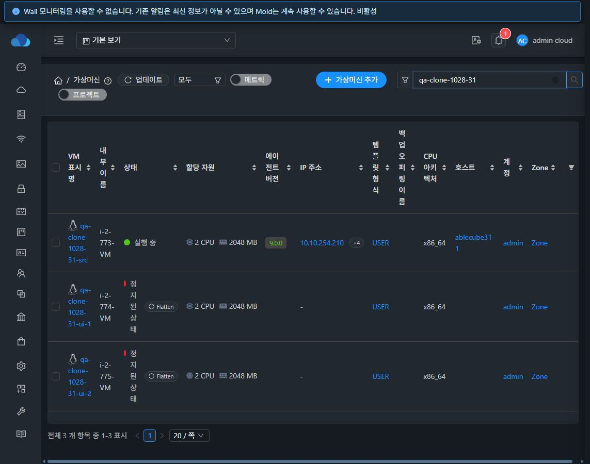
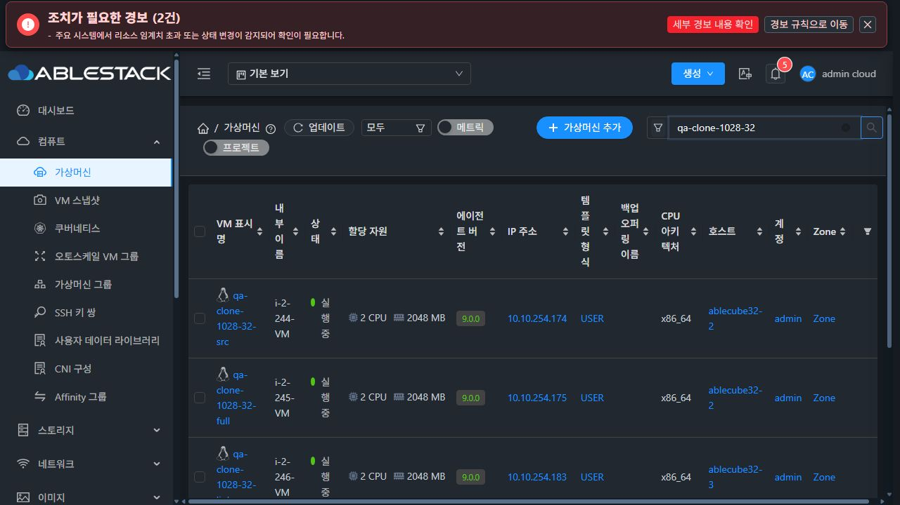
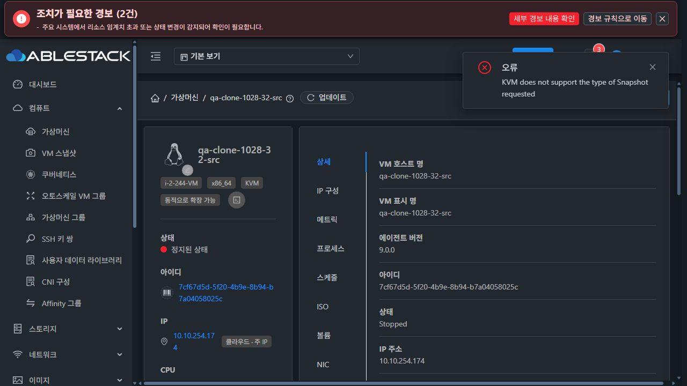
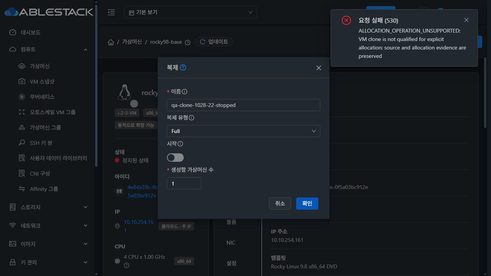
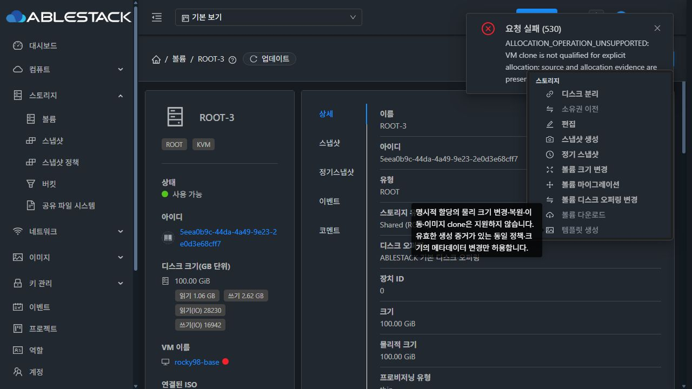

# 가상머신 복제 API·UI 실환경 검토 — 2026-10-28

## 범위와 결론

Mold 가상머신의 **작업 → 복제**를 31번 GFS2, 32번 RBD, 추가 요청된 22번 RBD에서 확인했다. 후속 요청에 따라 22번 명시적 할당 정책 볼륨의 **템플릿 생성·볼륨 다운로드**도 UI/API로 검증했다. 소스 검토 기준은 Europa `37bceae693041b9c79cc52084053b050b577029d`다. 배포 버전을 이 커밋과 동일하다고 추정하지 않았으며, 아래 동작은 각 클러스터에서 실제 관측한 결과다.

31번 2대, 32번 Full 1대와 Linked 2대의 UI 복제 생성이 성공했다. 31번은 ROOT 100GiB와 DATA 1GiB, 32번 Full은 ROOT 100GiB와 DATA 1GiB를 함께 복제했다. 32번 Linked는 별도의 ROOT 전용 원본으로 검증했다. 31번은 시작 옵션을 끈 상태에서 정지된 복제본이 생성되는 것을 확인한 뒤 별도 시작해 독립화까지 확인했다.

명시적 할당 정책의 도입으로 기존 기능을 사용할 수 없게 된 상태는 회귀로 다룬다. **복제·템플릿 생성·다운로드를 실제 사용 가능하게 복원하는 것이 필수 목표이며, UI 차단/안내만 추가하거나 allocation 정보를 제거해 우회하는 방식으로 완료 처리하지 않는다.** RBD 임시 스냅샷 정리, 상태별 지원 조건, 다중 결과와 독립화 단계, API 계약도 함께 개선한다. 이번 작업은 조사와 이슈 등록이며 제품 소스 수정·서비스 재시작·배포·전체 Cloud 빌드는 수행하지 않았다.

## API ↔ UI 대조

두 기존 클러스터와 22번의 실제 `listApis` 및 소스를 확인했다.

| API 입력 | UI | 판단 |
| --- | --- | --- |
| `virtualmachineid` | 현재 VM에서 자동 전달 | 정상 |
| `name` | 이름, 필수 | 정상. 영문 시작/허용 문자/63자 제한과 다중 접미사 길이 검증 확인 |
| `startvm` | 시작 스위치, 기본 false | false도 요청에 명시. 31 false와 32 true 실제 확인 |
| `count` | 1~50 정수, 기본 1 | UI 정상. API 메타데이터는 선택값이나 생략하면 HTTP 530. 서버는 최소 1만 검사하고 UI와 같은 50 상한을 명시하지 않음 |
| `clonetype` | RBD만 Full/Linked | 두 경로 실제 성공. GFS2는 선택기 없이 linked 준비→백그라운드 독립화 경로를 사용함. 고정 전략과 원본 의존성을 제출 전에 안내할 필요 |
| `account`, `domainid` | 없음 | 단순 UI 누락으로 확정할 수 없음. 계정 검증은 있지만 복제 생성은 원본 계정 `curAccount/curVmAccount`를 사용. 소유권 변경 지원 계약부터 확정해야 함 |
| `zoneids` | 없음 | 스냅샷 설명을 복사한 API 메타데이터. `CloneVMCmd.getZoneIds()`의 실제 복제 소비 경로를 찾지 못했고 VM/볼륨 생성은 원본 Zone을 사용. UI 추가보다 API 정정 또는 실제 구현을 먼저 결정 |

현재 실제 지원되는 기본 입력 5종의 단순 누락은 찾지 못했다. 의미 있는 누락은 **요청 전 복제 가능 여부/차단 사유, 원본·디스크 상속 요약, 전체 배치 결과, RBD 의존성 해제 단계**다. API에 이름만 있는 미지원 옵션을 UI에 그대로 추가하는 방식은 권장하지 않는다.

## 실환경 결과

| 항목 | 결과와 근거 |
| --- | --- |
| 31 GFS2, Running 원본, count=2, 시작=false | PASS. `qa-clone-1028-31-ui-1/-2` 생성, 둘 다 Stopped. 각 ROOT/DATA, Device ID 0/1과 크기 일치. Job `b1f37db3-6465-4617-a582-5bda88e22a3f`, status 1 |
| 31 생성 후 시작/독립화 | PASS. 두 VM Running·QGA ping 성공. ROOT/DATA에 대한 `flattened` Agent 응답, 원본 overlay 경로 원복, `clone.fast.*` 세부 상태 해제 확인. 정지 중에는 `Flatten 일시 중단 · 시작 후 재개`가 표시됨 |
| 32 RBD Full, Running 원본, 시작=true | PASS. `qa-clone-1028-32-full` Running, ROOT/DATA 2개. Job `19f6cef2-45a7-4af7-95db-c4faec2e0714`, status 1. libvirt 디스크 경로·QGA ping 및 RBD 부모 참조 해제 확인 |
| 32 RBD Linked, Stopped 원본, count=2 | FAIL. UI 허용 후 Job `1b5b79a6-6d65-4c3d-a473-04b0666de62b` status 2 / code 530 / `KVM does not support the type of Snapshot requested`. 새 복제본 없음. UI와 관리 로그 일치 |
| 32 Full 완료 후 같은 원본에서 재복제 | FAIL. Job `01cefbfc-a595-49bf-b023-ce7815657a7c` status 2, `There are other active Instance Snapshot tasks on the Instance, please try again later`. Full ROOT/DATA가 이미 `full-flattened`이고 실제 RBD parent가 없어도 VM snapshot id 6은 `Expunging`, removed NULL로 남음 |
| 32 RBD Linked, 별도 Running 원본, count=2, 시작=true | PASS. `qa-clone-1028-32-linked-1/-2` Running. Job `6c53263e-2b3b-42fe-821c-67d4f97c40ff`, status 1. 실제 두 RBD 이미지의 parent가 새 원본의 동일 스냅샷을 참조 |
| 22 RBD, 기존 `rocky98-base`, Full | FAIL/미지원 확인. UI 허용 후 HTTP 530 `ALLOCATION_OPERATION_UNSUPPORTED: VM clone is not qualified for explicit allocation; source and allocation evidence are preserved`. 비동기 Job/복제본 생성 전 거절. ROOT는 `policyorigin=explicit`, `off/raw`, `evidence=verified`, 실제 방식 `rbd-thin`. 원본 상태·정책은 변경하지 않음 |
| 22 ROOT 볼륨 → 템플릿 생성 | UI FAIL/API PASS. Ready·Stopped ROOT의 템플릿 생성 버튼이 명시적 정책 때문에 비활성. 직접 `createTemplate(volumeid=...)`는 Job `c5ef127c-fc01-4d92-9a49-e16e95c11a20` status 1, 템플릿 `d6c0c108-9eaf-4965-b7f5-fc7be8c93bf7`, isready=true / Download Complete. 실제 QCOW2, 논리 100GiB, 물리 2454978560 bytes. 불필요한 UI 차단 확인 |
| 22 ROOT 볼륨 다운로드 | UI/API FAIL. 다운로드 버튼 비활성. 직접 `extractVolume(HTTP_DOWNLOAD)`도 Job `95ae4b58-8965-4dc7-bfee-ab165d18e832` status 2, `ALLOCATION_OPERATION_UNSUPPORTED: volume copy/move is not qualified for explicit allocation; source and allocation evidence are preserved`. 다운로드 URL 생성 전 거절 |
| 빈 이름, `1bad_name`, 다중 접미사 포함 길이 초과 | PASS. 폼 오류, 제출 차단 |
| 수량 1.5 | PASS. 1~50 정수 오류, 제출 차단 |
| 기존 이름과 충돌 | PASS. 530으로 차단하고 폼 입력 보존. 영문 알림은 개선 대상 |
| 모바일 390×844, 오류 표시 | PASS. 다크 테마에서 폼과 취소/확인 사용 가능, 모달 가로 overflow 없음. 브라우저 viewport는 검증 후 원복 |

## 개선 작업과 완료 기준

### CL-01 · P1 · 명시적 할당 정책과 복제 지원 계약

- 22번에서 재현한 기본 RBD Thin의 명시적 `off/raw`를 포함해 기존에 유효한 정책/형식의 VM 복제를 실제 지원하도록 복원한다. 정책 존재 자체를 이유로 복제를 일괄 차단하지 않는다. UI 차단/안내만으로 완료할 수 없다.
- 원본과 대상의 ROOT/DATA 정책, 실제 형식·할당 방식·증거 및 다중 결과를 일관되게 관리한다. 기존 allocation 세부정보를 삭제하거나 legacy로 바꿔 우회하지 않는다.
- Backend가 authoritative한 `canClone`/차단 사유/지원 방식 정보를 제공하고 목록·상세·폼·API에서 같은 결정을 사용한다. 현재 `volumemutationblockedreason`은 비어 있는데 clone은 거절되는 사례도 포함한다.
- 완료: 22 RBD와 31 GFS2/32 RBD의 legacy/explicit, Thin/허용된 Full, ROOT/DATA 혼합을 실제 UI→API→DB→이미지로 대조한다. 미지원 조합은 생성 전에 설명하고 직접 API도 부작용 없이 거절한다.

### CL-02 · P1 · RBD 복제 임시 스냅샷 수명과 후속 작업 복구

- Full 독립화 후 남은 임시 VM 스냅샷을 안전하게 정리하고, `Expunging`이 정상 후속 복제를 지속 차단하지 않도록 한다. 현재 ROOT/DATA의 `full-flattened`와 부모 참조 해제 후에도 VM snapshot id 6이 남았다.
- Linked 자식이 참조하는 부모는 보존한다. 정리 재시도·중복 요청·부분 실패·관리 서버 재시작·실제 작업 부재를 구분하며 DB 상태만 강제로 바꿔 차단을 해제하지 않는다.
- 완료: Full→Full, Full→Linked, Linked 복수 자식→일부/전체 삭제→다음 복제를 두 RBD 환경에서 연속 검증한다. 임시 스냅샷·참조·DB 상태가 일치하고 사용자 스냅샷을 건드리지 않는다.

### CL-03 · P1 · 상태·스토리지·작업 충돌의 UI/API 일치

- 32번 Stopped RBD의 늦은 비동기 실패를 해결한다. 정지 복제를 구현하거나 지원하지 않으면 UI 비활성/사유와 API 사전 거절을 일치시킨다. GFS2의 별도 경로와 구분한다.
- VM 스냅샷 작업·백업·Flatten·호스트 상태·추가 XML 디스크·권한·할당 정책을 공통 capability로 판단한다. 소스에서 확인한 KVM/Simulator 제한과 스냅샷 전역 설정도 포함한다.
- 완료: 허용한 UI 조합은 실제 성공하고 차단한 조합은 영어 내부 예외를 뒤늦게 노출하지 않는다. 제출 사이에 상태가 바뀌면 서버에서 재검증한다.

### CL-04 · P2 · 배치 결과·실패 복구·독립화 상태

- API의 현재 단일 `Optional<UserVm>`/마지막 VM 응답을 호환성 있게 확장해 요청 개수, 생성된 모든 UUID·이름·시작 상태, 항목별 오류와 잔여 자원을 제공한다. 31 count=2와 32 Linked count=2 모두 마지막 한 대만 응답한다.
- UI에 전체 결과와 상세 이동, 부분 실패 시 재시도/정리 안내를 제공한다. 성공 알림의 원본 이름만으로 새 VM을 찾게 하지 않는다.
- 생성, 부팅, 독립화 완료를 구분하고 GFS2 정지 시 재개 조건과 RBD Full/Linked의 의존성을 알린다. 기존 GFS2 Flatten 표시/전원 제어는 회귀 보존한다.
- 완료: 다중 성공/중간 실패/시작 실패/조회 단절에 과다 생성·결과 유실이 없고 전체 대상과 실제 저장소 상태를 대조할 수 있다.

### CL-05 · P2 · API 입력 계약 정리

- `count`의 필수 여부·기본값·최대값, `startvm` 필수/기본 설명, `clonetype` enum·스토리지별 의미를 메타데이터·서버·UI에서 통일한다.
- 미사용 `zoneids`, 생성 소유자와 연결되지 않은 `account/domainid`는 호환성 정책에 따라 실제 구현하거나 지원하지 않는다고 명시/폐기한다. UI에 동작하지 않는 필드를 추가하지 않는다.
- 완료: 메타데이터로 만든 클라이언트, 생략/범위 초과/잘못된 type/존재하지 않는 대상/권한 경로에서 결과와 문서가 일치한다.

### CL-06 · P3 · 복제 전 요약과 공통 UX

- 원본 VM, 최종 이름 예시(`이름-1…-N`), ROOT/DATA 전체 복제 범위·크기, 컴퓨트/네트워크 상속, 시작 여부, 현재 스토리지의 고정/선택 가능한 전략을 간결히 보여준다.
- 게스트 내부 IP/hostname/인증정보 등의 복사와 Cloud의 새 NIC/MAC 할당을 구분해 안내한다. 게스트 일반화는 별도의 명시적 기능으로 설계하며 복사 성공을 일반화 완료로 표현하지 않는다.
- 한국어 오류·이유, 키보드 제출 1회 보장, 모바일·라이트/다크·긴 오류·취소/실패 입력 보존을 VM/MoldDialog 기준으로 확인한다.

### CL-07 · P1 · 명시적 정책 VM 볼륨의 템플릿 생성 UI 복원

- 22번 ROOT의 `Ready`, VM `Stopped`, 비암호화·정상 권한 조건에서도 `!!allocationIntent(record)`만으로 템플릿 생성이 비활성이다. 같은 원본의 직접 API는 실제 Ready 템플릿을 생성했다.
- `ui/src/config/section/storage.js`의 포괄 차단을 제거하고 기존 상태·권한·암호화·작업 충돌 검사를 유지한다. 원본 allocation 정보를 수정하지 않는다.
- 완료: 22 RBD와 31 GFS2/32 RBD에서 explicit/legacy ROOT와 지원 DATA 경로의 실제 UI 생성, 템플릿 Ready·형식/내용·원본 정책 보존, 생성 템플릿을 이용한 VM 부팅을 검증한다. 기존 API 성공을 새 UI 성공으로 오인하지 않는다.

### CL-08 · P1 · 명시적 정책 볼륨 다운로드 UI·Backend 복원

- UI의 allocation 일괄 비활성과 `extractVolume → orchestrateExtractVolume → VolumeServiceImpl.copyVolume`의 일괄 lifecycle 차단을 함께 해결한다. export용 읽기 복사와 원본의 pool/path/정책을 바꾸는 이동을 구분한다.
- 원본 정책·증거를 유지하며 Primary→Secondary export의 목적 이미지 형식과 증거를 검증한다. 기존 정지/분리·권한·암호화/보호·리소스 한도·실패 정리와 URL 수명 규칙을 보존한다.
- 완료: 22 RBD와 31 GFS2/32 RBD의 explicit/legacy 볼륨에서 UI 요청→작업 성공→실제 다운로드 파일의 형식·크기·해시/내용 검증까지 수행한다. 오류·중복·재시도·취소/만료에 임시 자원/URL이 누수되지 않고 원본이 변경되지 않는다.

## 소스 근거

- `api/.../vm/CloneVMCmd.java`: 8개 입력, 단일 응답, 선택 `count` 메타데이터.
- `ui/src/views/compute/CloneVM.vue`: 4개 표시 입력과 현재 VM 자동 전달, RBD 유형 조건, count/name 검사, 원본 이름 기반 Job 안내.
- `ui/src/config/section/compute.js`: Running/Stopped 메뉴 노출; 기존 백업/Flatten/추가 디스크 차단; 명시적 할당·RBD 정지·활성 VM 스냅샷과의 차이.
- `server/.../vm/UserVmManagerImpl.java`: `requireUnqualifiedVmAllocation`, `validateCloneCondition/validateCloneNames`, 두 복제 경로, `cleanupCloneVMSnapshot`, `createCloneVM`의 원본 계정 사용.
- `api/.../storage/VolumeAllocationPolicy.java:137`: 명시적 allocation lifecycle 안전 차단.
- `server/.../vm/snapshot/VMSnapshotManagerImpl.java`: KVM 전략 선택 실패와 `hasActiveVMSnapshotTasks`의 Expunging 차단.
- `engine/storage/snapshot/.../StorageVMSnapshotStrategy.java`: 임시 스냅샷 삭제와 디스크 스냅샷 의존성.
- `ui/src/config/section/storage.js:313/333`: 다운로드·템플릿 생성의 `!!allocationIntent(record)` 비활성 조건.
- `server/.../template/TemplateManagerImpl.java:2346`: 볼륨에서 템플릿 생성의 기존 권한·암호화·정지 조건.
- `server/.../storage/VolumeApiServiceImpl.java:5051/5370`, `engine/storage/volume/.../VolumeServiceImpl.java:2099/2736`: 다운로드와 copyVolume의 명시적 정책 일괄 차단.

## 검증 한계

- 실제 UI로 복제를 제출하고 API Job, DB, libvirt/QGA, GFS2/RBD 실물로 교차 확인했다. UI fixture나 단위 검사 결과로 실제 기능 성공을 대체하지 않았다.
- 22번은 현 정책에서 사전 거절됨을 검증했으며 성공 복제나 legacy 정책 우회를 수행하지 않았다. 원본 `rocky98-base`는 Stopped를 유지했다.
- 일반 사용자/프로젝트/동시성·부분 실패 주입, HA/FT/DR 보호 중인 VM, Windows/UEFI/TPM 및 다중 NIC/SSH 키/UserData 상속 전체 행렬은 이번 실환경 범위에 포함하지 않았다.
- 게스트 내부 파일의 바이트 동일성 검증은 완료하지 않았다. 32번 전용 이미지가 QGA `guest-exec`를 차단해 시험 marker 쓰기 자체가 거절되었고 보안 설정을 변경하지 않았다. 부팅/QGA 확인과 디스크 수·크기·연결·실제 부모 의존성 확인을 구분한다.
- 32번 Linked의 호스트 .3 SSH 키 불일치로 직접 QGA를 확인하지 않았다. Cloud Running과 실제 RBD parent는 확인했다. 31 두 복제본과 32 Full은 직접 QGA ping 성공이다.
- 전체 Cloud/Release CI, Maven 모듈/제품 UI 빌드·배포는 이번 조사에서 실행하지 않았다.

## 정리와 기존 자원 보존

31/32의 전용 VM 8대·볼륨 13개와 임시 VM 스냅샷은 정상 API로 정리했고 활성 잔여는 0이다. GFS2 이미지/overlay와 RBD 이미지도 잔여 0을 확인했다. 32번 Full 원본 삭제는 임시 스냅샷 때문에 한 번 실패했고, 정지 원본의 스냅샷 삭제는 `Domain not found`로 실패했다. 전용 원본 재시작 후 정상 스냅샷 삭제 API와 VM 삭제를 재시도해 정리했다. 이 수동 복구는 결함을 통과로 바꾸는 근거가 아니다. 분리된 DATA 볼륨 5개도 정확한 시험 UUID로 정상 삭제했다.

22번에서 API 검증으로 생성한 전용 템플릿은 정상 `deleteTemplate` Job `99240996-aad8-444a-8dde-a579e7365558` status 1로 삭제했다. 다운로드는 URL을 생성하지 못했다. 기존 원본 `rocky98-base`와 ROOT의 정책/내용은 바꾸지 않았고 Stopped를 유지했다. 검증 중 다른 작업에서 추가된 비시험 VM은 건드리지 않았다. `cleanup-summary.json`에 최종 API/DB·실물 확인 결과를 기록한다. 인증 비밀과 전체 운영 inventory는 게시 자료에서 제외한다.
