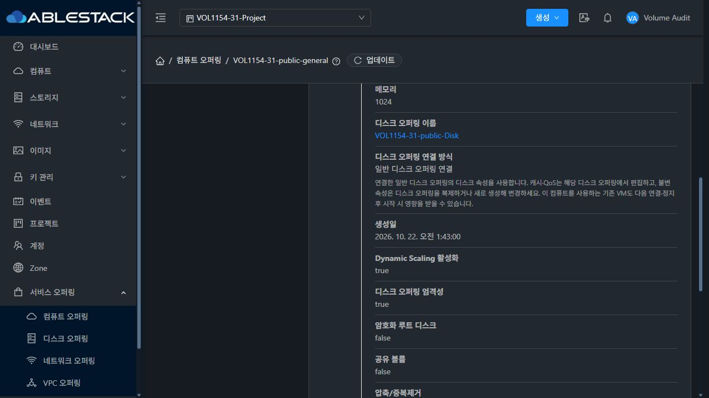
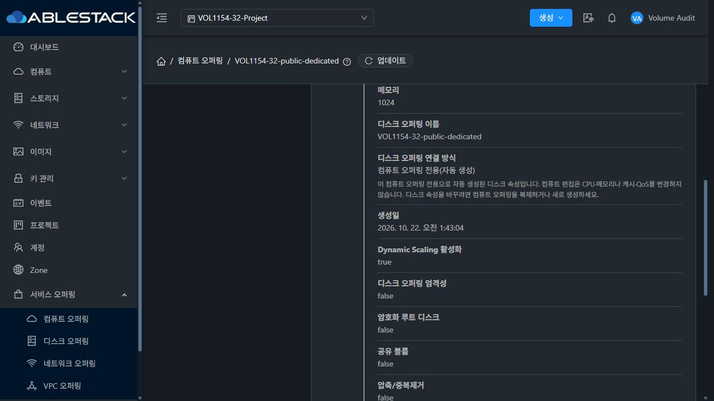

# #1154 연결된 디스크 오퍼링 표시·탐색 완료 보고서

Epic #1422 · 누적 Draft PR #1435 · 2026-10-22 · 실행 소스 `77475f80bd2ed1f38897b94d26bd2d27c7cb460c`

## 변경 결과와 설계

자동 생성된 컴퓨트 전용 디스크는 목록·상세 모두 일반 텍스트로 표시하고, 일반 디스크는 연결 ID·이름·조회 권한이 확인된 경우 정확한 디스크 상세 링크를 제공한다. 연결 방식은 기존 세로형 상세 행에서 “컴퓨트 오퍼링 전용(자동 생성)” 또는 “일반 디스크 오퍼링 연결”로 표시한다. 상세 레이아웃을 재배치하지 않았다.

이슈 등록 뒤의 선행 Epic 소스에는 이미 API의 `diskofferingcomputeonly` Boolean, 실제 DiskOfferingVO.computeOnly를 응답하는 서버 코드, “연결된 디스크 오퍼링” 목록 헤더와 상세 연결 방식 행이 있었다. 이번에는 이를 재사용하고 목록·상세를 `LinkedDiskOffering`으로 통일했다. 이름이 같은지로 유형을 추론하지 않는다.

- Boolean/문자열 true는 전용, Boolean/문자열 false는 일반으로 처리한다. 기존 상세의 문자열 false를 전용으로 오판하는 truthy 조건을 제거했다.
- 누락/null/잘못된 유형은 일반 링크로 추정하지 않는다. 상세에는 “알 수 없음”과 재조회 안내를 표시한다. 목록 이름의 도움말도 같은 계약을 사용한다.
- ID·이름·listDiskOfferings 권한이 없으면 이동을 제공하지 않는다. URL 경로의 ID는 인코딩한다. 새 응답이 전용/미확인으로 바뀌면 이전 링크를 제거한다.
- 목록 헤더·상세의 기존 세로형 행과 할당 정책/관측 증거는 유지했다. [설계](../../design/volume-1154-linked-disk-offering.ko.md).

구현 커밋: `4d794e91ed7`, `ae7afef326d`, `77475f80bd2`. API/server 소스는 이전 기준 `c347d137d5e`와 동일하다. [소스 계약](unchanged-api-source.json).

## 빌드와 배포

| 항목 | 결과 |
|---|---|
| 변경 UI 파일 lint | 성공 |
| 관련 Jest | 7 suites / 114 tests 성공 |
| UI production build | WSL ext4, exit 0 |
| Java/Maven/JAR/Agent/qemu | 소스 변경·빌드·배포 없음 |
| 전체 Cloud/Release CI | 미실행 |
| 31/32 정적 배포 | 각 908개 파일, 모든 해시 일치 |
| WEB-INF/META-INF/config/JAR/관리 PID | 보존 |
| 배포·정리 후 | Mold active, /client/ HTTP 200, 호스트 6개 Up |

앱 재시작 전 중단했던 빌드는 성공으로 집계하지 않고 같은 실행 소스에서 production 빌드를 새로 완료했다. Browserslist 갱신 안내 및 webpack 자산/entrypoint 크기 경고 2개가 있으며 종료 코드는 0이다. 관련 검사에서는 전체 UI coverage 수집을 끄고 지정한 7개 suite를 실행했다.

배포 전 동적으로 조합되는 번역 키를 잘못 지정한 검사 조건은 서버 변경 전에 수정했다. 실제 config 키 `linked.disk.offering` 및 새 컴포넌트·미확인 안내·FTCTL 마커를 검사했다. 활성 webapp 루트를 교체/삭제하지 않았고 정적 파일만 갱신했다. 설정·서버 파일 및 기존 해시 자산과 롤백 백업을 보존했다.

[빌드 요약](build-summary.json) · [로그 발췌](build-excerpts.log) · [배포 결과](ui-deployment.json) · [소스 해시](source-files.json)

## 실제 API/DB와 UI 검증

31 GFS2와 32 kernel RBD 각각 전용 접두어로 공개/도메인 일반 디스크 및 자동 전용/일반 연결 컴퓨트를 준비했다. Admin/DomainAdmin/User/사용자 소유 Project를 실제 로그인해 검사했다. 이 변경은 오퍼링 표시·탐색이므로 새 VM·볼륨·이미지는 생성하지 않았다.

| 근거 | 확인 범위 |
|---|---|
| API/DB 14개 기록 | 두 환경의 공개/도메인 4유형, 연결 ID·이름·computeOnly와 DB join, 전용 단독 상세 제외/일반 상세 조회, DA/User/Project 범위 |
| Inactive API 4개 | 비활성 컴퓨트의 연결 유형 보존, 일반 디스크의 독립 Active |
| API schema 2개 | listApis의 diskofferingcomputeonly Boolean |
| 재시작 후 API 재확인 2개 | 각 6개 fixture와 상태·유형 불변 |
| 최종 UI 83개 기록 | 기능 81개(실제 응답 경로 76개 + 제어 응답 5개), 설정 복원·로그아웃 2개 |

실제 화면에서 목록 헤더, 전용 이름의 무링크·클릭 시 경로 유지, 공개/도메인 일반 링크의 정확한 ID 상세 이동, 검색 조건을 유지한 뒤로가기, 상세 이름/연결 방식의 세로 행을 확인했다. DA/User/Project 각각 두 환경의 네 유형 목록·상세 및 두 일반 링크를 확인했다. Admin은 Inactive 목록/상세도 확인했다.

별도 **제어 응답 5개**는 실제 서버 계약과 구분한다. 31 목록/상세에서 유형 필드 누락, 32 목록에서 문자열 Boolean, 양 환경에서 특정 listServiceOfferings XHR의 HTTP 500을 주입했다. 미확인 링크 차단·안내, 정상 재조회 후 일반 링크 복구, 실패 시 기존 행/세션 보존과 오류 표시, 정상 갱신 복구를 확인했다. 이후 모든 중단 패턴을 제거하고 캐시 설정을 복원했다.

초기 Playwright 클릭이 실제 탐색을 시작하지 않은 시도와 검증 스크립트의 도움말 기대 문구 오류는 성공 집계에서 분리했다. 실제 AX 클릭·정확한 URL 및 표시된 도움말로 재검증한 결과가 최종 기록이다. [분리한 자동화 시도](ui-attempts.json).

[API/DB 기록](api-checks.json) · [비활성 API](inactive-api-checks.json) · [API schema](api-response-contract.json) · [재시작 후 확인](resume-checks.json) · [최종 UI 기록](ui-evidence.json) · [재현 절차](reproduction.ko.md)

일반 연결 — 기존 세로형 상세와 정상 상세 링크:

자동 생성 전용 — 기존 세로형 상세와 일반 텍스트:

## 정리와 보존

- 컴퓨트 12개·일반 디스크 4개 및 자동 전용 디스크 6개 Inactive. 일반 연결 디스크는 컴퓨트 비활성화만으로 변경되지 않고 자체 비활성화 직전까지 Active를 유지했다.
- 프로젝트 2개·계정 4개·도메인 2개 제거. 활성 compute/disk/account/domain/VM/volume 잔여 0. 서버 전송 임시 파일 6개 제거.
- 새 VM/이미지 생성 0. 기존 운영 inventory 동일, 호스트 6개 Up, 관리 JAR 해시·PID 동일, 최종 정적 파일 해시·FTCTL 마커·WEB-INF·HTTP 200·Mold active 재확인.
- 브라우저 설정 복원·로그아웃·검증용 두 탭 종료. 기존 사용자 탭은 보존.
- 제품 Inactive 이력과 배포 롤백 백업 보존. 보호된 주 작업 디렉터리의 HEAD·status·기존 FT diff 해시 동일.

[정리 결과](cleanup.json) · [작업 디렉터리 보존](workspace-protection.json)

## 완료 범위와 다음 작업

#1154는 구현·UI 모듈 빌드·31/32 배포·개별 기능 검증 완료 기준을 충족한다. 누적 PR #1435는 Draft·미병합이며 Epic #1422 전체 종료 판정은 별도다. #1154 종료 후 하위 이슈는 **16개 중 완료 12개·열림 4개**다.

다음은 **#1209 VM 생성 디스크 오퍼링 표시 개수/페이지**, 이어서 #1210 표시이름 기반 VM 연결 대상 조회, #1433 세 메뉴의 VM 표준 UI, #1434 최종 통합 회귀·Epic 종료 판정이다. [다음 작업](next-steps.ko.md).

권한 없는 링크·null/잘못된 유형·같은/다른 이름·응답 갱신의 추가 경계는 focused 검사 결과다. 이번 UI 검증으로 guest I/O·이미지 할당·다른 pool 이동·물리 수명주기·전체 테마/반응형 UI 행렬을 검증한 것으로 확대하지 않는다. 전체 UI 표준/통합 회귀는 #1433/#1434 범위다. #1437은 해결 상태를 유지한다. RBD falloc/lazy thick·미지원 Full 확장·영구 예약 보장을 추가하지 않는다.
