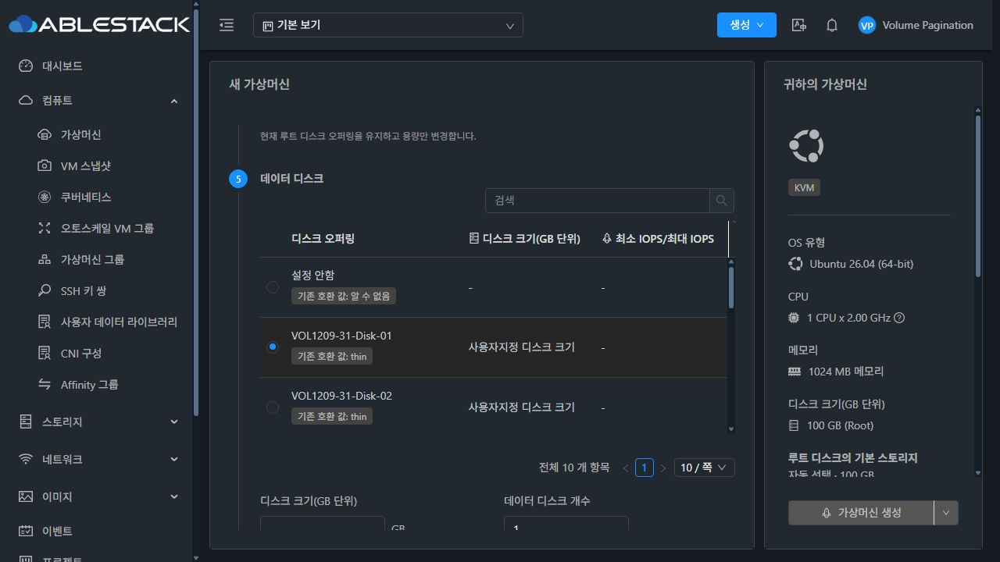
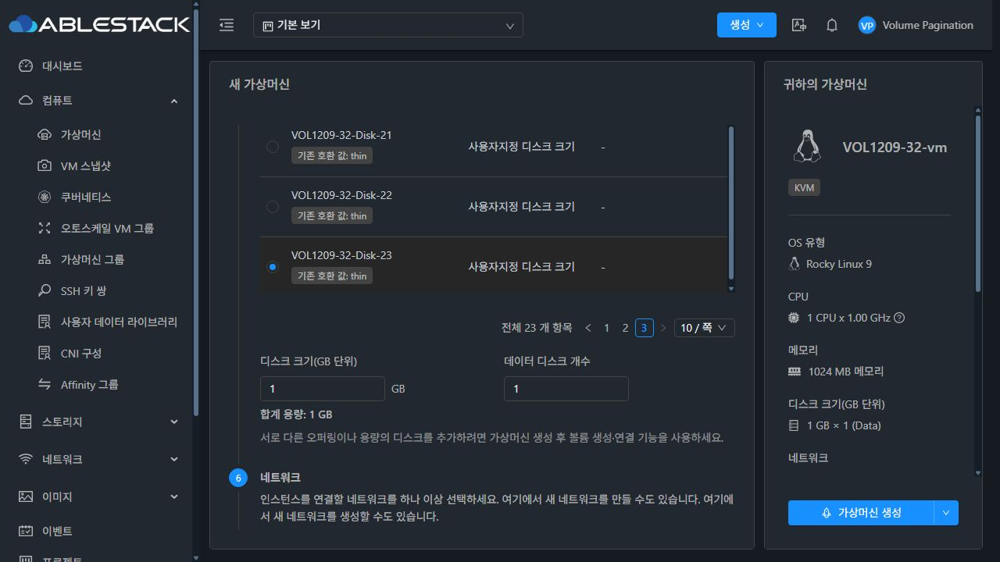

# #1209 VM 생성 디스크 오퍼링 페이지 처리 완료 보고서

Epic #1422 · 누적 Draft PR #1435 · 2026-10-22 · 실행 소스 `70dd965b2b662a15362f4c9ad2f2cdc92174017a`

## 원인·설계·구현

31/32 수정 전 실제 화면에서 **후보 23개 이상인데 “전체 10개 항목”과 1페이지만 표시**되는 증상을 재현했다. API는 전용 후보에 대해 count=23과 페이지별 10/10/3을 정상 반환했다. DiskOfferingSelection이 전체 rowCount 대신 현재 응답 페이지 길이를 total로 사용한 것이 직접 원인이다.

단순 total 교정과 함께 VM 생성의 ROOT/DATA가 같은 후보 배열을 공유하는 문제를 보완했다. 기존 readAllocationList로 소유자·도메인·프로젝트·Zone의 모든 API 페이지를 수집하고 완전한 결과만 교체한다. 각 선택기는 전체 후보에서 독립적으로 KVDO 적격성·이름/설명 검색·페이지·표시 개수를 계산한다. 페이지/검색이 부모의 후보 배열이나 선택 객체를 교체하지 않는다.

- 10/20개 표시·마지막 페이지·검색/해제 시 UUID와 크기·개수를 유지한다. “설정 안함”은 첫 데이터 페이지의 별도 선택지이며 오퍼링 count/슬롯에 포함하지 않는다. 필수 ROOT에는 넣지 않는다.
- 미선택/적격성 변경 때 이전 디스크 객체를 비운다. 같은 범위의 조회 실패는 기존 후보/선택을 유지하고 오류·재시도를 제공하며, 로딩/오류 중 생성을 차단한다.
- 소유자·Zone 범위 변경 시 이전 후보/선택을 제거하고 늦은 응답을 무시한다. 최초/후속 페이지 실패·원자적 교체·동시 요청/종료된 컴포넌트의 회귀를 검사했다.
- 명시적 allItems 모드는 DeployVM과 ISO 추가 데이터 선택기에 적용했다. 다른 부모의 기존 서버 페이지 계약은 유지하고 API rowCount를 사용하도록 공통 컴포넌트를 교정했다. ROOT/DATA/ISO·기존 부모 계약은 focused 검사로 구분한다.

[설계](../../design/volume-1209-disk-offering-pagination.ko.md) · [재현 절차](reproduction.ko.md)

## 모듈 빌드·배포

| 항목 | 결과 |
|---|---|
| 변경 UI lint | 성공 |
| 관련 검사 | 6 suites / 65 tests 성공 |
| UI production build | WSL ext4 · exit 0 |
| 테스트/빌드 Node | 20.20.2 / 14.21.3 |
| 31/32 활성 webapp 정적 배포 | 각 908개 파일 · 모든 해시 일치 |
| WEB-INF/META-INF/config/JAR/PID | 보존 |
| 최종 런타임 | Mold active · /client/ HTTP 200 · 호스트 6개 Up |

기존 테스트의 Array.at 사용을 지원하는 Node 20에서 focused 검사를 실행하고, 기존 UI production 툴체인 Node 14로 빌드했다. 전체 coverage 수집은 끄고 지정한 6개 suite를 검사했다. Browserslist 갱신 안내·번들 크기 경고는 있으나 빌드 종료 코드는 0이다.

변경 파일은 UI와 설계 문서뿐이다. Java/Maven/JAR/Agent/qemu 변경·빌드·배포와 전체 Cloud/Release CI 실행은 없다. 활성 webapp 루트는 삭제/교체하지 않았고 정적 파일만 갱신했다. FTCTL 마커·서버 파일·설정·기존 해시 자산·롤백 백업을 보존했다.

[빌드 요약](build-summary.json) · [로그 발췌](build-excerpts.log) · [배포](ui-deployment.json) · [소스 해시](source-files.json)

## API·DB·실제 UI 검증

각 환경에 공개 21개·같은 도메인 2개의 전용 일반 후보를 만들고, 다른 도메인 후보 1개를 별도로 준비했다. Admin/DomainAdmin/User/Project 실제 로그인과 소유자 단계를 확인했다.

| 근거 | 범위·결과 |
|---|---|
| API/DB 18개 기록 | 4역할 × 2환경의 count=23·10/10/3·마지막 ID 검색·빈 응답·다른 도메인 허용/거절 및 DB 일반 오퍼링 23개 |
| 실제 UI 52개 기록 | 기능 50개(실제 응답 49개·제어 응답 1개), 설정 복원/로그아웃 2개 · 최종 모두 성공 |
| 생성 요청 2개 | 환경별 deployVirtualMachine POST 1회, 마지막 disk23 ID·1GiB·개수 1·startvm=false |
| VM/볼륨 API·DB 2개 | 실제 Stopped VM, ROOT 100GiB·DATA 1GiB, DATA의 정확한 오퍼링 UUID/크기·컴퓨트/템플릿/네트워크 관계 |

두 환경의 데이터 페이지 1/2/3(10/10/3), 표시 개수 20개와 10개 복귀, 마지막 후보 선택·페이지 왕복, 설명 검색·해제, 미선택의 이전 객체 제거를 검증했다. 31번은 빈 검색 결과와 대소문자 없는 검색도 확인했다. ROOT의 검색/3페이지에서 disk22를 선택해도 DATA의 페이지·disk23 선택이 유지됐고 추가 listDiskOfferings 요청은 0개였다. 실제 생성에서는 ROOT 무시를 끄고 DATA disk23·1GiB·개수 1을 사용했다.

User 기본 보기에서 실제 VM을 생성한 뒤 API/DB와 VM 볼륨 탭을 대조했다. ROOT 내부 오퍼링 UUID는 일반 볼륨 API에서 노출되지 않아, 정리 후 보존된 DB 이력에서 선택한 컴퓨트의 내부 디스크 UUID와 일치함을 추가 확인했다. 볼륨 4개는 Allocated이며 pool/path가 없다. 이 결과를 실물 이미지 할당·게스트 부팅/I/O 성공으로 확대하지 않는다.

제어 응답 1개는 **31번 최초 오퍼링 조회 XHR의 HTTP 500**이다. 이름 입력·세션 유지, 오류/명시적 재시도, 생성 차단 및 정상 후보 복구를 확인했다. 같은 범위의 이전 후보 보존·후속 페이지 실패·소유자 전환의 늦은 응답 무시는 focused 검사 결과와 구분한다. UI 역할별 후보/마지막 페이지·다른 도메인 허용/거절은 실제 API 응답 경로다.

초기 검사의 표 측정용 행 집계, 기존 ROOT 선택 표현, Node 버전 차이와 자동화의 읽기 전용 콤보/역할별 단계 번호/정확한 텍스트 선택자를 조정했다. VM 볼륨 탭은 기존 규약으로 “1.00 GB”를 표시하며 API/DB에서는 1,073,741,824 bytes로 대조했다. GiB 문구를 기대한 두 초기 자동화 기록은 [분리한 시도](ui-attempts.json)에 보존하고 최종 성공 기록과 구분했다. 네트워크 준비 시 VLAN이 필요한 L2 오퍼링의 거절 이후 기존 활성 격리 오퍼링으로 전용 네트워크를 준비했다.

[수정 전 UI](ui-before.json) · [API/DB](api-checks.json) · [최종 UI](ui-evidence.json) · [생성 POST](ui-posts.json) · [VM/볼륨·DB](vm-checks.json)

수정 전 — 전체 개수가 10개로 잘못 표시됨:

수정 후 — 10개씩 총 23개, 3페이지 마지막 후보와 1GiB 선택:

## 정리·완료·다음 작업

- VM 2개 expunge·Allocated 볼륨 4개·전용 네트워크 2개·프로젝트 2개·계정 4개·도메인 4개 제거.
- 컴퓨트 2개·일반 디스크 48개·자동 전용 디스크 2개 Inactive. 제품 이력과 배포 백업은 보존했다.
- 활성 VM/볼륨/네트워크/계정/도메인/오퍼링 잔여 0, 기존 운영 inventory 동일. 관리 JAR/PID·최종 정적 해시·FTCTL/WEB-INF·Mold/HTTP·호스트 상태를 재확인했다.
- 브라우저 중단 패턴/캐시 복원·로그아웃·검증 탭 종료. 기존 사용자 탭과 보호된 주 작업 디렉터리의 FT diff/HEAD/status를 보존했다.

[정리 결과](cleanup.json) · [작업 디렉터리 보존](workspace-protection.json) · [기계 판독 요약](summary.json)

#1209는 설계·구현·UI 모듈 빌드·31/32 배포·개별 기능 검증 기준을 충족한다. 종료 후 하위 이슈는 **완료 13개·열림 3개**다. 누적 PR #1435는 Draft·미병합이고 Epic #1422는 열린 상태를 유지한다.

다음은 **#1210 표시이름으로 연결 대상 VM 조회/선택 → #1433 VM 표준 UI 통일 → #1434 최종 통합 회귀·Epic 종료 판정**이다. [다음 작업 상세](next-steps.ko.md).

이번 실환경 검증은 DeployVM의 템플릿 ROOT/DATA 경로다. ISO·복구·VNF·오토스케일 등 다른 부모의 전체 실환경 생성, KVDO 실물 배치, 다른 Zone 전환, ROOT override 실물 생성·게스트 부팅/I/O·전체 테마/반응형 행렬은 검증하지 않았다. 관련 컴포넌트 경계/늦은 응답 검사는 위 focused 결과로 한정한다. #1437은 해결 상태를 유지하며 RBD falloc/lazy thick·미지원 Full 확장·영구 예약을 추가하지 않는다.
