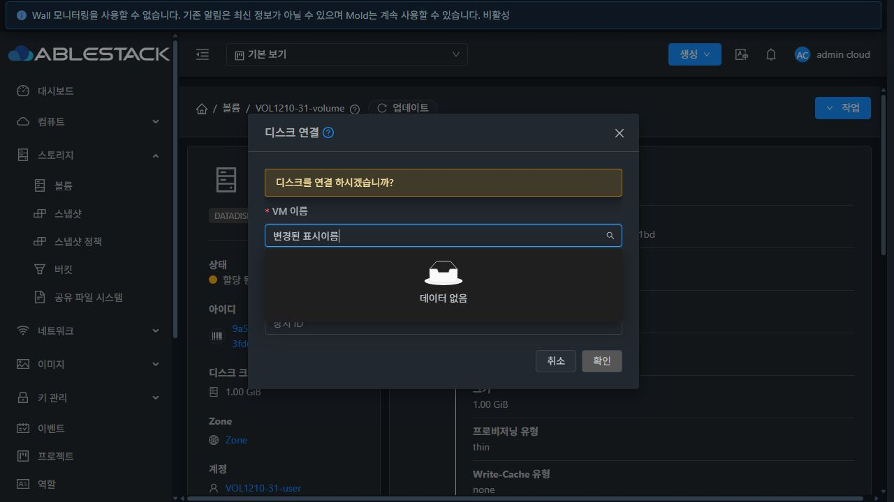
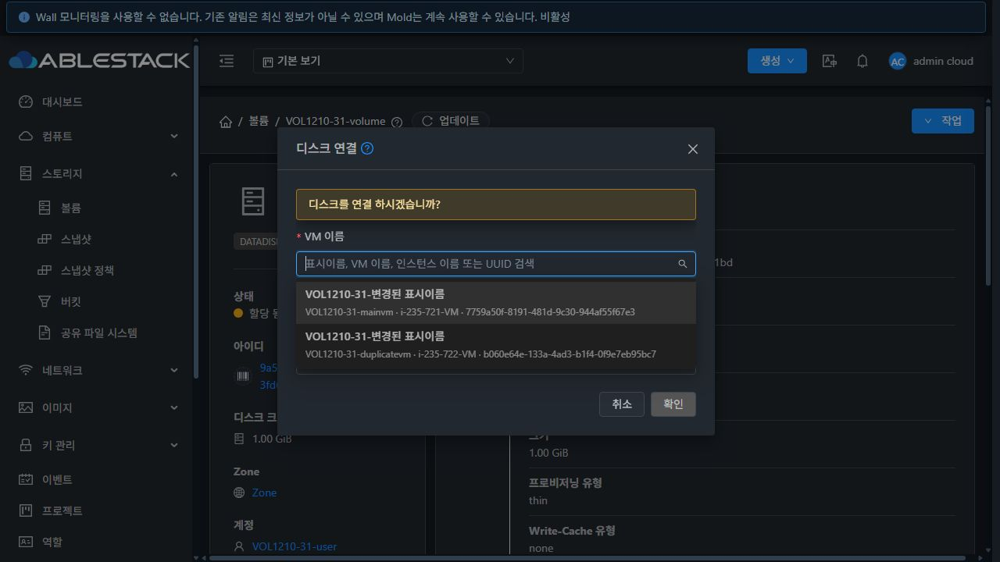
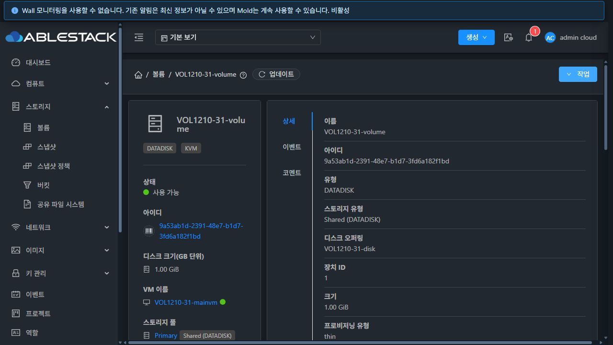
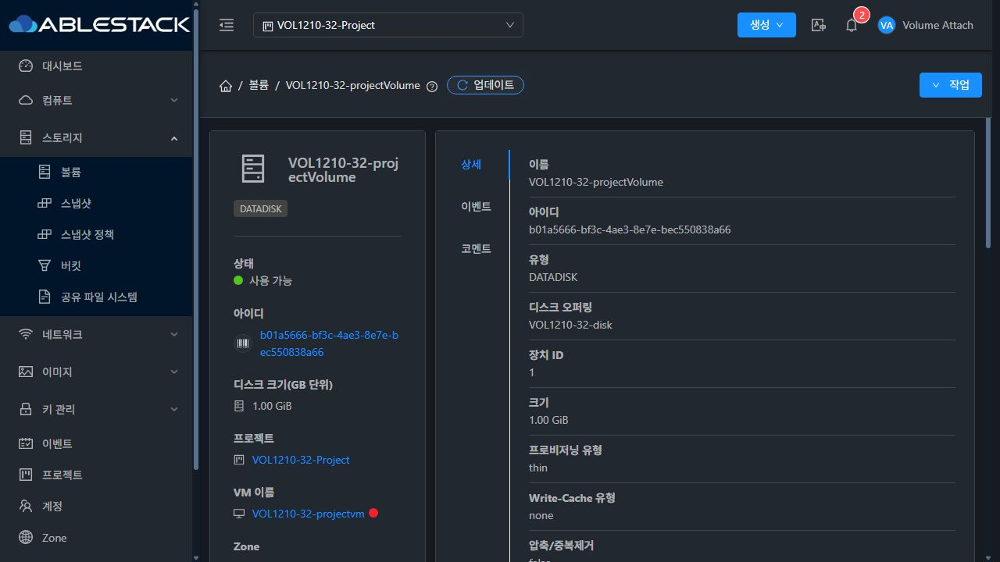

# #1210 볼륨 연결 VM 표시이름 검색·선택 완료 보고

2026-10-22 · Epic #1422 · 누적 Draft PR #1435
실행 소스: 5c9a982064df4f05ad9b5623520a1cb2dbe3f9ad

## 결과와 구현

스토리지 > 볼륨 > 디스크 연결에서 변경된 표시이름으로 VM을 찾고 UUID로 선택하도록 수정했다. 기존 VM 이름을 우선하던 표시/검색을 표시이름 우선으로 바꾸고, 이름·API가 제공하는 인스턴스 이름·UUID를 보조 행에 표시한다. 동명 VM을 식별하며 기존 이름 검색도 유지한다.

Running/Stopped 각각 모든 API 페이지를 조회한 뒤 원자적으로 교체한다. 소유자/프로젝트·Zone·하이퍼바이저 범위, 조회 오류/독립 재시도·입력 보존·제출 차단, 늦은 응답/범위 변경 차단과 제출 직전 UUID·현재 상태·소유자·백업 제한 확인을 반영했다. 실제 UI에서 발견한 다크 테마 보조 글자 대비와 Alert action 슬롯 미표시도 수정했다. 기존 상세 스타일과 다른 승인 대화상자는 유지했다.

공개 로그는 줄끝 공백·개행을 정규화했으며 원본 실행 로그는 비공개 작업 폴더에 보존했다.

## 빌드·배포·검증

| 구분 | 결과와 한계 |
|---|---|
| UI 모듈 | WSL ext4 lint·3 suites/61 tests·production build 성공. 신규 AttachVolume 17개와 관련 44개 검사 |
| 도구 | 검사 Node 20.20.2, production build Node 14.21.3 |
| 서버/전체 CI | Java/Maven/JAR/Agent/qemu 변경·빌드·배포 없음. 전체 Cloud/Release CI 미실행 |
| 31/32 API·DB | 일반·권한 계약 32개, 실제 연결 대조 6개, 재연결 준비 분리/경로 보존 2개 |
| 최종 UI | 기능 성공 기록 53개: 실제 응답 51·제어 응답 2. 복원/로그아웃 2개 별도 |
| 실제 UI 연결 요청 | 8회: 연결 성공 6회, 기존 서버 결함 #1471 실패 2회. 모든 선택 UUID/프로젝트 범위 정확 |
| 역할 | Admin/DomainAdmin/User/Project × 31/32. Admin만 API가 제공한 인스턴스 이름 검색; 제한 역할은 표시이름·이름·UUID |
| 실제 연결 | 환경별 Running 주 VM → 분리 → 같은 표시이름의 다른 Stopped VM, 기동 이력 있는 프로젝트 Stopped VM |
| 실물 | Running 두 건은 API/DB, host libvirt source/target, GFS2 QCOW2 정보·kernel RBD RAW 정보와 1GiB 논리 크기 대조 |
| 배포 보존 | 각 서버 정적 파일 908개 해시 일치, WEB-INF/META-INF/config·JAR·관리 PID 보존, FTCTL 마커·Mold active·HTTP 200 |
| 미검증 | 100개 초과 실 VM, 게스트 I/O·처리량·정상 게스트 종료·전체 수명주기/통합 회귀를 주장하지 않음 |

[설계](design.ko.md) · [재현 절차](reproduction.ko.md) · [기계 판독 요약](summary.json) · [UI 기록](ui-evidence.json) · [실제 연결](attach-checks.json) · [검사](unit-checks.json)

## 별도 열린 제품 결함 #1471

최초 기동 전 Stopped VM(ROOT Allocated, pod/last host null)에 Allocated DATA를 연결하면 31/32 모두 서버의 nullable pod ID를 primitive long으로 언박싱하는 NPE로 실패했다. UI가 보낸 VM/volume/project UUID는 정확했다. 원래 실패 2건은 성공으로 바꾸지 않고 새 Epic 하위 이슈 [#1471](https://github.com/ablecloud-team/ablestack-cloud/issues/1471)에 등록했다.

후속 프로젝트 연결 성공 2건은 전용 VM을 최초 기동 후 정지해 ROOT Ready/pod가 초기화된 별도 조건이다. 정지 준비는 UUID가 확인된 전용 도메인의 강제 종료를 사용했으며 정상 게스트 종료 검증이 아니다. 이 준비 변경은 원래 결함의 해결이나 최초 기동 전 경로 PASS를 뜻하지 않는다. #1210은 표시이름 검색/UUID 선택 구현 범위로 완료하며 #1471의 서버 결함은 열린 상태로 #1434 전에 수정·재검증해야 한다.

[실패 조건](backend-failures.json) · [결함 상세](new-backend-issue.ko.md)

## 정리와 보존

두 환경의 전용 VM 6개·볼륨 10개·물리 이미지 8개, 네트워크 4개·프로젝트 2개·계정 4개·도메인 2개를 정리했다. 컴퓨트/일반 디스크 오퍼링 각 2개는 Inactive이며 제품 이력·배포 백업은 보존한다. 테스트 VM·라우터 정의와 API/DB 활성 잔여·이미지 잔여는 0이다. 운영 inventory는 이전과 동일하고 호스트 6개 Up, JAR/PID·정적 해시·HTTP/서비스 상태를 다시 확인했다.

특정 XHR 제어와 캐시 설정을 복원하고 두 전용 브라우저 탭에서 로그아웃 후 종료했다. 보호된 원래 FT 작업 디렉터리는 HEAD·status·diff hash가 동일하다.

[정리 증거](cleanup.json) · [FT 작업 보존](protected-worktree.json)

## 다음 작업

#1471 서버 null pod 경로 수정 → #1433 세 메뉴 VM 표준 UI 통일 → #1434 31/32 전체 통합 회귀와 Epic 종료 판정. 기존 세로형 상세·승인 대화상자를 유지하고 #1437은 해결 상태로 유지한다. 이번 개별 기능 완료는 Epic 전체 완료나 PR 병합을 뜻하지 않는다.

[다음 작업 상세](next-steps.ko.md)

## UI 증거

수정 전 표시이름 검색 결과 없음과 수정 후 동명 후보/UUID 보조 행을 비교할 수 있다.

