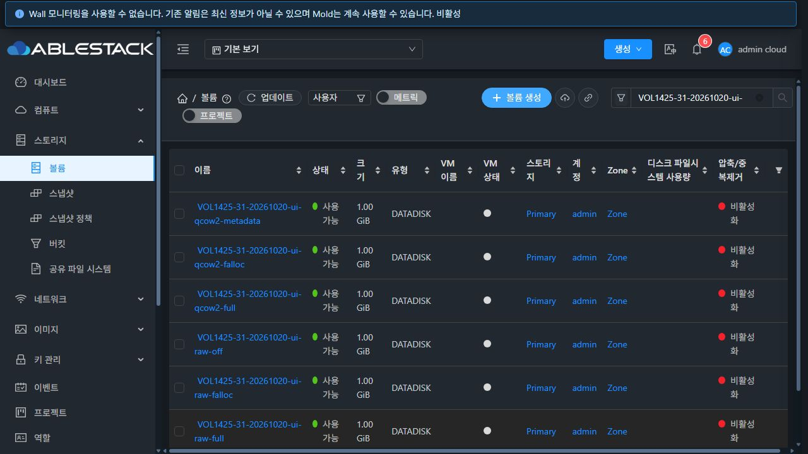

# VOL-03 (#1425) GFS2 실제 할당 구현·배포·검증

부모 Epic #1422 · 누적 Draft PR [#1435](https://github.com/ablecloud-team/ablestack-cloud/pull/1435) · 브랜치 `dhslove/epic-1422-volume-offerings`

## 결과

31번 GFS2에서 **QCOW2 metadata/falloc/full, RAW off/falloc/full**의 빈 DATA 생성과 독립 템플릿 복사를 Cloud job → Agent → 실제 파일 → 검증 증거 저장으로 연결했다. 6개 조합의 UI 생성과 API 생성, linked/compute-only ROOT 생성, Running VM 연결의 실제 파일/드라이버 XML까지 검증했다. RAW metadata와 지원표 밖 조합은 임시 파일/볼륨 레코드 생성 전에 거절한다.

- 기본 구현: `188043f7dbeb3a17e7b6fc0a2fe38c41430693fa`.
- RAW 기동 정의 보완: `f49077a87b72dd4f72b6e0f08d22a32c3d6aa13b`, 파일 장치 유형/연결 보완: `1214e673a15833956cd40a2e2945182ca8eb8102`.
- 최종 Agent 연결 형식 보완: `5ec9411b67794de3f98189a436c3000983b2a97c`.
- [설계](../../design/mold-volume-1425-gfs2-allocation.ko.md) · [기계 판독 증거](summary.json) · [다음 작업](next-steps.ko.md).

기존 thin/sparse/fat 매핑과 기록은 유지하며 검증된 새 적용 정책으로 backfill하지 않는다. RBD는 #1426의 RAW off/full만 유지한다. 공통 계약 확장으로 RBD falloc/QCOW2가 Thin으로 유입되지 않도록 Agent 자체 검증과 회귀 검사도 추가했다.

## 실행과 실패 계약

실제 GFS2 마운트·user xattr와 설치 QEMU를 확인한 Agent capability를 사용한다. 풀·태그·형식·작업과 모든 eligible Up host를 확인한다. 형식별 qemu-img measure 결과와 filesystem usableSpace/pool available을 비교하며 이 점검을 공간 예약으로 설명하지 않는다.

0700 전용 stage에서 요청 형식/정책으로 이미지를 생성한다. 복사는 backing 없이 preallocated 대상에 convert -n을 사용하며 Full/falloc은 -S 0으로 할당이 sparse 최적화로 풀리지 않게 한다. falloc 템플릿 복사도 zero 데이터를 쓸 수 있지만 blank falloc을 eager 쓰기와 같다고 설명하지 않는다.

형식·가상 크기·파일 길이·stat.st_blocks×512·backing 부재·전체 데이터/zero tail을 확인하고 요청 지문을 inode xattr에 기록한 뒤, 덮어쓰지 않는 hard link로 최종 UUID를 공개한다. 동일 지문의 재시도도 데이터·할당을 다시 검사한다. 실패 시 자신의 stage만 정리하고 기존 원본/동명 파일은 보존한다. 관리 서버도 풀/이미지 UUID·크기·형식·요청/적용 메서드·관측 출처를 검사한 뒤 Ready/증거를 저장한다. DDL과 기존 볼륨 backfill은 없다.

## 검사와 빌드

WSL ext4에서 JDK17/Maven3.9.10으로 변경한 5개 모듈만 빌드했다. api/server/storage-volume/KVM의 구현과 engine-orchestration의 변경된 계약 회귀 검사를 포함한다. 이후 RAW 경로 보완은 KVM 모듈만 재빌드했다. -am/전체 reactor와 qemu/ftctl 패키지 빌드는 사용하지 않았다.

| 범위 | 결과 |
|---|---:|
| api 관련 검사 | 13 |
| server 관련 검사 | 380 |
| engine/orchestration 관련 검사 | 54 |
| engine/storage/volume 관련 검사 | 54 |
| KVM 관련 검사 | 122 |
| 관련 소스 검사 합계 | **623, 실패·오류·skip 0** |
| 실제 관리 JAR 검사 | 256 |
| 호스트별 최종 API/core/KVM JAR 조합 검사 | 74씩, 총 222 |
| 최종 배포 JAR JVM 검증·테스트 합계 | **478회 통과** |
| 실환경 확인 항목 | **145 PASS**, 초기 제품 실패 2회는 아래에 별도 기록 |

전체 Cloud/Release CI는 수행하지 않았다. Checkstyle은 기존 API 4건/server 15건 때문에 전역 성공이 아니며, 이번 변경 파일의 위반은 0건이다. Runtime 검사 초기의 로컬 JDBC 의존성 구성 오류는 검사 classpath를 바로잡고 174개를 재실행해 통과했다. 제품 실패와 구분한다.

## 31번 배포와 보존

Mold와 `10.10.31.1/2/3`의 mold-agent에 반영했다. 관리/API/core는 기본 구현 커밋, 최종 KVM은 연결 형식 보완 커밋이며 그 사이 관리 소스는 변경되지 않았다. 기존 배포본과 소스의 차이가 있어 이번 대상 메서드/새 클래스를 반영하고 비대상 코드와 선행 Epic 패치를 보존했다.

- 관리 JAR SHA256: `0b54af42012db87eda85960a51b96df35392408cf57268f720a59da621a319ba`.
- 호스트 KVM SHA256과 API/core 해시는 summary.json에 기록했다. 각 호스트의 기존 JAR을 각각 보존했다.
- 관리 클래스 15개를 반영하면서 비대상 메서드 1,430개·JAR 항목 204,497개를 보존했다. Agent 기본 패치는 비대상 메서드 691개씩을 보존했고, 후속 기동/연결 패치도 대상 외 원시 메서드 바이트와 JAR 항목을 대조했다.
- 백업: `/root/volume-1425-188043f7dbe`(관리), 같은 경로의 backup(각 Agent), `/root/volume-1425-1214e673a15-raw`, `/root/volume-1425-5ec9411b677-raw`(후속 KVM).
- 중간 배포의 service job 취소 1회는 기존 JAR로 원복된 상태를 확인했다. 최종 원자 교체/restart는 새 PID·해시·Up 재접속을 확인했으며 실행 중 도메인/상태·Agent 설정은 보존됐다.
- WEB-INF/index와 관련 6개 테이블 스키마 보존, mold active 및 client HTTP 200을 확인했다. UI assets는 배포하지 않았다.
- 32번은 배포하지 않았다. 기존 #1426 관리·KVM JAR 4개의 해시와 서비스 active가 동일하다. 보호 중인 WSL FT worktree diff SHA도 전후 동일하다.

## UI/API·DB·파일 대조

최종 확인 세트는 **RAW/QCOW2 1GiB 23개(DATA 15, ROOT 8)**다. DATA는 API 신규 정책 6개, UI 신규 정책 6개, legacy 3개다. ROOT는 linked 6조합, compute-only QCOW2 falloc, 최종 RAW Full 연결 검증 VM이다. 20개 명시적 볼륨에서 요청·적용·관측 정보 **220행**을 DB와 대조했다. 모두 backing 없는 독립 이미지이며 빈 이미지 전체 zero/ROOT의 패턴 데이터와 더 큰 대상의 zero tail을 비교했다.

API로 만든 빈 1GiB의 관측값은 다음과 같다. 파일 길이는 논리 크기/실제 할당과 다르며 GFS2 부가 블록도 관측에 포함된다.

| 형식 | 정책 | 파일 길이 B | st_blocks×512 B |
|---|---|---:|---:|
| qcow2 | metadata | 1074135040 | 348160 |
| qcow2 | falloc | 1074135040 | 1076203520 |
| qcow2 | full | 1074135040 | 1076203520 |
| raw | off | 1073741824 | 12288 |
| raw | falloc | 1073741824 | 1075871744 |
| raw | full | 1073741824 | 1075871744 |

legacy thin/sparse/fat는 각각 QCOW2 할당량 208896/348160/1076203520 B였고 API effectivepolicy는 unknown을 유지했다. old sparse를 falloc으로 재해석하지 않았다.

실제 등록·다운로드한 64MiB QCOW2 패턴 템플릿을 1GiB ROOT로 복사했다. VM을 하나씩 Running으로 만들고 XML의 source=file/실제 driver 형식을 확인한 뒤 중지·데이터 검증·expunge해 CPU 점유를 줄였다. **패턴 이미지에 guest OS는 설치하지 않았다.**

최종 RAW Full ROOT VM에서는 UI에서 만든 6개 DATA를 모두 Running 상태에 연결하고 file/qcow2 또는 file/raw XML을 확인했다. VM을 중지한 뒤 분리하고 DATA 전체 zero·ROOT 데이터 보존을 재확인했다. Guest OS의 장치 인식이나 Running hot unplug 성공을 뜻하지 않는다.

[생성 예시](31-ui-qcow2-metadata-create.png) · [RAW Full 상세](31-ui-raw-full-detail.png) · [UI Full 확장 차단](31-ui-full-resize-blocked.png) · [정리 후 빈 목록](31-ui-cleanup-empty.png). 저장된 AX 파일도 함께 제공한다. 현재 fat/sparse/thin 표시는 구 호환 필드다. 정책 선택·실제 적용/관측 표시는 #1431, VM UI 표준 통일은 #1433에서 진행한다. 기존 Wall 모니터링 비활성 배너는 이번 기능의 실패로 집계하지 않는다.

## 실제 발견한 RAW 오류와 재검증

1. 최초 RAW ROOT는 이미지 복사/증거 저장 후 VM 시작에서 실패했다. RAW 파일을 QCOW2 디스크 정의로 전달해 QCOW2 metadata cache 계산이 거절됐다. 명시적 Cloud RAW 형식·풀 UUID·일반 파일을 확인해 file/raw로 정규화하고 버스·serial·캐시/QoS를 보존했다. 새 ROOT 6조합으로 기동부터 다시 통과했다.
2. 추가 Running 연결에서 RAW AttachCommand의 형식이 physical disk 객체에 유지되지 않는 경로를 확인했다. 연결 진입에서도 실제 RAW 형식을 고정하고, RAW 일반 파일을 block 장치로 전달하지 않도록 했다. 새 RAW Full ROOT VM에서 6개 DATA 연결·XML·중지 후 분리·데이터 보존을 다시 통과했다. allocation map이 없는 형식 전용 transport도 정책 증거를 backfill하지 않는다.

초기 QCOW2 ROOT 성공 3개와 RAW 시작 실패 1개, 최초 연결 진단 VM은 제품 이력/진단에 남기고 최종 23개 세트와 구분했다. 최초 실패를 PASS로 바꿔 재집계하지 않는다.

## 실패·중복·정리

최종 활성 Agent classpath의 64/96MiB 시험에서 6개 빈 이미지+6개 템플릿 복사, 전 조합 응답 유실 재시도, Full 전 범위 zero, 실제 stage 후 복사/timeout 오류 주입과 원본 보존을 확인했다. 용량 부족은 운영 풀을 채우지 않고 가용량을 통제했다. 미소유 동명 파일도 보존됐다. 2개 호스트/JVM의 실제 경합은 공개 1건·충돌 1건이었고 동일 요청 재검증과 stage 정리를 통과했다.

- Cloud 생성 이력: VM 13개, 볼륨 28개(진단 포함), 공개 DO 11개+내부 DO 1개, SO 11개, 템플릿 1개를 정상 API로 정리했다. 비활성/Destroyed/removed 등 정상 제품 이력은 보존했다.
- 활성 전용 VM·볼륨·NIC·오퍼링·allocation details는 모두 0이다. 전용 이미지·stage·primary template cache와 secondary 템플릿 폴더도 없다.
- 보조 어댑터 이미지 16개씩의 초기/최종 시험 및 경합 이미지·barrier를 모두 정리했다. Agent 임시 zero 파일 0, HTTP 서비스·패턴 파일·임시 firewall rule·관리 배포 staging도 제거했다. 롤백 백업은 보존했다.
- 기존 API inventory는 볼륨 140/VM 111/DO 7/SO 15로 복구됐고 선택 필드가 전후 동일하다. 기존 path/chaininfo/pool/size/state와 VM host/state 등을 대조했다.

Full/falloc은 생성·복사 시점 파일시스템 할당의 관측이다. 지속 예약이나 guest discard 이후 보장을 하지 않는다. backing/external data/encryption 소스와 명시적 정책의 resize/오퍼링 변경/clone/restore/migrate는 별도 실증 전까지 차단한다. #1240의 별도 파일시스템 포맷 문제나 Epic 전체 완료를 이번 결과로 해결 처리하지 않는다.
