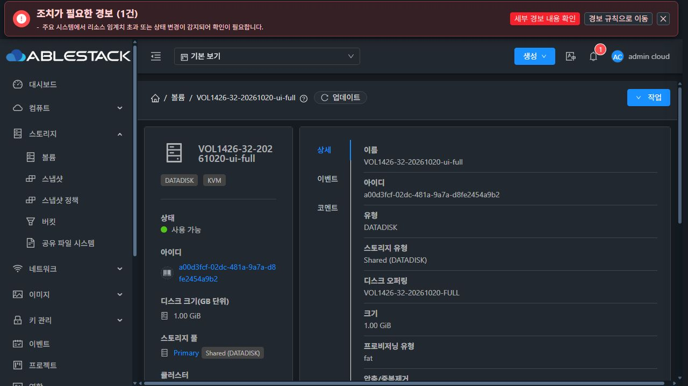

# VOL-04 (#1426) RBD RAW 할당 구현·검증 결과

부모 Epic #1422 · 누적 Draft PR [#1435](https://github.com/ablecloud-team/ablestack-cloud/pull/1435) · 브랜치 `dhslove/epic-1422-volume-offerings`

## 결과와 구현 범위

RBD RAW의 명시적 `off`/`full`을 Cloud job → KVM Agent → 실제 이미지 생성·전체 복사 → 검증 증거 저장 경로로 연결했다. 32번에서 UI/API 생성, 연결된 디스크 오퍼링 및 컴퓨트 전용 내부 오퍼링의 ROOT 생성까지 검증했다. 기존 RBD `sparse/fat` 값은 새로운 생성·복사에서 실제 Full로 간주하지 않고 거절한다. 기존 볼륨 기록은 변경하지 않는다.

- 기본 구현: `defb87309a9572778a5b255c38a6c6cc350bfa3a`.
- Full 가용량 보강: `c4b10d9e46dd05e92423d8e0cc5479919144143d`. libvirt의 raw 클러스터 여유량을 풀의 쓰기 가능량으로 사용하지 않고, 같은 인증 정보로 조회한 Ceph `max_avail`을 사용한다. 조회할 수 없으면 Full capability를 제공하지 않고 실행도 거절한다. 용량 점검은 예약이 아니다.
- [설계](../../design/mold-volume-1426-rbd-allocation.ko.md), [기계 판독 증거](summary.json).

| 요청 | 실제 실행 또는 거절 |
|---|---|
| 명시적 RAW off, 빈 볼륨 | 일반 RBD create, `rbd-thin` 증거 |
| 명시적 RAW Full, 빈 볼륨 | `rbd create --thick-provision`, 전체 zero 읽기·할당량 검증 |
| 명시적 RAW Full, 템플릿 복사 | thick 대상 생성 후 `qemu-img convert -n -S 0`, 데이터와 zero tail 비교, parent 부재·할당량 검증 |
| legacy thin | 기존 경로 유지. 기록 값만으로 검증된 적용 정책을 backfill하지 않음 |
| legacy sparse/fat로 RBD 생성·복사 | `RBD_LEGACY_ALLOCATION_UNVERIFIED`로 거절 |
| RBD falloc/lazy thick, qcow2 metadata | 제공하지 않음 |
| 명시적 정책의 확장·오퍼링 변경·복원·이동·VM clone | 미검증 경로를 변경 전에 차단. 지원 확대는 #1427에서 별도 검증 |

요청은 `volume_details`에 한 번 저장한다. Agent는 전용 임시 이미지를 만든 뒤 검증과 요청 지문 기록을 완료하고, 덮어쓰지 않는 rename으로 최종 UUID를 공개한다. 관리 서버도 요청·풀 UUID·이미지 UUID·크기·RAW·메서드·관측 출처를 검사한 뒤 경로와 Ready를 갱신한다. 구 Agent가 요청을 무시하거나 증거를 누락해도 Full 성공으로 전환하지 않는다. 공개 metadata API로 요청·적용 증거를 바꿀 수 없다. DDL과 기존 볼륨 backfill은 없다.

## 검사와 빌드

WSL ext4 작업 트리에서 JDK 17/Maven 3.9.10으로 변경한 6개 모듈만 빌드했다. `-am`이나 전체 Cloud 빌드는 사용하지 않았다. 용량 보강은 변경된 KVM 모듈만 다시 빌드했다. qemu/ftctl 패키지는 변경하지 않았다.

| 모듈 | 관련 테스트 |
|---|---:|
| api | 13 |
| core | 7 |
| server | 377 |
| engine/orchestration | 54 |
| engine/storage/volume | 49 |
| plugins/hypervisors/kvm | 86 |
| 합계 | **586, 실패·오류·skip 0** |

실제 배포할 관리 JAR에서 248개, 호스트별 최종 JAR 조합에서 38개씩 총 **362회**의 JVM 검증·테스트도 통과했다. 클래스별 JVM을 사용해 기존 테스트의 전역 설정 상태가 다른 테스트에 전파되지 않도록 했다. Checkstyle은 기존 API 4건/server 15건 때문에 전역 성공이 아니며, 이번 변경 파일의 위반은 0건이다. 이 결과는 전체 Cloud CI 성공을 뜻하지 않는다.

## 배포와 보존

32번 Mold 및 `10.10.32.1/2/3`의 `mold-agent`에 반영했다. 관리 서버는 `defb87309a9`, 호스트 KVM 용량 보강은 `c4b10d9e46d`이며 관리 소스는 두 커밋 사이에 변경되지 않았다. Agent API/core는 기본 구현 버전, KVM은 용량 보강 버전이다.

- 관리 JAR SHA256: `2e0e3edeee781069f05912d0dbd634d2cb8cc5295bf873984c26b6cf9e13a210`.
- 호스트별 KVM JAR SHA256은 `summary.json`에 기록했다. 서로 다른 기존 JAR을 각각 보존해 공통 파일 전체로 덮어쓰지 않았다.
- 관리 클래스 15개를 반영하며 관련 없는 메서드 **1,426개**, 기존 JAR 항목 **204,492개**를 보존했다. 각 호스트의 기존 메서드 693개도 보존했다. 용량 후속 패치는 이 작업에서 추가한 RBD 클래스 5개와 메타데이터만 갱신했다.
- 관리 백업: `/root/volume-1426-defb87309a9`. 호스트 백업: `/root/volume-1426-defb87309a9-agent`, `/root/volume-1426-c4b10d9e46d-capacity`.
- `WEB-INF` 전체, static index, Agent 설정과 배포 전후 libvirt 도메인 상태를 보존했다. Mold active, `/client/` HTTP 200을 확인했다. 31번 JAR은 기존 #1424 버전과 동일하고 새 배포는 하지 않았다.

## UI/API·DB·실물 대조

최종 **73개 실환경 확인 항목이 PASS**다. 정책 capability/거절, API 생성, linked/internal 컴퓨트 ROOT, 기존 오퍼링 호환, metadata 보호, UI 교차 검증 및 기존 자원 보존을 포함한다. 세 호스트 모두 실제 도구·풀 접근을 검사해 create/copy의 off/full만 제공한다.

모든 Cloud 검증 볼륨은 RAW 1GiB였다.

| 경로 | image used_size | 추가 검증 |
|---|---:|---|
| 명시적 off DATA | 0 | Ready, 요청·적용 off |
| legacy thin DATA | 0 | Ready, 적용 정책 unknown 유지 |
| API Full DATA | 1GiB | 전체 zero 읽기 SHA256 |
| UI Full DATA | 1GiB | 목록·상세 Ready, 전체 zero 읽기 SHA256 |
| linked 컴퓨트 ROOT Full | 1GiB | Cloud 템플릿 전체 복사 및 zero tail 동일 |
| 내부 디스크 컴퓨트 ROOT Full | 1GiB | 동일 검증 |
| 최종 용량 보강 Agent의 Full DATA | 1GiB | 전체 zero 읽기 SHA256 |
| 최종 Agent의 템플릿 ROOT Full | 1GiB | Cloud 복사 및 zero tail 동일 |

8개 모두 COW parent가 없었다. 6개 Full의 image used_size는 각각 `1073741824`, Thin 2개는 0이었다. 명시적 계약이 있는 7개 볼륨에서 요청·적용·관측 메타데이터 77행을 DB와 대조했다. ROOT 경로는 전용 64MiB QCOW2 패턴 템플릿을 실제 등록·다운로드한 뒤 VM을 Running으로 만들고 Stopped로 전환해 검증했다. 설치된 guest OS나 애플리케이션 I/O를 검증한 것으로 해석하면 안 된다.

64MiB 전용 Adapter 시험에서는 Full 전 범위 zero, QCOW2→RAW 데이터 동일성, 응답 유실 후 재검증, 기존 이미지 미채택·보존을 확인했다. 두 별도 JVM의 실제 동시 쓰기는 최종 공개 1개/충돌 1개로 끝났고, 충돌 단계 이미지 정리와 동일 요청 재시도도 통과했다. 실제 thick 임시 이미지 생성 후 복사 실패를 주입해 정리·원본 보존을 검증했다. 용량 부족은 운영 풀을 채우지 않고 가용량을 통제한 시험과 풀 `max_avail` 단위 검사로 검증했다.

Full 확장·오퍼링 변경·VM clone·VM restore·볼륨 이동·Running VM 스토리지 이동이 사전 거절됐다. 실제 RBD 볼륨 snapshot을 만든 뒤 revert와 snapshot으로 볼륨 복원이 거절되는 것도 확인하고 snapshot을 삭제했다. RAW VM snapshot은 기존 KVM에서 생성 단계에 지원하지 않는 유형으로 거절됐다. 이 환경에서 VM snapshot revert를 실행한 것으로 보고하지 않으며, 해당 가드는 관련 테스트 6개에 포함했다.

### UI 증거와 남은 표시 작업

API로 정의한 명시적 Full 오퍼링을 기존 볼륨 생성 폼에서 선택해 RBD에 생성했고, 상세의 Ready·1GiB 및 실제 RBD 할당량을 대조했다. UI 확장은 오류 이유를 표시하고 기존 크기·적용 증거를 보존했다. UI의 legacy fat 생성도 431로 거절됐으며 개체가 생기지 않았다.

[생성 대화상자](32-ui-full-create.png), [확장 차단](32-ui-full-resize-blocked.png), 각 `.ax.txt`는 해당 화면의 증거다. 위 화면의 `fat`는 구 호환 필드다. 명시적 요청/실제 메서드/관측 시점을 표시하고 미지원 선택·작업을 제어하는 UI는 #1431, VM 목록·상세·탭·대화상자 표준화는 #1433에서 진행한다. 상단의 기존 호스트 센서 경보를 이번 기능의 실패로 분류하지 않았다.

## 정리와 범위의 한계

- 전용 VM 3개, 볼륨 8개(그중 ROOT 3개), 공개/내부 디스크 오퍼링 8개, 컴퓨트 2개, 템플릿 1개를 정상 API로 정리했다. 활성 전용 VM·볼륨·NIC·오퍼링·템플릿·snapshot·allocation detail은 모두 0이다.
- snapshot의 `Destroyed` 이력 1행과 비활성 오퍼링·작업 등 정상 제품 이력은 보존했다. `removed IS NULL`만으로 Destroyed snapshot을 활성 잔여로 세지 않았다.
- 전용 RBD 이미지·stage, 2차 스토리지의 전용 템플릿·snapshot 파일이 없다. 보조 JVM 종료 대기로 남았던 64MiB 시험 이미지 4개도 요청 지문·생성 시각·데이터·DB 참조 0을 확인해 개별 정리했다. RBD 이미지 수는 시작 시점의 69개다.
- 임시 HTTP 서비스·전용 파일·firewall runtime rule과 임시 Ceph 인증 파일을 제거했다.
- 기존 API inventory는 볼륨 48/VM 48/디스크 오퍼링 6/컴퓨트 4로 일치한다. 볼륨 path/chaininfo/pool/size/state 및 VM host/state 등 선택한 필드는 동일하다. 관련 6개 테이블 스키마와 보호 중인 WSL FT worktree diff SHA도 동일하다.

Full은 **생성·복사 검증 시점**의 image 할당이다. `rbd du` image used_size를 복제본 포함 클러스터 물리 소비량이나 영구 예약으로 표현하지 않는다. discard/zero 최적화 및 이후 수명주기에도 계속 예약된다는 주장은 하지 않는다. 별도 data-pool·namespace·암호화·다른 RBD 풀 원본 등 검증하지 않은 조합도 지원 범위에 넣지 않았다.

전체 Cloud/Release CI와 실제 guest OS workload는 이번 결과가 아니다. Epic/하위 이슈는 누적 Draft PR 검토·병합 및 남은 구현이 필요하므로 이번 작업으로 Epic을 종료하지 않는다.
