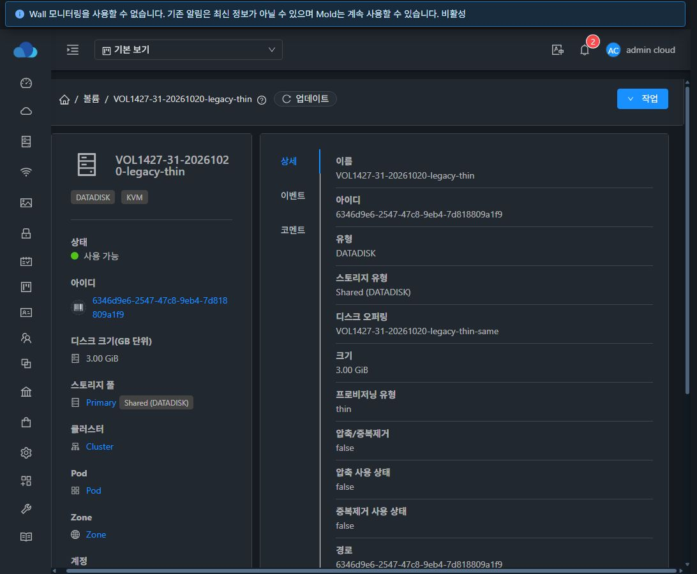

# VOL-05 (#1427) 할당 수명주기 설계·구현·배포·검증

부모 Epic #1422 · 누적 Draft PR [#1435](https://github.com/ablecloud-team/ablestack-cloud/pull/1435) · 브랜치 `dhslove/epic-1422-volume-offerings`

## 결과와 범위

동일한 할당 정책/형식을 유지하는 오퍼링 변경 및 동일 크기의 **Cloud IOPS 값 변경**을 실제 이미지 resize와 분리했다. 명시적↔legacy·정책/형식 변경과 legacy thin/sparse/fat 간 변환은 이미지 변환 엔진이 없으므로 사전 차단한다. 명시적 정책의 물리 resize/복원/이동/clone은 검증된 adapter 없이 허용하지 않는다. 기존 legacy Thin 확장 경로는 유지한다.

구현 커밋: `70610aea823a38580a70c061b85586d4c5cbdb5c`. [작업별 지원표·설계](../../design/mold-volume-1427-lifecycle.ko.md) · [기계 판독 증거](summary.json) · [후속 작업](next-steps.ko.md).

API/결정된 크기 검증과 큐 실행 직전 검증을 연결하고, StorageService·orchestration의 직접 copy/migrate/resize/restore/clone·duplicate에도 원본/대상 동결 계약을 검사한다. `saveVolumeDetails`는 기존 이미지에 새 계약을 부여하거나 동결 계약을 바꾸는 작업을 거절한다. 관리자 path/pool/chain/state/type 변경으로 기존 증거를 다른 이미지에 붙이는 우회도 차단한다. FT/DR 자동 해제·DDL·기존 데이터 backfill은 없다.

`allocation.evidencescope=creation-or-copy-time`은 할당 관측이 생성/복사 시점임을 명시한다. 같은 정책 오퍼링/QoS 변경은 requested/fixed/applied/observed를 재작성하지 않는다. 이 결과는 실행 중 VM의 cache/QoS 적용이나 영구 예약·discard 이후 보장을 뜻하지 않는다.

## 빌드와 검사

WSL ext4에서 JDK17/Maven3.9.10으로 변경 5모듈만 package/install했다. -am/전체 reactor 및 qemu/ftctl 패키지 빌드는 사용하지 않았다.

| 관련 소스 검사 | 통과 |
|---|---:|
| api | 26 |
| server | 234 |
| engine/orchestration | 8 |
| engine/storage/volume | 27 |
| plugins/hypervisors/kvm | 78 |
| 합계 | **373, 실패·오류·skip 0** |

배포 예정/최종 활성 JAR과 일치하는 조합을 -Xverify:all 및 class origin 확인으로 검사했다. Mold별 229회씩, 31번 Agent별 78회씩 **총 692회 통과**했다. 변경 밖 Checkstyle API 4건/server 15건은 남아 있으며 변경 파일 위반은 0건, 나머지 변경 모듈 Checkstyle은 성공했다. 전체 Cloud/Release CI는 수행하지 않았다.

## 실제 기능 검증

**실환경 확인 157개 PASS**다. 이 수치는 아래 별도 생성 실패를 포함하거나 성공으로 재집계하지 않는다.

- 31 GFS2 QCOW2 metadata/falloc/full·RAW off/falloc/full, 32 RBD RAW off/full의 8개 명시적 정책과 legacy Thin 2개, 총 Ready DATA 10개를 사용했다. 각 파일/이미지에 두 구간의 패턴을 기록하고 나머지 전 범위 zero를 대조했다.
- 8개 조합의 동일 정책 오퍼링 변경 및 Cloud IOPS 110/180 변경이 성공했다. 이미지/데이터·기존 생성 증거 88행과 관측 시각을 유지했고 GFS2 inode/mtime/실제 블록도 비교했다. 이미지 resize를 호출하지 않는 경로다.
- 명시적 볼륨의 1→2GiB resize 반복, legacy 계약으로 변경, 관리자 path/chain 변경, Full→Thin 및 GFS2 형식/정책 변환을 거절했다. 상태·크기·경로·풀·오퍼링·증거와 데이터가 유지됐다.
- 양쪽 legacy Thin은 API 1→2GiB, UI 2→3GiB 확장에 성공했다. 실제 virtual size, 기존 두 패턴과 새 영역을 포함한 전체 zero를 64MiB 이하 요청으로 검증했고 effectivepolicy는 unknown을 유지했다.
- 실제 스냅샷 2개를 BackedUp까지 확인한 뒤 revert와 createVolume 복원을 정책 오류로 거절했다. 복원 대상 볼륨이 생성되지 않았음을 확인했다.
- UI에서 양쪽 RAW Full의 동일 정책 오퍼링 변경이 성공했고 Full 확장은 ALLOCATION_OPERATION_UNSUPPORTED, 31번 Full→Thin 변경은 ALLOCATION_CONVERSION_UNSUPPORTED로 거절됐다. 실패 후 원본은 Ready·1GiB였다.
- 클러스터당 pool이 1개여서 실제 다른 pool 이동은 수행하지 않았다. 같은 pool을 지정한 API의 정책 진입점 거절과 독립 orchestration/StorageService 검사는 실제 이동 성공을 뜻하지 않는다.

[31 동일 정책 변경](31-same-policy-offering-success.png) · [32 동일 정책 변경](32-same-policy-offering-success.png) · [31 Full 확장 거절](31-full-resize-rejected.png) · [32 Full 확장 거절](32-full-resize-rejected.png) · [정책 변환 거절](31-policy-conversion-rejected.png).

[32 RBD Thin UI 확장](32-legacy-thin-ui-grown.png). 화면의 기존 fat/thin 표시는 호환 필드이며 정책 입력/실제 적용 표시는 #1431, VM 기준 UI 통일은 #1433에서 진행한다. 기존 31 Wall 비활성/32 경보 배너는 이번 기능 실패로 집계하지 않는다.

## 새로 발견한 미해결 결함 — #1437

배포 전 Cloud 생성에서 QCOW2 falloc 1건·RAW falloc 2건이 실패했다. 해당 job은 실패했고 볼륨은 Ready/적용 증거를 얻지 않았다. stage/이미지 정리를 확인해 API로 정리했다. 이 실패들을 후속 성공으로 바꿔 집계하지 않는다.

GFS2의 이전 Script 경로가 비교 명령의 비정상 종료를 Stream closed로 가려, GFS2 전용 실행기를 통해 실제 exit code/출력·시간 초과·전용 출력 파일 정리를 보완했다. 그 뒤 활성 31.2 Agent의 64MiB QCOW2 falloc 시험에서 **exit 1, Content mismatch at offset 66580480**을 확인했다. 기준 RAW의 전체 zero 읽기는 성공했지만 대상 QCOW2의 전체 zero 읽기는 실패했다. 다른 재현의 성공 및 별도 121회 비교 성공은 최초 불일치를 해결한 근거가 아니다.

원인이 QEMU/GFS2/캐시 등 어디에 있는지는 확정하지 않았다. **이 실행기 보완으로 zero 불일치 자체가 해결됐다고 주장하지 않는다.** [#1437](https://github.com/ablecloud-team/ablestack-cloud/issues/1437)을 Epic의 새 P1 하위 이슈로 등록해 열어 두었다. #1427의 정책/메타데이터 변경 검증은 실제 데이터 검증에 성공한 개체로 수행했고, #1437은 Epic 종료 전 별도로 해결·검증해야 한다.

## 배포와 보존

31·32 Mold 및 31.1/2/3 Agent에 반영했다. 32번 Agent JAR은 변경하지 않았다. 각 활성 JAR SHA256·클래스 해시·백업과 원시 메서드 보존 증거는 summary.json에 있다. 기존 배포본과 소스 차이 때문에 대상 메서드/실행 전 hook·새 클래스만 반영했다. Mold 각각 비대상 메서드 387개와 JAR 항목 204,509/204,504개를 보존했으며 Agent의 기존 GFS2 코드/FT 관련 코드와 대상 밖 항목도 비교했다.

백업은 각 배포 서버 `/root/volume-1427-70610aea823`에 유지했다. 서비스 active/새 Agent PID·Up, client HTTP 200, WEB-INF/index 해시 및 6개 테이블 스키마를 확인했다. UI assets와 qemu/ftctl 패키지·스크립트는 변경하지 않았다. WSL의 보호 중인 FT worktree diff 해시도 동일하다.

기존 API inventory는 31번 볼륨/VM/DO/SO 140/111/7/15, 32번 48/48/6/4의 선택 필드가 동일했다. 기존 native 도메인의 이름/상태는 유지됐다. 다만 32.3 최종 native 목록에는 기존 Cloud Running VM `i-2-61-VM`이 추가 관측됐다. 이 VM은 2026-10-10 생성된 기존 E1345 자원이며 본 작업에서 VM 변경 명령을 발행하지 않았다. 원인은 확정하지 않았고 운영 자원을 삭제/되돌리지 않았다. 따라서 native 목록 전체가 전후 완전히 동일했다고 보고하지 않는다.

## 정리와 제한

Ready 볼륨 10개·실패 생성 이력 3개, 디스크 오퍼링 32개·스냅샷 2개를 API로 정리했다. VM·네트워크·계정·컴퓨트 오퍼링·템플릿은 생성하지 않았다. 활성 전용 볼륨/오퍼링/스냅샷·활성 할당 정보는 0이고 GFS2/RBD 이미지·stage·스냅샷 2차 파일도 0이다. 진단 파일과 zero 참조, 명령 출력 임시 파일·업로드 배포 payload를 정리했다. 비활성/삭제 이력과 롤백 백업은 보존했다.

[31 정리 후 UI](31-cleanup-empty.png) · [32 정리 후 UI](32-cleanup-empty.png).

테스트 초기 mock DAO 누락, IOPS 요청 파라미터, 스냅샷 비동기 완료 polling, 3GiB의 단일 qemu-io read 크기 및 검사 JVM 종료 구성 문제는 시험 도구 보정과 제품 결함을 구분했다. 최종 성공 수치에는 최종 관련 검사만 사용한다.

실제 다른 pool 이동, 명시적 resize/restore/clone/migrate의 새 실행 엔진, guest OS workload/장치 인식, 전체 역할 행렬·UI 표준화 및 전체 Cloud/Release CI는 이 결과에 포함하지 않는다. 새로운 RBD lazy thick/falloc·Full 확장 보장을 제시하지 않는다. #1427은 이 범위의 구현·개별 검증 완료로 종료하며 PR #1435는 Draft·미병합 상태를 유지한다.
