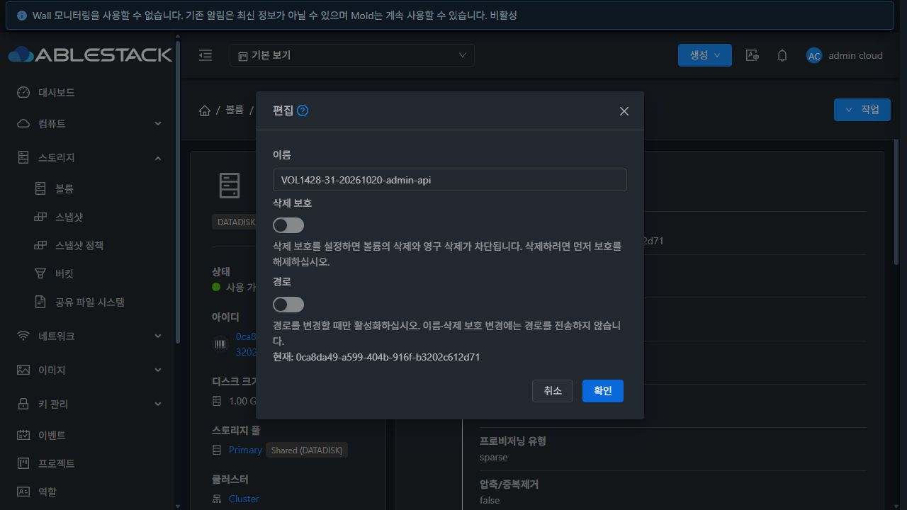
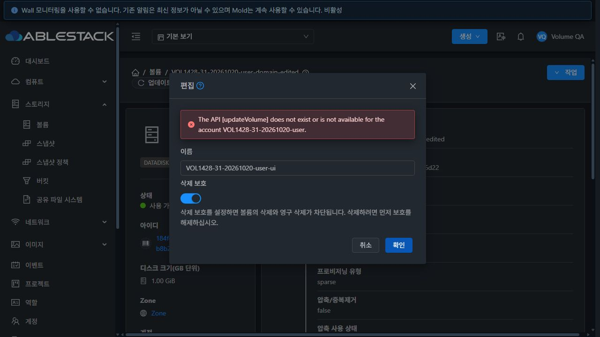
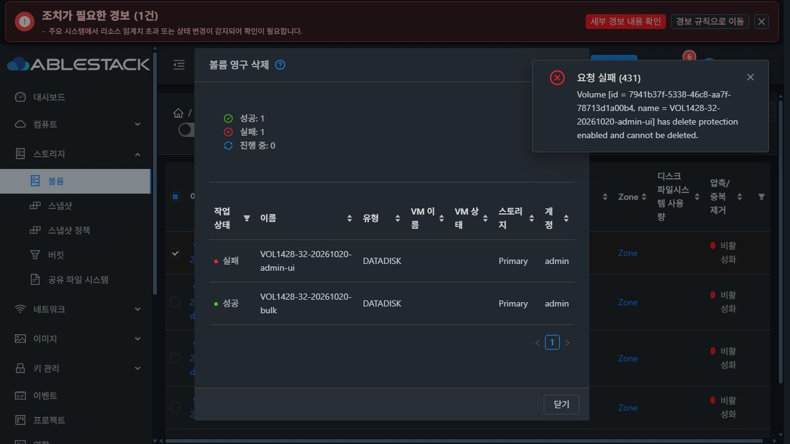
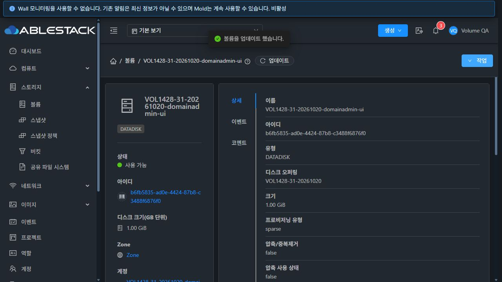

# #1428 볼륨 편집·삭제 보호 구현 및 검증

## 결과

기존 편집 폼의 삭제 보호 입력 누락과 불필요한 path/account/domainid 전송을 수정했다. Admin·DomainAdmin·User·Project의 UI 편집과 실제 API/DB/이미지 상태를 31·32에서 검증했다. 검증 후 전용 자원을 정리했다. 누적 Epic PR #1435는 Draft·미병합이며 Epic #1422 전체 완료는 아니다.

## 설계·구현

[설계](../../design/mold-volume-1428-edit-protection.ko.md)

- 이름·삭제 보호를 현재 값으로 초기화하고 실제 변경한 필드만 POST한다. 프로젝트의 공통 projectid 컨텍스트는 유지한다.
- 경로는 API 파라미터 권한이 있는 Admin의 허용 상태에만 노출한다. 현재 경로·수동 이미지 참조 변경의 영향을 설명하며 빈 경로와 명시적 정책/기존 KVDO 제한을 처리한다. 이름 변경에 path를 포함하지 않는다.
- 대상·계정·프로젝트·화면을 고정하고 제출 전 현재 상태·소유자·변경 필드 충돌을 검사한다. 변경하지 않은 보호 값이나 경로를 덮지 않는다.
- 검증 시작부터 중복 제출을 잠근다. 서버·통신 오류에도 입력·대상을 유지하고 성공 후에만 상세를 갱신한다.
- 작업 결과가 불명확하면 같은 작업 ID만 재조회한다. 검증 중 발견한 재확인 성공 후 경고 잔존도 공통 추적기의 batchKey에 작업 ID를 전달하여 수정했다.
- 보호된 볼륨의 개별·일괄 삭제를 차단한다. 영구 삭제는 모든 상태에서 Admin/DomainAdmin 또는 계정 설정 허용 조건을 적용한다. 기존 flatten 제한과 서버의 최종 거절을 유지한다.

소스 커밋: d4ee18f65ff(기능), 7bd56a4b185(영구 삭제 권한), 4fa57a8429472c517f9071767f760166fa278e6a(결과 미확인 알림 정리).

## 빌드·검사

변경 모듈은 UI뿐이다. WSL ext4에서 **8 suites / 102 tests**, 변경 파일 lint, UI production build가 통과했다. Java/Agent/qemu 소스는 변경하지 않았으므로 Maven/JAR/Agent 빌드·배포는 하지 않았다. 전체 Cloud/Release CI 및 Actions 전체 빌드는 실행하지 않았다. Webpack 크기 경고 2건과 Browserslist 갱신 안내가 있었다.

## 실제 환경 검증

- API·스토리지 행렬 **62항목**: 권한별 이름/보호 설정·해제, 보호 상태의 destroy/delete 거절, 허용되지 않은 path의 불변, 소유권·프로젝트 비회원 거절, 빈 경로 거절, 테스트 이미지 복사 대조.
- UI·실제 요청 대조 **48항목**, Admin/DomainAdmin/User/Project의 **8개 환경·권한 조합**과 Running/Stopped/명시적 정책 **6개 경로 노출 사례**.
- 전체 POST 본문을 다시 읽어 불필요한 account/domainid 및 변경하지 않은 path가 없음을 확인했다. 프로젝트 요청의 projectid는 공통 컨텍스트다. 인증값은 증거에서 제외했다.
- 보호 설정/해제 후 API·DB·이미지 형식/논리 용량 대조. 이름·보호 변경 후 path/chain/storage/state 보존.
- GFS2 QCOW2와 RBD RAW의 전용 legacy Ready 볼륨에서 실제 테스트 이미지 참조로 경로를 변경했다가 원복했다. 두 참조의 내용 비교와 64KiB 데이터 패턴 읽기가 통과했다. 이미지 이동/복사나 명시적 정책 수명주기 지원으로 해석하지 않는다.
- 네트워크 실패 후 입력 유지·재시도, 더블클릭 1회 제출, 오래된 값의 덮어쓰기 차단, 편집 중 역할 권한 회수/복구 후 동일 입력 재시도.
- 두 개 일괄 삭제 성공, 삭제 확인 후 보호가 바뀐 경우 1개 성공/1개 거절 및 원인 표시, 보호 해제 후 개별 삭제 성공, 일반 사용자 soft-delete 성공.
- 결과 조회만 차단했을 때 서버 반영과 UI 미확인을 구분하고, 같은 작업 ID의 조회만 재시도했다. 최종 알림 보완은 4fa57a84294 배포본에서 다시 검증하여 성공 후 경고가 사라지고 추가 updateVolume이 없는 것을 확인했다.

환경별 기능 행렬은 7bd56a4b185에서 검증했고, 최종 변경은 알림 식별자 한 줄과 해당 회귀 기대값이다. 최종 배포 후 두 환경에서 보호 설정/해제와 결과 재확인 동작을 재검증했다. Allocated/Uploaded 및 KVDO 조합은 단위 검사/기존 UI 제한 범위이며 실제 새 업로드 볼륨이나 VM 연결 경로 교체는 수행하지 않았다. 운영 Running/Stopped 볼륨은 편집창 열기·취소만 수행했다.

## 배포·보존·정리

두 관리 서버의 활성 webapp에 정적 파일 896개를 배포하고 모두 SHA-256을 대조했다. WEB-INF/META-INF/config·관리 JAR·Mold PID를 보존했다. 서비스 재시작 없이 새 로그인·Mold active·/client/ HTTP 200을 확인했다.

- 최종 백업: 두 서버 /root/volume-1428-ui-4fa57a84294-edit-protection.
- 배포 tar SHA-256: f0f5c84c195b557c892fd4c9c04a36ea605d3b124b2c1867978fa6b2384de910.
- 볼륨 12개(각 1GiB), 테스트 참조 이미지 2개 정리. UI 영구 삭제 4개와 API 최종 정리 8개이며, User/Project soft-delete 후 관리자가 최종 정리한 경우를 포함한다.
- 일반 디스크 오퍼링 4개 비활성화, 계정 6개·역할 4개·도메인 2개·프로젝트 2개 삭제.
- 활성 전용 자원·실물 이미지·stage 0. 운영 inventory 및 기존 역할 권한 동일, Routing 호스트 6개 Up.
- 운영 전역 설정은 변경하지 않았다. 영구 삭제 제한은 전용 User 계정에만 설정했고 해당 계정과 함께 정리했다.

[기계 판독 결과](summary.json), network-sanitized.json, payload-qualification.json 및 화면/AX 증거를 함께 보존했다.

## VM 표준 비교와 다음 작업

기존 세로형 폼·라벨·스위치·취소/확인 배치를 유지하고 상세 탭은 변경하지 않았다. 최종 화면을 #1433의 VM 대화상자 비교 대상에 포함한다. 기존 볼륨 폼 폭(500px/85vw)과 VM EditVM(450px/80vw)의 규격 차이는 #1433에서 일괄 통일한다.

다음 구현은 #1429(대상 오퍼링 기준 크기/IOPS)이며, #1430(캐시/QoS·상속), #1432 및 기존 #1154/#1209/#1210을 진행한 뒤 #1433 UI 통일과 #1434 통합 회귀·Epic 종료를 수행한다. #1437은 해결 상태를 유지한다.

## 화면

검증 당시의 전용 자원 화면이다. 촬영 후 정리했다.

