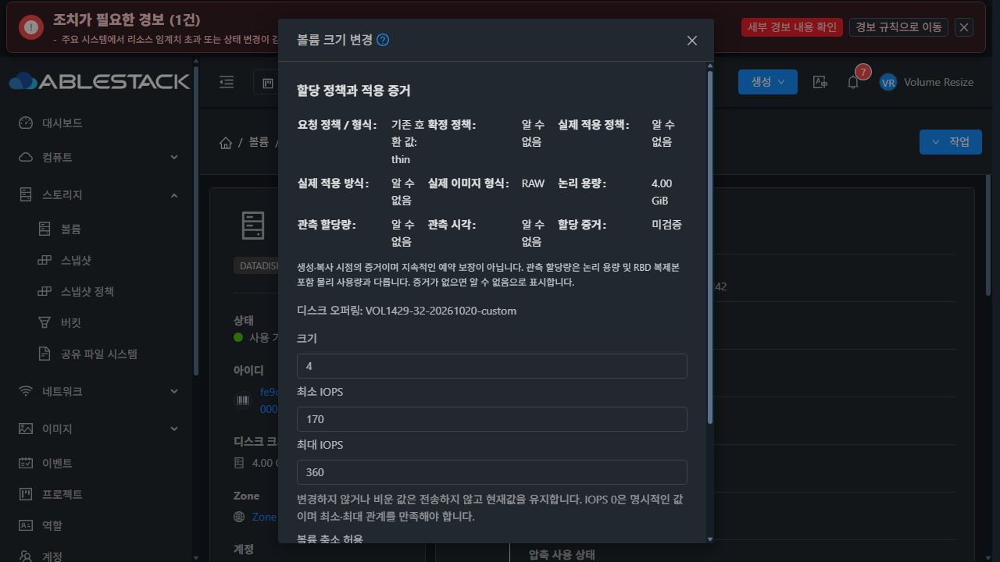

# #1429 볼륨 크기·IOPS 변경 구현·배포·검증

Epic #1422의 VOL-07을 UI 모듈에서 구현했다. 소스는 5d718731694 및 cdbf29fb7a6이며 누적 Epic PR은 #1435다. PR은 Draft·미병합이고 Epic 전체 종료 판정은 #1434에 남는다.

## 구현

- diskofferingid와 정확히 일치하는 오퍼링만 조회한다. 첫 목록 항목과 페이지 크기를 사용하지 않는다. 31번 23개·32번 22개 오퍼링 중 대상이 첫 10개 밖인 조건을 검증했다.
- compute-only ROOT는 볼륨 응답의 내부 숫자 serviceofferingid를 사용하지 않고 해당 VM의 UUID 관계로 컴퓨트 오퍼링을 조회한다. ROOT의 IOPS 재정의와 일반 디스크의 고정/사용자 지정 IOPS 계약을 구분한다.
- 현재 크기·최소/최대 IOPS를 초기화한다. 변경하지 않은 값과 빈 값은 생략해 현재값을 유지하고 0은 명시적으로 보낸다. 정수·안전한 수치 범위·최소≤최대·현재값과의 null 쌍을 검사한다.
- IOPS 단독, 크기 단독, 동시 변경을 제공하고 오퍼링 전환 ID는 보내지 않는다. shrinkok/automigrate는 관련 크기 변경에만 보낸다. QCOW2 확장 시 축소 허용 스위치를 켜도 불필요한 shrinkok는 전송하지 않는다.
- 명시적 할당과 엄격한 고정 크기는 물리 크기 변경을 차단한다. 컴퓨트 고정 루트 크기는 ISO 예외가 있어 안내 후 API가 최종 판단한다.
- 제출 직전 볼륨·소유권·상태·크기·IOPS·경로·풀·할당 의도와 오퍼링을 다시 확인한다. 대상/사용자/프로젝트 변경 및 중복 제출을 차단한다.
- 통신·권한·비동기 작업 실패는 입력과 서버 사유를 유지한다. 작업 ID가 있는 미확인 결과는 같은 작업만 재조회하고 성공 후 닫는다. 작업 ID 없는 모호한 제출은 재제출을 잠그고 현재 상태 확인 후 다시 열도록 안내한다.

[설계](../../design/mold-volume-1429-resize-iops.ko.md)

## 빌드·배포

변경 모듈은 UI다. WSL ext4의 /home/ablecloud/work/dhslove/cloud-epic-1422에서 Node 14.21.3으로 관련 7 suites / 115 tests, lint, production build를 통과했다. Java/JAR/Agent/qemu 변경 및 Maven 빌드는 없다. 전체 Cloud/Release CI는 실행하지 않았다.

실제 초기 브라우저 검증에서 Ant Design Vue 3 Alert의 action 슬롯이 재시도 버튼을 렌더링하지 않는 문제를 발견했다. 버튼을 별도로 배치하고 렌더링 단언을 추가한 cdbf29fb7a6로 재빌드·재배포했다. 초기 증거도 보존했다. 최종본에서 통신 오류와 실제 빈 오퍼링 응답의 재시도, IOPS만/크기만/동시 변경을 모두 다시 실행했다.

두 서버에 정적 파일 896개를 배포하고 모든 해시, WEB-INF/META-INF/config·JAR·PID 보존 및 /client/ HTTP 200과 새 로그인 성공을 확인했다. 최종 백업은 두 서버의 /root/volume-1429-ui-cdbf29fb7a6-resize-iops다. UI 번들 SHA256은 20373582e479e9227cf6854fed31aaddceff57e64c087520a9d15b2396570121이다. 기존 상세 탭의 세로 목록 스타일은 변경하지 않았다.

[빌드 결과](build-qualified.json) · [배포 결과](deployment-qualified.json)

## 실제 기능 결과

Admin·DomainAdmin·User × 31 GFS2 / 32 RBD의 6개 조합을 검증했다. UI 증거 77건과 별도의 요청·화면 판정 42항목, 전체 POST 본문 35개를 대조했다. 변경 요청 35개는 모두 원문 본문을 조회해 검증했으며 해당 기록 구간 누락은 0이다. 실패 발견 증거를 모두 성공 건수로 합산하지 않는다.

| 검증 | 31 GFS2 | 32 RBD |
|---|---|---|
| 현재값과 정확한 대상 오퍼링, 10개 초과 | 통과 | 통과 |
| IOPS만, 크기만, 동시 변경 | 통과 | 통과 |
| 빈 IOPS 유지, 명시적 0 IOPS | 통과 | 통과 |
| 고정 IOPS 읽기 전용, 엄격한 크기 제한 | 통과 | 통과 |
| 명시적 정책의 크기 제한과 IOPS 단독 변경 | 통과 | 통과 |
| ROOT의 VM·오퍼링 UUID 조회 | 읽기 전용 확인 | 읽기 전용 확인 |
| 음수·소수·0 크기·수치 범위·최소>최대 | 제출 차단 | 제출 차단 |
| 초기 조회 실패·실제 빈 응답 후 재시도 | 최종본 통과 | 최종본 통과 |
| 제출 전 통신 실패·stale 충돌 | 요청 차단·입력 보존 | 요청 차단·입력 보존 |
| 더블클릭 | POST 1개 | POST 1개 |
| 결과 조회 실패 후 같은 작업 재확인 | 추가 POST 0개 | 추가 POST 0개 |
| 실제 권한 회수·복구 | HTTP 432 보존 후 재시도 성공 | HTTP 432 보존 후 재시도 성공 |
| 실제 저장소 한도 초과 작업 실패·복구 | 사유/입력 보존 후 성공 | 사유/입력 보존 후 성공 |
| 축소 | Ready QCOW2를 UI에서 차단 | 동의 후 libvirt 거절을 표시하고 크기 보존 |

최종 번들의 일반 사용자 경로는 2 GiB / 140·320 IOPS에서 IOPS만 150·340, 빈 IOPS로 3 GiB, 크기·IOPS 동시 변경으로 4 GiB / 170·360을 순서대로 완료했다. 각 단계의 API·DB·실제 이미지 크기와 원래 경로/오퍼링을 대조했다.

API 계약 16항목과 API/DB/qemu-img·RBD 이미지 대조 52회를 수행했다. 전용 메인 볼륨의 기존 64KiB 데이터 패턴 보존은 18회, 확장 영역 2지점의 zero 샘플 읽기는 14회 확인했다. 전체 이미지 zero 검사나 guest 파일시스템 확장 검증으로 확대하지 않는다.

[UI/요청 판정](ui-qualified.json) · [POST 및 네트워크 증거](ui-network.json) · [API 계약](api-contract-qualified.json) · [API/DB/이미지](ui-api-db-image.jsonl)

## 지원 한계

- 32번 legacy RBD RAW의 2→1 GiB 축소는 libvirt가 실제로 invalid argument: can't shrink capacity below existing allocation을 반환했다. API·DB·이미지는 모두 2 GiB를 유지했다. UI는 성공으로 닫지 않고 원인과 입력을 보존했다. 이 경로를 축소 성공이나 모든 RBD의 축소 지원으로 주장하지 않는다. [오류 화면](32-raw-shrink-backend-error-retains-input.png)
- 명시적 할당의 물리 확장·정책 변환 제한은 #1427과 같다. RBD falloc/lazy thick·Full 확장·영구 예약 보장을 추가하지 않는다.
- ROOT는 기존 운영 VM에서 관계와 입력을 읽기 전용 확인했다. 운영 ROOT 변경, guest workload·파일시스템 확장, 전체 Cloud/Release CI는 수행하지 않았다.
- 권한별 실제 실행은 위 3역할이다. 프로젝트/대상 전환은 단위 검증으로 차단을 확인했으며 프로젝트의 실제 변경 실행은 이번 검증에 포함하지 않았다.
- VM 생성 오퍼링 페이지 문제 #1209와 VM UI 전체 표준 통일 #1433은 열린 후속 범위다. 이 대화상자의 대상 ID 단건 조회 회귀는 완료했다.

## 정리와 종료 판정

볼륨 12개, 계정 4개, 역할 4개, 도메인 4개를 정리하고 디스크 오퍼링 32개를 비활성화했다. 활성 API/DB 테스트 잔여와 이미지/stage는 0이다. 양쪽 운영 볼륨·VM·오퍼링 inventory 및 다른 역할 권한은 초기와 같고 호스트 6개 Up, Mold active, WEB-INF 보존, /client/ 200을 확인했다. 브라우저의 일시적 요청 차단을 해제하고 테스트 세션/탭도 정리했다.

#1429의 구현·모듈 빌드·배포·지원 경로 기능 검증은 완료다. 누적 PR #1435에 반영하고 이 이슈를 Completed로 종료한다. Epic #1422 및 Draft PR #1435는 남은 범위를 위해 유지한다. #1437은 해결된 상태를 유지한다.

[정리 결과](cleanup-qualified.json) · [기계 판독 요약](summary.json) · [다음 작업](next-steps.ko.md)
