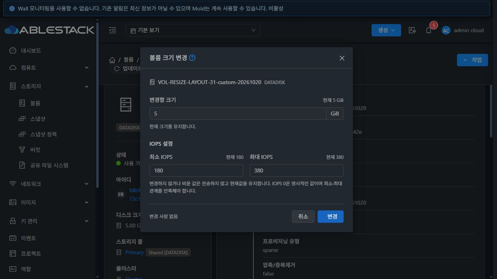
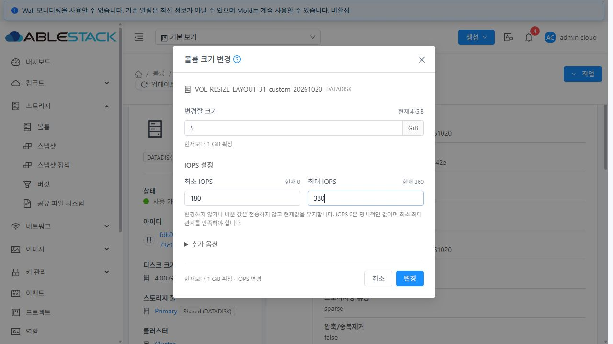
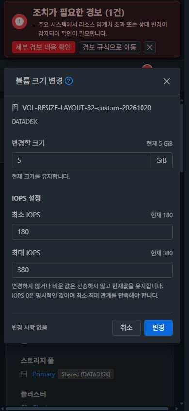
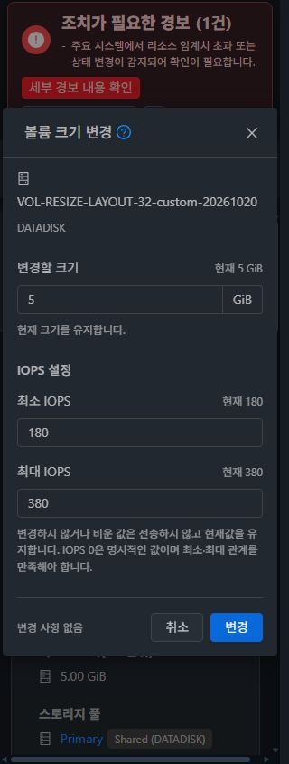

# 볼륨 크기 변경 대화상자 입력 중심 배치 반영

2026-10-20~21에 사용자가 승인한 첫 번째 목업을 적용하고 31 GFS2·32 RBD 환경의 배포와 기능 검증을 완료했다. 최종 UI 소스는 `7025ea66ae129fdd8defc684793e5c7a7f10fb73`이며 누적 Epic PR은 #1435다. #1429는 Completed 상태를 유지하고 Epic PR은 Draft·미병합으로 유지한다.

## 적용 결과

상단의 할당 정책·적용 증거 요약 및 별도 오퍼링 이름 블록을 제거했다. 볼륨 이름·유형으로 대상을 식별한 뒤 크기를 입력하고, 현재 크기와 IOPS를 각 레이블 옆에서 확인한다. 정책과 적용 증거는 기존 세로형 상세 탭에서 확인한다.

- 크기 입력에 GiB 단위를 붙이고 크기 제한·ROOT 안내·증감량을 입력 아래에 표시한다.
- 최소·최대 IOPS는 데스크톱에서 나란히, 480px 이하에서는 위아래로 배치한다. 빈 값 유지·명시적 0·고정 IOPS 읽기 전용 표시를 유지한다.
- 자동 마이그레이션은 유효한 크기 변경이 있을 때 접힌 추가 옵션으로 표시한다. 축소 동의·지원 불가 사유는 축소 입력 시 크기 가까이에 표시한다. 동의 컨트롤은 크기 FormItem의 수집에서 분리한다.
- 하단에는 실제 요청 계약으로 계산한 변경 요약과 취소·변경 버튼을 표시한다. 대상 오퍼링 조회·부분 payload·제출 전 재조회·중복 방지·오류와 입력 보존·동일 작업 재확인은 유지한다.

[설계](../../design/mold-volume-1429-resize-layout.ko.md)

## 빌드·배포

WSL ext4 `/home/ablecloud/work/dhslove/cloud-epic-1422`에서 Node 14.21.3을 사용해 관련 7 suites / 115 tests, 린트와 UI production build를 통과했다. Java/Maven/JAR/Agent/qemu 변경이나 전체 Cloud/Release CI 실행은 없다.

초기 배포 `28c85867ed8`의 실제 390px 검증에서 기본 폼의 모바일 flex 규칙이 IOPS 레이블과 입력을 가로 배치하는 것을 발견했다. 세로 흐름을 명시하고 자식 너비를 보완한 최종 `7025ea66ae1`을 다시 빌드·배포했다. 초기 발견 화면을 보존하고 최종 번들의 실제 레이블/입력 좌표와 스크린샷으로 수정 결과를 확인했다. 초기 발견 기록을 최종 통과 건수로 합산하지 않는다.

31·32 각각 정적 파일 896개의 해시 일치, `WEB-INF`/`META-INF`/config·관리 JAR·PID 보존, 새 로그인과 `/client/` HTTP 200을 확인했다. 최종 백업은 두 서버의 `/root/volume-resize-layout-ui-7025ea66ae1`이다. 배포 payload SHA256은 `5a13e2458d09a7566680525fc44b48564c9cf2896fe9b7a092bccb590041bec3`이다. 기존 FTCTL 번들 표식도 확인했다.

[빌드 결과](build-qualified.json) · [최종 배포](deployment-qualified.json) · [초기 배포](deployment-initial.json)

## 실제 기능 검증

전용 Admin 볼륨을 사용했다. GFS2는 QCOW2, RBD는 RAW의 기존 호환 볼륨을 실제 변경했다. 각 클러스터에서 IOPS만 150/300, 빈 IOPS로 2→3 GiB, 크기·IOPS 동시 변경으로 4 GiB/170/360을 완료했다. 최종 배포본에서 최소 IOPS 0과 5 GiB/180/380 동시 변경을 다시 완료했다.

변경 POST 10개를 원문 본문에서 확인해 대상 ID와 변경 필드만 전송한 것을 대조했다. API·DB의 용량/IOPS와 실제 이미지의 논리 용량, 원래 경로·오퍼링·스토리지·상태 및 기존 64KiB 데이터 패턴 보존을 10회 확인했다. IOPS 변경의 guest 처리량이나 실제 실행 중 QoS 성능을 검증한 결과로 확대하지 않는다.

| 검증 | 결과 |
|---|---|
| 상단 할당 블록 제거, 각 입력의 현재값·단위, 하단 변경 요약 | 두 클러스터 통과 |
| IOPS만·크기만·동시 변경, 빈 값 유지·명시적 0 | POST 10개 및 API/DB/이미지 대조 통과 |
| 고정 IOPS 읽기 전용, 엄격한 크기/명시적 정책의 크기 차단과 IOPS 편집 | 두 클러스터 확인, 최종 번들에서도 크기 제한 재확인 |
| 잘못된 IOPS의 오류·입력 보존 | 입력 유지·POST 0 |
| 오퍼링 조회 실패와 재시도 | 버튼 표시, 현재값 유지 후 복구 |
| Ready QCOW2 축소 | 지원 불가 표시·POST 0 |
| RAW 축소 동의의 위치·폼 수집 분리·취소 | 동의 입력 확인, 크기 입력 ID 1개, POST 0 |
| 최종 데스크톱 밝은/어두운 테마 | 레이블·입력 정렬 확인 |
| 최종 390px·320px | 한 열, 레이블 아래 입력, 가로 넘침·겹침 없음 |

최종 판정 59개가 통과했다. UI 관측 기록 33개에는 초기 발견과 최종 재검증을 함께 보존하며 각 기록에 소스 커밋을 표시했다. 레이블의 아래 좌표 ≤ 입력의 위 좌표, 입력의 아래 좌표 ≤ 항목의 아래 좌표를 대조해 세로 정렬과 겹침 방지를 확인했다.

[UI 판정](ui-qualified.json) · [화면 기록](ui-evidence.json) · [POST 본문](ui-requests.json) · [레이블/입력 좌표](label-geometry.json) · [API/DB/이미지 대조](runtime-checks.jsonl)

이번 수정은 UI 배치와 조건부 정보 표시다. ROOT·guest 파일시스템 변경 및 권한별 전체 실환경 행렬은 재실행하지 않았다. 기존 제출 계약은 115개 회귀 테스트로 확인했다. RBD 축소는 동의·취소 경로만 확인했으며 새로운 축소 지원이나 실제 축소 성공을 주장하지 않는다.

## 정리와 완료

전용 볼륨 8개를 삭제하고 디스크 오퍼링 8개를 비활성화했다. 활성 테스트 볼륨·테스트 이미지는 0이며 운영 inventory가 초기와 일치한다. 호스트 6대 Up, Mold active, `WEB-INF` 보존과 `/client/` 200을 확인했다. 배포용 임시 전송 파일을 제거하고 롤백 백업은 보존했다. 브라우저 요청 차단·임시 CSS·화면 크기 재정의를 해제하고 원래 어두운 테마를 복원했으며 두 테스트 세션을 로그아웃하고 임시 탭을 닫았다.

[31 정리](31-cleanup.json) · [32 정리](32-cleanup.json) · [기계 판독 요약](summary.json)

## 적용 화면

[초기 모바일 정렬 문제](32-mobile-390-before-fix.png) · [수정 전 상단 요약 배치](31-before.png)
