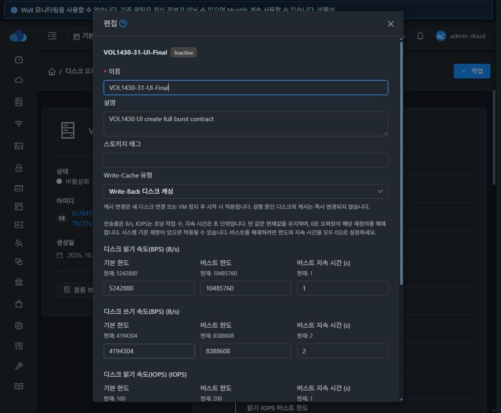
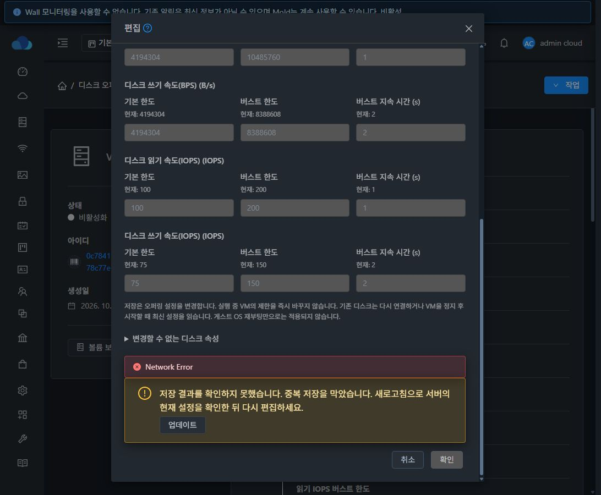

# #1430 디스크 오퍼링 캐시·QoS와 컴퓨트 상속 검증

대상은 Epic #1422의 VOL-08이며 누적 Draft PR은 [#1435](https://github.com/ablecloud-team/ablestack-cloud/pull/1435)다. 개별 구현·배포·검증 기준으로 #1430을 완료한다. Epic 전체 회귀와 PR 병합은 이번 범위가 아니다.

## 변경 결과

- 디스크 편집에 캐시 4종과 읽기/쓰기 B/s·IOPS의 기본·버스트 한도·지속 시간 총 12개 항목을 추가했다. 현재값과 단위, 0/빈 값 의미, 적용 시점을 입력 가까이에 표시한다.
- 생성·복제·수정의 필드 정의·값 변환·검증·payload를 공통화했다. 숨겨진 값의 재상속을 막으며 일반 디스크 연결형 컴퓨트는 연결 UUID를 유지하고 별도 캐시·QoS를 보내지 않는다.
- 크기·스토리지 IOPS·정책 등 불변 속성은 접힌 안내에 표시한다. 기존 세로형 상세 목록과 상태·접근 범위·비활성화 작업을 유지한다. 공유 디스크 캐시는 none으로 제한한다.
- 서버는 생략한 필드를 보존하고 명시적인 0을 기록한다. 부분 수정의 기존 base/max/duration을 병합해 검증한 후 저장하므로 잘못된 조합이 DB에 남지 않는다.
- Inactive 복제 조회, 저장된 사용자 지정/ROOT 크기 0 sentinel의 복제, 스토리지 IOPS 종류 판정, 컴퓨트 QoS 0의 기존 양수 검증 충돌을 실환경에서 찾아 수정했다.
- 읽기 실패는 사유·재시도를 제공하고 저장을 막는다. 전송 결과 미확인은 입력을 보존하고 중복 저장을 막은 뒤 서버 재조회를 요구한다. 공통 요청 계층의 실패 보존 옵션을 연결해 전송 오류가 먼저 로그아웃시키던 문제도 보완했다.

[API·필드·상속·배포 설계](../../design/volume-1430-offering-performance.ko.md)

## 빌드와 배포

WSL ext4 `/home/ablecloud/work/dhslove/cloud-epic-1422`에서 변경 모듈만 빌드했다.

| 검사 | 결과 |
|---|---|
| server package 및 ConfigurationManager/할당 복제 회귀 | 92개 통과 |
| API package 및 서비스 오퍼링 상속 응답 계약 | 2개 통과 |
| 실제 31/32 관리 fat JAR 클래스 로딩 조합 | 각 16개, 총 32회 통과 |
| 변경 Java·테스트 파일 Checkstyle | 통과 |
| 최종 UI 관련 Jest | 8 suites / 127개 통과 |
| 최종 UI 변경 파일 lint·production build | 통과 |

표준 모듈 Checkstyle은 기존 무관한 테스트의 wildcard import 15건으로 실패한다. 모듈 package에는 `checkstyle.skip`을 사용하고 변경 파일은 별도로 검사했다. 전체 Cloud/Release CI·Agent/qemu 빌드는 실행하지 않았다. PR에 등록된 check run이 없다는 상태를 CI 성공으로 표시하지 않는다.

관리 서버 기존 fat JAR의 필요한 메서드·응답 호환 부분만 반영하고 나머지 메서드와 약 20만 개 JAR entry를 보존했다. 31번 구 배포본에 없던 `diskofferingcomputeonly` 응답은 현재 소스 계약에 맞게 보완해 실제 API의 true/false를 확인했다. DB schema와 무관 FTCTL 코드는 변경하지 않았다.

| 클러스터 | 관리 JAR SHA256 | 백업 |
|---|---|---|
| 31 GFS2 | `e426ab0cccef23aac0cf3f514c53dcafbedc063306af65f791217540bf5a9072` | `/root/volume-1430-final-6f5b0b35820` |
| 32 RBD | `952b783b29d483d47ab6c4bcaff69f9b3dada6a76f43aab9c545e0e3a418a752` | `/root/volume-1430-final-6f5b0b35820` |

Java 최종 동작 소스는 `6f5b0b35820`, 최종 UI 소스는 `d2c9c75b4e0`다. 이후 문서 커밋은 실행 코드를 바꾸지 않는다. UI는 활성 webapp의 정적 파일만 갱신하고 WEB-INF/META-INF/config, 관리 JAR와 PID를 보존한다. 실제 해시·로그인·Mold active·`/client/` HTTP 200 결과는 배포 JSON에 기록한다.

## 실환경 기능 검증

31 GFS2 QCOW2와 32 커널 RBD RAW에서 같은 절차를 수행했다. 각 클러스터에서 전용 VM 2개와 ROOT 2개·데이터 2개를 사용했다.

| 단계 | 실제 관찰 결과 |
|---|---|
| 오퍼링 캐시·12개 QoS 수정 | API·DB 일치. 기존 Running ROOT/데이터의 XML/QMP는 즉시 바뀌지 않음 |
| 새 데이터 연결 | 최신 설정 적용, 기존 디스크는 기존값 유지 |
| 기존 데이터 분리·재연결 | 데이터에 최신 설정 적용, ROOT는 기존값 유지 |
| Cloud 정지·시작 | ROOT·데이터 모두 최신 캐시/iotune, XML·QMP 일치 |
| 12개를 0, 캐시 hypervisor_default로 수정 | 실행 중 값 유지 후 정지·시작에서 재정의 해제·기본 캐시 적용 |
| 디스크 데이터 보존 | 정지 상태 64KiB의 0x5a 패턴 유지, UUID/path/size/format 유지. QCOW2 check 통과 |
| 컴퓨트 전용 디스크 복제로 새 VM 생성 | clone 값·API·DB·실제 ROOT XML/QMP 일치 |

양수 수정 검증 값은 읽기 B/s 5242880/10485760/1초, 쓰기 B/s 4194304/8388608/2초, 읽기 IOPS 100/200/1초, 쓰기 IOPS 75/150/2초와 writethrough다. 새 컴퓨트 복제 VM은 writeback, 읽기 B/s 3145728/6291456/1초, 읽기 IOPS 100/200/1초, 나머지 0을 적용했다.

UI에서 디스크·컴퓨트 생성/복제, QoS none으로 복제 시 숨겨진 12개 0, 일반 디스크 연결 컴퓨트 복제의 UUID/숨겨진 payload 생략, 고정 스토리지 IOPS 100/200 복제, 12개 0 컴퓨트 생성을 실행했다. Inactive 이름 수정은 상태와 불변 IOPS를 보존했다. 실제 POST 본문과 API/DB를 대조했다.

최종 `d2c9c75b4e0` 배포본에서는 두 환경의 빈 base/max 입력을 남긴 이름 수정이 이름만 POST하고 원래 12개 값을 보존하는 것을 API/DB로 확인했다. 전송 실패 후 두 환경 모두 세션·입력을 유지하고 저장을 잠갔으며 서버 재조회로 원래 값을 복구했다. 31번의 결과 미확인 상태에서 키보드 재제출의 추가 POST는 0개다. 32번의 정확한 대상 조회 전송 실패는 저장을 막고 실제 재시도로 복구했다. 31번 503 사유 표시도 별도로 확인했다.

최종 화면의 데스크톱 어두운 테마, 32번 밝은 테마, 양 환경 390px/320px의 레이블·입력 DOM을 확인했다. QoS 입력 12개에 겹침과 대화상자 밖 이탈이 없다. 모바일 비트맵의 캡처/포털 표시 불일치는 제외하고 DOM 좌표 증거만 사용했다. 원래 어두운 테마와 브라우저 크기·캐시·네트워크 차단 설정을 복원하고 로그아웃·임시 탭 종료를 완료했다.

Admin·Domain Admin·User를 두 환경에서 확인했다. Domain Admin은 허용된 전용 오퍼링을 수정하고 태그 권한이 없을 때 태그 입력/전송이 없다. 일반 User는 읽기만 가능하고 수정 작업/API가 없다. Domain Admin의 공개 오퍼링 변경 및 공유 디스크의 writeback은 서버에서 거절한다. 음수·소수·오버플로·기존 max 충돌·지속 시간 조합·잘못된 캐시·생성/복제 오류 20건은 DB 보존을 함께 확인했다.

## 판정과 한계

- 초기 크기 sentinel·Inactive 조회·스토리지 QoS 오분류·컴퓨트 0 입력 오류는 실패로 기록한 뒤 수정·재빌드·재검증했다. 잘못 복제된 초기 스토리지 오퍼링은 검증 성공에 포함하지 않고 비활성화했다.
- 제어한 전송 실패는 실제 장애 발생률 측정이 아니다. 원래 전송 실패가 로그아웃을 유발한 결과는 성공으로 집계하지 않으며 실패 보존 수정 이후 별도로 확인한다.
- 게스트 QGA guest-exec가 비활성화되어 정책을 완화하지 않았다. 게스트 처리량 벤치마크를 주장하지 않는다. 설정 적용은 실제 XML/QMP와 오프라인 데이터 패턴으로 검증했다.
- 32번은 커널 RBD RAW의 기존 캐시/iotune 경로다. falloc/lazy thick·새 예약 방식·Full 확장·축소 성공·영구 예약 지원을 추가하거나 추정하지 않는다.
- 컴퓨트 전용 디스크 링크 #1154, 목록 개수 #1209, VM 이름 조회 #1210, 전체 API/권한 #1432, 전체 VM UI 통일 #1433, 통합 회귀 #1434는 각 이슈가 소유한다. #1437은 해결 상태를 유지한다.

VM 4개와 ROOT/데이터 볼륨·이미지 8개를 삭제했고 디스크 오퍼링 19개와 컴퓨트 오퍼링 12개는 Inactive다. 컴퓨트 전용 디스크의 동반 비활성화와 일반 연결 디스크의 독립 상태도 확인했다. 계정 4개·도메인 2개와 전송 임시 파일 22개를 정리했다. 활성 테스트 잔여·이미지·VM 정의 0, 기존 운영 inventory 동일, 호스트 6개 Up, Mold active·WEB-INF 존재·HTTP 200이다. 백업과 제품 이력은 유지한다.

최종 판정과 제외 증거는 [summary.json](summary.json), [cleanup.json](cleanup.json), [ui-final.json](ui-final.json)에 기록했다. [Java 빌드](build-java.json), [검사 로그 발췌](build-java-excerpts.log), [UI 빌드](ui-qualified-complete-summary.json), [배포](ui-deployment.json), [실제 적용 단계](runtime-checks.jsonl), [다음 작업](next-steps.ko.md)을 함께 확인할 수 있다. 로그인 비밀·세션키·비밀 키가 포함된 원본 API journal/접속 스크립트는 게시하지 않는다.

