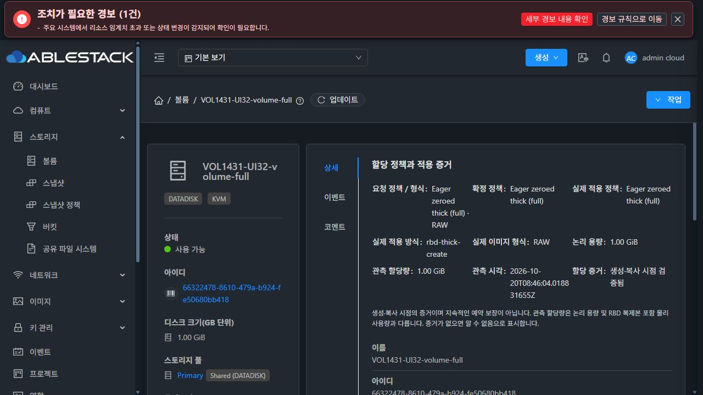
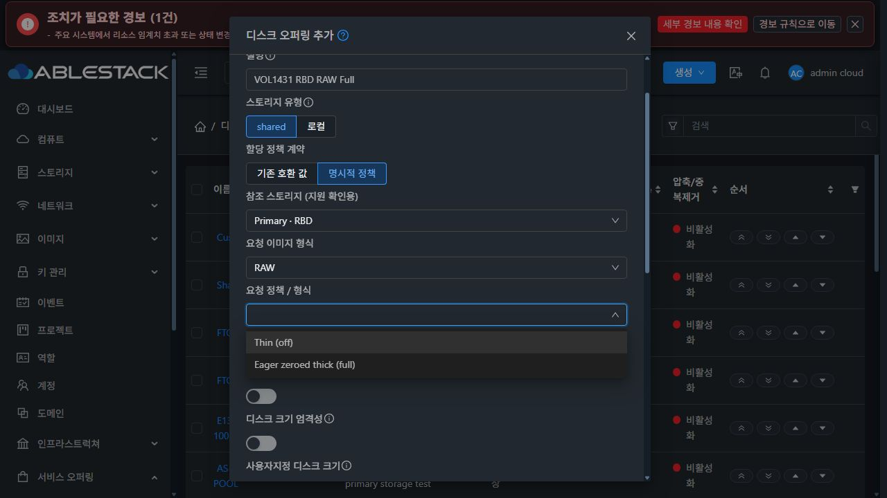
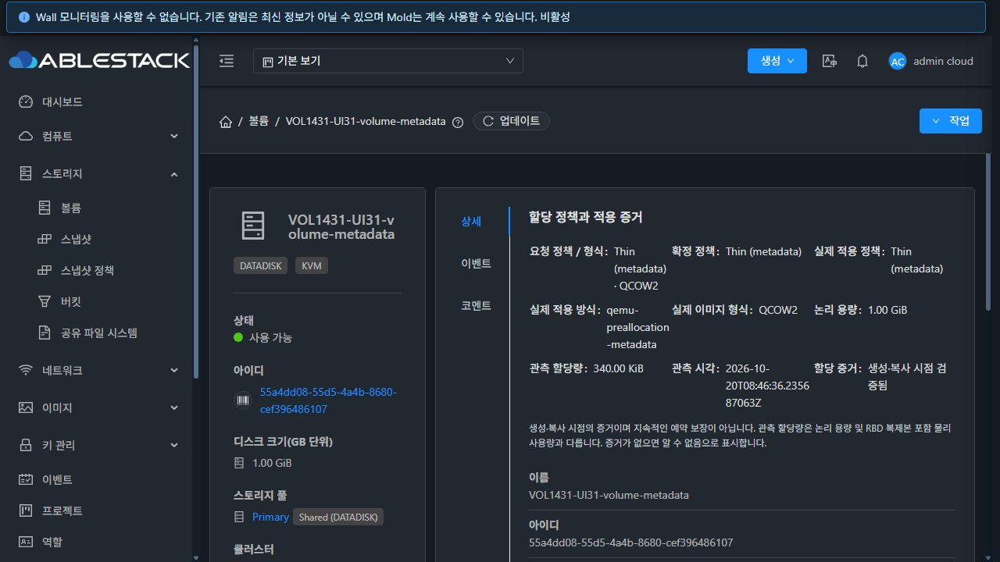

# #1431 지원 정책 선택·요청 및 실제 적용 증거 UI 검증

> 상세 탭 배치는 후속 요청에 따라 기존 세로형 목록 스타일로 수정했습니다. 현재 배포 상태는 [상세 탭 후속 수정 보고서](../volume-1431-detail-style-20261020/report.ko.md)를 참고하세요.

2026-10-20 · Epic #1422 · 누적 Draft PR #1435 · 브랜치: dhslove/epic-1422-volume-offerings

## 결과

#1431의 설계·구현·변경 모듈 빌드·31(GFS2)/32(RBD) 배포·기능 검증을 완료했다. capability에 따른 정책 선택, 기존 호환 값 보존, 루트/데이터 정책 상속, 요청과 실제 적용 증거 분리 표시를 제공한다. RBD는 실제 검증된 RAW off/full만 표시한다.

## 구현과 검증 중 보완한 오류

- 공통 AllocationPolicyEditor/AllocationSummary와 페이지 전체 조회·응답 범위 검사·오래된 응답 무시를 추가했다. 권한 없음/빈 결과/조회 실패는 지원 성공으로 바꾸지 않으며 입력을 보존하고 제출을 막는다.
- 오퍼링 정의 복제에서 명시적 요청을 보존하고 실제 이미지 복제의 미지원 가드와 분리했다. 기존 thin/sparse/fat의 이름만 복제할 때 기본 getter가 thin으로 덮는 문제를 수정했다.
- 실제 API 시험에서 크기 생략 복제가 DB bytes를 API GiB로 전달해 최대 크기 오류가 발생했다. 디스크/컴퓨트 복제에서 단위를 변환했고, 올바른 DB 단위의 fixture와 회귀 테스트로 재검증했다.
- 자식 정책 편집기의 값이 부모 폼의 ref 필터에서 빠지던 문제를 수정했다. 명시적 정책에는 allocationpolicy/format을, 기존 호환 값에는 원래 provisioningtype을 보낸다.
- listVolumesMetrics의 BeanUtils 복사에서 allocation이 누락됐다. VolumeResponse getter를 추가해 일반 API·Metrics API·상세 UI의 증거를 일치시켰다.
- VM 데이터 디스크 표의 행 데이터가 헤더 슬롯에서 참조되던 회귀를 실제 브라우저에서 발견했다. 행 슬롯으로 옮기고 실제 Ant 테이블을 렌더링하는 루트/데이터 회귀 테스트를 추가했다.
- 컴퓨트 복제의 allocation.* 내부 키를 편집 가능한 하이퍼바이저 세부 정보에서 제외했다. 사용자가 입력한 다른 세부 정보는 유지한다.
- 명시적 물리 확장·복원·이동·이미지 clone의 기존 제한을 안내하고, 이동의 대상 조회/제출과 볼륨 다운로드·템플릿 이미지 복사를 UI에서도 차단한다. 동일 정책 변경을 물리 변환으로 설명하지 않는다.

## 빌드·자동 검사

| 검사 | 최종 결과 |
|---|---|
| WSL ext4 API 모듈 install | 성공 (API 단위 검사는 생략, Metrics 통합 회귀로 getter 검증) |
| server 모듈 package | 30개 PASS |
| Metrics 모듈 package | 18개 PASS |
| 실제 31/32 관리 JAR의 관련 클래스 조합 | 각 48개, 총 96회 PASS |
| UI 관련 Jest | 7개 suite, 66개 PASS |
| 변경 UI lint / production build | 성공 |

표준 server Checkstyle은 변경 전부터 있던 무관한 star import 15건으로 실패했다. 해당 결과를 분리하고 변경 모듈 package에 checkstyle.skip을 사용했다. 이를 전체 Checkstyle 통과 또는 전체 Cloud/Release CI 성공으로 표현하지 않는다. 전체 Cloud 빌드와 Actions dispatch는 수행하지 않았다. 초기 API 실패·표 렌더링 회귀와 수정 후 통과 결과는 별개다.

## 배포

- 관리 API/server 소스: 13fa9b104c6. UI 소스: ffbbf9443f0519851b48cdb5e254758def5591fc.
- 환경별 활성 관리 JAR의 cloneDiskOffering/cloneServiceOffering 두 메서드, OfferingAllocationClone 클래스와 VolumeResponse getter만 갱신했다. ConfigurationManagerImpl의 무관 메서드 257개와 VolumeResponse의 무관 메서드 164개 코드를 보존했다.
- 31 관리 JAR SHA256: dd0fa170dbf2019bed9304b43f4f64915d35ca05a0d9ff362e2a26e425a34912.
- 32 관리 JAR SHA256: fb1c64d75e1d156b073c5f9009e6981e61e8adfe93e4addde38dde9c249d85ca.
- Agent·qemu·FTCTL은 배포하지 않았다. 관리 서비스 재시작 후 정적 UI를 배포했다. 재시작이 이전 정적 파일을 다시 푸는 동작을 확인해 순서를 보정했다.
- 정적 파일 894개를 검증해 덮어쓰고 index를 마지막에 공개했다. WEB-INF/META-INF/config, 관리 JAR와 PID, 기존 해시 자산을 보존했다. 루트 교체나 rsync --delete를 사용하지 않았다.
- 각 단계에서 mold active·로그인·/client/ HTTP 200 및 FTCTL의 blockingLoadingState/fetchSyncProgress/extractJobId 마커를 확인했다.
- 최종 백업: 관리 /root/volume-1431-13fa9b104c6, UI 배포 로그에 기록한 별도 /root/volume-1431-ui-* 디렉터리. 배포 파일의 해시와 보존 검사는 summary.json에 요약했다.

## API→DB→실물

API 행렬 38항목이 통과했다. 31의 QCOW2 metadata/falloc/full·RAW off/falloc/full, 32의 RAW off/full에서 이름만 복제한 오퍼링으로 1GiB 볼륨을 생성했다. 두 환경에서 기존 thin/sparse/fat 정의 복제 및 컴퓨트 전용/일반 디스크 연결 상속도 확인했다.

UI 생성 2개를 더한 볼륨 10개의 요청·확정·적용 정책, 형식·메서드, 논리 용량, 관측 할당량·시각을 API/DB와 qemu-img info 및 stat/RBD du로 대조했다. 각 볼륨의 전체 1GiB를 64MiB 단위 qemu-io read -P 0으로 읽었다. 사용자 VM이나 디스크에는 쓰지 않았다.

| 환경 | 형식 / 정책 | 실제 적용 방식 | 관측 bytes | 전체 zero·API/DB/이미지 |
|---|---|---|---:|---|
| 31 | qcow2 / metadata | qemu-preallocation-metadata | 348,160 | PASS |
| 31 | qcow2 / falloc | qemu-preallocation-falloc | 1,076,203,520 | PASS |
| 31 | qcow2 / full | qemu-preallocation-full | 1,076,203,520 | PASS |
| 31 | raw / off | qemu-preallocation-off | 12,288 | PASS |
| 31 | raw / falloc | qemu-preallocation-falloc | 1,075,871,744 | PASS |
| 31 | raw / full | qemu-preallocation-full | 1,075,871,744 | PASS |
| 31 | qcow2 / metadata | qemu-preallocation-metadata | 348,160 | PASS |
| 32 | raw / off | rbd-thin | 0 | PASS |
| 32 | raw / full | rbd-thick-create | 1,073,741,824 | PASS |
| 32 | raw / full | rbd-thick-create | 1,073,741,824 | PASS |

관측값은 생성·복사 시점의 이미지 할당이며 영구 공간 예약이나 RBD 복제본을 합한 물리 사용량을 뜻하지 않는다.

## 실제 UI 검증

- 31에서 QCOW2 metadata 오퍼링을 UI 생성·복제하고 그 복제본으로 볼륨을 생성했다. 상세에 metadata/QCOW2/qemu-preallocation-metadata/논리 1GiB/관측 340KiB/시각이 각각 표시됐다.
- 32에서 RAW 형식만, off/full 정책만 표시됨을 확인했다. UI Full 오퍼링으로 생성한 볼륨은 rbd-thick-create·관측 1GiB·시각을 표시했다.
- 31의 컴퓨트 전용 RAW Thin 요청은 literal off로 저장했다. UI 복제 시 새 내부 디스크의 소유권을 검증했다. 32의 일반 Full 디스크 연결 컴퓨트 생성·복제는 같은 일반 디스크를 유지하고 경쟁하는 자체 정책을 저장하지 않았다.
- 기존 fat은 기존 호환 값 모드로 열리고 복제·메타데이터 재저장 후에도 fat을 유지했다. 실제 적용 증거는 알 수 없음으로 남았다.
- 실제 RBD Full 볼륨에서 이동 확인 버튼 비활성, 물리 크기 입력 비활성, 다른 정책의 오퍼링 선택 비활성을 확인했다. 다운로드·템플릿 생성도 비활성 상태였다.
- VM 생성 화면에서 컴퓨트/루트/데이터 선택의 정책 용어와 표시 및 루트/데이터 표 선택을 확인하고 생성 없이 취소했다.
- 다중 페이지/범위 불일치/빈 결과/권한 없음/조회 실패/오래된 응답 조건은 관련 자동 검사로 검증했다. 모든 역할과 대규모 목록의 실제 UI 회귀를 수행했다고 확대하지 않는다.

## 정리와 보존

클러스터별 전용 볼륨 삭제·오퍼링 비활성화 후 API/DB 활성 잔여와 해당 이미지·stage가 0임을 확인했다. 컴퓨트 전용 내부 디스크도 비활성 상태다. 삭제 이력과 기존 운영 자원은 유지했다. 이번 실행의 falloc 내용 불일치 진단 슬롯은 소유 UUID와 파일 집합을 확인하고 root 전용 압축본의 해시를 검증한 뒤 풀에서 정리했다. 재시도 후 공개된 이미지의 최종 전체 zero 읽기는 통과했다. 커널/호스트 수정 대기 항목을 만들지 않았다.

- 31: 볼륨 7개 삭제, 일반 디스크 오퍼링 20개·컴퓨트 6개 비활성화. 운영 inventory 동일.
- 32: 볼륨 3개 삭제, 일반 디스크 오퍼링 12개·컴퓨트 6개 비활성화. 운영 inventory 동일.

## 지원 제한과 다음 작업

#1437은 제한 재시도와 안전 실패 조치로 해결 종료됐으며 다시 미해결로 취급하지 않는다. 커널/호스트의 근본 수정은 제품 범위가 아니다. RBD falloc/lazy thick/QCOW2/Full 확장/영구 예약 보장과 명시적 물리 수명주기 지원을 새로 주장하지 않는다.

#1431 종료 후 열린 하위 이슈는 9개다. 다음 권장 구현은 #1428이며 #1429, #1430, #1432와 기존 선택기/링크 결함을 처리한 뒤 #1433의 VM 표준 UI 통일과 #1434의 통합 회귀·Epic 종료 판정으로 진행한다. 전체 화면 재배치, 모든 역할의 UI 검증, 실제 pool 간 이동·guest workload 검증을 이번 통과에 포함하지 않는다. [다음 작업](next-steps.ko.md).
