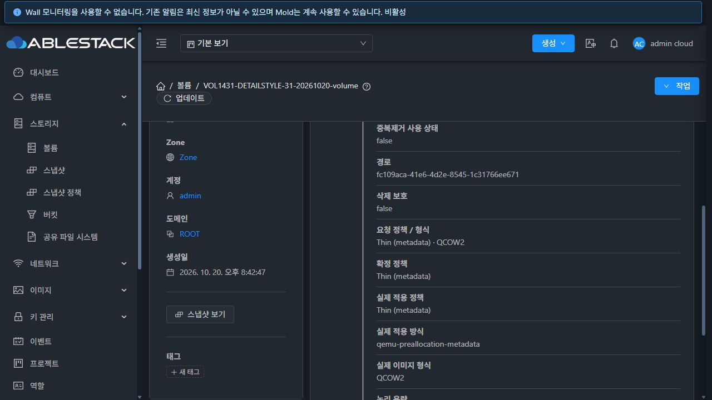
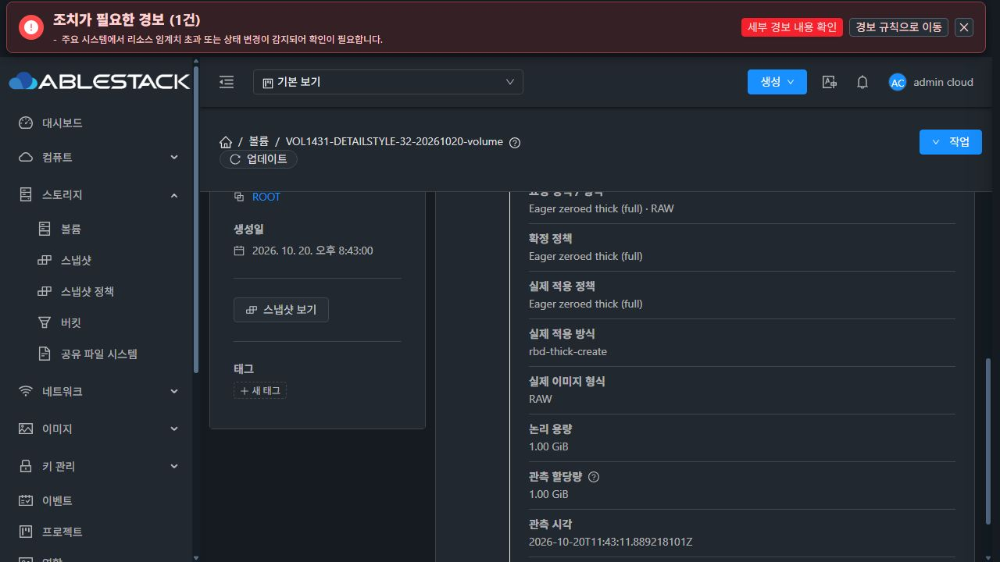
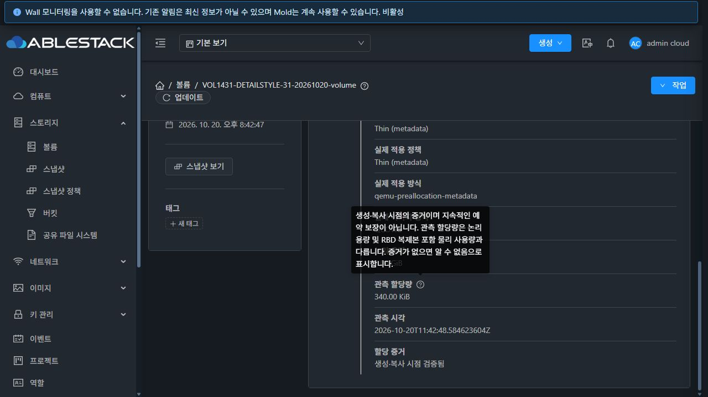
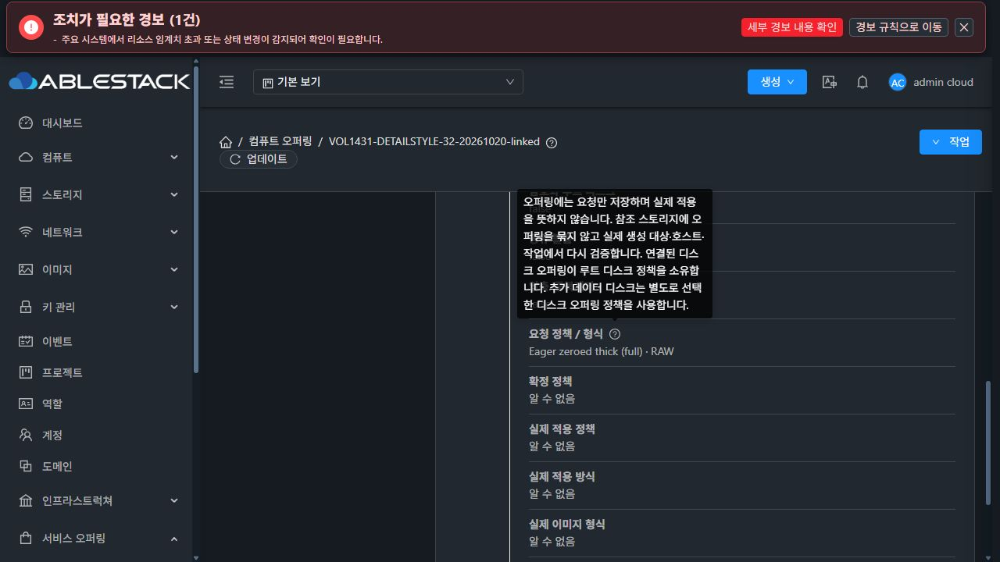

# #1431 후속 수정 — 상세 탭 기존 스타일 유지

## 변경 결과

볼륨·디스크 오퍼링·컴퓨트/시스템 오퍼링 상세의 별도 할당 요약 그리드를 제거했다. 기존 resource-details-list의 세로형 **항목명 → 값** 구조와 기존 항목 순서를 유지하고, 필요한 할당 정보를 같은 목록의 마지막에 추가했다. CSS는 변경하지 않았다.

- 볼륨: 요청 정책/형식, 확정 정책, 실제 적용 정책·방식, 실제 이미지 형식, 논리 용량, 관측 할당량·시각, 할당 증거 9개 항목.
- 오퍼링: 논리 용량을 제외한 8개 항목. 증거가 없으면 적용·관측 값은 계속 **알 수 없음**으로 표시한다.
- 관측값의 한계와 연결된 디스크 오퍼링의 루트 정책 소유권 설명은 해당 항목의 도움말로 제공한다.
- 대화상자의 AllocationSummary 배치는 유지하고 표시값 생성 함수를 공유한다. API·정책 지원 범위·생성 동작은 변경하지 않았다.

소스: a720247198ab1081623adfaec2b03b8991e15a92. [설계](../../design/mold-volume-1431-policy-ui.ko.md) · [직전 검증](../volume-1431-20261020/report.ko.md).

## 검증

WSL ext4 UI에서 Jest **7 suites / 66 tests**, 변경 파일 lint, production build가 통과했다. Webpack asset/entrypoint 크기 경고 2건과 Browserslist 갱신 안내가 있었다. 전체 Cloud/Maven/Release CI는 실행하지 않았다.

31(GFS2 QCOW2 metadata)·32(RBD RAW full)에서 각각 볼륨, 명시적 디스크 오퍼링, 연결형 컴퓨트 오퍼링, legacy fat 오퍼링의 총 **8개 상세 화면**을 대조했다.

1. 기존 항목의 텍스트·순서가 배포 전과 동일했다.
2. 추가 항목은 같은 목록에 정해진 순서로 표시됐다.
3. computed style이 기존 값과 같았다: 글자 14px, 행 높이 22.001px, 여백 8px 0px, 항목명 굵기 700, 동일한 배경·글자색·1px 구분선. 마지막 항목의 구분선 생략은 기존 Ant List 규칙을 따른다.
4. UI의 정책/형식·실제 방식·관측값·시각과 API 응답을 대조했다. 증거가 없는 오퍼링은 실제 적용을 추정하지 않았다.
5. 관측 한계와 연결형 루트 정책 설명이 툴팁에 표시됐다.

*-after.json은 항목·스타일 대조 결과, *-after.ax.txt는 전체 접근성 트리다. 두 테스트 볼륨은 각각 1GiB이다. 시스템 오퍼링은 같은 컴포넌트 적용 및 빌드 범위이며 별도의 실제 시스템 오퍼링 생성은 하지 않았다.

## 배포와 정리

31·32 활성 webapp에 정적 파일 **896개**를 배포하고 파일별 SHA-256을 모두 대조했다. WEB-INF/META-INF/config, 관리 JAR, Mold PID를 보존했으며 재시작하지 않았다. 두 서버 모두 새 로그인 성공, Mold active, /client/ HTTP 200이다.

- 백업: 두 서버 /root/volume-1431-ui-a720247198a-detail-style.
- 배포 tar SHA-256: 514a5f762713c44c6e498b95d5f096eead3da2ff2c78ae1c4abf1ecc43f5cddb.
- 테스트 볼륨 총 2개 삭제, 디스크 오퍼링 4개·컴퓨트 오퍼링 2개 비활성화.
- API/DB 활성 전용 자원 0, 실제 이미지·stage 0. 기존 VM/볼륨/활성 오퍼링 inventory 동일. 두 클러스터의 Routing 호스트 각 3개 Up.

[기계 판독 결과](summary.json)에 로그 해시·배포·정리 결과를 보존했다. #1431의 완료 상태는 유지한다. 누적 Epic PR #1435는 Draft이며 병합하지 않았다.

## 화면 증거

검증 당시 화면이며, 촬영 후 전용 자원은 정리했다.

