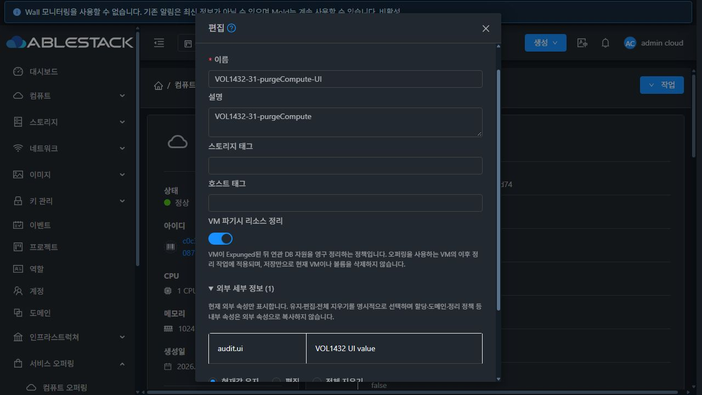

# #1432 잔여 API/UI 매핑·관리 기능·접근 제어 완료 보고

Epic #1422 · 누적 Draft PR #1435 · 2026-10-21

## 결과

관련 API 66개의 UI 위치 또는 의도적 미노출을 결정했다. 볼륨 소유권 이전, 컴퓨트 정리 정책·외부 정보 편집, 디스크/컴퓨트 접근 범위 선택기를 보완했고 31 GFS2·32 kernel RBD에 배포했다. 이 보고서는 #1432의 구현·개별 검증 완료 근거다. 누적 PR은 Draft·미병합이며 Epic 전체 종료 판정은 #1434에 남긴다.

- [전체 API/UI 결정표](api-ui-map.ko.md): 권한 등록, 상태, 스토리지, 기존 진입점, 구현/미노출 결정과 소스 위치. 미결정 항목 없음.
- [실제 API 실행 행렬](api-execution-matrix.json): 214개 기록. 초기 서버 168+38개와 최종 수정 서버 8개를 단계별로 구분한다. API 등록·빈 조회·거절과 실제 변경 성공을 구분한다.
- [UI 실행 증거](ui-evidence.json): 32개 기록. 실제 생성된 자원의 화면과 요청, 의도적인 통신 실패 주입을 구분한다.
- [요약](summary.json), [빌드](build-summary.json), [배포](deployment.json), [정리](cleanup.json), [재현 절차](reproduction.ko.md).

## 설계와 구현

| 항목 | 반영 결과 |
|---|---|
| assignVolume | Admin/DomainAdmin 및 API 허용 시 볼륨 상세에 소유권 이전 제공. 현재 소유자 옆에 계정/프로젝트 UUID 대상 선택과 확인을 둔다. Ready DATADISK·미연결·mutation 상태 확인, 스냅샷 사전 검사, 저장 직전 원본·후보 재조회, 단일 대상 전송과 중복 방지. 프로젝트 보기의 출발 projectid 자동 주입을 억제한다. 서버가 양쪽 소유권·상태·한도를 최종 검사한다. |
| 컴퓨트 편집 | purgeresources의 생략과 명시적 false를 구분한다. 이름/상태/domain/zone 부분 수정은 기존 정책을 보존한다. 이후 Expunged VM의 DB 정리 정책이라는 영향 범위를 설명한다. External: 항목만 유지/편집/확인 후 전체 정리하며, 변경·정리 범위는 선택한 오퍼링 ID로 제한한다. |
| 컴퓨트 복제 | External: 접두어를 제거해 외부 키만 API에 전달한다. domain/zone/purge/allocation 내부 키와 중복 External: 접두어를 외부 속성으로 복제하지 않는다. |
| 오퍼링 접근 범위 | Inactive 포함 원본 재조회, 도메인/존 전체 페이지와 UUID 선택. 실제 변경 필드만 전송한다. Root Admin만 공개/존 변경, DA는 허용 도메인의 비공개 오퍼링 관리. 공용 오퍼링의 DA 편집/접근/비활성화 작업을 숨기고 허용된 복제는 유지한다. 네트워크/VPC 오퍼링은 기존 컴포넌트를 유지한다. |
| 실패·문맥 처리 | 읽기 실패의 오류/재시도, 저장 실패 입력 보존, 전송 결과 불명 시 재전송 차단과 재조회, 다른 자원/로그인/프로젝트 문맥의 오래된 응답 폐기. 실제 인증 만료 처리는 유지한다. |
| 관련 탭·정기 스냅샷 | Events/Comments/Stats의 API·설정 조건과 실패 보존을 보완했다. 정기 스냅샷의 볼륨 후보/정책 전체 페이지 조회, 정책 읽기 실패의 기존 행 보존·재시도, 소유 문맥 전환 시 데이터 격리를 추가했다. |

기존 세로형 상세 스타일과 입력 중심 볼륨 대화상자 스타일을 유지했다. 새 대화상자의 현재값·대상·확인은 입력 영역에 배치한다. 세 메뉴 전체의 VM 표준 통일은 #1433의 별도 범위다.

## 의도적 미노출과 기존 기능

- checkVolume은 관리자 유지보수 API로 유지한다. 서버 지원은 KVM Ready QCOW2/VDI이며 연결 VM은 Stopped가 필요하다. repair=leaks/all을 일반 메뉴에 추가하지 않았다. 31 QCOW2의 읽기 검사는 성공했고 32 RBD RAW는 서버가 거절했다. RAW 대응이나 RBD falloc/lazy thick을 가정하지 않는다.
- import/unmanage는 기존 도구/StorageBrowser 진입점을 연결했다. 범용 resourceDetails 편집은 내부 계약을 임의 변경하는 UI로 노출하지 않는다.
- StatsTab은 instancesdisksstatsretentionenabled와 listVolumesUsageHistory 권한이 모두 필요하다. 설정 비활성화를 누락 UI로 간주하지 않는다.
- deleteDiskOffering/deleteServiceOffering의 기존 계약은 Inactive다. 별도 물리 삭제 버튼을 만들지 않고 전용 디스크의 동반 비활성화를 확인했다.

## 빌드·배포

| 검사 | 결과·실행 소스 |
|---|---|
| 변경 Maven server 모듈 | WSL ext4에서 package 성공. ConfigurationManager 78 + allocation clone 9 + QoS 5 + 이번 회귀 7 = 99개, 실패/오류 0. 서버 소스 bc6cccd989712989312720f97e0fbd8bc9b9417b. |
| 변경 Java Checkstyle | 변경한 2개 파일 0 위반. 표준 전체 규칙의 기존 무관한 wildcard 15건은 수정 범위에서 제외했다. |
| 배포 JAR 자격 검사 | 실제 31/32 관리 fat JAR 조합에서 각각 21개 통과. 기존 관리 JAR에 server 빌드의 updateServiceOffering 및 resolvePurgeResources만 반영했고 무관한 259개 메서드와 나머지 JAR 엔트리를 보존했다. |
| UI | 관련 lint, 15 suite/219개, production build 성공. UI 소스 aa7063fced9f78da12bc54544ad8598e64649402. 이후 bc6cccd9897은 서버/서버 검사만 변경했다. |
| 배포·재확인 | 두 환경 정적 파일 각 908개 해시 일치. WEB-INF/META-INF/config, 무관 JAR와 FTCTL 로직 보존. 최종 JAR 해시와 정적 파일 전체 재대조, Mold active, /client/ HTTP 200, 새 로그인 성공, 호스트 6개 Up. |

전체 Cloud/Release CI, Agent/qemu 빌드는 요청·실행하지 않았다. 등록된 GitHub check/status가 없는 상태를 CI 성공으로 표시하지 않는다. [빌드 발췌](build-excerpts.log)와 배포 JSON에 정확한 소스·JAR/번들 해시·백업 경로를 보존했다.

## 실제 기능·권한 검증

31 QCOW2와 32 RAW 각각 전용 A/B 도메인, DomainAdmin, 소유 User, 동일 도메인 Peer, 다른 도메인 Foreign과 User 소유 Project를 만들었다. 각 계정으로 직접 로그인했고 프로젝트는 별도 역할이 아닌 projectid 소유 범위로 검증했다.

- Admin/DA/User/Project의 실제 볼륨 조회, API 권한에 따른 편집 허용/거절, Stopped VM 연결/분리, 삭제 보호의 서버 거절, 소유자 생성/영구 삭제를 실행했다. User/DA의 기본 역할에 updateVolume이 없는 점을 UI 노출과 직접 API 거절에 반영했다. storageid 없는 사용자 생성은 Allocated 메타데이터 생성으로 구분한다.
- 다른 계정·프로젝트·도메인의 실존 UUID로 목록/metrics/스냅샷/이벤트/코멘트 및 변경/연결/삭제/이전을 요청해 빈 조회 또는 거절과 데이터 불변을 확인했다. 다른 도메인 전용 오퍼링 조회·생성 사용 거절, 일반 User/Project의 오퍼링 생성/편집/복제 거절, DA의 사설 복제 허용과 공용/다른 도메인/존 변경 거절을 대조했다.
- UI에서 31 계정→프로젝트→계정, 프로젝트 보기→계정, DA의 도메인 내 이전, 32 계정→프로젝트 이전에 성공했다. UUID·경로·크기·스토리지·할당 증거를 보존했고 미리 기록한 64KiB 0x5a 패턴을 두 스토리지에서 최종 재개방해 읽었다. 블록 복사나 새 할당 성공으로 표현하지 않는다.
- 실제 스냅샷 2개를 생성한 뒤 UI 사전 차단 및 직접 API 거절을 확인했다. 연결 볼륨은 관리자의 이전 메뉴가 비활성화된다. 소유 User/Project의 코멘트와 User 이벤트 30개/10개 페이지 표시, 실제 코멘트 생성도 확인했다.
- UI 이름만 수정하는 요청은 purge/외부 값을 보내지 않았다. true/false 명시 변경, 확인 없는 외부 정리의 쓰기 0건, 확인 후 정리, 외부 값 편집, 내부 키 없는 실제 컴퓨트 복제를 확인했다. API/DB에서 최종 값과 다른 오퍼링의 외부 값 보존을 대조했다.
- 특정 XHR에만 실패를 주입했다. 이전 조회 실패/재시도, 저장 결과 불명 시 선택·확인 보존과 재전송 차단, 실제 정기 정책 삭제 후 조회 실패의 기존 행 보존·재시도 후 실제 빈 결과 갱신을 확인했다. 주입한 실패는 제품 성공 호출로 집계하지 않는다.
- 390/320px에서 이전 대화상자, 320px에서 컴퓨트·접근 대화상자의 컨트롤이 화면 안에 있는지 DOM으로 확인했다. 컴퓨트 대화상자는 내부 border box의 scroll/client 폭이 4px 다르며 컨트롤 잘림은 없다. 모바일 비트맵의 정확성을 주장하지 않는다. 스크린샷은 배포된 데스크톱 UI다.

외부 정보 변경 검사 중 발견한 범위 조건을 보완한 후, DA의 한 오퍼링 변경·정리가 공용 및 다른 도메인의 별도 테스트 오퍼링을 유지하는지 최종 API/DB로 확인했다. 테스트 전 전체 운영 오퍼링 31번 15개/32번 4개 모두 외부 데이터가 없었음을 원본 응답으로 대조했다. 운영 데이터 복구가 필요한 항목은 없었다. [영향 확인](external-impact-check.json).

## 정리와 검증 한계

VM 4개, 볼륨 16개(실제 primary 이미지 10개 및 Allocated 자원 포함), 실제 스냅샷 2개와 정책 1개를 정리했다. 계정 8개·도메인 4개·프로젝트 2개·네트워크 4개를 제거하고 컴퓨트 11개·일반 디스크 오퍼링 8개 및 연결된 전용 디스크를 Inactive로 남겼다. primary 이미지 10개·스냅샷 파일 2개·VM 정의·활성 테스트 자원 잔여 0이다. Destroyed 스냅샷 DB 이력은 ref_cnt=0, 파일 없음으로 확인하고 보존했다. 운영 inventory는 전후 동일하다.

정리 초회에 기본 관리 목록에서 프로젝트 자원이 제외되는 점을 보완해 프로젝트별 명시 조회로 모두 정리·재검증했다. 초기 빌드/검사 단언·로그인/프로젝트 전환 대기·실패 주입 등 부적합한 검사 시도는 최종 성공 근거로 세지 않았다. 브라우저 요청 가로채기·캐시/화면 크기 설정을 복원하고 로그아웃·임시 탭 종료를 확인했다. 배포 백업과 제품 이력은 보존했다.

이번 VM은 Stopped fixture이며 Running 게스트 I/O·장기 사용 통계·KMS/ABLESTACK Block 전용 환경·물리 resize/restore/다른 pool 이동 전체 회귀는 미실증이다. 이 범위를 #1434에 연결한다. #1154/#1209/#1210의 기존 결함과 전체 UI 표준 #1433은 완료로 대체하지 않는다. #1437은 해결 상태를 유지한다. [다음 작업](next-steps.ko.md).
