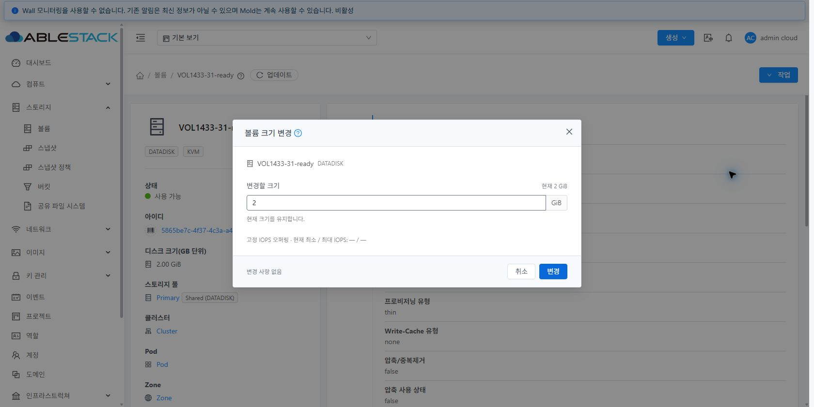
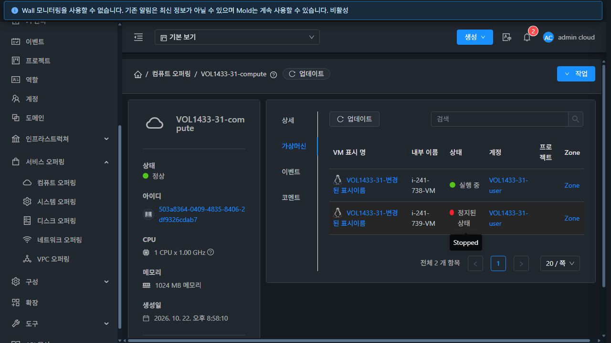

# #1433 볼륨·오퍼링 VM 표준 UI 통일 완료 보고서

Epic #1422 · 누적 Draft PR #1435 · 2026-10-22

실행 소스: `4e1016a6c401333d4ee49d73477b087e553a51f2` · 기준 소스: `15c14ce1d704e2d21286eb5a56490d5dce3259d8`

## 설계·구현

31번 실제 VM 목록·상세를 기준으로 기존 AutogenView/ResourceView/InfoCard/DetailsTab/ListView와 MOLD-DIALOG-1.0 공통 쉘을 재사용했다. 기존 세로형 상세와 승인된 입력 중심 크기 변경·마이그레이션·오퍼링 변경 본문을 유지했다. [설계](design.ko.md).

| 대상 | 기준·구현 및 실제 확인 |
|---|---|
| 세 메뉴 목록 | 주 작업 텍스트/보조 아이콘·검색·고급 검색·상태/페이지·열·선택의 기존 공통 패턴 유지. 같은 범위 갱신에서 행·선택을 보존하고 오류/재시도 제공. |
| 상세·관계 | 기존 요약 카드·세로형 상세·UUID·작업 메뉴 유지. 미연결 VM을 —로 표시하며 undefined/null/제거/권한 없는 관계 링크 차단. compute-only는 설명·텍스트, 일반 디스크는 정상 상세 링크. |
| 관련 탭 | 컴퓨트→소비 VM, 디스크→사용 볼륨, 볼륨→스냅샷을 명시적 읽기 API로 연결. 공통 표·우측 검색·페이지·빈 상태/재시도, URL/뒤로가기·권한·자원/사용자/프로젝트 격리 적용. 동명 VM은 내부 이름으로 구분한다. |
| 대화상자 | 폼/그룹/조건부 필드를 보존하고 대화상자 수준 버튼만 공통 고정 푸터로 Teleport. 내부 행 작업은 본문 유지. 스냅샷 정책 탭은 활성 탭의 푸터만 표시한다. |
| 비동기·접근성 | 작업 중 필드/취소/닫기/Escape 잠금, 생성·복제 검증 뒤 이중 제출/문맥 변경 재확인, 조회 실패 시 변경 작업 차단과 실제 job 완료 갱신. 아이콘 접근성 이름·Tab/Escape 및 원래 트리거 포커스 복귀. |

실화면에서 추가 발견한 푸터 폭 축소, 리사이즈 뒤 Affix 작업 버튼의 화면 밖 위치, 재시도 버튼이 설치된 AntD에서 지원하지 않는 슬롯에 숨는 문제를 수정했다. 스냅샷 열은 실제 API의 intervaltype/physicalsize를 사용한다. 마지막 검사에서 고급 검색이 높이 809px로 720px 화면을 넘는 것을 확인해 세 메뉴에만 화면 크기 제한과 내부 스크롤을 추가했다.

#1212의 미병합 로컬 작업을 완료로 합산하지 않았다. 현재 브랜치에 이미 포함된 공통 쉘과 토큰을 재사용했다.

## 검사·모듈 빌드·배포

| 항목 | 결과 |
|---|---|
| 주요 UI/공통 요청·#1154/#1209/#1210 관련 회귀 | 21 suites / 448 tests PASS (60bf0bd3fe0) |
| 마지막 SearchView 수정 후 검색/필터 회귀 | 3 suites / 33 tests PASS (4e1016a6c40) |
| 변경 UI lint / 추가 SearchView lint | 모두 exit 0 |
| 최종 표준 최적화 production UI build | WSL ext4, Node 14.21.3, 462초, exit 0 |
| 테스트 런타임 | Node 20.20.2, focused 검사, coverage 전체 수집 끔 |
| 31·32 정적 UI 배포 | 각 911개 파일, 활성 파일 전체 해시 일치, app.fda45aa8.js |
| 서버 보존 | WEB-INF/META-INF/config/JAR/PID·기존 파일/해시 자산·FTCTL 마커·32의 추가 29GB 이미지 보존 |
| 최종 런타임 | Mold active, /client/ HTTP 200, 호스트 6개 Up |

24 suites / 481 tests는 서로 다른 검사 묶음의 합계다. 마지막 변경은 SearchView의 조건부 클래스와 CSS 9행이며 그 외 UI 코드는 21개 묶음 실행 소스와 동일하다. 전체 Cloud/Release CI, Maven/JAR/Agent/qemu 빌드·배포는 실행하지 않았다. 등록된 PR checks가 없는 상태를 CI 성공으로 표현하지 않는다. Browserslist 갱신 안내·번들 크기 안내는 빌드 실패와 구분한다.

피드백용 비최적화 production-mode 배포와 중간에 소스 변경으로 중단한 빌드는 최종 빌드 성공에 합산하지 않는다. 최종 배포는 위 표준 최적화 빌드다. [빌드](build-summary-final.json) · [검사](checks-final.json) · [추가 검색 검사](search-checks.json) · [검사 발췌](focused-tests-final-summary.log) · [생산 빌드 발췌](ui-build-final-summary.log) · [배포](ui-deployment.json) · [최종 런타임](runtime-final.json).

## 실제 UI·API·DB·호스트 검증

전용 VOL1433-* 자원을 사용했다. UI 생성·편집/IOPS·복제·비활성화/재활성화, 두 환경 크기 변경·스냅샷 생성·동명 VM 연결, 프로젝트 볼륨 생성, 삭제/복구와 RBD 오퍼링 변경을 실제 API/job·DB·호스트와 대조했다. 역할별 폼·상태/권한 제한과 관련 탭을 실제 로그인 경로에서 확인했다.

- 31/32 모두 크기 변경 1→2GiB 성공. resizeVolume 이중 클릭의 POST는 환경별 1회이며 실제 job 성공 후 UI/API/DB/호스트 논리 크기가 2,147,483,648 bytes였다.
- User 기본 보기에서 동일 표시이름의 두 VM을 이름·UUID로 구분해 선택했다. attachVolume 대상 UUID, device 1, 선택한 Running VM의 libvirt 디스크 이미지가 일치했다. GFS2 qcow2와 RBD raw를 호스트에서 확인했다.
- 스냅샷은 두 환경 BackedUp·MANUAL이고 관련 탭 API 값/링크와 일치한다. 작은 백업의 물리적 크기 196,640 bytes는 기존 GiB 표기에서 0.00 GiB로 반올림된다. 이를 실제 할당 0 bytes로 해석하지 않는다.
- 31번 UI 생성 일반 디스크의 읽기 IOPS=500 저장·복제, 컴퓨트의 일반 디스크 연결·복제·비활성화/재활성화를 확인했다. compute-only는 링크가 없고 일반 디스크 관계 링크는 정확한 상세로 이동했다.
- 32 프로젝트 보기에서 소비 VM 1개만 조회되고 기본 보기의 VM이 섞이지 않았다. 프로젝트 볼륨은 해당 projectid·오퍼링 UUID·1GiB·Allocated로 생성됐다.
- RBD Ready 볼륨의 오퍼링은 태그 적격성을 확인한 전용 UI 디스크로 변경됐고 크기 2GiB와 RAW 형식을 유지했다. 임의 운영 오퍼링이나 운영 볼륨을 변경하지 않았다.
- 특정 listSnapshots/listVolumes XHR만 실패시켰다. 기존 행·부모 정보·선택·세션을 보존하고 재시도 버튼으로 정상 복구했다. 검색 빈 결과와 뒤로가기도 확인했다. 실제 인증 실패·늦은 응답·권한 없는 링크/탭·문맥 경합 차단은 focused 검사와 구분한다.
- #1209 재확인은 User VM 생성 DATA 선택기의 전체 12개·2페이지, 마지막 페이지 선택·1GiB·개수 1의 페이지 왕복 보존 경로다. 이 smoke에서 VM을 다시 생성하지 않았으며 이전 #1209의 23개/실제 생성 증거를 새 실행으로 합산하지 않는다.
- UUID 복사의 정확한 텍스트는 자동 확인했고, 자동화 클립보드 읽기는 비어 있었다. 사용자 실붙여넣기 확인으로 정확한 UUID 복사를 PASS 처리했다. 클립보드 제품 결함으로 분류하지 않았다.

[기능 기록](browser-functional.json) · [정제한 UI 요청](browser-network.json) · [실물/기능 대조](runtime-functional.json).

## 화면·키보드 행렬

볼륨 대화상자 10종 × 두 테마 × 390px/확대 동등 레이아웃 = 40개, 오퍼링 생성/편집/액세스/복제 × 두 화면 크기 = 16개, 추가 데스크톱 1개로 총 57개 DOM 경계 검사를 통과했다. 단일 푸터·화면 내 헤더/푸터·본문 가로 넘침 없음·본문 스크롤을 검사했다. 테마별 오퍼링 표본은 31 라이트 컴퓨트·32 다크 디스크이며 반대 테마의 기본 폼도 별도 확인했다.

200% 검사는 1280×720의 200% 확대와 동일한 640×360 CSS viewport/DPR 2 레이아웃이다. 네이티브 브라우저 확대율을 실제 200%로 제어한 결과와 구분한다. IAB의 에뮬레이션 스크린샷은 스케일 차이가 있어 작은 화면 합격 근거는 DOM 경계 수치이며 아래 대표 이미지는 실제 Chrome 최종 번들이다. Tab이 폼 안으로 이동하고 Escape 취소 후 볼륨 생성 버튼으로 포커스가 돌아오는 것을 확인했다.

고급 검색은 최종 빌드에서 31의 1280×720·390×844·640×360 및 32의 390×844 경계를 통과했고, 32에서 하단 검색 버튼의 실제 실행도 확인했다. [대화상자 행렬](dialog-matrix.json) · [최종 팝업 행렬](popup-matrix.json).

## 지원 한계·다음 범위

현재 각 환경의 적격 Primary는 한 개여서 마이그레이션은 빈 후보·재시도·이동 차단/현재 위치 유지 UI를 확인했다. 실제 다중 풀 이동을 PASS로 주장하지 않는다. 업로드/다운로드·임포트/관리 해제·템플릿 전체 전송, KVDO 활성 시 조건부 폼의 실물 동작, 새 루트 정책별 게스트 부팅/I/O와 전체 지원표 회귀는 #1434의 범위다. 현재 diskStatsEnabled=false라 Metrics 탭의 활성 실환경 경로는 검사하지 않았고 설정/권한별 노출은 focused 검사했다.

RBD 기능/지원표와 #1437의 해결 상태를 변경하지 않았다. RBD falloc/lazy thick·영구 예약이나 미지원 Full 확장/clone을 새로 제안하지 않는다.

## 정리·완료 판정

테스트 VM 6대, 라우터 2대, 볼륨 15개(라우터 ROOT 포함), 스냅샷 2개 및 전용 네트워크/프로젝트/계정/도메인과 생성 오퍼링을 정리했다. API/DB 활성 잔여·GFS2/RBD 이미지·VM 정의 잔여를 확인하고 기존 운영 inventory와 JAR/PID를 대조했다. 스냅샷 Destroyed/오퍼링 Inactive 이력과 배포 백업은 보존했다. 스냅샷 removed만 검사한 초기 정리 집계는 Destroyed 이력을 활성으로 오인했으므로 status와 API를 함께 확인하도록 수정했다.

브라우저 조회 실패 주입·캐시·뷰포트·테마를 복원하고 전용 탭은 로그아웃 후 닫았다. 기존 사용자 탭·클립보드와 보호된 FT 작업 폴더는 보존했다. [정리](cleanup.json) · [작업 디렉터리 보존](workspace-protection.json) · [기계 판독 요약](summary.json).

#1433은 구현·UI 빌드·배포·개별 기능 검증 범위에서 완료한다. PR #1435는 Draft·미병합, Epic #1422는 열림을 유지한다. 다음은 **#1434 최종 통합 회귀 및 Epic 종료 판정**이다. [다음 작업](next-steps.ko.md).
