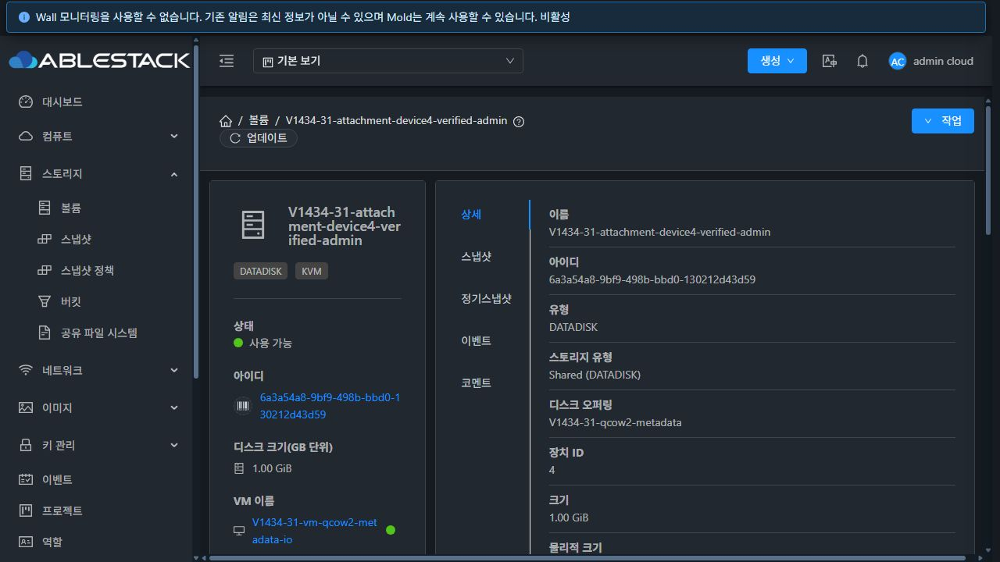

# #1434 볼륨·오퍼링 최종 통합 회귀

Epic #1422 / 누적 PR #1435 / 브랜치 `dhslove/epic-1422-volume-offerings`.

**판정: #1434 종료 기준 충족. Epic #1422는 구현·통합 검증 기준으로 종료 가능하다.** 누적 PR은 Draft·미병합이며 Epic은 Open으로 유지한다. PR 검토·병합과 릴리스 절차는 별도 후속 작업이다.

## 이번에 수정한 결함

| 결함 | 원인과 수정 | 재검증 |
|---|---|---|
| 이전 볼륨 생성 완료가 다음 대화상자에 영향을 줄 수 있음 | 백그라운드 완료의 중복 닫기를 제거하고 원래 VM·장치·프로젝트를 캡처 | 다음 미제출 폼 보존, 원래 VM 연결, 프로젝트 전환 시 추적 취소·교차 연결 없음 |
| 장치 ID 4 입력이 자동 번호 2로 연결됨 | 입력에 폼 `ref/name`이 없어 제출 필터에서 누락. 선택 입력과 예약 번호 검증을 연결하고 생성/연결 payload를 분리 | 실제 4번 연결과 libvirt 매핑, 예약 번호 3 제출 차단, 빈 값의 자동 배정 |
| RBD QCOW2 요청이 RAW capability로 선행 검증됨 | 명시적 형식 검사와 자동 후보 제외를 추가 | QCOW2 요청은 볼륨 행 생성 전 거절, RAW off/full은 실물 생성 성공 |
| 템플릿 복사 실패를 성공으로 반환 | `createtmplt.sh`가 `cp` 실패를 뒤의 `chmod` 성공으로 덮음. 복사/변환/메타데이터 실패 전파, 불완전 파일 정리, 전체 논리 내용 비교를 추가. 일반 RAW 파일도 QCOW2로 변환 | 6대의 실제 공간 부족 안전 실패, GFS2 QCOW2/RAW와 RBD 템플릿 API 전체 내용 비교 |
| 볼륨 API의 읽기·쓰기 QoS 값 혼동 | 쓰기 대역폭에 읽기 getter, 읽기 IOPS에 쓰기 getter를 사용. 각각 올바른 필드로 수정 | 읽기/쓰기 5/4 MiB/s·100/75 IOPS를 서로 다르게 설정해 Full/Restricted 응답 직렬화와 배포 API 대조 |

실행 코드 커밋: `4101cbe5cd9021b1922d11a7ed7468171d26536b`, `6ee8e831b3dc8f131617946c4bb2bbb25cc5e979`, `89ca85c96a15a9340e2810c68e63c4b805ea70b3`, `1c0307d3cc8618ae62c31923736f8349b05f196e`, `f5be0f7dd40979a554e5b1ba075012675c57ba94`. 테스트 실행 디렉터리 격리는 `4f4094723ef03776d3567ada512a9858af3e46e6`에 추가했다.

## 실환경 검증

기존 운영 개체를 수정하지 않고 31 GFS2와 32 RBD에 전용 계정·도메인·프로젝트·네트워크·VM·볼륨·오퍼링을 준비했다. VM 템플릿의 실제 크기인 **100GiB**로 ROOT를 배포했다. 차단된 QGA 실행 기능을 열지 않고 전용 시험 VM의 키 기반 SSH로 게스트를 확인했다.

| 백엔드 / 형식 | 정책 | DATA | ROOT |
|---|---|---|---|
| GFS2 / QCOW2 | metadata, falloc, full | 3개 각 1GiB | 3개 각 100GiB |
| GFS2 / RAW | off, falloc, full | 3개 각 1GiB | 3개 각 100GiB |
| RBD / RAW | off, full | 2개 각 1GiB | 2개 각 100GiB |

8개 조합 모두 UI 생성/기동, API·DB 계약과 실제 이미지·관측 할당량, ROOT의 독립 전체 복사·OS 부팅을 확인했다. DATA는 전체 zero 읽기 후 처음/끝 패턴 쓰기·fsync·전체 1GiB SHA256을 대조했고, 정지/시작 뒤 ROOT canary와 DATA 해시가 유지됐다. RBD Full ROOT의 복사 시점 `rbd du --exact` used size는 107374182400바이트였다. 이는 이미지 관측량이며 복제 물리량·영구 예약 보장이 아니다.

| 구분 | 실행 결과 / 지원 경계 |
|---|---|
| 부분 수정·삭제 보호 | 이름·보호 변경 후 path/pool/chain/state 보존. 보호 중 삭제 거절, 해제 후 삭제·복구·최종 영구 삭제 |
| 권한 | Admin/DomainAdmin/User/Project 목록·상세·연결·정책 탭·편집 및 교차 소유자 거절. 원래 기본 역할의 API 제한을 확인한 뒤 시험 계정에만 복제 역할을 부여해 편집 허용 경로도 검증. 기존 역할 권한은 변경하지 않음 |
| 최초 기동 전 연결 | 두 환경의 계정·사용자·프로젝트 VM에서 ROOT Allocated·배치 null인 원래 조건으로 UI 연결. Uploaded 패턴 볼륨도 최초 기동 전에 연결하고 이후 실제 부팅·매핑 확인 |
| IOPS·동일 계약 교체 | 8개 조합의 같은 계약 오퍼링 교체·IOPS 단독 변경, path/size/할당 증거 유지. 미지원 성장·정책 제거/변환·수동 경로·풀 이동은 변경 전 거절 |
| 캐시·QoS | 두 환경의 compute-only ROOT와 일반 DATA에 서로 다른 cache와 12개 QEMU 제한을 적용. 정지 후 시작한 libvirt XML·QMP 경로·게스트 부팅 확인. Cloud min/max IOPS 메타데이터와 QEMU read/write throttle을 구분 |
| 기존 방식 | GFS2 thin/sparse/fat 성공, 기존 sparse를 falloc 검증 완료로 재해석하지 않음. RBD legacy sparse/fat은 검증되지 않은 의미를 적용하지 않고 명확히 거절 |
| legacy 수명주기 | 실제 두 번째 풀로 이동·원래 풀 복귀, 스냅샷 복원/되돌리기, 1→2GiB 성장, 관리 해제/재임포트, 삭제/복구. 기존 패턴과 새 zero tail 확인 |
| 업로드·다운로드 | 환경별 실제 QCOW2 업로드·최초 연결·기동, 전체 HTTP 다운로드와 원본 논리 데이터 비교. 다운로드 파일은 524288바이트이며 논리 볼륨은 1GiB |
| 명시적 계약의 제한 | 업로드·임포트·스냅샷 복원/되돌리기·미지원 확장/이동은 해당 API에서 사전 거절하고 원본·경로·증거 유지. 명시적 볼륨의 스냅샷 백업 및 독립 템플릿 내보내기는 별도로 실증 |
| RBD 제한 | QCOW2·falloc/lazy thick 거절. RAW off/full 빈 생성·실체화된 전체 복사만 지원 판정. COW clone·Full 확장·영구 예약 지원을 주장하지 않음 |
| 실패·용량 | 전용 RBD 풀의 Cloud 용량 제한에 대한 생성 전 거절·무공개. 템플릿은 시험 source UUID에만 적용하는 임시 fault wrapper로 출력 디렉터리를 1MiB tmpfs에 격리하여 실제 ENOSPC→API 실패·Ready 없음 확인. wrapper를 제거한 뒤 **같은 원본 UUID**로 API 재시도·전체 내용 비교 성공. 3대 제품 스크립트 해시 복구·임시 mount 해제 확인 |
| falloc 회피 경로 | 자연 발생한 3회 불일치 소진의 비공개·안전 실패와 이후 새 요청의 전체 검증 성공을 별도 기록. Full로 바꾸지 않음. 실패 image/reference/manifest는 비공개 압축 보존 후 시험 슬롯 정리 |

두 번째 풀은 각각 전용 GFS2 디렉터리와 전용 Ceph pool이다. 실제 다른 Cloud pool UUID·경로·이미지로 이동했지만 같은 물리 계층을 공유하므로 독립 장애 영역 검증으로 확대하지 않는다. #1437은 완료 상태를 유지한다. 커널·호스트 근본 수정은 이 Epic의 완료 조건에 포함하지 않는다.

## UI 회귀

- 기존 세로형 상세 스타일, 관련 VM/볼륨 링크, 빈 관계 표시, 스냅샷·정기스냅샷 분리와 프로젝트별 주간 정책 표시를 확인했다.
- 컴퓨트/디스크 추가 폼은 기본 설정·볼륨 배포·고급 옵션으로 나뉘며 Europa 방식이 기본이다. 실제 생성 결과의 기본값 RAW/off, 스토리지 태그, 컴퓨트 CPU·메모리와 설명 기본값을 API에서 대조했다. 참조 스토리지 선택은 없다.
- 컴퓨트 3개 탭·디스크 3개 탭의 다크 24조건, 정기스냅샷·이동·오퍼링 변경·크기 변경의 라이트 16조건: 너비 320/390/736/1280에서 폼 넘침·페이지 넘침 0. 정책 표는 좁은 화면에서 표 내부 가로 스크롤을 사용한다.
- 실제 볼륨·컴퓨트/디스크 오퍼링·VM의 이벤트/코멘트 탭 표시를 측정했다. 이번 세션에서 약 0.4~0.7초였고 표시 후 spinner는 0이었다. 성능 SLA나 부하 시험 결과로 확대하지 않는다.
- 세 메뉴 코멘트 실제 저장과 관련 개체 링크, 메트릭 전환, 2페이지 업데이트 유지, 검색 후 1페이지 초기화·검색 유지, 키보드 제출을 확인했다.
- 특정 이벤트 요청 503에서 기존 8행·로그인을 유지하고 재조회로 복구했다. 생성 POST 503에서는 입력 유지·제출 중 비활성화·재시도 후 한 번만 생성됨을 확인했다. 프로젝트 전환은 추적 취소 경계이며 자동 교차 연결 성공으로 세지 않았다.
- 양쪽에 KVDO 활성 템플릿이 0개다. 비활성 표시/작업 노출 제한은 확인했으며 활성 KVDO 엔진 전환은 조건부 N/A다. 이를 활성 동작 PASS로 기록하지 않는다.

## 검사·빌드·배포

| 단계 | 최종 결과 |
|---|---|
| UI | 관련 Jest 22개 suite / **321개**, lint 성공. WSL ext4 Node 14.21.3 최적화 production 빌드 성공 |
| server | 변경 모듈만 WSL ext4에서 Maven package, **96개** 관련 테스트 성공. 변경 Java 4개 scoped Checkstyle 0 위반 |
| 템플릿 스크립트 | `bash -n`, 실행 회귀 **12개**, 배포된 6대의 실제 RAW/QCOW2 복사·공간 부족 18조합 성공. 스크립트 패키지·manifest·해시 보존 |
| 기존 Agent 회귀 | 활성 31 JAR 조합의 90개×3대, 32 JAR 조합의 38개×3대. 32의 구 API가 더 이른 단계에서 안전 거절하는 한 오류 문자열 차이는 쓰기 0 검증을 유지한 호환 harness로 분리 기록 |
| 관리 서버 배포 파일 | server 모듈 결과에서 해당 메서드/클래스만 활성 shade JAR에 반영. 기존 다른 메서드·20만여 엔트리와 앞선 RBD 검증 패치 보존. 최종 JAR마다 96개 재검증 |
| UI 배포 | 31/32의 정적 파일 914개 해시 일치. index 마지막 갱신, WEB-INF/META-INF/config/JAR/PID와 32의 별도 이미지 보존 |
| 관리 서버 배포 | 정상 서비스·API·`/client/` 200, 기존 웹앱/설정/다른 JAR·스키마·활성 VM/볼륨 행 보존 확인 |

전체 Cloud/Release 빌드와 GitHub Actions는 요청하지 않아 실행하지 않았다. 최초 broad server Checkstyle은 무관한 CNI/UserData 테스트의 기존 wildcard import 15건으로 실패했고, 변경 파일에 한정한 검사는 통과했다. 이를 전체 CI 성공으로 표현하지 않는다.

## 중간 실패의 분리

- 템플릿 원본 100GiB 복사 중 NFS 공간이 소진됐는데도 Ready가 된 실제 결함을 보존했다. 잘못된 템플릿을 API 삭제해 공간을 회복했으며 원본의 파일시스템 헤더와 내보낸 zero 구간을 대조했다.
- QoS 최종 배포의 첫 31 시도는 시험 업로드 파일 정리가 보존 검사와 겹쳐 자동 롤백됐다. 기존 정상 JAR·서비스 복구를 확인했고, 정리 완료 후 새 기준으로 순차 재배포했다. 이 시도를 최종 성공에 포함하지 않는다.
- 비동기 수정의 완료를 기다리지 않은 초기 harness와 영구 삭제 API를 soft-delete로 오인한 harness가 전용 볼륨 2개를 삭제했다. 새 전용 개체에서 원래 I/O·정지/시작 조건을 반복했고 soft-delete는 `destroyVolume`/`recoverVolume`으로 별도 통과했다.
- Ceph quota는 반영 지연 중 1GiB 생성을 허용했다. 이를 용량 부족 PASS로 세지 않고 삭제·quota 복구 후 Cloud의 전용 풀 용량 제한으로 사전 거절을 확인했다.
- 오퍼링 응답 키, MySQL 컬럼, 마운트 경로, 테스트 mock 설정 및 이미 삭제된 포워딩 규칙 정리의 준비 오류는 제품 성공/실패와 구분했다. 운영 데이터를 수동 복구하거나 실패 증거를 성공으로 덮지 않았다.
- 이전 스크립트의 오류 재현 harness가 작업 디렉터리를 명시하지 않아 보호 작업 트리에 7바이트 `partial` 임시 파일 하나를 만들었다. 원본 증거를 비공개 보존 후 이 시험 파일만 제거하고 harness를 격리했다. 최종 보호 트리 HEAD·tracked diff SHA256·1389개 상태 항목이 시작 전과 정확히 일치한다.

## 종료·보존

전용 볼륨·VM·활성 오퍼링·정책·활성 스냅샷·템플릿·코멘트·계정·프로젝트·도메인·네트워크·시험 풀의 활성 DB 잔여는 모두 0이다. GFS2 파일 이름/원래 inode, RBD 원래 이미지 69개와 기존 Ceph pool 설정을 대조했다. 시험 Ceph client·pool, GFS2 시험 디렉터리·실패 증거 슬롯, NFS 다운로드·업로드 파일, 호스트/관리 서버의 전송·fault 임시 파일을 정리했다. 빈 시험 Ceph pool 삭제를 위해 leader mon의 runtime 삭제 허용만 잠시 사용했으며 false로 복구하고 persistent 설정 동일성을 확인했다.

운영 API inventory는 31 볼륨 152·VM 115·디스크 오퍼링 9·컴퓨트 16, 32 볼륨 48·VM 48·디스크 6·컴퓨트 4로 원래 식별자와 기록된 주요 속성이 일치한다. 모든 Agent의 기존 PID·JAR·QEMU 버전과 원래 도메인은 유지됐다. **32.3에는 기존 운영 VM 61의 실행 도메인 하나가 추가 관측됐다.** 이 VM의 원래 Cloud Running/host 상태는 동일하며, 시험 API journal에서 해당 UUID를 대상으로 한 변경 요청은 0이다. 원인은 확정하지 않았고 운영 정의를 임의 삭제하지 않았다. 따라서 호스트 도메인 목록 전체가 완전히 동일하다고 주장하지 않는다. 시험 VM·라우터 정의는 남지 않았다.

32의 Destroyed 스냅샷 2행 등 제품 이력은 유지했다. `removed IS NULL`만으로 이를 활성 자원으로 세지 않았으며, 해당 RBD/NFS 실물은 남지 않았다. 롤백 백업과 비공개 실패 증거는 의도적으로 보존했다.

최종 정리 결과, 하위 17개 대응, 정확한 배포 해시와 검사 결과는 [summary.json](summary.json), [하위 이슈 대응](issue-map.ko.md), [다음 작업](next-steps.ko.md)을 따른다. 자격 증명·전체 API journal·게스트 키·원시 호스트/DB 자료·실패 이미지 압축본은 비공개 작업 디렉터리에만 보존한다. 제품의 Inactive/Destroyed/Expunged 이력과 롤백 백업을 SQL 물리 삭제로 제거하지 않는다.

위 전용 자원은 검증 후 정리했다.
