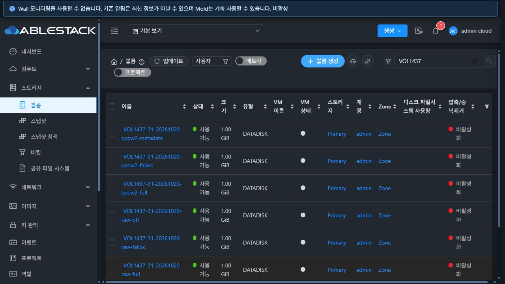
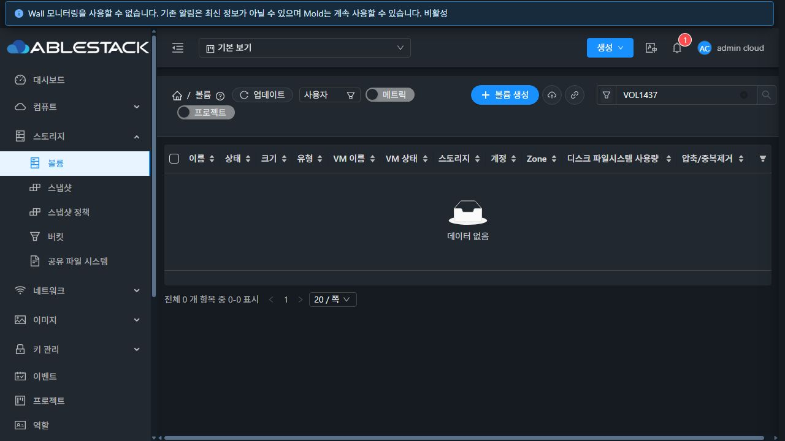

# #1437 GFS2 falloc 회피 경로 검증

2026-10-20 · Epic #1422 · 누적 Draft PR #1435 · 구현 475184d41d012d8e50547b5dd7a87cbe374efbe7

## 결과와 이슈 상태

사용자 선택에 따라 **최초 시도 + 새 이미지로 최대 2회 falloc 재시도**를 구현·모듈 빌드·31 Agent 3대 배포·기능 검증했다. Full 전환은 없다. 전체 내용 검증을 통과한 이미지 하나만 공개하며, 모두 실패하면 오류를 반환한다.

**#1437은 해결됨(Closed / Completed)으로 종료한다.** 사용자가 제품 범위를 명확히 했다. Cloud의 검증된 제한 재시도·안전 실패 처리로 제품 조치를 완료했으며, 커널/호스트/스토리지 수준의 근본 수정은 제품 영역과 이 이슈의 완료 조건에서 제외한다. 초기 재현 사실과 증거는 유지한다.

## 재현으로 확인한 범위

| 실제 시험 | 결과 |
|---|---|
| 31.1 QEMU falloc 64MiB | RAW 첫 회 불일치(offset 1028096) |
| 31.2 QEMU 반복 | RAW 50회·QCOW2 50회 성공 |
| 31.3 QEMU falloc 64MiB | QCOW2 두 번째 회 불일치(offset 66834432) |
| 실패 파일 sync 후·직접 재개방·세 호스트 읽기 | 동일 불일치 유지 |
| 31.3 QEMU 없는 호출 | posix_fallocate, truncate 후 posix_fallocate, util-linux fallocate 모두 비zero 재현 |
| KEEP_SIZE 대안 | 일부 반복 성공 후 31.1 QCOW2 불일치 재현; 해결책에서 제외 |
| zero-range 대안 | 현재 GFS2 Operation not supported |

환경은 커널 5.14.0-687.42.1.el9_8.x86_64, QEMU 10.1.0-17.el9_8.5, 실제 GFS2 공유 마운트이다. 발생 계층이 Cloud/QEMU에 한정되지 않는다는 근거이며, 커널 단독 결함인지 블록/스토리지 경로인지는 확정하지 않았다. 비zero 바이트 내용은 공개 로그·저장소에 넣지 않았다.

## 구현

- qemu-img compare의 구조화된 exit code를 전달한다. **exit 1인 내용 불일치만** 회피 대상이며, 열기/할당 조회/읽기 오류(2/3/4), 일반 I/O·권한·용량·timeout은 즉시 실패한다. 분류는 [QEMU 공식 compare 문서](https://qemu-project.gitlab.io/qemu/tools/qemu-img.html#cmdoption-qemu-img-arg-compare)에 따른다.
- 각 시도마다 새 0700 stage를 사용한다. 원본 불변·현재 가용 용량·동일한 최초 명령 제한 시간을 유지한다. 실패 inode를 보정하거나 다시 공개하지 않는다.
- 첫 실패만 풀당 .cloudstack-allocation-failure-v1에 격리한다. image 길이 2GiB 이하, 실제 zero 기준 파일과 manifest, 0700/0600 권한, 기존 슬롯 비덮어쓰기, 원인·시도 횟수 로그를 적용했다.
- 공개 경로/receipt/반환 적용 증거는 최종 검증 성공 후에만 생성한다. 응답 유실 재검증은 기존 공개 inode를 재생성하지 않는다.
- 요청/확정 정책과 적용 메서드는 falloc 유지. API 계약·DB 스키마·UI 자산·RBD·FT/DR 코드 변경은 없다.

## 빌드·검증

| 범위 | 결과 |
|---|---|
| WSL ext4 변경 KVM 모듈 package / Checkstyle | 성공 |
| 관련 소스 5개 suite | 90개, 실패·오류·skip 0 |
| 활성 배포본과 같은 JAR 조합, -Xverify:all | 90 × 3 = 270회 성공 |
| 배포 전 실제 GFS2 아티팩트 시험 | 29 × 3 = 87 assertion 성공 |
| **배포 후 활성 JAR 출처 확인 + 실제 GFS2** | **29 × 3 = 87 assertion 성공** |
| 6개 조합의 blank / RAW 원본 전체 복사 | target RAW off/falloc/full, QCOW2 metadata/falloc/full의 전체 zero·두 패턴·zero tail 검증 |
| 제어된 실제 데이터 불일치 | 전용 stage에만 잘못된 패턴을 기록해 두 번 실패 후 세 번째 새 stage 성공; 실제 compare 사용 |
| 3회 모두 불일치 / read error | 공개 이미지 없음 / 재시도 없음 |
| 두 호스트 동시 공개 | 승자 1개·실패 1개, 원본 보존, 세 번째 호스트 응답 유실 재검증 성공 |
| 실제 API / UI | API 6개·UI RAW falloc 1개 Ready, 증거 77행 및 7GiB 전체 논리 zero를 세 호스트에서 읽음 |

**실제 자연 실패 회복:** 31.2 Agent 로그에서 QCOW2 falloc 볼륨 e64236be-13b1-48da-97e0-0eaeb36e2edd의 attempt=1/3 내용 불일치와 첫 증거 보존을 확인했다. 같은 API 생성 작업이 Ready로 끝났고, 최종 전체 zero 검증을 세 호스트에서 통과했다. 이 사례에는 fixture/API 작업 전체 재시도를 넣지 않았다.

의도적인 fault injection 결과는 자연 발생 결함의 재현 횟수에 합산하지 않았다. 최초 실패의 사실도 이후 성공으로 지우지 않았다. 전체 Cloud/Release CI, guest OS workload, 모든 역할/교차 pool 이동 회귀를 수행했다는 의미는 아니다.

## 배포·보존

31.1/2/3의 활성 KVM JAR만 변경했다. 각 기존 JAR의 해당 메서드와 신규 helper만 적용하고 **무관한 raw 메서드 바이트와 기존 항목 522개를 각각 보존**했다. API/core JAR도 전후 동일하다. 기존 배포본에 포함된 별도 변경을 통째로 덮지 않았다.

| 호스트 | 활성 KVM JAR SHA256 |
|---|---|
| 31.1 | bf975feb1028881ce798bafe139512ec9790549a1ae4a938a5c3093da5b9f131 |
| 31.2 | 4438a919458ec8b5e02f1269e8e7d57e4c22805fd956b1a70bbe2fb66b04a221 |
| 31.3 | b20ee8a308bc63d7d5f4a54333b817c1b3143c6c93147b8e5adda85fbdaa0831 |

롤백 사본은 각 호스트 /root/volume-1437-475184d41d0/original.jar에 있다. Agent 재접속 Up, mold-agent active, 설정·기존 virsh 전체 목록 동일, Mold binary/index 동일, WEB-INF 존재, /client/ HTTP 200을 확인했다. 32 클러스터는 배포 대상이 아니다.

## 정리와 보관

시험 볼륨 7개 삭제, 오퍼링 6개 Inactive, 활성 소유 볼륨·오퍼링·allocation detail 0, 시험 UUID/stage와 공유 진단 슬롯 0을 확인했다. 운영 API inventory는 시험 전후 완전히 같으며 항목 수는 {'volumes': 140, 'vms': 111, 'diskofferings': 7, 'computes': 15}이다. 시험 VM·네트워크·계정은 만들지 않았다.

**실패 이미지·실제 기준 파일은 삭제 전에 비공개 보관했다.** 31.1의 /root/volume-1437-475184d41d0/failure-evidence.tgz 및 WSL 전용 작업 디렉터리에 압축본이 있다. SHA256 386b004c585eb7b57c8b2f4353c6213a3a413444f664b2f7fe0790ee7a833769. 압축본과 롤백 백업은 의도적으로 남겼다. 공개 보고서에는 이미지 바이트·암호·세션 키를 포함하지 않는다.

## UI 증거

UI 생성과 목록·상세의 Ready 및 경로를 확인했다. 기존 상세의 fat 표기는 호환 컬럼이며 falloc의 실제 정책 표시는 #1431에서 보완한다.

## 다음 작업

1. #1431: 요청/확정/적용/관측 정책과 지원 범위, 생성 실패·재시도 안내의 UI 표시.
2. #1428/#1429/#1430/#1432 및 #1154/#1209/#1210: 남은 삭제 보호·크기/IOPS·캐시/QoS·API/역할·기존 결함.
3. #1433: 기능 구현 뒤 가상머신의 목록·상세·탭·컨텐츠·대화상자를 기준으로 UI 통일.
4. #1434: 통합 회귀와 Epic 종료 검토. #1437에서 완료한 제한 재시도·전체 검증·소진 시 안전 실패 계약을 회귀 검증한다.
5. #1437: 제품 회피 경로 구현·배포·검증 완료로 해결 종료. 호스트 근본 수정 대기는 남은 Epic 작업에 포함하지 않는다.
