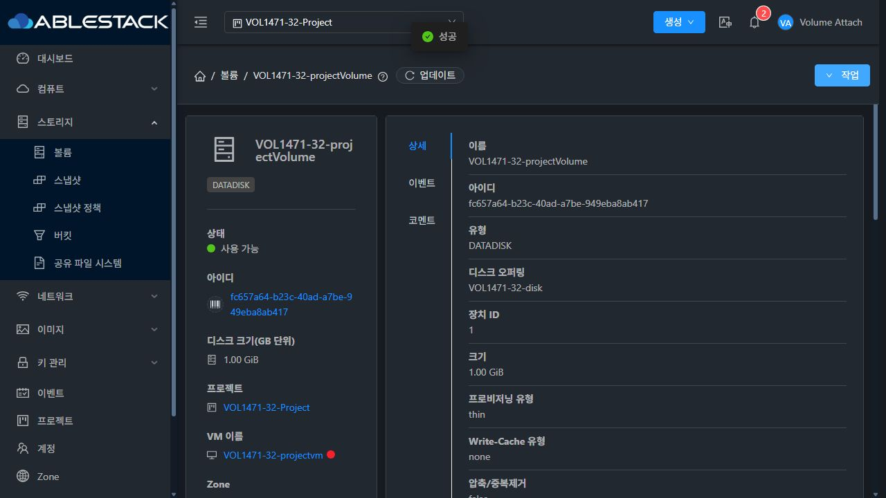

# #1471 최초 기동 전 볼륨 연결 수정·배포·검증

최초 기동 전 Stopped VM의 null pod 언박싱과 클러스터 범위 저장소 탐색을 수정했다. VM을 먼저 기동하지 않고, 수정 전 실패한 동일 VM/볼륨 UUID로 31 GFS2·32 RBD의 일반 계정·프로젝트 UI 연결 4건을 통과했다. 개별 결함의 구현·배포·검증 완료이며, Epic #1422와 누적 Draft PR #1435의 최종 통합 완료는 별도다.

## 설계와 구현

실제 getPool 경로가 공통 suitable lookup을 사용하도록 해 primitive 언박싱을 제거했다. Zone 범위 조회를 먼저 하고, 후보가 없으며 VM의 pod/cluster/host가 모두 미정인 경우에만 해당 Zone의 실제 Enabled pod들을 기존 할당기에 전달한다. Disabled/다른 Zone pod는 제외한다. 같은 DiskProfile·VM으로 태그·로컬 여부·용량·하이퍼바이저·명시적 풀 제약을 유지하며 VM 배치 값은 기록하지 않는다. 알려진 배치는 조회 범위를 넓히지 않고, 사라진 pod/cluster와 적격 풀 없음은 명확히 실패한다.

기존 ROOT 풀 재사용, Ready 무변경, Uploaded 제한·생성 오류 전달을 보존했다. API/DB 스키마·UI·Agent/qemu 변경은 없다. RBD RAW off/full 계약과 미지원 falloc/lazy thick·Full 확장 등의 차단은 그대로다.

실행 소스: b1052a73d4458415fec5a4eb2b7713109bbd28c3. [설계](design.ko.md) · [기계 판독 요약](summary.json)

## 빌드와 배포

WSL ext4에서 변경 server 모듈만 package했다. 소스 101개 테스트(신규 배치 20개·기존 연결 10개 포함), 변경 Java 두 파일 scoped Checkstyle 0 위반을 확인했다. package의 Checkstyle은 skip하고 두 파일을 별도 검사했다. UI가 그대로여서 UI 빌드·배포는 반복하지 않았고, 전체 Cloud/Release CI는 실행하지 않았다.

활성 관리 fat JAR의 빌드된 두 메서드만 교체했다. 다른 195개 메서드 코드와 31번 204,520개·32번 204,514개 JAR 엔트리의 내용을 비교해 보존했다. 실제 배포 JAR 조합 JUnit은 31번 91개·32번 63개 통과했다. 32의 기존 RBD 전용 allocation manager에 GFS2 지원을 기대하는 별도 테스트 2건은 원본과 1차 패치 모두 동일한 실패였다. 무관한 이 클래스를 바꾸지 않았으며 최종 63개와 구분한다. 원본 JAR에서는 신규 초기 회귀 15개 중 11개가 실패했다.

31·32를 순차 재시작하고 JAR SHA256·active·/client/ 200·WEB-INF·웹앱 파일·설정·다른 JAR·DB 스키마와 재시작 전후 VM/볼륨 행을 대조했다. 관리 PID는 승인된 배포 재시작으로 변경됐다. Agent/qemu는 배포하지 않았다. [배포 증거](deployment.json)에 해시와 롤백 백업 경로를 기록했다.

## 원래 실패와 최종 UI 성공

| 환경/범위 | 원본 NPE 작업 | 최종 UI 성공 작업 | 첫 성공 당시 조건 |
|---|---:|---:|---|
| 31 계정 | 14957 | 14975 | Stopped, ROOT Allocated, pod/host/last_host null |
| 31 프로젝트 | 14959 | 14979 | 동일 |
| 32 계정 | 2273 | 2286 | 동일 |
| 32 프로젝트 | 2275 | 2288 | 동일 |

같은 UUID를 유지하고 일반 사용자 로그인·프로젝트 범위 선택으로 UI를 실행했다. 요청 UUID·작업 사용자·완료 상태·DB 연결을 대조했다. DATA만 Ready와 적격 pool/path를 갖게 됐으며, 31 QCOW2·32 RAW 각 1GiB 전체 zero 읽기를 통과했다.

초기 null 처리만 적용한 31 UI 작업 14968은 적격 풀 없음으로 실패했다. 실환경에서 클러스터/로컬 할당기의 pod 요구를 확인하고 Enabled pod 탐색을 보완했다. 이 중간 실패를 성공으로 집계하지 않았다. 업로드 준비 중 31 임시 HTTP 포트의 No route to host 실패는 기존 HTTP 서비스로 동일 테스트 이미지를 제공해 해소했다. 방화벽·보안 허용 설정은 바꾸지 않았고 실패 등록의 자동 제거 이력은 보존했다.

[원래 재현](original-reproduction.json) · [최초 연결 실물 검사](pristine-attach-checks.json) · [요청/작업 대조](attach-job-evidence.json) · [UI 증거](ui-evidence.json)

## 추가 회귀

각 환경 11개씩 총 22개 항목을 통과했다.

- VM pod는 null이지만 Ready DATA로 cluster가 정해진 상태의 새 Allocated 연결.
- 31 QCOW2 metadata·32 RAW off 정책 보존과 전체 zero 읽기.
- 부적격 태그의 명확한 실패 및 연결/pool/path/state 불변.
- Uploaded DATA를 다른 최초 기동 전 VM에 연결하고 64KiB 0x5a 패턴·나머지 전체 zero 읽기.
- 일반 계정·프로젝트·Uploaded VM 3대씩 첫 시작 후 Cloud Running·libvirt running·ROOT/DATA의 실제 경로 매핑.
- Running Allocated 연결의 ROOT 풀 재사용과 기동 이력이 있는 프로젝트 Stopped Allocated 연결.
- Ready 분리·Stopped 재연결의 경로/풀/오퍼링 불변, 첫 시작 뒤 Uploaded 패턴·전체 zero tail 재확인.

첫 시작은 Cloud/libvirt 상태와 디스크 매핑 검사다. 게스트 OS 부팅·게스트 I/O 전체 인증이나 정상 게스트 종료는 주장하지 않는다. 테스트 정지는 forced=true를 사용했다. [회귀 증거](regression-checks.json)를 참고한다.

## 정리와 보존

전용 VM 6대·라우터 4대, 라우터 ROOT 포함 볼륨 26개·이미지 24개를 정리했다. 네트워크 4개·프로젝트 2개·계정 4개·도메인 2개를 제거하고 컴퓨트 2개·일반 디스크 오퍼링 6개를 비활성화했다. 제품 이력과 롤백 백업은 보존했다. API/DB 활성 잔여·이미지·테스트 VM/라우터 정의는 0, 호스트 6개 Up이다. 임시 HTTP 프로세스·테스트 이미지·전송 파일과 브라우저 2개도 정리했다. 웹앱/WEB-INF·설정·다른 JAR·FTCTL 표식 및 보호된 원래 FT 작업의 HEAD/diff/status를 대조했다.

운영 inventory 예외: 31의 기존 VM 1대는 Running·오퍼링을 유지하며 호스트가 바뀌었다. 별도 admin MigrateVMCmd 작업 14977(2026-10-22 15:15:18~15:15:23 KST) 완료 이력을 확인했고 이번 테스트 호출에는 해당 명령이 없다. 원래 스냅샷을 수정하거나 VM을 되돌리지 않았다. 이 차이를 제외한 VM 속성과 운영 볼륨·오퍼링은 동일하며 32 inventory는 전체 동일하다. 전체 inventory가 완전히 동일하다고 주장하지 않는다.

[정리 증거](cleanup.json) · [FT 작업 보존](protected-verification.json)

보존 검사 도중 기존 웹앱의 약 29GB monitoring-vm.qcow2를 한 번에 읽던 검증용 Python이 OOM으로 종료됐다. 파일은 변경하지 않았고 해시를 1MiB 스트리밍으로 계산하도록 검사 스크립트를 수정해 재검증했다. 최종 배포 후 Mold PID와 active 상태가 유지됨을 확인했다. 이 검사 도구 오류는 기능 회귀의 최종 PASS나 제품 오류로 혼합하지 않았다.

## 다음 작업

#1471 완료 후 17개 중 완료 15개·열림 2개다. 다음은 #1433의 세 메뉴 VM 표준 UI 통일, 이후 #1434의 전체 수명주기·게스트 부팅/I/O·실물/역할/다중 풀·UI 회귀와 Epic 종료 판정이다. 기존 세로형 상세·승인된 입력 중심 대화상자와 #1437 해결 상태를 유지한다. Epic #1422와 PR #1435는 열려 있고 PR은 Draft·미병합이다. [상세 다음 작업](next-steps.ko.md)

