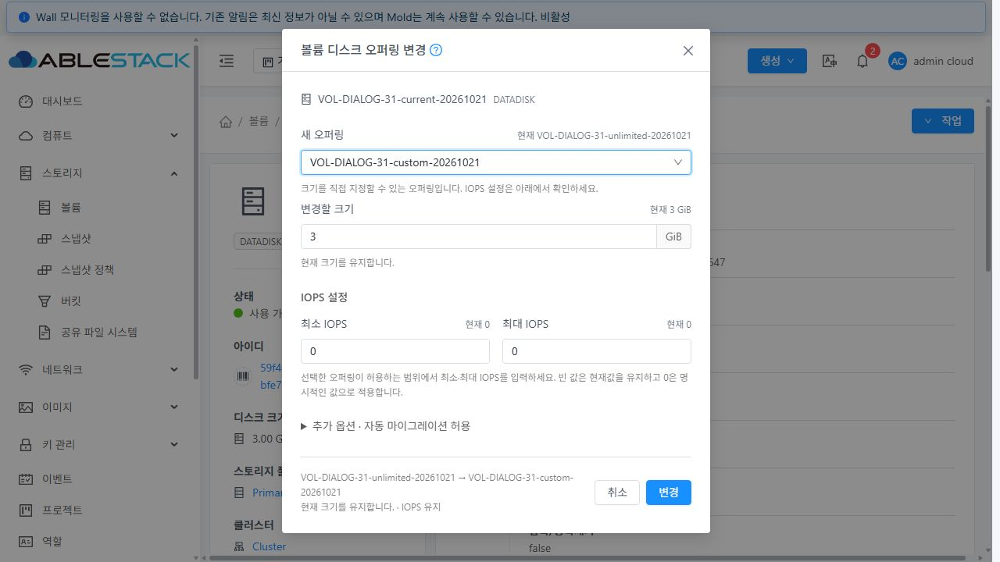
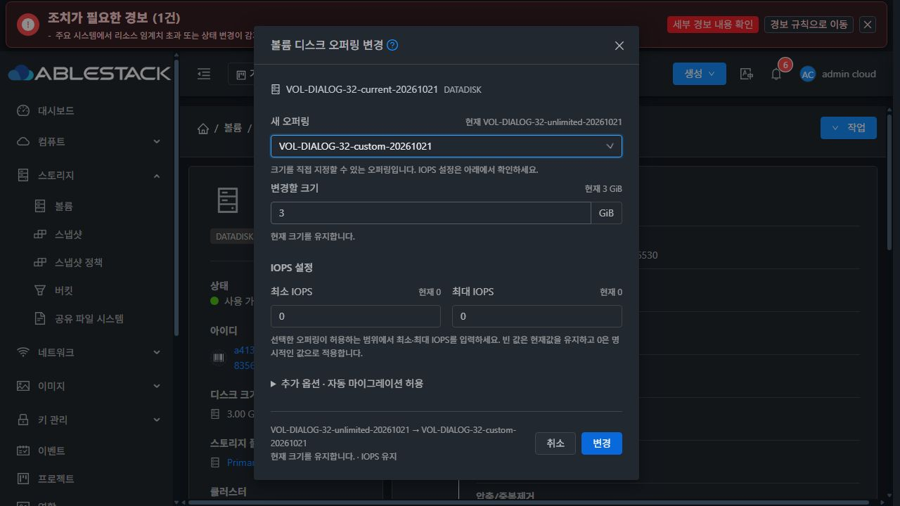
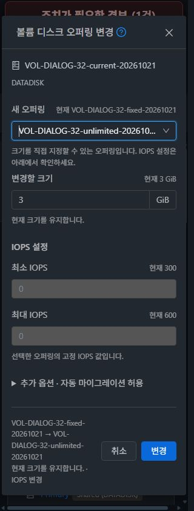
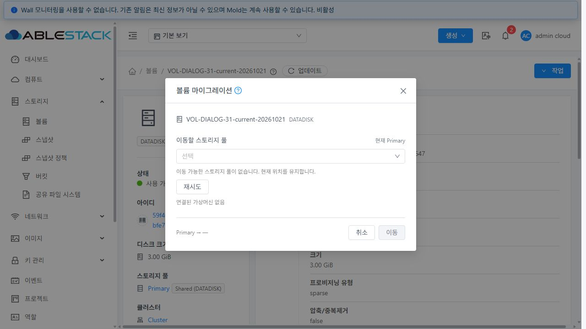
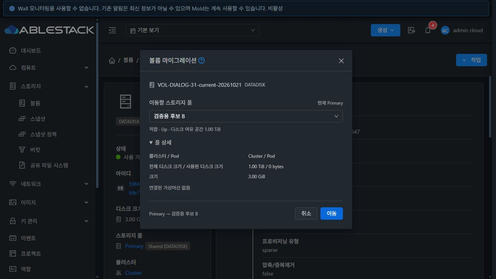
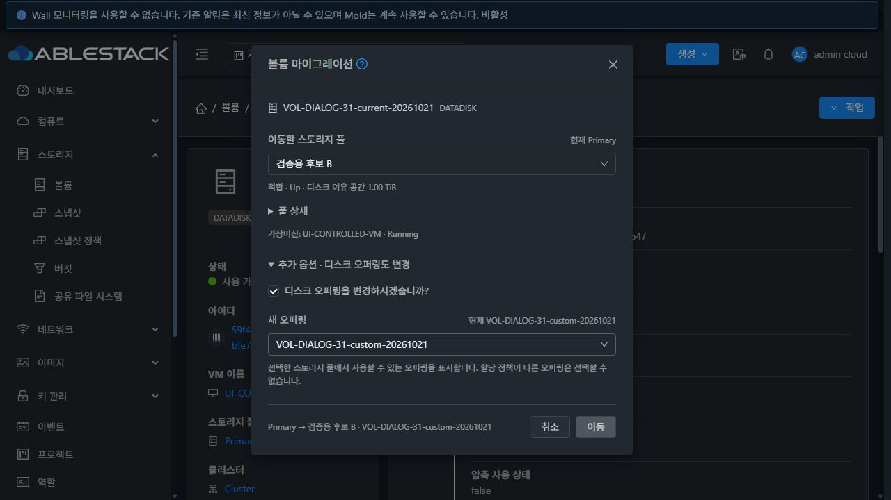

# 볼륨 마이그레이션·디스크 오퍼링 변경 대화상자

승인된 목업에 따라 두 대화상자를 크기 변경 UI와 같은 입력 중심 배치로 변경했다. 상단의 할당 요약과 일반 확인 문구 대신 대상 이름/유형을 표시하고, 현재값·도움말·제약을 각 입력 가까이에 배치했다. 추가 옵션은 접되 현재 적용 여부를 제목에 표시하고 하단에 변경 요약을 둔다.

구현 소스: `2c5ab260cf9`, 최종 UI 소스: `2d7e96619e0854b0b888558a0191e55bbeaeef4a`. [설계](../../design/mold-volume-operation-dialogs-layout.ko.md). 누적 Epic PR: [#1435](https://github.com/ablecloud-team/ablestack-cloud/pull/1435).

## 동작 보완

- 마이그레이션은 API 후보 전체 페이지를 모아 검색형 선택란으로 표시한다. 현재 풀을 제외하고 Up 이외의 풀을 비활성화한다. 적합성/여유 용량은 선택란 아래에, 클러스터/Pod·전체/사용 용량·볼륨 크기는 풀 상세에 표시한다. 기존 공용 테이블의 다른 사용처는 변경하지 않았다.
- 선택 풀을 ID/객체로 혼용하던 부분을 정리하고 오퍼링 조회에 정확한 풀 UUID를 전달한다. 풀 전환 중 이전 응답이 새 선택을 덮지 못한다. 명시적 할당 정책의 마이그레이션 제한은 입력 아래에 표시한다.
- 오퍼링 변경은 선택된 오퍼링의 사용자 지정 여부에 맞춰 크기·IOPS를 입력 또는 읽기 전용으로 표시한다. 현재값을 기본값으로 사용하며, 자동 마이그레이션의 표시 기본값과 POST 값을 일치시킨다. KVDO의 숨긴 옵션과 고정 오퍼링의 사용자 지정 필드는 보내지 않는다.
- 숫자/IOPS 범위·축소 동의와 기존 이미지/할당 정책 제한을 유지한다. 실패 시 입력을 보존하며, 결과 미확인 시 같은 작업 ID를 재조회한다. POST 응답을 받지 못했을 때 중복 요청을 막는다.
- 실제 검증 중 고정 IOPS가 없는 오퍼링의 요약이 잘못 유지로 표시되는 것을 발견했다. 서버의 `setNewIopsLimits` 계약과 실제 결과에 맞춰, 누락된 고정값은 `제한 없음`으로 표시하고 기존 양수 제한을 없애는 경우 IOPS 변경으로 요약한다. API가 명시적으로 반환한 0은 그대로 표시한다. 최종 번들을 다시 빌드·배포해 제한 해제와 API/DB의 0 적용을 확인했다.

## 검증 범위

UI 모듈만 변경했다. WSL ext4 `/home/ablecloud/work/dhslove/cloud-epic-1422/ui`에서 Node 14.21.3으로 최종 관련 **4 suites / 95 tests, lint, production build**를 통과했다. Java/Maven/JAR/Agent/qemu 변경과 전체 Cloud/Release CI 실행은 없다. [빌드 결과](build-qualified.json).

31(GFS2)·32(RBD)의 운영 inventory를 먼저 기록한 뒤, 클러스터마다 전용 볼륨 2개와 오퍼링 6개를 준비했다. Legacy 볼륨 2개에는 64 KiB의 `0x5a` 패턴을 기록해 변경 후 API·DB·실제 이미지와 기존 데이터를 대조했다. 명시적 정책 볼륨은 기존 할당 증거가 보존되는지 확인했다.

두 클러스터 모두 기본 스토리지 풀은 하나이고 실제 `findStoragePoolsForMigration` 후보는 0개다. 따라서 실제 다른 풀로의 복사·라이브 마이그레이션 성공을 이번 결과에 포함하지 않는다. 실제 빈 후보/정책 제한 검증과, 제어된 브라우저 응답으로 수행한 선택 UI/요청 계약 검증을 구분한다. RBD의 새로운 축소·falloc/lazy thick·예약 지원을 추가하거나 보장하지 않는다.

## 배포

두 서버 각각 정적 파일 **896개 해시**를 대조했고, `WEB-INF`/`META-INF`/config·관리 JAR·PID 보존, 새 API 로그인·Mold active·`/client/` 200을 확인했다. 기존 자산을 삭제하지 않고 새 해시 자산을 추가한 뒤 index를 마지막에 교체했다. 활성 번들에서 두 대화상자의 새 식별자와 기존 FTCTL 비동기 진행 표시를 함께 확인했다.

최종 롤백 백업: 각 서버의 `/root/volume-operation-dialogs-ui-2d7e96619e0-1792513166`. [최종 배포 결과](deployment.json) · [초기 배포 결과](deployment-initial.json).

## 실제 기능과 UI 검증

| 범위 | 확인 결과 |
|---|---|
| 사용자 지정·고정 오퍼링 변경, IOPS 0, 2→3 GiB 확장 | 두 클러스터에서 실제 UI 실행, API·DB·이미지 및 기존 데이터 대조 |
| 같은 명시적 정책/크기에서 오퍼링·IOPS 변경 | GFS2 metadata/QCOW2, RBD off/RAW 각각 성공. 기존 할당 증거와 크기 유지 |
| 제한 없는 고정 IOPS 선택 | 최종 번들에서 누락값의 제한 없음 표시와 IOPS 변경 요약, 기존 양수 제한의 실제 해제 확인 |
| 현재값·단위·하단 요약, 고정값 읽기 전용 | 입력 옆의 현재값 및 선택된 오퍼링 기준 표시 확인 |
| 잘못된 IOPS, QCOW2 축소, RAW 축소 동의·취소 | 제출 차단 또는 동의 표시 확인. 실제 RBD 축소 요청/성공을 포함하지 않음 |
| 실제 마이그레이션 후보 없음 / 명시적 정책 제한 | 이동 비활성화·관련 사유·취소 및 빈 후보의 재시도 확인 |
| 후보 검색·Down 비활성화·적합성·용량·풀 상세 | 제어된 브라우저 응답으로 확인. 사용량 0에서도 여유 용량 표시 |
| 연결된 VM·오퍼링 동시 변경 | 제어된 VM/후보 응답으로 추가 옵션 배치와 오퍼링 조회의 정확한 풀 UUID 확인. 서버의 VM 연결/복사 작업은 실행하지 않음 |
| 단건 조회 실패·재시도 | 대상 볼륨의 조회만 차단. 최종 503 사유/재시도 표시, 세션 및 크기·IOPS 초기값 복구 확인 |
| 중복 요청 / 추가 옵션 기본값 | 첫 변경 더블클릭에 POST 1개, 자동 마이그레이션 true/false 본문 대조 |
| 밝은/어두운 테마·390px/320px | 한 열 전환, 레이블/입력 좌표 대조, 가로 넘침·겹침 0 |

실제 오퍼링 변경 POST는 **12개(각 클러스터 6개)**이고 API/DB/이미지 대조도 12회다. 최종 `2d7e96619e0` 배포본의 실제 재실행은 4개이며, 앞선 8개와 소스별 UI 기록을 구분했다. 실제 마이그레이션 POST는 0개다. 사용자/도메인 관리자/프로젝트 전체 행렬과 guest workload, ROOT 변경은 이번 UI 배치 수정의 실환경 재검증 범위에 포함하지 않았다.

UI 관측 기록 39개 중 37개를 판정에 사용했다. 초기 전역 오퍼링 조회에 잘못 적용한 실패 주입과 다른 탭에 적용된 뷰포트 기록 2개는 제외하고, 정확한 볼륨 조회/탭별 화면 크기로 다시 검증했다. 제외 이유는 기계 판독 결과에 남겼다. 이 두 기록을 기능 통과로 계산하지 않았다.

마이그레이션의 320px 판정은 탭별 에뮬레이션에서 실제 `innerWidth=320`과 모달 폭 304px을 대조한 DOM 좌표 결과다. 이 경로의 비율이 맞지 않는 비트맵 캡처는 게시 증거에서 제외했다. 오퍼링 변경의 390px/320px 캡처는 아래에 별도로 제공한다.

[UI 판정](ui-qualified.json) · [화면·값·좌표 기록](ui-evidence.json) · [POST 본문](ui-requests.json) · [API/DB/이미지 대조](runtime-checks.jsonl) · [요약](summary.json).

## 정리와 완료

볼륨 4개를 삭제하고 오퍼링 12개를 비활성화했다. 활성 잔여·이미지 0, 운영 inventory 동일, 호스트 6대 Up을 확인했다. 배포 임시 전송 파일을 제거하고 롤백 백업은 보존했다. 브라우저 요청 차단/화면 크기 재정의를 해제하고 31번의 원래 어두운 테마를 복원했다. 두 테스트 세션의 로그아웃을 확인하고 임시 탭을 닫았다.

[31 자원 정리](31-cleanup.json) · [32 자원 정리](32-cleanup.json) · [서버 정리/상태](server-cleanup.json) · [브라우저 정리](browser-cleanup.json).

누적 Epic PR #1435는 Draft·미병합 상태로 유지한다. 이번 배치 수정만으로 잔여 Epic 이슈를 종료하지 않는다. 다음 기존 구현 범위는 #1430이며 #1437은 해결 상태를 유지한다.

## 적용 화면

아래 두 화면은 실제 API 인벤토리를 대체한 **제어 응답**으로 선택 및 추가 옵션의 배치만 검증한 증거다.

[오퍼링 변경 수정 전](31-offering-before.png) · [마이그레이션 수정 전](31-migration-before.png) · [390px](32-offering-final-mobile-390.png).
