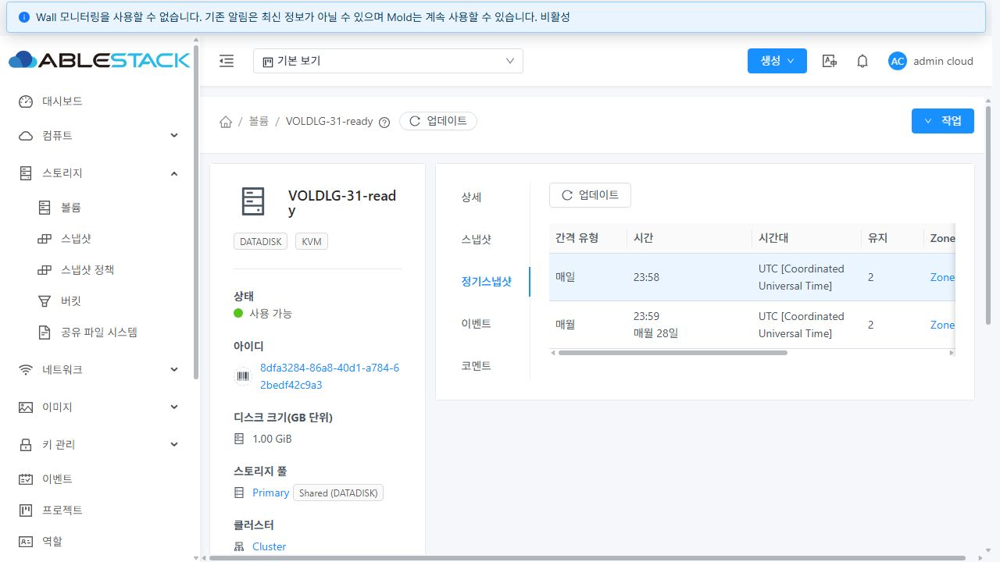
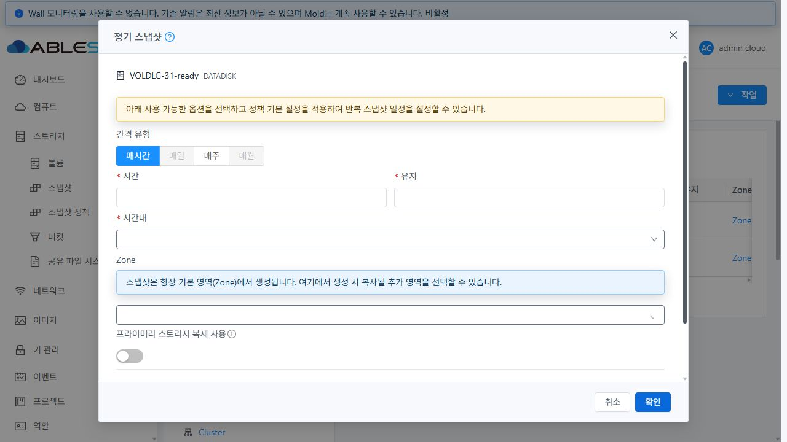
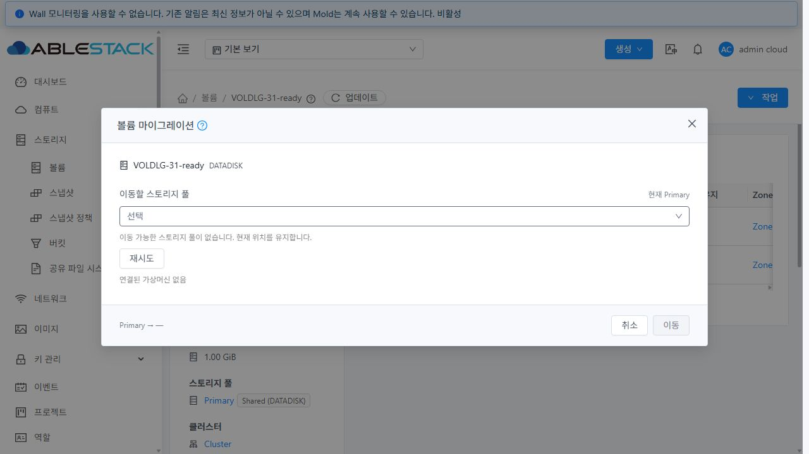
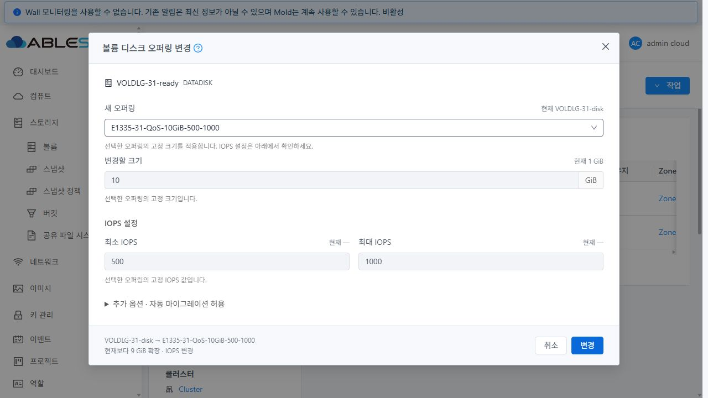

# 볼륨 대화상자 정렬·정기스냅샷 상세 탭 검증

사용자 후속 요청에 따라 정기스냅샷·볼륨 마이그레이션·볼륨 디스크 오퍼링 변경 대화상자의 본문을 정렬하고, 볼륨 상세에 정기스냅샷 정책 탭을 추가했다. Epic #1422의 기존 Draft PR #1435에 누적한다.

## 변경 내용

세 대화상자의 내부 고정 폭을 제거해 공통 쉘의 본문 폭을 사용한다. 정기스냅샷 폼은 작은 화면에서 필드를 한 줄씩 배치하며, 공통 고정 푸터와 내부 스크롤을 유지한다. 마이그레이션은 실제 제출 상태로 공통 busy 잠금을 적용한다.

볼륨 상세의 `스냅샷` 다음에 `정기스냅샷` 탭을 추가했다. 정책의 주기·실행 시각·요일/일자·시간대·유지 수·존·스토리지·태그와 삭제 작업을 제공한다. 기존 정책 목록은 등록 대화상자에서 제거했다. 대화상자는 대상 볼륨과 등록 필드만 표시하며 기존 주기의 중복 등록 차단은 유지한다.

등록 후 상세 목록을 자동 갱신한다. 조회 실패 시 기존 행과 세션을 유지하고 재시도하며, 인증 거부 시 기존 행을 제거한다. 볼륨·사용자·프로젝트가 바뀐 뒤 이전 응답이 섞이지 않게 방어하고 API 권한에 따라 탭·삭제·관계 링크를 제한한다.

## 검증과 배포

실행 소스 `04a5b31a27cb957bf8e05e9ec8aae57523478134`. [검증 요약](summary.json), [설계](design.ko.md).

| 검증 | 결과 |
| --- | --- |
| UI 린트·관련 Jest | exit 0, 6 suites / 95 tests 통과 |
| 표준 최적화 UI 빌드 | WSL ext4, Node v14.21.3, 452초, exit 0 |
| 31·32 정적 UI 배포 | 각 914개 파일 해시 일치, 활성 `js/app.f41477a4.js` |
| 대화상자 정렬 | 두 클러스터 × 3 화면 크기 × 기본 3종+정기스냅샷 주간 폼 = 24개 통과 |
| 정책 등록·삭제 | UI → API → DB 일치, 등록 직후 수동 갱신 없이 표시 |
| 볼륨 구분·실패 복구 | 빈 볼륨·직접 링크·뒤로 가기, 기존 행/세션 보존·삭제 잠금·재시도 통과 |
| 전용 자원 정리 | 볼륨 4개·오퍼링 2개·정책 정리, 활성 DB·이미지 잔여 0 |

기존 내부 폼 폭은 마이그레이션·오퍼링 변경 500px, 정기스냅샷 800px이었다. 최종 1280×720 화면에서는 본문 내용 폭과 같은 902px / 892px을 사용한다. 작은 화면에서는 정기스냅샷의 시간·요일·유지·시간대 필드가 모두 한 줄 폭을 채우고 푸터는 화면 안에 유지된다. 390×844 CSSpx와 640×360 CSSpx/DPR2를 실측했다. 후자는 200% 확대와 동등한 화면 크기의 레이아웃 시험이며 네이티브 브라우저 확대율을 직접 제어한 시험은 아니다. 좁은 화면 증거는 DOM 실측으로 기록했다.

각 환경에 배포 전 월간 정책(매월 28일 23:59 UTC, 유지 2)을 만들고, 최종 UI에서 일간 정책(23:58 UTC, 유지 2)을 등록·삭제했다. 기존 월간 정책의 UUID·주기·시간·시간대·유지·존·스토리지가 유지됐고 다른 빈 볼륨에는 표시되지 않았다. 부모 볼륨 응답이 같아 객체를 교체하지 않는 경우도 resourceReadPending 완료 후 정책을 조회한다. 정책 API만 실패시킨 시험에서도 로그인과 기존 두 행을 유지하며 삭제를 잠그고 재시도로 복구했다.

브라우저 기능 시험은 관리자 계정으로 수행했다. 권한별 탭·삭제·링크, 인증 거부, 늦은 응답, 중복 제출·컨텍스트 변경 방어는 집중 Jest에서 검증했다. 실제 다중 풀 이동은 대상 풀이 없어 제출 비활성화까지만 확인했다.

최종 정리 후 두 Mold active·/client/ 200·호스트 6개 Up, 운영 inventory·JAR·PID·WEB-INF/META-INF·config.json 해시 보존을 확인했다. 32번 추가 이미지(29,194,321,920 bytes)의 크기·mtime·inode도 유지됐다. 배포 임시 파일은 제거하고 백업은 남겼다. 기존 FT 작업 체크아웃의 HEAD·status·diff SHA256도 보존했다. 테스트 브라우저의 테마·캐시·가로세로 설정과 오류 주입을 복원하고 로그아웃 후 전용 탭을 닫았다.

증거: [대화상자 실측](dialogs.json), [정책 화면](policy-ui.json), [UI 요청](browser-network.json), [정책 생성 대조](policies-created.json), [삭제 대조](policies-deleted.json), [배포](ui-deployment.json), [정리](cleanup.json), [최종 런타임](runtime-final.json), [작업공간 보존](workspace-protection.json).

## 범위와 다음 작업

이번 변경은 UI이며 API/스토리지 엔진·호스트 커널·RBD 할당 정책은 변경하지 않는다. 다중 풀 실이동과 전체 Cloud/Release CI는 이번 검증에 포함하지 않는다. #1433은 완료 상태를 유지하고, Epic #1422·Draft PR #1435는 통합 회귀 #1434 이후 종료/병합을 판단한다.
