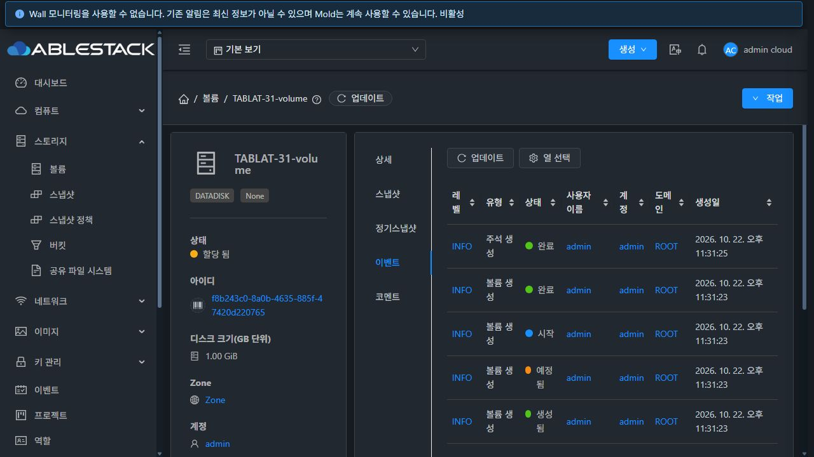
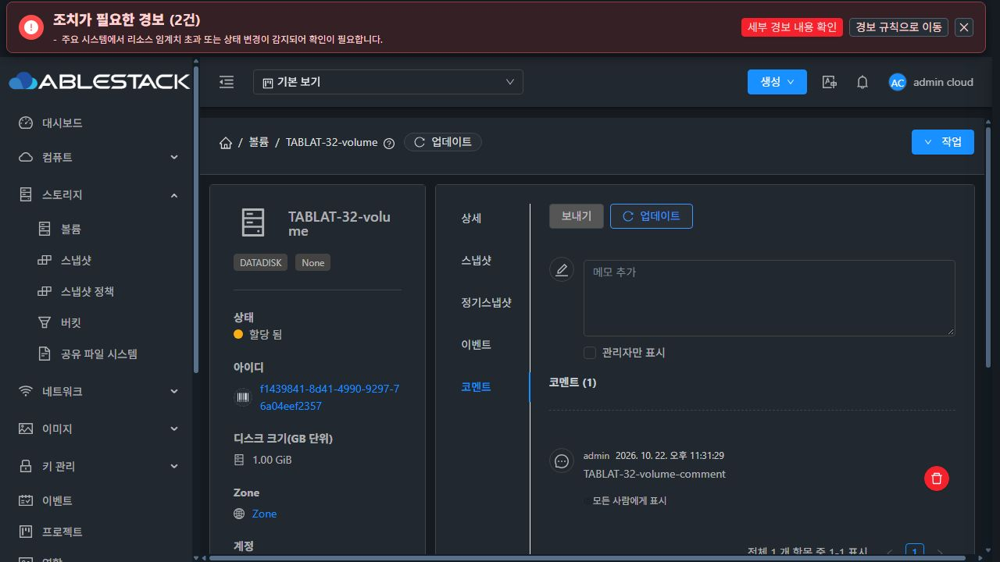

# 볼륨·오퍼링 상세 이벤트·코멘트 탭 지연 개선

세 메뉴의 이벤트·코멘트가 정상 API 응답을 첫 조회에 반영하도록 개선하고 31·32번에 배포했다. 실행 소스 `bbf1b9cc4d41e816f7fc2fca6671970d56ae3796`, Epic #1422 / Draft PR #1435 후속 보완이다.

## 원인

공통 탭 모듈이 이미 로드된 상태에서 탭을 처음 열면 query.tab이 바뀌기 전에 조회가 시작될 수 있었다. 전체 URL을 요청 소유 범위로 사용하므로 URL 커밋 뒤 도착한 HTTP 200 응답과 로딩 해제를 이전 범위의 응답으로 폐기했다. 다음 10초 자동 갱신 때 같은 API를 다시 호출한 뒤 표시했다. 일부 최초 모듈 로드는 빨라 항상 재현되는 현상은 아니었다.

변경 전 12개 지연 조건에서 첫 API는 약 0.1초에 완료됐지만 화면은 약 10.2초를 기다렸다. 같은 환경의 가상머신은 약 0.56–0.67초에 표시했다. 수정 전 소스에서 세 메뉴×두 탭의 회귀 테스트 6개도 같은 문제로 실패했다.

## 변경과 전후 비교

listRefreshMixin에 routeKey 옵션을 추가하고 공통 EventsTab·AnnotationsTab은 표시용 tab만 제외한 경로·query를 사용한다. 다른 어댑터의 기본 전체 URL 범위는 유지한다. 자원·프로젝트·사용자·페이지·기타 query 변경의 이전 응답 차단과 in-flight 요청 병합도 유지한다. 상세한 계약은 [설계](design.ko.md)에 기록했다.

| 메뉴 | 변경 전 | 변경 후 |
| --- | --- | --- |
| 볼륨 | 10.21–10.25초 | 0.57–0.69초 |
| 컴퓨트 오퍼링 | 10.21–10.25초 | 0.58–0.66초 |
| 디스크 오퍼링 | 10.18–10.25초 | 0.59–0.64초 |

각 행은 두 클러스터×이벤트·코멘트의 4개 조건이다. 총 12개 지연 조건 모두 첫 API 1회로 완료됐다(변경 전 2회). 값은 동일 자원에서 브라우저 자동화의 클릭→로딩 해제 관측 시간이며 도구 왕복을 포함한다. API 부하 시험이나 응답 시간 SLA를 의미하지 않는다. 수정 후 가상머신 비교도 약 0.52–0.67초로 유지됐다. 최초 모듈 로드·빈 코멘트 목록도 별도로 확인했다.

응답을 대기시킨 뒤 코멘트 탭으로 전환하고 돌아오는 시험은 0.66초·이벤트 요청 1회로 완료했다. 두 환경에서 이벤트·코멘트 API만 실패시켜 기존 행·로그인을 보존하고 로딩 종료 및 업데이트 재시도를 확인했다. 31번에서는 입력 중인 코멘트 초안의 실패·탭 전환 시 보존과 다른 볼륨으로 이동할 때 이전 초안·행이 섞이지 않는 것도 확인했다. 검증 코멘트의 API와 DB 값은 일치했다.

## 빌드·배포·정리

- 관련 UI 린트 성공, 8 suites / 100 tests 통과. 탭 URL 변경 중 첫 응답·빈 결과·중복 요청, 자원/프로젝트/사용자/페이지/query 변경 차단과 기본 어댑터의 URL 범위를 검증했다.
- 표준 최적화 UI 빌드: WSL ext4·Node v14.21.3·463초·exit 0. 두 환경의 활성 번들은 `js/app.376758f4.js`, 정적 파일 해시 전부 일치했다.
- 전용 볼륨 4개·컴퓨트 오퍼링 2개·디스크 오퍼링 2개·코멘트 6개 정리. 연결 내부 디스크 오퍼링도 비활성화됐고 활성 잔여는 0이다. 볼륨은 Allocated 상태로 시험하여 프라이머리 이미지를 할당하지 않았다.
- 기존 운영 inventory·JAR·PID·WEB-INF/META-INF·config.json·32번 추가 이미지를 보존했다. 최종 Mold active·/client/ 200·호스트 6개 Up, 배포 임시 파일 제거와 백업 보존을 확인했다.
- 기존 FT 작업 체크아웃의 HEAD·status·diff SHA256은 유지했다. 브라우저 오류 주입·캐시 설정을 복원하고 시험 세션·전용 탭을 종료했다.

실제 브라우저는 관리자 계정으로 검증했다. API/DB/스토리지 엔진 변경과 전체 Cloud/Release CI는 수행하지 않았다. PR은 Draft·미병합이며 #1433 완료 상태를 유지한다. 다음 작업은 #1434 통합 회귀와 Epic 종료 판정이다.

증거: [요약](summary.json), [40개 관측 기록](browser-timing.json), [브라우저 기능 검증](browser-functional.json), [회귀 재현](reproduction.json), [테스트](jest-summary.json), [배포](ui-deployment.json), [API·DB](api-db.json), [정리](cleanup.json), [최종 런타임](runtime-final.json), [작업공간 보존](workspace-protection.json).

