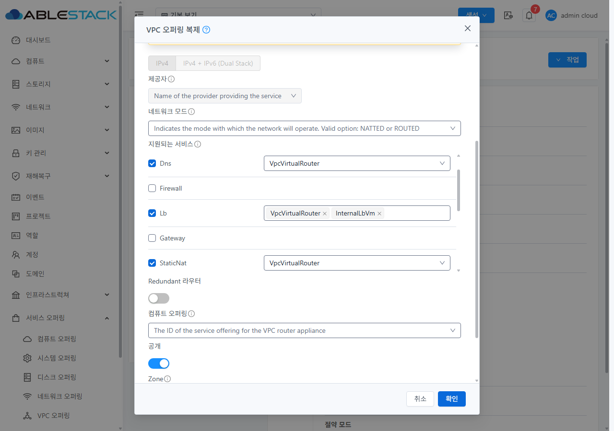
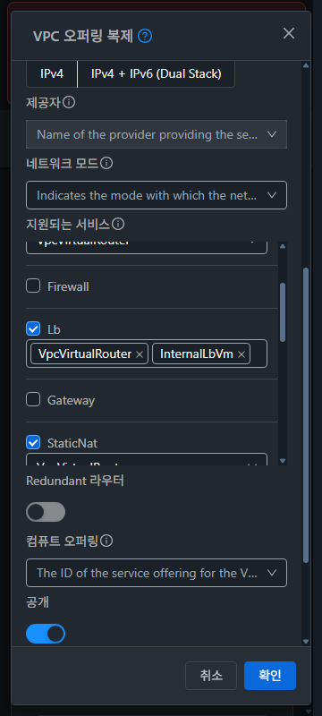
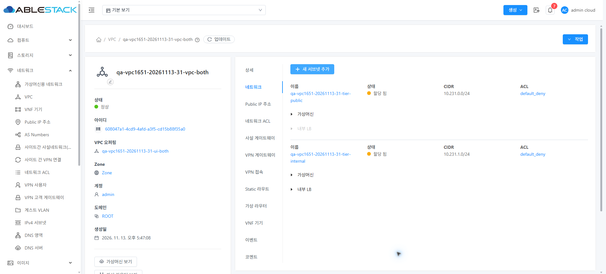

<!--
Licensed to the Apache Software Foundation (ASF) under one
or more contributor license agreements. See the NOTICE file
distributed with this work for additional information
regarding copyright ownership. The ASF licenses this file
to you under the Apache License, Version 2.0 (the
"License"); you may not use this file except in compliance
with the License. You may obtain a copy of the License at

http://www.apache.org/licenses/LICENSE-2.0

Unless required by applicable law or agreed to in writing,
software distributed under the License is distributed on an
"AS IS" BASIS, WITHOUT WARRANTIES OR CONDITIONS OF ANY
KIND, either express or implied. See the License for the
specific language governing permissions and limitations
under the License.
-->

# VPC-01 / 이슈 #1651 구현·배포·검증 결과

기본 VPC 오퍼링의 이름/설명만 바꿔 UI로 복제할 때 InternalLbVm이 사라지던 문제를 수정했다. 31(GFS2)·32(RBD)에 배포하고 양쪽 실제 UI에서 두 LB 제공자의 보존, 명시적 변경, 복제본을 사용하는 티어 후보와 생성을 검증했다. 시험 자원은 모두 정리했다.

Epic #1650의 첫 하위 이슈만 구현했다. 브랜치 `dhslove/epic-1650-vpc`, 누적 [Draft PR #1660](https://github.com/ablecloud-team/ablestack-cloud/pull/1660)에서 추적한다. Epic의 나머지 8개 항목은 미완료이며 병합하지 않는다. 승인 없이 별도 이슈를 생성하지 않았다.

## 설계 실증과 변경 경계

- 기준 소스: Europa `0edd20dcc9218312b3da533582f03e11535c5eb8`.
- 제공자 계약 수정: `44f2f71ee060c2bb36fd17e53f2bf4566a8229c2`.
- 독립 입력 ID/label 및 실제 Ant Form 회귀 보완·최종 배포 소스: `4865041676154736c3b17c69231f0380289fc8a6`.
- 제품/단위 테스트 변경은 `offering.js`, `CloneVpcOffering.vue`, 신규 `vpcOfferingProviders.js`, `CloneVpcOffering.spec.js`의 UI 4개 파일로 제한했다.
- 공통 CheckBoxSelectPair, 신규 오퍼링 폼, capability helper, 서버/Agent/JAR/호스트 소스를 변경하지 않았다. #1652의 활성화 기본값, #1653의 비동기 완료·메시지, #1658의 전체 화면 통합을 구현하지 않았다.

실제 clone API는 같은 서비스명을 반복한 `serviceProviderList[n].service/provider` 쌍으로 복수 제공자를 받는다. 변경이 없으면 매핑을 생략해 서버가 전체 원본을 상속하고, 변경이 있으면 선택한 모든 서비스·제공자 쌍을 전송하도록 했다. 일부만 전송하면 전체 매핑으로 해석되므로 변경한 LB만 전송하지 않는다. [설계](DESIGN.ko.md)와 `*-design-contract.json`에 각 6개 API 조건을 기록했다.

LB는 복수 선택으로 표시한다. 원본의 UI 미등록 서비스/제공자를 선택 모델과 후보에 보존하며, 비LB 복수 제공자는 읽기 전용으로 유지한다. 체크를 껐다 켜도 마지막 선택이 복구된다. 활성 서비스의 제공자를 모두 지우면 요청 전에 검증한다. 실제 Ant Form을 렌더링하는 회귀로 각 제공자 입력의 고유 ID와 네이티브 label 연결도 검증했다.

## 검증 결과

| 검증 | 31 GFS2 | 32 RBD | 판정 기준 |
|---|---:|---:|---|
| API 설계 실증 | 6건 | 6건 | 원본 상속·두 제공자 명시·Public/ Internal 전용·Redundant 상속/명시 |
| 실제 UI 복제 성공 | 10건 | 10건 | 전체 서비스/provider와 원본·의도값 비교, DB capability 플래그 대조 |
| LB 티어 후보 | 3조합 | 3조합 | 두 제공자·Public 전용·Internal 전용의 허용/차단 일치 |
| 실제 UI 티어 생성 | 2개 | 2개 | Public/Internal 각각 Allocated, CIDR·ACL·오퍼링·VPC 일치 |
| 시험 VPC 라우터 | Running 1개 | Running 1개 | 두 제공자 복제본의 시험 VPC |
| 최종 스타일 | 6조합 | 6조합 | light/dark × 360/768/1280px |
| 정리·기존 자원 보존 | 통과 | 통과 | UUID 집합·선택 주요 필드 차이 0건 |

UI 복제 10건은 기본 두 제공자 유지, 체크 토글, Public 전용, Internal 전용, VPN 제외, Redundant 명시 선택, Netscaler 원본, 단일 제공자 원본, 최종 기본 상속, 최종 단일→두 제공자 변경이다. 처음 8건씩은 `44f2f71`에서 수행했으며, 제공자 로직이 동일한 최종 `4865041`에서는 핵심 상속·명시 변경 2건씩과 입력 ID/label·빈 선택 검증·전체 스타일·티어 검증을 수행했다. `*-ui-cases.json`에 실행 소스 단계를 표시했다.

`*-ui-clone-oracle.json`은 성공한 20건 전체를 별도 API 세션으로 대조한 결과다. listVPCOfferings가 노출하지 않는 Redundant/Distributed/Region 플래그 3개는 관리 서버에 SSH한 뒤 로컬 MySQL에서 **읽기 전용 SELECT**로 확인했다. `*-design-capabilities-db.json`과 `*-capability-db-oracle.json`에 원본/시험 결과만 수록했다. DB를 수정하지 않았다.

인증 인자를 제거한 `*-ui-requests.json`은 캡처된 요청 일부다. 최종 기본 상속 요청에는 supportedservices/serviceProviderList가 없고, 명시 변경에는 서로 다른 인덱스의 Lb/VpcVirtualRouter와 Lb/InternalLbVm이 있다. 빈 선택 검증 후 최종 이름당 제출은 한 번이다. 전체 20건의 모든 전송 패킷을 수집했다는 의미는 아니다.

복제 VPC는 API로 각 3개 준비하고, Public/Internal 티어는 실제 UI로 각 2개 생성했다. 두 제공자가 있는 VPC에서는 두 후보를 허용하고, Public 전용에서는 Internal을, Internal 전용에서는 Public을 비활성화했다. `lb-candidate-matrix.json` 6행과 `*-tier-oracle.json`이 근거다. 기존 #1554/#1569의 LB VM·패킷 통신 시험은 반복하지 않았다. 이번 추가 실행은 후보 선택, 네트워크 할당 및 VPC 라우터 기동까지이며 실제 LB 트래픽 성공을 새로 주장하지 않는다.

## VM 표준 UI·스타일

컴퓨트 > 가상머신의 목록·상세·편집 대화상자를 기준으로 기존 공통 프레임을 비교했다. 복제 창은 `MoldDialog`의 md(720px), `MoldDialogActions`의 고정 하단, 본문 스크롤 및 기존 Ant 테마를 사용한다. 다른 VPC 화면 전체의 스타일 개선 완료를 뜻하지 않는다.

- 1280/768px: 대화상자 폭 720px. 360px: 폭 336px, 좌우 12px 여백과 세로 필드 배치.
- 12조합에서 본문/서비스 영역의 scrollWidth와 clientWidth가 같고 두 LB 선택 칩에 가로 잘림이 없었다. 글꼴은 14px이다.
- light 배경/글자 `rgb(255,255,255)` / `rgb(31,41,55)`, dark `rgb(34,40,47)` / `rgb(240,243,246)`를 확인했다.
- `style-matrix.json`의 PNG 실측 크기는 실제 viewport와 일치한다. 최종 증적은 `*-clone-{light,dark}-{360,768,1280}.png` 12장이다. 초기 스케일이 잘못된 JPEG 시도는 판정에 사용하지 않았다.
- 빈 제공자 선택은 제출을 차단한다. 기존 그룹 검증 메시지는 서비스 목록 아래에 있어 본문 스크롤로 확인한다. 범위 밖 폼 전체 재설계로 확대하지 않았다.







위 티어 이미지는 검증 중 생성 상태이며, 해당 자원은 아래 정리 단계에서 제거했다.

## 로컬 테스트와 빌드

WSL ext4 `/home/ablecloud/work/dhslove/cloud-epic-1650/ui`에서 lockfile 기준 `npm ci` 후 실행했다. Node v20.20.2 / npm 10.8.2, lockfile SHA256 `23379939285231d360907e8d7242206efd5359654b9903614788040680133ffc`다.

```bash
CI=1 NODE_OPTIONS=--openssl-legacy-provider npm run test:unit -- \
  --runTestsByPath tests/unit/views/offering/CloneVpcOffering.spec.js \
  tests/unit/views/network/NetworkOfferingForm.spec.js \
  tests/unit/views/network/NetworkOfferingLb.spec.js \
  tests/unit/views/network/UpdateNetworkOffering.spec.js \
  --runInBand --watch=false --forceExit --silent --coverage=false
npm run lint -- --no-fix src/views/offering/CloneVpcOffering.vue \
  src/utils/vpcOfferingProviders.js src/config/section/offering.js \
  tests/unit/views/offering/CloneVpcOffering.spec.js
NODE_OPTIONS='--openssl-legacy-provider --max-old-space-size=8192' npm run build
```

4 suites / 65 tests 통과, 변경 UI 4개 파일 lint 통과, 최종 production UI build 종료 코드 0(718초). `unit-result.json`, `build-result.json`에 결과와 소스 해시를 기록했다. 생성된 설정 파일은 복원하여 UI 소스가 빌드 전후 일치함을 확인했다. 전체 Cloud/Maven/RPM 빌드는 요청·실행하지 않았다.

## 배포와 보호

WSL ext4에서 SSH/SCP로 두 관리 서버의 `/usr/share/cloudstack-management/webapp`에 **정적 자산만** 배포했다. 최초 배포 후 입력 ID 보완을 반영한 최종 소스를 다시 빌드·배포했다. 두 서버 모두 689개 정적 파일(31,258,787 bytes)의 SHA256 불일치 0, `/client/` HTTP 200이다. WEB-INF/META-INF, config.json, JAR, 관리 프로세스 PID가 보존됐다. webapp 전체 교체나 rsync --delete는 사용하지 않았다.

- 최종 app: `js/app.2b740601.js`.
- 최종 index SHA256: `c60a5ef3fa6e04b8ca1c80cd96885b3d9f3b3ebef2c4356933e17098040b1fbe`.
- 제공자 수정/고유 ID: `js/chunk-3ff6c442.96fba806.js`.
- 기존 FTCTL blockingLoadingState/fetchSyncProgress/extractJobId: `js/chunk-339f49ae.fd3fdd7c.js`에서 보존 확인.
- 31 최종 배포 단계: `/dev/shm/vpc1651-20261113-174252`, 이전 정적 자산 백업 SHA256 `bc7a1d6f0d8c5ccbcb9f3801be5c0a5f1dc647cd005acd108ec2691462aa7782`.
- 32 최종 배포 단계: `/var/tmp/vpc1651-20261113-174252`, 이전 정적 자산 백업 SHA256 `4b86c67afae8340dac50155b7f0845683c9cee065b8021a694d9ebac7323c15d`.

배포 전 백업과 복원용 자료는 WSL `/home/ablecloud/work/vpc1651-20261113/backups/`에도 보관했다. 32 최초 준비에서 /dev/shm 여유 공간 부족으로 백업이 실패했으나 적용 전 index가 유지됨을 확인했다. 이번 작업의 실패한 준비 디렉터리만 정리하고 /var/tmp로 재시도했다. 다른 프로세스·임시 파일이나 패키지는 변경하지 않았다. 최종 배포 영수증은 `31-deployment.json`, `32-deployment.json`이다.

## 정리·보존

API 설계 복제 6개씩과 초기 대조용 복제본을 정리했다. 본 UI 시험의 복제 오퍼링 10개씩, VPC 3개씩, UI 티어 2개씩 및 따라 생성된 VPC 라우터 1개씩도 제거했다. 자신의 prefix `qa-vpc1651-20261113-` 및 연결 UUID를 검사한 뒤 삭제했다. Public IP 목록 UUID는 원래 집합과 같고 시험 VPC에 연결된 IP가 남지 않았다.

| 기본 보기 API 범위 | 31 전→후 | 32 전→후 |
|---|---:|---:|
| VPC 오퍼링 | 7→7 | 7→7 |
| VPC | 2→2 | 1→1 |
| 네트워크 | 31→31 | 16→16 |
| 가상 라우터 | 20→20 | 10→10 |
| 사용자 VM | 132→132 | 58→58 |
| Public IP 목록 | 24→24 | 9→9 |

`*-preservation.json`에 UUID 집합 일치와 선택 주요 필드 차이 0건을 기록했다. 조회 범위는 listall=true/page=1/pagesize=500의 기본 보기이며 모든 프로젝트/물리 파일/DB 이력 전체를 전수 비교했다는 의미는 아니다. 양쪽 UI의 시험 prefix 검색 0건을 확인했고 기존 프로젝트 보기 `qa-gn1569-31-shared-reg` / `qa-gn1569-32-shared-reg`, 라이트 테마, 1920×871 viewport로 복원했다.

원래 FTCTL 작업 트리의 기존 수정 파일 3개는 작업 시작 시 해시와 같았다. 해당 작업 트리와 upstream 로컬 저장소를 수정하지 않았다. 전체 원본 inventory와 진단 중간 자료·실행 스크립트는 로컬 비공개 `C:/Users/ablecloud/Documents/Codex/2026-11-13/vpc1651/private/`에 보관하고 공개 증적에서는 제외했다. 인증 비밀번호·세션키·API/Secret key를 커밋하지 않는다.

## 제한과 CI 판정

Redundant 시험은 **시험자가 기존 폼의 Redundant 스위치를 명시 선택**한 조건이다. 현재 listVPCOfferings에 capability가 노출되지 않으며, 명시하지 않은 기존 서버 자동 상속은 String/HashMap 변환 오류가 난다. 기존 UI의 비동기 성공 오표시도 관찰했다. 따라서 Redundant의 이름만 바꾼 자동 복제를 PASS로 주장하지 않는다. 명시 조건의 최종 제공자와 DB 플래그 비교는 통과했다. 관련 capability 응답/서버 상속 및 #1653의 실패 추적 처리를 이번 제공자 수정으로 확대하지 않았고 새 이슈도 만들지 않았다. 기본 Default VPC의 이름/설명만 바꾼 복제는 양쪽 모두 통과했다.

소스 `4865041`의 [License Check](https://github.com/ablecloud-team/ablestack-cloud/actions/runs/43392831368)는 기존 Unknown Licenses 4,079건 때문에 실패했다. 변경 UI 4개는 모두 AL 승인이다. [전체 pre-commit](https://github.com/ablecloud-team/ablestack-cloud/actions/runs/43392831192)도 기존 파일의 라이선스·실행 권한·symlink·공백/철자/Python/Markdown 오류로 실패했고, 변경 UI 경로에는 진단이 없었다. 병합 충돌 확인은 통과했다. `ci-source-checks.json`이 해당 소스의 판정 근거다. 범위 밖 CI 전체 정리는 수행하지 않았다. 문서 증적 커밋으로 새로 시작되는 전체 CI는 이 소스 검증 결과와 구분한다.
