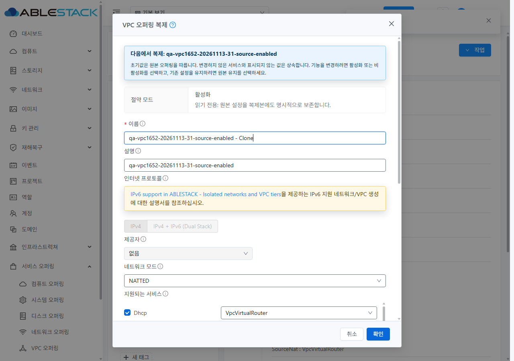
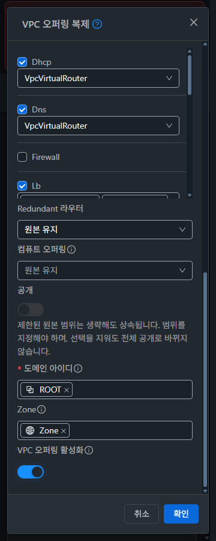

<!--
Licensed to the Apache Software Foundation (ASF) under one
or more contributor license agreements. See the NOTICE file
distributed with this work for additional information
regarding copyright ownership. The ASF licenses this file
to you under the Apache License, Version 2.0 (the
"License"); you may not use this file except in compliance
with the License. You may obtain a copy of the License at

http://www.apache.org/licenses/LICENSE-2.0

Unless required by applicable law or agreed to in writing,
software distributed under the License is distributed on an
"AS IS" BASIS, WITHOUT WARRANTIES OR CONDITIONS OF ANY
KIND, either express or implied. See the License for the
specific language governing permissions and limitations
under the License.
-->

# VPC-02 / 이슈 #1652 구현·배포·실환경 검증

2026-11-13~14 KST에 31(GFS2)·32(RBD)에서 검증했다. Enabled/Disabled 원본의 복제 초기 표시를 원본 상태와 맞추고, 제출 시 `enable=true/false`를 명시해 화면·요청·결과를 일치시켰다. conserve mode는 읽기 전용 요약과 명시 전달로 보존한다. 조회되지 않은 값은 임의 OFF 대신 **원본 유지**로 표시한다.

상위 Epic #1650의 두 번째 하위 이슈만 다룬다. 기존 네트워크 Epic의 LB VM/패킷·ACL·VPN 회귀를 반복하지 않았다. 별도 이슈를 만들지 않았으며 #1653 비동기 완료/메시지와 #1658 전체 화면 통합은 Open 범위로 남긴다.

## 소스와 설계

- 기준: `6ef9ac9a5c1aa59098af9923950fc47c60b7de27`.
- 상속·상태 구현: `21da0d56225b146744399d3d8653ac5134689935`.
- 전송 실패 입력·세션 보존 보완 및 최종 배포: `5e1d22312e2578e419abd81492bcb95e7f8d7fd9`.
- [실환경 실증을 반영한 필드별 설계](DESIGN.ko.md). UI 제품/테스트 변경은 5개 파일이다. 기존 #1651 제공자 수정과 합친 Epic의 UI 변경은 8개 고유 파일이다.

원본의 도메인·Zone은 UUID로 초기화한다. 서버가 생략된 제한 범위를 상속하므로 제한된 원본을 선택 해제해 전체 공개로 바꾸는 오해를 막고 설명한다. 전역 원본의 범위 축소는 허용한다. 컴퓨트·Redundant 등의 변경은 해당 서비스가 선택된 경우만 전송한다. false를 미입력으로 취급하지 않는다.

서버 capability 배열은 전체 대체 계약이다. 따라서 적용 가능한 기능을 일부만 명시하고 나머지를 원본 유지로 남기는 조합은 제출 전에 막는다. 모두 원본 유지 또는 모두 명시 선택하도록 안내한다. 후보 조회/네트워크 모드 변경은 편집 중인 이름·활성화·범위를 다시 초기화하지 않는다. 다른 원본으로 바꾸면 폼을 초기화하고 이전 조회의 늦은 응답을 무시한다.

## 검증 결과

| 검증 | 31 GFS2 | 32 RBD | 근거 |
|---|---:|---:|---|
| 설계 API 대조 | 10건 | 10건 | enable 생략/true/false 6건, conserve 명시 true/false 2건, Redundant 명시 true/false 2건 |
| 실제 UI 복제 성공 | 13건 | 13건 | 아래 두 배포 단계 구분 |
| UI 결과/API·DB 대조 | 13건 통과 | 13건 통과 | 상태·절약 모드·scope·프로토콜/라우팅·provider·컴퓨트·capability |
| 신규 VPC 화면 후보 | 13개 일치 | 13개 일치 | 실제 UI 조회 응답에서 Enabled만 포함. 대표 Disabled 검색 결과 없음 |
| 라이트/다크 반응형 | 6조합 통과 | 6조합 통과 | 360/768/1280 × 900px, 원본 유지 popup도 모바일 검증 |
| 마지막 오퍼링 정리 | 15개 | 15개 | 시험 원본 2 + UI 복제 13, 기본 오퍼링 제외 |

첫 소스 `21da0d5`에서 클러스터당 10건을 수행했다. Enabled/Disabled 각각 미조작·ON·OFF·ON→OFF 8건과 Redundant 명시 true/false 2건이다. 서비스 변경, Public/Internal LB 제공자 선택, 컴퓨트 명시 변경, 전역 원본의 도메인/Zone 축소, ROUTED→NATTED 왕복 후 이름·OFF 보존, capability 혼합 차단을 포함한다.

첫 배포의 탭 전체 오프라인 시도는 공통 전송 오류 처리로 인증이 초기화되어 재시도를 완료하지 못했다. 생성 결과가 없음을 확인했고 **성공 건수에 포함하지 않았다**. 이 기준을 해결하기 위해 Clone 요청 한 곳에서 기존 `postAPI` 옵션 `preserveOnFailure=true`를 사용했다. 공통 API/인증 처리 및 실제 401 정책은 변경하지 않았다.

최종 `5e1d223`을 다시 빌드·배포한 뒤 클러스터당 3건을 추가했다. Clone XHR 한 건만 `ConnectionFailed`로 실패시킨 뒤 입력·admin 제어 유지와 동일 payload 재시도를 확인했고, Enabled/Disabled 미조작을 다시 확인했다. 최종 요청 증적은 실패 1회와 성공 3회로 4개이며, 재시도 두 payload가 같다. 전체 26건의 최종 API/DB 값은 기대와 일치한다. 최종 소스에서 26건 전부를 다시 생성한 것으로 해석하지 않는다.

UI 제공자 선택 DOM과 실제 결과의 전체 서비스/provider를 비교했다. DB는 읽기 전용으로 source·API 대조군·UI 결과 26행씩의 conserve, Redundant, 컴퓨트 ID, distributed/region/AS 플래그를 확인했다. DB 수정은 하지 않았다. 폼 재열기·다른 원본·늦은 조회 응답·조건부 요청 제거는 단위 테스트로도 보완했다.

## UI 스타일 검증

VM 표준의 공통 `MoldDialog` md(720px)·`MoldDialogActions`·고정 하단·본문 스크롤·테마를 유지했다. 기준 VM 목록/상세/대화상자는 앞선 [#1651 검증 캡처](../vpc-1651-20261113/README.ko.md)를 재사용했다. 이번 변경은 복제 창의 원본 유지/읽기 전용 정보와 상태 제어에 집중한다. 전체 VPC breadcrumb·목록·상세·탭 통합 완료를 뜻하지 않는다.

12개 PNG의 실제 크기와 viewport를 대조했다. 360px에서는 대화상자 폭 336px(좌우 12px)이며 본문·서비스·요약의 가로 넘침이 없고 확인 버튼이 viewport 안에 있다. 라이트/다크 레이블은 14px이며 테마 색상과 배경을 따른다. 모바일 3개 선택 항목 popup도 폭 292px로 화면 안에 표시된다. 대표 이미지를 직접 확인했다.

## 로컬 검증·빌드

- WSL ext4 `/home/ablecloud/work/dhslove/cloud-epic-1650/ui`에서 **5 suites / 81 tests 통과**, 변경 JS/Vue/테스트 3개 lint 통과, 두 locale JSON 파싱 통과.
- 테스트는 복제 상태 신규 suite, #1651 제공자 suite와 연관 네트워크 폼 3개 suite다. 실환경 일반 네트워크 트래픽 재검증을 의미하지 않는다.
- 최종 production UI build exit 0, 688.8초. Node 20.20.2/npm 10.8.2, 기존 lockfile/의존성 환경을 재사용했다. 이번에 npm ci를 다시 실행한 것으로 기록하지 않는다.
- lockfile SHA256 `23379939285231d360907e8d7242206efd5359654b9903614788040680133ffc`.
- 자체 설계·보고서 Markdown은 markdownlint 0.45.0, 증적 폴더 전체 텍스트는 codespell 2.4.2를 통과했다. JSON 파싱·UTF-8/LF·인증 정보 검사를 통과했다.
- 전체 Cloud/Maven/RPM/호스트 빌드·배포와 release Actions는 실행하지 않았다.

## 배포와 롤백

양쪽 활성 `/usr/share/cloudstack-management/webapp`에 정적 UI 689개 파일, 31,261,421 bytes만 갱신했다. 해시 불일치 0, `/client/` HTTP 200, WEB-INF/META-INF·설정·JAR·관리 프로세스 PID 보존을 확인했다. 루트 교체/전체 삭제/rsync --delete는 사용하지 않았다.

- 최종 app: `js/app.fc1f09da.js`.
- 복제 기능 chunk: `js/chunk-6a8cbdda.ea0c0c4c.js`, `preserveOnFailure:!0` 확인.
- index SHA256: `9ddf33d8d23bb1a3289a199782c88093384bd08796c5d3350452790c816769da`.
- 기존 FTCTL bundle의 blockingLoadingState/fetchSyncProgress/extractJobId 마커 보존.
- 31 원격 stage: `/dev/shm/vpc1652-20261114-001550`.
- 32 원격 stage: `/var/tmp/vpc1652-20261114-001550`.
- 정적 자산 롤백 백업은 WSL `/home/ablecloud/work/vpc1652-20261113/backups/`에 보관했다. 배포 receipt에 SHA256을 남겼다. 백업에는 비공개 운영 파일이 있어 저장소에 올리지 않았다.

## 정리와 보존

설계 API 대조군 10개씩과 수정 전 재현 복제본은 먼저 정리했다. 마지막으로 소유 prefix와 UUID ledger를 일치시킨 시험 오퍼링 15개씩을 비활성화 후 삭제했다. 기본 Redundant 원본은 소유 대상에 포함하지 않았다. UI prefix 검색도 양쪽 0건이다. VPC/VM/네트워크/라우터를 새로 생성하지 않았다.

| 기본 보기 API 범위 | 31 전→후 | 32 전→후 |
|---|---:|---:|
| VPC 오퍼링 | 7→7 | 7→7 |
| VPC | 2→2 | 1→1 |
| 네트워크 | 31→31 | 16→16 |
| 가상 라우터 | 20→20 | 10→10 |
| 사용자 VM | 132→132 | 58→58 |

5종 조회의 UUID 집합과 선택 주요 설정 차이는 0건이다. 모든 프로젝트·DB 이력·물리 파일 전체 보존을 전수 증명하는 비교는 아니다. 기존 프로젝트 보기, 라이트 테마, viewport override 해제, 캐시·네트워크·요청 가로채기 설정을 복원했다. 별도 FTCTL 작업 파일 3개의 SHA256도 작업 시작 때와 동일함을 확인했다.

## 제한과 CI

`listVPCOfferings`는 현재 Redundant와 원본 컴퓨트 오퍼링 ID를 노출하지 않는다. 원본 유지 선택을 제공하며 해당 값을 임의 false로 추측하지 않는다. 기존 서버의 Redundant 자동 상속 String/HashMap 오류는 수정하지 않았고, 이름만 바꾼 Redundant 자동 복제 성공으로 계산하지 않는다. 이번 명시 true/false 결과는 UI·요청·DB로 검증했다. API의 conserve 생략 시 false가 되는 동작도 백엔드에서 수정하지 않았으며 UI가 원본 boolean을 명시해 보존한다.

비동기 job 접수 후 최종 완료 추적·실패 복구와 기존 번역 키 노출은 #1653 범위다. 이 문서는 생성 결과를 별도 API/DB로 확인한 성공만 센다. 외부 제공자·IPv6/BGP 실제 배포·모든 권한 조합은 시험하지 않았다.

제품 소스 `5e1d223`의 [License Check](https://github.com/ablecloud-team/ablestack-cloud/actions/runs/43448695686)는 기존 Unknown Licenses 4,079건으로 실패했다. 변경 JS/Vue/테스트 3개는 AL 승인, locale JSON은 기존 제외 규칙을 따른다. [전체 pre-commit](https://github.com/ablecloud-team/ablestack-cloud/actions/runs/43448695822)도 범위 밖 기존 파일들의 라이선스/줄끝/스크립트/맞춤법 등으로 실패했다. 초기 전체 파일 identity 나열 이후 이번 UI 변경 경로 진단은 0건이고 로컬 변경 파일 lint는 통과했다. [충돌 검사](https://github.com/ablecloud-team/ablestack-cloud/actions/runs/43448695691)는 통과했다. 문서 증적 커밋의 새 CI 상태와 제품 소스 결과를 구분하며 범위 밖 CI 수정으로 확대하지 않았다.

## 증적 읽기

`evidence/31-*`와 `32-*`는 설계 API 요청/결과, source fixtures, UI 사례별 소스·기대·실제 DOM 값, 인증 인자 제거 요청, API/DB oracle, 신규 VPC 후보, 정리·보존 receipt다. `initial-*` 및 `*-initial-offline-*`는 첫 빌드와 실패한 재시도 기록이며 최종 성공으로 계산하지 않는다. `style-matrix.json`, `mobile-popups.json`, `ui-restoration.json`, 최종 build/unit/deployment receipt로 최종 상태를 확인한다.

전체 DOM·기준선/최종 inventory·로그·개인 실행 스크립트는 비공개 작업 경로에 보관했다. 공개 JSON은 관찰한 control 값과 결과 중심으로 발췌했고 원본 snapshot 문자열은 제거했다. 인증 정보와 비밀번호는 공개 증적에 포함하지 않는다. 캡처는 실제 브라우저에서 얻은 원본 PNG다.
