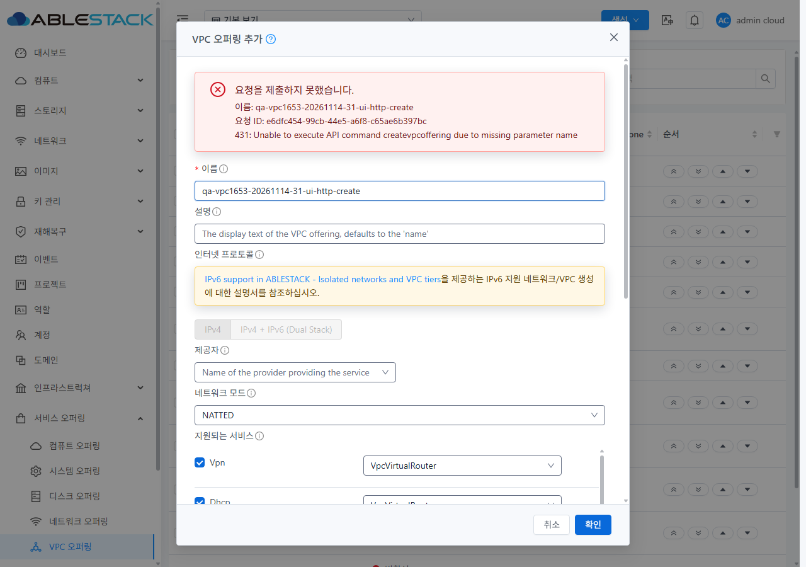
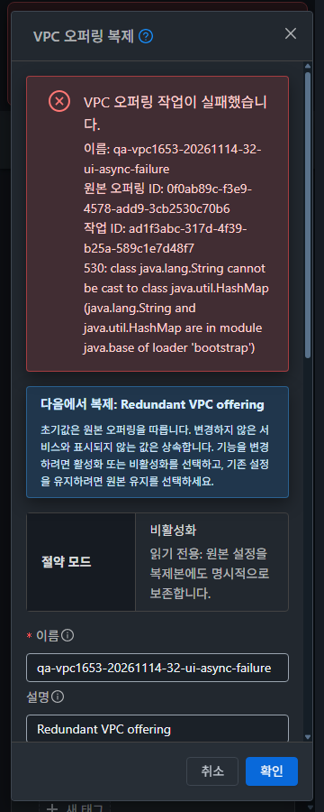

<!--
Licensed to the Apache Software Foundation (ASF) under one
or more contributor license agreements.  See the NOTICE file
distributed with this work for additional information
regarding copyright ownership.  The ASF licenses this file
to you under the Apache License, Version 2.0 (the
"License"); you may not use this file except in compliance
with the License.  You may obtain a copy of the License at

  http://www.apache.org/licenses/LICENSE-2.0

Unless required by applicable law or agreed to in writing,
software distributed under the License is distributed on an
"AS IS" BASIS, WITHOUT WARRANTIES OR CONDITIONS OF ANY
KIND, either express or implied.  See the License for the
specific language governing permissions and limitations
under the License.
-->

# VPC-03 / #1653 생성·복제 비동기 완료와 실패 복구 검증

31(GFS2)·32(RBD)에서 설계 전 API 실증, 구현, UI 정적 배포, 실제 브라우저 기능·스타일 검증과 시험 자원 정리를 완료했다. #1653의 7개 완료 기준을 충족했다. Epic #1650의 다른 기능이나 서버 상속 오류를 수정한 결과가 아니다.

## 변경과 실환경 설계

- 기준: `0df0a392ac4a62705dac194501a3954956f456f6` (#1652 완료).
- 비동기 구현: `f698b0191965af5e030a328fdc7a5dffe3f86491`.
- 실제 Ctrl+Enter 보완·최종 실행 코드/배포: `5b25092d8cec7a10d1e7ddf3c6c1f8890d750640`.
- 라이선스 주석 정규화: `59e7d9b1e158b2f8f21fbe2a9e50d4122729b075`. Vue compiler-sfc의 template/script/style 내용이 배포 소스와 모두 같고 변경 파일 lint가 통과했다. 실행 코드 변경이 없어 기존 최종 정적 배포를 유지했다.
- 브랜치: `dhslove/epic-1650-vpc`, 누적 Draft PR [#1660](https://github.com/ablecloud-team/ablestack-cloud/pull/1660). 이번 변경은 UI 12개, Epic 누적은 UI 14개 고유 파일이다.

[설계서](DESIGN.ko.md)와 [초기 설계 코멘트](https://github.com/ablecloud-team/ablestack-cloud/issues/1653#issuecomment-6858261508)를 기준으로 구현했다. 최종 보존 정책은 로그인/프로젝트 변경 시 추적을 무효화하되 인증정보 없는 소유자·프로젝트별 기록을 유지하고, 같은 문맥으로 돌아온 뒤 명시 재조회하는 방식이다.

설계 API는 클러스터당 6건, 총 12건이다. 정상 생성·복제, 실제 Redundant 자동 상속 실패, 잘못된 원본의 즉시 거부, customjobid 생성·복제를 대조했다. HTTP 접수 후 jobstatus=1/2와 즉시 431 거부는 다른 결과였다. clone 접수의 id는 원본 내부 번호 1/3이므로 새 복제본 UUID로 사용하면 안 됐다. 양쪽 customjobid는 접수 jobid와 같았고 동일 ID로 최종 결과를 조회할 수 있었다. 설계 시험의 성공 오퍼링 8개는 즉시 정리했다.

수정 전 31 UI는 실제 Redundant 작업의 HTTP 접수 후 창이 닫혔으나 해당 job은 최종 실패했고 개체가 없었다. 짧은 토스트는 캡처하지 못했으므로 토스트 문자열 증거로 주장하지 않는다. 접수 즉시 성공 처리하는 소스와 실제 닫힘/실패 job을 함께 근거로 삼았다.

## 구현 동작

| 상황 | 최종 동작 |
|---|---|
| 제출·접수·job 진행 | 입력/원본/요청 UUID를 보존하고 POST 1회. 진행 중 중복 제출·닫기 차단 |
| job 성공 | jobresult의 새 UUID·이름을 listVPCOfferings에서 확인한 뒤 한국어 성공·목록 갱신·닫기 |
| HTTP 명시 거부 / job 실패 | 서로 구분해 입력·원본·작업 ID·서버 오류를 유지. 이전/새 이름의 개체 존재 확인 후 편집 재시도 |
| 접수 응답 유실 / 조회 실패 / 결과 확인 실패 | 미확정 상태와 같은 작업 재조회 제공. 새 POST 금지 |
| 창 재열기·페이지 새로고침 | sessionStorage의 소유자/프로젝트/원본별 입력·식별자 복원. 토큰·세션키·비밀번호 저장 없음 |
| 원본·경로·프로젝트·로그인 전환 | 세대 가드로 오래된 응답이 새 폼을 닫거나 갱신하지 못함. 복원 작업은 명시 재확인 |

새 전용 operation controller/mixin/status가 기존 createJobTracker를 재사용한다. 공통 작업 추적기·API·인증·provider helper·서버 코드는 변경하지 않았다. 실패 후 잔여 개체가 있으면 자동 삭제/재생성하지 않고 미확정 상태로 남긴다.

생성과 복제 모두 VM 공통 MoldDialog/MoldDialogActions의 md 프레임과 고정 푸터를 사용한다. 진행 상태·긴 UUID·서버 오류를 인라인 표시하고 한국어 복제 성공 키를 복원했다. 버튼·폼·Ctrl+Enter는 같은 검증/잠금 경로를 사용한다.

첫 배포 실환경에서 Ctrl+Enter가 제출되지 않는 문제가 추가로 확인됐다. 공통 directive의 keydown이 Teleport 푸터로 포커스를 이동해 keyup이 본문에 도달하지 않았다. 두 폼의 푸터에 같은 handleSubmit을 연결했으며 공통 directive는 변경하지 않았다. 실제 directive와 Teleport/일반 푸터의 생성·복제 4개 테스트 및 최종 실환경 단축키 재시험으로 확인했다.

## 기능 검증 결과

최종 실행 코드에서 집중 단위 테스트 **7 suites / 115 tests**, 변경 JS/Vue/테스트 lint, codespell, locale JSON 파싱이 통과했다. 기존 #1651/#1652 계약 회귀와 새 비동기·복원·문맥 전환·단축키 검증을 포함한다. Node 20.20.2 / npm 10.8.2의 기존 의존성 환경을 재사용했으며 새 npm ci는 실행하지 않았다.

UI는 양쪽 각 9사례·12회 POST, 총 **18사례·24회 POST**를 실행했다. 실제 성공 18개, 실제 job 실패 4회, 실제 HTTP 431 거부 2회다. 실패/거부 후 수정 재시도를 포함하므로 사례 수와 POST 수를 구분한다.

| UI 사례 (양쪽 실행) | 검증 |
|---|---|
| 정상 생성 / 지연 복제 | 접수와 최종 완료 분리, 진행 중 이중 제출 차단, 최종 상태·한국어 성공 |
| job 조회 오류 후 재조회 | 조회 전달 실패 주입 3회 후 미확정, 같은 job 확인, POST 추가 없음 |
| 최종 개체 조회 오류 후 재조회 | job 성공을 곧바로 완료로 표시하지 않고 결과 확인 재시도 |
| 접수 응답 유실·새로고침·재열기 | 서버 HTTP 200 접수 응답 전달만 차단. 입력/원본/OFF/동일 customjobid 복원, 동일 작업으로 완료 |
| HTTP 거부·복원·단축키 재시도 | 브라우저에서 전송 이름만 제거해 실제 서버 431 유도. 입력/9개 서비스 보존, 취소/재열기/새로고침 후 최종 Ctrl+Enter 성공 |
| 실제 async 실패·단축키 재시도 | 기존 Redundant 자동 상속 오류로 jobstatus=2/530. 창·입력/OFF/원본/작업 ID/오류 유지. 명시 Redundant=true 수정 후 성공 |
| 늦은 성공 보호 | 최종 성공 응답 보류 중 원본 변경. 이전 응답 전달 후 새 폼 유지, 원래 원본에서 명시 완료 확인 |
| 늦은 실패 보호 | 실제 실패 응답 보류 중 원본 변경. 전달 후 새 폼에 이전 오류/닫기 없음. 원래 원본에서 복원 후 수정 성공 |

초기 f698 배포에서 성공 10회와 HTTP 거부 2회를 확인했고, 최종 5b 배포에서 성공 8회와 실제 job 실패 4회를 확인했다. 초기 HTTP 거부의 수정 재시도는 최종 배포에서 수행해 각 attemptSources를 구분했다. 상태 엔진/mixin chunk `chunk-280a6694.67332f79.js`는 두 배포에서 동일하며 최종 변경은 두 푸터의 단축키 연결이다. 모든 초기 fault 주입 조합을 최종 배포에서 다시 실행했다는 주장은 하지 않는다.

독립 API 검증기로 모든 UI 시도의 job command/status, 새 UUID·이름·상태·conserve·서비스/provider, 같은 이름의 중복 개체 없음을 확인했다. UI 목록의 양쪽 9개 행 링크/상태도 일치했다 (각 Enabled 1 / Disabled 8). 원본/경로/프로젝트/로그인 전환은 집중 테스트로 검증했고 실브라우저에서는 같은 창의 원본 전환 뒤 늦은 성공·실패 응답을 확인했다. 모든 실제 역할/로그인/프로젝트 전환 조합의 E2E 검증은 아니다.

증거: [31 UI 사례](evidence/31-ui-cases.json), [32 UI 사례](evidence/32-ui-cases.json), [31 독립 대조](evidence/31-ui-oracle.json), [32 독립 대조](evidence/32-ui-oracle.json), [단위 테스트](evidence/unit-result.json).

## 배포와 UI 스타일

WSL ext4에서 최종 UI production build가 682.4초에 성공했다. 관리 서버의 `/usr/share/cloudstack-management/webapp`에 정적 허용 목록만 갱신했다. WEB-INF/META-INF, 런타임 설정, 관리 JAR/PID를 보존했고 서버 재시작이나 호스트 변경은 없었다. 양쪽 **691개 정적 파일 / 31,289,068 bytes, 해시 차이 0, /client/ HTTP 200**이다.

- 최종 앱: `js/app.ceda62e4.js`.
- index SHA256: `9fe57c9c76686340e7d2f223e3761259ac56cbaf90f72b38097b7d857e006cb6`.
- 31 롤백 백업 SHA256: `6fdfc612f8931c36ed4cd7b3b32f9efc579e4cc5a9abae64c240f137942984b3`.
- 32 롤백 백업 SHA256: `02a4db13f224e119befa81775cb8260bd64e45cd9886b4ad14102bd164aadbbf`.
- 백업은 WSL의 `/home/ablecloud/work/vpc1653-20261114/backups/20261114-015303/`에 보존했다. 원격 31 임시 경로는 /dev/shm이므로 영구 보관 근거로 사용하지 않는다.

[빌드](evidence/build-result.json), [31 배포](evidence/31-deployment.json), [32 배포](evidence/32-deployment.json), [주석 동등성](evidence/license-comment-equivalence.json)에 근거를 저장했다. 기존 FTCTL 번들 표식도 유지된다. Maven/JAR/RPM/전체 Cloud 빌드나 릴리스 Actions는 실행하지 않았다.

VM 공통 프레임/토큰과 기존 VM 비교 자료를 기준으로 **2폼 × 2클러스터 × light/dark × 360/768/1280 = 24조합**을 최종 배포에서 확인했다. 1280/768 화면의 대화상자 폭은 720px, 360 화면에서는 336px이다. 본문·오류에 가로 넘침이 없고 고정 푸터가 viewport 안에 있으며 긴 UUID·서버 오류가 줄바꿈됐다. 모바일 하단 접근 8회와 popup 2회도 확인했다. 전체 VPC breadcrumb/목록/상세/탭 통합은 #1658 범위로 남긴다.

24조합의 계측과 원본 PNG: [스타일 행렬](evidence/style-matrix.json), [하단 접근](evidence/style-lower.json), [모바일 popup](evidence/mobile-popups.json), [screenshots](screenshots/).

## 정리와 보존

UI 시험 성공 오퍼링 18개를 소유 UUID/이름 대장과 대조해 모두 삭제했다. 설계 성공 오퍼링 8개도 앞서 삭제했다. 실패 작업은 생성 개체가 없었다. 양쪽 UI의 시험 prefix 검색 결과는 0건이다. 기존 자원의 UUID 집합과 선택 주요 필드는 아래 5종에서 차이 0건이다.

| 자원 | 31 전→후 | 32 전→후 |
|---|---:|---:|
| VPC 오퍼링 | 7→7 | 7→7 |
| VPC | 2→2 | 1→1 |
| 네트워크 | 31→31 | 16→16 |
| 라우터 | 20→20 | 10→10 |
| VM | 132→132 | 58→58 |

기존 프로젝트 보기 `qa-gn1569-31-shared-reg` / `qa-gn1569-32-shared-reg`, 라이트 테마, viewport를 복원했다. 임시 응답 차단·오프라인·속도 제한·캐시 변경도 해제했다. 별도 FTCTL 작업 파일의 해시를 보존했다. 모든 프로젝트·DB 이력·호스트 물리 파일 전수 비교를 주장하지 않는다.

증거: [31 정리](evidence/31-cleanup.json), [32 정리](evidence/32-cleanup.json), [31 보존](evidence/31-preservation.json), [32 보존](evidence/32-preservation.json), [UI 복원](evidence/ui-restoration.json).

## CI·증거의 한계와 범위

제품 5b 소스의 GitHub License run 43465080761은 기존 Unknown 4,079건으로 실패했고 이번 JS/Vue/테스트 10개는 AL이었다. pre-commit run 43465080782도 실패했으며 이번 Status Vue의 짧은 주석 1개가 자동 수정 대상에 포함돼 59e7에서 저장소 템플릿으로 정규화했다. 해당 주석 수정 외에 기존 저장소의 PNG/라이선스/줄끝/스크립트/codespell/flake8/Markdown 실패를 확대 수정하지 않았다. 충돌 검사 43465080481은 통과했다. [CI 범위](evidence/ci-scope.json)에 당시 판정과 주석 보완을 구분한다. 로컬 집중 검사 통과를 전체 CI 통과로 표현하지 않는다.

브라우저 event cursor가 빌드 대기와 새로고침을 가로지르며 일부 구간이 만료됐다. 보존/복구한 자체 요청 24개 POST, UI 상태 확인, 별도 서버 job/고유 이름 대조를 함께 사용한다. 연속된 전체 네트워크 로그 또는 누락 구간 요청 0건을 주장하지 않는다. 31 최초 생성의 pending 캡처와 짧은 토스트는 없고, 최종 생성 단축키 시험에서는 pending·성공을 다시 확인했다. [캡처 제한](evidence/network-capture-notes.json)을 참조한다.

실제 서버 Redundant 자동 상속 오류는 UI 실패 복구 실증에 사용했으며 서버 결함 자체는 수정하지 않았다. 미노출 API 인자·전체 VPC UI 통합·기존 LB VM/트래픽/ACL/VPN 회귀를 확대 구현하거나 반복 검증하지 않았다. 새 별도 이슈는 생성하지 않았다. 인증정보·전체 inventory·원격 백업·비공개 실행 스크립트는 공개 증적에 포함하지 않았다.
