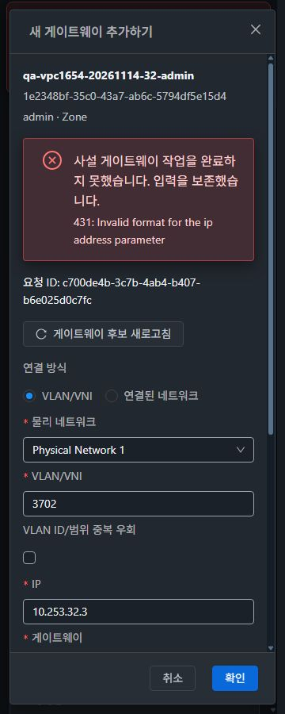

<!--
Licensed to the Apache Software Foundation (ASF) under one
or more contributor license agreements.  See the NOTICE file
distributed with this work for additional information
regarding copyright ownership.  The ASF licenses this file
to you under the Apache License, Version 2.0 (the
"License"); you may not use this file except in compliance
with the License.  You may obtain a copy of the License at

  http://www.apache.org/licenses/LICENSE-2.0

Unless required by applicable law or agreed to in writing,
software distributed under the License is distributed on an
"AS IS" BASIS, WITHOUT WARRANTIES OR CONDITIONS OF ANY
KIND, either express or implied.  See the License for the
specific language governing permissions and limitations
under the License.
-->

# #1654 사설 게이트웨이 검증·입력 보존·복구 완료 보고

2026-11-14 KST. [이슈 #1654](https://github.com/ablecloud-team/ablestack-cloud/issues/1654), [Epic #1650](https://github.com/ablecloud-team/ablestack-cloud/issues/1650), [누적 Draft PR #1660](https://github.com/ablecloud-team/ablestack-cloud/pull/1660).

사설 게이트웨이 생성이 실패해도 창과 입력을 유지하며, 최종 job 및 생성 개체 확인이 성공한 경우에만 창을 닫도록 수정했다. 서버 계약에 맞춘 사전 검증, 명시적인 ACL 기본값, owner/project/Zone 후보 제한, 동일 작업 재조회와 문맥 보호를 추가했다. 31(GFS2)·32(RBD)에 배포하고 실제 UI와 VM 표준 스타일을 검증했다. 전체 Epic 완료나 PR 병합을 의미하지 않는다.

## 변경과 실증 설계

- 기준 소스 `1368ff877f1b1b6e3f0948cb21d5124bf586fc53`, 본 구현 `86fd3a5d7208a188415d7ac8ce7af6615be73621`, 최종 제품·배포 소스 `7a217b89f2f3b5c213ee7251ed6a65368b573837`.
- [DESIGN.ko.md](DESIGN.ko.md)에 설계 전 API/UI 재현과 판단을 기록했다. 양쪽 수정 전 UI는 malformed IP의 실제 431 뒤 닫혔고, 재열기 시 입력·선택을 잃었다.
- `PrivateGatewayCreate.vue`와 `utils/privateGateway.js`로 생성 경로를 분리했다. `VpcTab.vue`에서는 해당 모달·후보 조회·무조건 finally 닫기만 제거했다. 한국어/영어 문구와 집중 테스트를 포함해 이번 제품/테스트 변경은 UI 7개 파일, Epic 누적은 UI 19개 고유 파일이다.
- 일반 IPv4·앞자리 0·연속 넷마스크·연결 방식의 배타 조건, 같은 연결의 알려진 중복 및 연결 네트워크 CIDR 겹침을 검사한다. 실제 API가 수락한 VLAN 9999와 게이트웨이 서브넷 밖 IP에는 경고를 제공하며 임의의 강제 제한을 만들지 않았다. RFC 주소 대역 정책은 서버 안내와 실제 거부를 유지한다.
- 새 ACL은 서버 생략 기본값과 같은 `default_deny`를 명시한다. 명시한 선택 ID는 재열기·조회 실패·새로고침에서 보존한다. 네트워크는 VPC의 owner/project/Zone·Isolated/L2·현재 상태를 확인하고, ACL은 기본 ACL 또는 같은 VPC로 제한한다. 페이지 단위 조회를 모두 읽으며 빈 후보·조회 실패·권한 미노출을 구분한다.
- `customjobid`를 제출 전 보존해 1회 POST하고 기존 공통 tracker를 재사용한다. job 결과와 별도 개체 조회의 UUID/VPC/Zone/owner/주소/마스크/ACL/NAT/연결/Ready를 확인한다. 조회 미확정은 새 생성 없이 같은 job을 재조회한다. terminal 실패는 입력과 마지막 ID를 보존하고 잔여 개체가 있으면 중복 사전 검사로 새 POST를 막는다.
- 인증정보 없는 sessionStorage를 user/role/project/VPC/owner 문맥별로 사용한다. 경로·프로젝트·로그인 변경은 현재 처리를 무효화하고 늦은 응답의 다른 폼 갱신·닫기를 막는다.

## 실환경 API 계약 대조

각 클러스터 13개 경계 사례와 7개 역할 사례, 총 **40건**을 수행했다. fixture 준비·정리·단순 조회는 이 수에 포함하지 않는다.

| 검증 | 31 / 32 결과 |
|---|---|
| 잘못된 IP/게이트웨이/비연속 마스크/앞자리 0 IP·마스크 | 실제 431 거부 |
| 연결 방식 누락·동시 지정, 비사설 대역, 다른 owner 네트워크, 동일 연결 중복 | 실제 거부 |
| ACL 생략 정상 생성 | 양쪽 `default_deny`, customjobid와 최종 jobid 일치 |
| 게이트웨이 서브넷 밖 IP / VLAN 9999 | 실제 수락, UI는 경고 정책 |
| 일반 사용자 자기 VPC/L2 / 소속 프로젝트 VPC/L2 | 성공, owner/project/ACL 대조 |
| 다른 owner VPC·네트워크 / 관리자 VLAN 인자 / 다른 VPC ACL | 실제 531 또는 431 거부 |

정상 API 생성은 총 **10개**였다. 삭제 job의 true 응답만으로 정리 성공을 단정하지 않았고, 잔여 2개는 아래 정리 예외로 따로 처리했다. 실제 Zone은 서버별 1개이므로 다른 Zone 후보 거부는 실제 zoneid 제한 요청과 혼합 Zone DTO 집중 테스트를 함께 근거로 한다. 가짜 Zone을 만들지 않았다.

증적: `evidence/{31,32}-design.json`, `*-ipv4-boundary.json`, `*-role-probes.json`, `*-user-candidates.json`, `*-createPrivateGateway-contract.json`, `*-user-create-contract.json`.

## 배포 후 실제 UI 검증

모든 아래 시험의 제품 소스는 `7a217b89f2f3b5c213ee7251ed6a65368b573837`이다. 두 서버의 서버 index와 브라우저 app 번들도 확인했다. 처음 남아 있던 이전 번들 캐시는 명시적인 reload 후 최종 번들로 확인했다.

| UI 사례 | 실행 결과와 근거 |
|---|---|
| 양쪽 malformed IP·mask·VLAN 입력 | 필드별 오류, 입력 유지, 보존한 구간 POST 0건 |
| 양쪽 실제 서버 431 | 정상 폼의 전송 IP만 잘못된 값으로 바꾸어 실제 거부. 폼의 주소/선택/ACL/요청 ID 유지, 취소·재열기 복원 |
| 오류 수정·실제 Ctrl+Enter | 양쪽 생성 성공, 진행 중 입력·버튼·닫기 가드와 최종 목록 반영 확인 |
| 31 job 조회 timeout·reload | 15초 XHR timeout 재시도 후 미확정 표시. 페이지 reload/재로그인/재열기에서 동일 job과 입력 복원, 명시 재조회 후 성공 |
| 31 늦은 응답·다른 VPC | 작업 조회를 지연시키고 다른 owner VPC의 새 폼으로 이동. 이전 요청을 재개해도 새 VPC/빈 IP/default_deny 유지. 원 VPC에서 동일 job 재조회 후 성공 |
| 32 최종 개체 조회 실패 | 서버 job 성공 뒤 GET을 실패시켜 미확정·입력/ID 보존. 같은 job 재조회 후 성공 |
| 32 terminal 실패 UI 분기 | query 응답만 status=2/error=530으로 주입. 입력/오류/마지막 job 보존. 실제 서버 job은 **1**이고 실제 개체는 Ready였음을 별도 저장 |
| 32 실패 뒤 수정 재시도 | 잔여 개체가 있는 동안 preflight 차단·POST 0건. 전용 개체를 API로 정리한 뒤 같은 폼에서 수정·1회 POST·성공 |
| 31 프로젝트 일반 사용자 | 자기 프로젝트 L2만 후보로 표시, VLAN/물리망 인자 없음. 선택한 전용 ACL 유지, 후보 조회 실패 시 제출 차단·입력/ID 보존, 재조회 후 같은 ACL로 1회 제출·성공 |
| 32 일반 사용자 | 자기 owner L2만 후보로 표시, 관리자 인자 없이 `default_deny`로 1회 제출·성공 |

UI 생성 요청은 총 **11회**: 실제 HTTP 431 거부 2회, 서버가 수락해 생성한 개체 9개다. 이 중 하나는 최초 CUA 캡처 중단으로 요청/job trace를 잃었으나 고유 UUID의 Ready와 목록 반영은 확인했다. 나머지 8개는 독립 API의 최종 job=1을 확인했다. 합성 실패는 서버 성공 9개 중 1개이며 실제 서버 job 실패로 계산하지 않는다.

`evidence/{31,32}-ui-cases.json`은 보존한 POST·폼·목록 상태이고 `*-ui-job-oracle.json`은 별도 API 세션의 대조 결과다. 프로젝트 POST에는 정확한 projectid/associatednetworkid/custom ACL이 있고 관리자 VLAN/physical/bypass 인자는 없다. 일반 사용자 POST도 자기 account/domain/associatednetworkid만 전달한다.

### 캡처·실행 한계

- 31 최초 생성의 CUA reset과 두 사례의 페이지 reload/Network domain 재활성화 사이에는 캡처 누락이 있다. 첫 추가 생성은 jobid도 복구하지 못했고 listAsyncJobs는 빈 응답이었다. 31의 모든 성공을 연속 전체 trace 또는 네트워크 로그만으로 1 POST라고 주장하지 않는다. 이후 32 및 사용자/프로젝트 사례는 gaps=false의 1 POST와 독립 job/개체를 대조했다.
- 31 늦은 응답 시험의 오래된 Fetch request에는 networkId가 없어 응답 본문을 다시 수집하지 못했다. 실제 다른 VPC 폼 보호와 원래 job의 최종 성공은 각각 UI/API로 확인했다.
- 진행 중 보조 키 이벤트/Escape를 보내려던 자동화 호출은 지원되지 않아 실제 입력으로 세지 않았다. 실제 최초 Ctrl+Enter는 양쪽에서 실행했고, 중복 키·문맥 가드의 세부 분기는 집중 테스트로 확인했다.
- 서버 job=2의 실제 라우터 적용 장애를 만들기 위해 VM/Tier/라우터를 배포하거나 기존 장비를 손상시키지 않았다. 합성 응답의 분기 검증과 실제 서버 결과를 분리한다. 응답 완전 유실과 모든 역할/프로젝트 E2E 조합을 검증했다고 주장하지 않는다.

## VM 표준 UI 스타일 검증

컴퓨트 > 가상머신이 사용하는 공통 `MoldDialog(size=md)`와 `MoldDialogActions`를 재사용했다. 대상 이름/UUID/owner/Zone, 고정 header/footer, 본문 스크롤, 단일 제출 경로와 테마 토큰을 적용했다. 기존 VPC breadcrumb/목록/상세/탭을 유지하며 이번 사설 게이트웨이 대화상자에 집중했다. 전체 화면 통합은 #1658의 범위다.

**2클러스터 × light/dark × 360/768/1280px = 12조합 통과**. 대화상자 폭은 md 720px, 모바일 336px이며 오류/긴 UUID가 본문 안에서 줄바꿈되고 수평 넘침이 없다. 900px 높이에서 footer가 viewport 안에 있고 본문만 스크롤한다. 모바일 하단 접근 4회와 ACL popup 2회를 추가 확인했다. 31/32 다크 모바일 대표 캡처도 직접 열어 가독성을 확인했다.

측정: [style-matrix.json](evidence/style-matrix.json), [style-lower.json](evidence/style-lower.json). 원본 40개 캡처는 [screenshot-manifest.json](evidence/screenshot-manifest.json)의 실제 JPEG/PNG 형식·치수·SHA256으로 추적한다. 이미지 변환이나 편집은 하지 않았다.

## 집중 검사·빌드·배포

- WSL ext4 작업 사본에서 **2 suites / 56 tests 통과**. IPv4·마스크·중복·후보/페이지네이션·wire params·ACL 선택·HTTP/job/query/result 실패·sessionStorage·문맥 전환·키보드·동시 제출 조건을 검증했다.
- 변경 JS/Vue/테스트 5개 lint와 codespell 통과, locale JSON 파싱 통과. Node 20.20.2/npm 10.8.2의 기존 의존성을 사용했고 새 npm ci는 실행하지 않았다.
- UI production build 성공, **679.4초**. 첫 86fd 빌드는 추가 실증에서 앞자리 0 거부를 확인해 97.5초에 의도적으로 중단했으며 배포하지 않았다. 최종 7a 빌드만 양쪽에 배포했다.
- 최종 app `js/app.15446e4d.js`, index SHA256 `c3ab7db3e093d812963c7dbda1e9368007091c1689a49561f9a891ad0c4c82a1`.
- 서버별 **정적 파일 691개 / 31,316,164 bytes**, 해시 차이 **0건**. `/usr/share/cloudstack-management/webapp`의 WEB-INF/META-INF·설정·JAR/PID를 보존하고 `/client/` HTTP **200**을 확인했다. 기존 FTCTL bundle marker도 유지됐다. 정적 파일 allowlist만 배포했다.

| 서버 | 원격 배포/백업 위치 | 지속 보관 백업 SHA256 |
|---|---|---|
| 31 | `/dev/shm/vpc1654-20261114-125053` | `7fc57cfff9f833f12392fa19b4f0ef956c281159ca29fa03cc39352da3d22511` |
| 32 | `/var/tmp/vpc1654-20261114-125053` | `f5234f4744c0244502e12d86c53d9a57540cd9685d5dd64fb2b3a6caf10f5f42` |

지속 보관 위치는 WSL `/home/ablecloud/work/vpc1654-20261114/backups/20261114-125053/{31,32}/static-backup.tar.gz`다. 최초 배포 도우미의 이전 prefix 가드는 webapp 변경 전에 중단됐고 도우미만 바로잡아 다시 실행했다. 제품 소스 변경이나 부분 배포가 아니었다. [빌드 결과](evidence/build-result.json), [집중 테스트](evidence/unit-result.json), [31 배포](evidence/31-deployment.json), [32 배포](evidence/32-deployment.json)를 보존했다.

## 시험 자원 정리와 기존 자원 보존

API 성공 10개 + UI 성공 9개, 총 **19개 게이트웨이**를 정리했다. 전용 VPC 7개(32의 초기 중복 fixture 1개 포함), L2 6개, 전용 ACL 2개, 프로젝트/일반 계정 각 2개도 소유 UUID 대장으로 정리했다. 정적 라우트는 만들지 않았다. 이전 ACL CRUD/읽기 전용·LB VM/트래픽·NAT·VPN 통신 회귀는 반복하지 않았다.

### 정리 예외: 시험 전용 잔여 행

같은 IP를 다른 VLAN에 수락하는 설계 시험 후, 양쪽 VLAN 9999 게이트웨이는 삭제 job success=true 뒤에도 Deleting으로 남았다. 기존 서버 소스에서 network별 private IP 목록이 빈 경우 접근과 IP+VPC 조회 조건을 확인했다. 부모 VPC API 삭제 뒤에도 잔여 행 때문에 전역 게이트웨이 조회가 530을 반환했다. 이 서버 삭제 구현은 이번 이슈 범위로 수정하지 않았고 별도 이슈도 만들지 않았다.

모든 정상 자원은 API로 삭제했다. 남은 게이트웨이 2개와 그 전용 내부 시스템 네트워크 2개만 관리 서버의 로컬 DB에서 soft remove했다. UUID·시험 VPC 이름/IP/VLAN·Deleting 상태·부모 removed 상태를 확인하고, private IP/정적 경로/활성 NIC 참조가 모두 0임을 검사했다. 내부 시스템 네트워크의 일반 deleteNetwork API는 431로 거부돼 같은 참조 검사를 거쳐 해당 행의 removed만 설정했다. 조건부 단일 행 갱신의 전후 데이터와 affected row=1을 보존했다. 스키마·서버 코드·JAR·기존 자원은 변경하지 않았다. [31 정리 예외](evidence/31-orphan-cleanup.json), [32 정리 예외](evidence/32-orphan-cleanup.json).

설계의 DB 무변경 계획에서 벗어난 부분은 위 시험 잔여물 정리뿐이다. 삭제 API가 정상 정리됐다는 PASS로 바꾸지 않는다.

| 기본 보기 API 범위 | 31 전 → 후 | 32 전 → 후 |
|---|---:|---:|
| VPC / 게이트웨이 / 정적 라우트 | 2/0/0 → 2/0/0 | 1/0/0 → 1/0/0 |
| 네트워크 / ACL | 31/4 → 31/4 | 16/2 → 16/2 |
| 물리 네트워크 / Zone / VPC 오퍼링 | 2/1/7 → 2/1/7 | 2/1/7 → 2/1/7 |
| 라우터 / VM | 20/132 → 20/132 | 10/58 → 10/58 |
| 계정 / 프로젝트 | 26/7 → 26/7 | 22/5 → 22/5 |

양쪽 **12종 UUID 집합·선택 주요 필드 차이 0건**. 저장한 기본 보기 `listall=true,page=1,pagesize=500` 비교 범위이며 모든 프로젝트/DB 이력/호스트 물리 파일 전수 비교를 의미하지 않는다. 전용 프로젝트는 소유 대장과 개별 정리 응답으로 추가 확인했다. [31 보존 비교](evidence/31-preservation.json), [32 보존 비교](evidence/32-preservation.json).

UI 시험 prefix 검색 0건을 확인하고 기존 VPC 목록(31 2개/32 1개)을 복원했다. admin·기본 보기·라이트·native viewport로 복원하고 Fetch fault/오프라인/캐시 비활성 설정을 해제했다. 별도 작업 사본의 기존 FTCTL 변경 3개도 SHA256이 동일하다. [UI 복원](evidence/ui-restored.json), [FTCTL 보존](evidence/ftctl-preserved.json).

## CI 상태와 범위 한계

제품 7a 소스의 [License 43552698084](https://github.com/ablecloud-team/ablestack-cloud/actions/runs/43552698084)는 기존 Unknown/Unapproved **4,079건**으로 실패했다. 이번 JS/Vue/테스트 5개는 AL이었다. [충돌 검사 43552697955](https://github.com/ablecloud-team/ablestack-cloud/actions/runs/43552697955)는 통과했다. [pre-commit 43552697999](https://github.com/ablecloud-team/ablestack-cloud/actions/runs/43552697999)는 저장소 전체 검사에서 실패했다. 전체 CI 통과로 보고하지 않는다.

pre-commit의 Vue 라이선스 자동 수정 목록에는 이번 `PrivateGatewayCreate.vue`도 있었다. 현재 헤더가 기존 `VpcOfferingOperationStatus.vue`의 저장소 표준 HTML 주석과 정확히 동일함을 별도 확인했다. Vue에 `//` 주석 스타일을 지정한 전역 hook 문제를 맞추기 위해 SFC 밖에 잘못된 주석을 추가하거나 전역 규칙을 변경하지 않았다. 다른 전역 이미지/문서/권한/심볼릭 링크/줄 끝/codespell/flake8/markdownlint 실패도 이번 범위로 확대하지 않았다. [CI 범위 증빙](evidence/ci-scope.json).

호스트/스토리지/패킷 경로 검증, 서버 삭제 결함 수정, 공통 tracker/API/인증 변경은 없다. Maven/JAR/RPM/전체 Cloud 빌드는 실행하지 않았다. #1655~#1659는 후속 Open 범위이며 이번 이슈의 완료와 구분한다. 공개 증적에는 비밀번호·세션키·API/Secret key를 포함하지 않았다.
