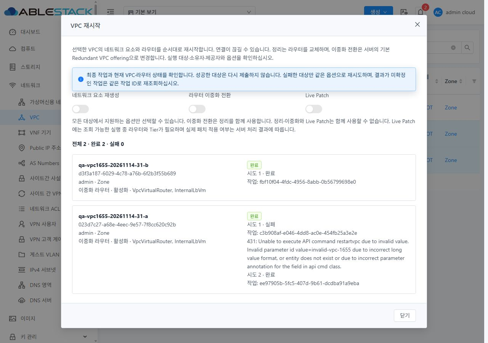

<!--
Licensed to the Apache Software Foundation (ASF) under one
or more contributor license agreements.  See the NOTICE file
distributed with this work for additional information
regarding copyright ownership.  The ASF licenses this file
to you under the Apache License, Version 2.0 (the
"License"); you may not use this file except in compliance
with the License.  You may obtain a copy of the License at

  http://www.apache.org/licenses/LICENSE-2.0

Unless required by applicable law or agreed to in writing,
software distributed under the License is distributed on an
"AS IS" BASIS, WITHOUT WARRANTIES OR CONDITIONS OF ANY
KIND, either express or implied.  See the License for the
specific language governing permissions and limitations
under the License.
-->

# VPC-05 / #1655 구현·31/32 배포·UI 검증 보고서

VPC 단일/일괄 재시작에서 `cleanup`, `makeredundant`, `livepatch`를 명시 boolean으로 전달하고,
대상별 최종 결과·시도별 작업 ID·오류를 유지하도록 수정했다. 성공한 대상은 다시 제출하지 않으며,
실패·미실행 대상만 재시도한다. 미확정 작업은 같은 ID로 조회하고 결과 확인 전 새 제출을 차단한다.
31(GFS2)·32(RBD)에 배포하고 실제 UI·API 결과와 VM 표준 스타일을 검증했다.

## 범위와 최종 소스

- 기준: `9c62ea852a62139585133c8c557dcdc1e1d589c3` (#1654 증적 완료).
- 주 구현: `7142c37347cf2bf3e3e6fa0b7a10264bdf0c3e89`.
- 중단 후 미실행 복원: `1ec052df7defc830d1bc3f560daa5257469ba7bb`.
- **최종 제품·빌드·배포·UI 검증 소스: `281e9758c04137f42475ca3742acf34f3f0ba339`.**
- Epic 브랜치 `dhslove/epic-1650-vpc`, 누적 Draft PR #1660 → `ablestack-europa`. 병합하지 않는다.
- 이번 변경은 UI 제품/테스트 8개 파일이며 Epic 누적 UI 변경은 25개 고유 파일이다.
  일반 네트워크 RestartNetwork와 공통 tracker/인증/API/서버/호스트 구현은 변경하지 않았다.
  전체 VPC breadcrumb/목록/상세/탭 통합은 #1658에 남긴다. 별도 이슈는 생성하지 않았다.

## 실환경 설계 실증

[설계](DESIGN.ko.md)와 [집계](evidence/design-summary.json)를 함께 본다.

수정 전 실제 UI 일괄 재시작은 양쪽 각 2 POST에 ID만 있었고 세 옵션이 누락됐다.
Live Patch를 켠 UI와 wire가 불일치했다. 4개 중 3개 job 성공, 31의 1개는 실제 job=2였다.
이 실패는 라우터 시작의 `SHARED_RAW_BUSY: disk protection is being changed`였고 일반 재시도로 성공했다.
해당 서버/호스트/보호 설정은 수정하지 않았다.

각 클러스터에서 6조합, 총 12개 실제 재시작을 추가 실행해 모두 job=1을 확인했다.
명시 false, 세 옵션 생략, 실제 Live Patch, cleanup+patch, 이중화+patch,
이미 이중화된 대상에 전환 요청을 대조했다. 서버는 cleanup을 patch보다 우선하며,
이중화는 기본 Redundant VPC offering으로 변경하고 cleanup을 강제했다.
UI는 cleanup/전환과 patch의 동시 선택을 막고 전환 시 cleanup을 켠다.

31 r-1060-VM·32 r-540-VM의 실제 패치 성공 관리 로그, cleanup 후 라우터 교체,
이중화 전환 후 기본 오퍼링·flag·Running 라우터 2개를 확인했다.
추가로 일반 사용자/프로젝트의 정상 재시작 2건, 타 소유 VPC 재시작 531 거부 2건,
타 소유 VPC 조회 빈 응답 2건을 대조했다. **설계·권한 18건**이며 수정 전 UI 4건과 구분한다.

현재 `queryAsyncJobResult`는 Vpc type을 주지만 instance UUID가 없고,
resourceid+Vpc의 완료 작업 목록도 빈 응답이다. UI는 제출 전 저장한 customjobid와
user/선택 문맥을 묶고 반환 jobid/명령/user 및 제공된 instance를 검증한다.
대상 UUID가 없는 소유자 범위의 미해결 VPC job은 보수적으로 새 실행을 막는다.
이 제한을 서버 job view 변경으로 확대하지 않았다.

일반 사용자에는 `listRouters`가 노출되지 않았다. 기본 재시작은 제공하되
조회 가능한 Running 라우터·Tier가 필요한 Live Patch는 비활성화한다.

## 구현 동작

- VPC 전용 `vpcRestart.js`와 단일/일괄 공용 `RestartVpc.vue`를 사용한다.
  VPC groupMap에도 동일 옵션 매핑을 적용하고 Autogen에는 고정 대상 전달 분기만 추가했다.
- 전체 선택과 각 대상 제출 직전에 owner/project/Zone/상태·오퍼링/제공자·Tier·노출 라우터·진행 작업을 다시 읽는다.
  불가 대상이 섞인 최초 선택은 전체 제출을 막는다. 조회는 15초로 제한해 기본 긴 HTTP 대기를 피한다.
- 대상별 순차 제출 후 공통 `createJobTracker`로 최종 job을 확인하고 현재 VPC/노출 라우터를 대조한다.
  단순 HTTP 접수를 완료로 표시하지 않는다. 시도별 ID·오류와 성공한 대상은 유지한다.
- 실제 전환 실패로 flag/오퍼링만 바뀐 경우 현재 값을 다시 읽는다.
  같은 UUID/owner/Zone와 정확한 기본 이중화 오퍼링으로 바뀐 경우만 원 옵션의 정리 재시도를 허용한다.
- 인증정보 없는 최소 기록을 user/role/project/선택 UUID별 sessionStorage에 보존한다.
  작업 중 화면 이동 후 재열기는 진행 항목을 미확정, 아직 제출하지 않은 항목을 재시도 가능 상태로 복원한다.
  늦은 응답이 다른 대상 창을 갱신하거나 나머지 작업을 제출하지 않는다. 기록 저장 실패는 새 제출을 막는다.
- VM 공통 MoldDialog(lg)/MoldDialogActions, 고정 header/footer와 본문 스크롤·테마 토큰을 재사용했다.
  대상 이름/UUID/소유자·프로젝트/Zone/제공자/단일·이중화와 중단 영향을 보여준다.

## 배포 후 실제 UI 검증

아래 POST 수는 customjobid로 중복 제거했다. 재조회/재개 전후 캡처가 겹쳐도 합산하지 않는다.
각 캡처의 gaps=false이며 모든 접수 job은 별도 admin API로 최종 성공을 대조했다.

| 시나리오 | 31 | 32 | 관찰 |
|---|---:|---:|---|
| 두 대상 Live Patch, 실제 Ctrl+Enter | 2 | 2 | 모든 대상에 false/false/true 전달, 최종 성공 |
| 단일 전환/정리 | 1 | 1 | 31 true/true/false 전환·Running 2개, 32 true/false/false 라우터 교체 |
| 삭제된 R+정상 B 혼합 선택 | 0 | 0 | 실행 직전 전체 차단, 정상 B도 미제출 |
| 부분 HTTP 거부 후 실패 대상만 재시도 | 3 | 3 | 먼저 성공한 대상 ID 유지, 실패한 대상 1 POST만 재제출 |
| 미확정/문맥 변경 후 복원·재조회·미실행 재개 | 2 | 2 | 최초 1개와 재개 1개, 기존 작업 재제출 0 |
| 합성 terminal 실패 후 실패 대상만 재시도 | 해당 없음 | 3 | 실제 서버 성공과 UI 분기 주입을 분리 |
| 일반 사용자/프로젝트 | 1 | 1 | owner/project 범위 정확, 기본 재시작 성공 |
| **합계** | **9** | **12** | **21 POST = 실제 job 성공 19 / 실제 HTTP 431 거부 2** |

부분 HTTP 거부는 각 클러스터의 **두 번째 요청 ID만 전송 중 invalid-vpc-1655로 변조**했다.
실제 서버의 431을 표시했으며 UI가 사용자의 정상 ID를 잘못 생성한 결함으로 계산하지 않는다.
폼·옵션·성공 결과·거부 오류와 로컬 customjobid를 보존했다. 재시도는 원 대상만 1회 실행했다.

32 조회 통신 실패는 동일 작업 조회 3회를 브라우저에서 실패시켰다. 첫 항목은 미확정,
두 번째는 미실행으로 남고 재시도 버튼은 잠겼다. 닫기/재열기 후 같은 job을 조회해
성공으로 확인할 때 POST는 0이며, 이후 미실행 항목만 1회 실행했다.

31은 첫 작업 조회 응답을 잠시 보류한 채 다른 VPC 상세로 이동하고 응답을 재개했다.
다른 단일 대상 창은 idle·새 이력으로 열렸고 추가 제출은 없었다.
원래 두 대상을 재열면 첫 작업은 같은 ID의 미확정, 나머지는 미실행으로 복원됐다.
동일 job 재조회 후 나머지만 실행했고 최종 두 대상 모두 성공했다.
늦은 응답 본문 자체는 별도 파일로 저장하지 않았으며 해당 서버 job 성공을 독립 대조했다.

32 terminal 분기 시험은 실제 job=1 응답 한 건을 **브라우저에서만 job=2/530으로 주입**했다.
UI가 실패·오류를 유지하고 다음 대상을 처리했으며 실패한 대상만 재시도했다.
실제 서버 terminal 실패를 배포 후 유발했다고 주장하지 않는다.
실제 job=2는 수정 전 31 실증에만 있고, 부분 전환 실패의 최신 메타데이터 표시는 집중 테스트로 검증했다.

작업 중 옵션/중복 제출/닫기 가드, 혼합 단일·이중화의 전환 비활성,
31 소유자 범위 pending 가드와 완료 후 해제도 확인했다.
일반 사용자 31 소유 VPC 및 32 소속 프로젝트 VPC는 각각 1 POST/job=1이었다.
모든 역할·도메인·외부 제공자 조합이나 별도 Escape/보조 키 입력까지 실행한 결과는 아니다.

주요 증적:

- [31 UI 시나리오](evidence/31-ui-cases.json), [32 UI 시나리오](evidence/32-ui-cases.json)
- [31 독립 job 대조](evidence/31-ui-job-oracle.json), [32 독립 job 대조](evidence/32-ui-job-oracle.json)
- [31 화면 문맥 복원](evidence/31-late-original-restored.json), [32 미확정 복원](evidence/32-unknown-restored.json)
- [32 합성 응답/원래 성공 응답](evidence/32-terminal-response-fault.json)

## VM 표준 스타일

2클러스터 × light/dark × 360/768/1280px, 높이 900px **12조합**을 통과했다.
부분 실패의 긴 UUID·한국어·영문 431 오류를 포함해 modal이 viewport 안에 있고
본문/푸터 가로 넘침이 없으며 본문 스크롤 중 푸터를 사용할 수 있음을 대조했다.
모바일 하단은 양쪽 테마별 **4회** 스크롤 입력을 보냈다. 31의 두 캡처는 긴 오류/시도 이력과
고정 재시도 버튼을 확인했다. 32의 두 캡처에는 스크롤 뒤 본문 일부가 그려지지 않은 구간이 있어
긴 오류 전체의 시각 검증 근거로 사용하지 않는다. 32 결과 DOM에는 전체 오류/이력이 있고
캡처의 고정 버튼도 보이지만, 하단 치수 측정은 스크롤 반영 전 scrollTop=0이므로
네 번 모두 완전한 하단 시각 검증을 통과했다고 주장하지 않는다.
이 창은 switch 3개이며 select popup은 없어 popup 시험은 해당하지 않는다.

[치수·테마·통과 판정](evidence/style-matrix.json), [모바일 하단](evidence/style-lower.json),
[43개 원본 캡처의 형식·크기·SHA256](evidence/screenshot-manifest.json)을 보존했다.
[하단 캡처의 최종 검수 한계](evidence/mobile-lower-review.json)를 함께 적용한다.
새 스타일 시스템이나 전체 VPC 화면 재설계는 추가하지 않았다.

## 집중 검사와 빌드·배포

- **3 suites / 96 tests 통과**, 실패 0. 새 정책·컴포넌트와 기존 RestartNetwork 회귀 포함.
  최종 실행은 coverage=false로 전체 트리 coverage 처리를 제외했다. [결과](evidence/unit-result.json).
- 변경 JS/Vue/테스트 6개 lint(no-fix), 신규 4개 codespell, locale JSON 파싱 통과.
  보고서 Markdown/JSON·UTF-8·비밀정보 검사와 git diff 공백 검사도 별도로 수행했다.
- WSL ext4에서 UI production build **690.9초 성공**. Node20.20.2/npm10.8.2 기존 환경,
  새 npm ci 미실행. 빌드 후 소스 설정을 복원하고 UI 소스 clean을 확인했다.
  앞선 7142/1ec 빌드는 실증 경계 보완을 위해 각각 중단했고 **배포하지 않았다**.
- [빌드 receipt](evidence/build-result.json)의 app은 `js/app.d82fbbd2.js`,
  index SHA256은 `14294ac7f457c716953b651b6b5528d565f112ba8508afe94b308eb79e48a012`다.
- 31/32 활성 `/usr/share/cloudstack-management/webapp`에 정적 allowlist만 갱신했다.
  각각 **693개 / 31,355,254 bytes, 해시 차이 0**이다.
  WEB-INF/META-INF·런타임 설정·JAR/PID를 보존하고 전후 `/client/` HTTP200을 확인했다.
  기존 VPC 오퍼링/사설 게이트웨이와 FTCTL marker도 유지했다.
- [31 배포](evidence/31-deployment.json), [32 배포](evidence/32-deployment.json).
  원본 정적 백업은 WSL `/home/ablecloud/work/vpc1655-20261114/backups/20261114-150811/{31,32}/static-backup.tar.gz`에 보관한다.
  SHA256은 31 `58d05c45f2409ee727299e60a25e013291b5692829cfa6d97361a5231db24a2b`,
  32 `ea8680ffdb784c2e8ae35ff2b74b161976703b05cf5f35ce6a46912a32a54f99`다.

## 정리와 보존

전용 이름 prefix와 UUID 대장을 확인해 **VPC 8/Tier 4/계정 2/프로젝트 1** 및 자동 라우터를 정리했다.
삭제된 대상 혼합 시험에서 먼저 제거한 빈 VPC 2개도 같은 대장의 삭제 성공으로 포함했다.
API 정상 삭제만 사용했으며 DB/호스트 파일 수동 수정은 없다.
기존 12종 UUID 집합·선택 주요 필드 차이는 모두 0이다.

| 종류 | 31 전→후 | 32 전→후 |
|---|---:|---:|
| VPC / 라우터 | 2/20 → 2/20 | 1/10 → 1/10 |
| 사용자 VM | 132 → 132 | 58 → 58 |
| 네트워크 / ACL | 31/4 → 31/4 | 16/2 → 16/2 |
| VPC 오퍼링 / Zone / 물리망 | 7/1/2 → 7/1/2 | 7/1/2 → 7/1/2 |
| 계정 / 프로젝트 | 26/7 → 26/7 | 22/5 → 22/5 |
| 사설 게이트웨이 / Static route | 0/0 → 0/0 | 0/0 → 0/0 |

[31 보존](evidence/31-preservation.json), [32 보존](evidence/32-preservation.json),
[별도 FTCTL 파일 해시 보존](evidence/ftctl-preservation.json)을 확인했다.
UI prefix 검색은 양쪽 0건이고 검색 해제 후 기존 VPC는 각각 2/1개다.
관리자·기본 보기·라이트 테마 및 임시 viewport/Fetch/cache 설정을 복원했다.

## CI와 판정 한계

제품 281e의 [충돌 검사](https://github.com/ablecloud-team/ablestack-cloud/actions/runs/43563830885)는 통과했다.
[License](https://github.com/ablecloud-team/ablestack-cloud/actions/runs/43563830851)는 기존 Unknown **4,079건**으로 실패했다.
이번 JS/Vue/테스트 6개와 DESIGN은 RAT에서 AL이다.
[전체 pre-commit](https://github.com/ablecloud-team/ablestack-cloud/actions/runs/43563830839)도 실패했다.
전역 이미지/라이선스/개행/실행 권한/링크/오탈자/Python/Markdown 항목이 포함된다.
이번 RestartVpc.vue도 전역 license hook의 수정 목록에 있지만 기존 Vue의 표준 HTML Apache 헤더와 동일하고 RAT는 AL이다.
// 형식을 Vue에 삽입하는 전역 hook이나 기존 전체 트리 문제를 이번 범위로 확대 수정하지 않았다.
[원본 CI 판정 요약](evidence/source-ci.json)을 보존하며 **전체 CI green이나 병합을 주장하지 않는다**.

전체 Cloud/Maven/JAR/RPM 빌드 및 서버·호스트 배포는 없다.
이전 일반 네트워크 NAT/PF/LB/ACL/VPN/태그/코멘트·패킷 회귀를 반복하지 않았다.
Live Patch 요청·실제 패치 로그와 최종 상태를 검증했으나 무중단 트래픽·페일오버 성능을 검증한 의미는 아니다.
NSX/Netris/Netscaler/IPv6/BGP, 모든 역할과 프로젝트 조합, 브라우저 응답 완전 유실 전수 시험은 미실행이다.

이슈 #1655의 6개 완료 기준은 위 집중 범위에서 충족한다.
Epic은 이 항목 완료 후 **5/9**이며 #1656~#1659는 Open으로 남긴다.
