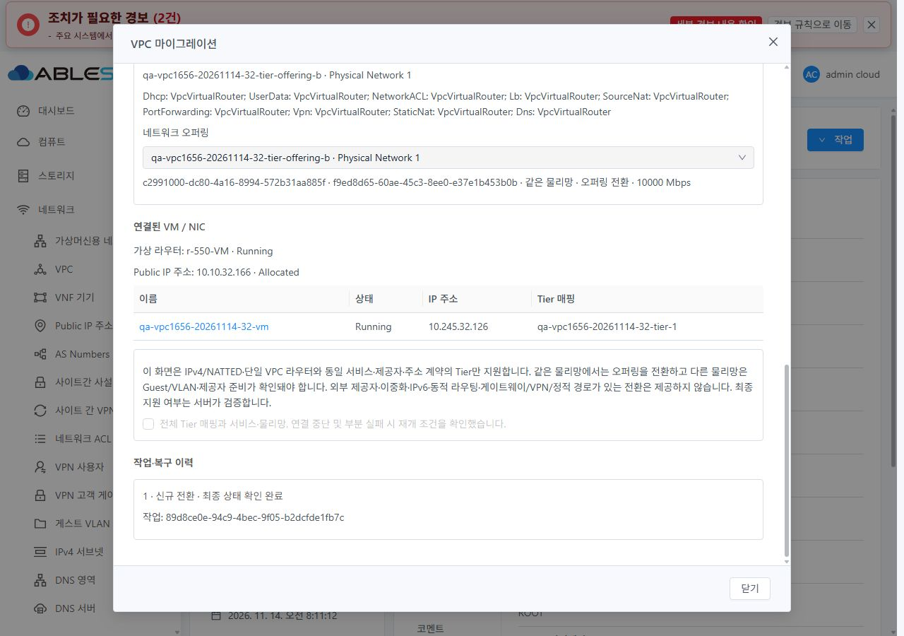

<!--
Licensed to the Apache Software Foundation (ASF) under one or more
contributor license agreements. See the NOTICE file for copyright ownership.
The ASF licenses this file under the Apache License, Version 2.0.
http://www.apache.org/licenses/LICENSE-2.0
Unless required by applicable law or agreed to in writing, software
distributed under the License is distributed on an AS IS BASIS,
WITHOUT WARRANTIES OR CONDITIONS OF ANY KIND, either express or implied.
-->

# #1656 관리자 VPC 전환·Tier 매핑·부분 실패 재개

VPC 상세의 관리자 작업에 `migrateVPC` UI를 추가했다. VPC 오퍼링과 모든 Tier를
함께 검증하고, 접수와 최종 완료를 구분하며, 실제 서버 체크포인트로만 재개한다.
31 GFS2/32 RBD에서 같은 물리망의 오퍼링 전환을 실증했다.
다른 물리망 이동이나 외부 제공자 전환의 성공을 뜻하지 않는다.

- 범위: [#1656](https://github.com/ablecloud-team/ablestack-cloud/issues/1656),
  Epic [#1650](https://github.com/ablecloud-team/ablestack-cloud/issues/1650),
  누적 Draft PR [#1660](https://github.com/ablecloud-team/ablestack-cloud/pull/1660).
- 작업 브랜치: `dhslove/epic-1650-vpc`. 제품 구현 `487f254e868104509de6c380ab4a137a624ac7cb`,
  완료 표시·복원 검증 보완 `95305daaed94c67d92501245ee98b3a7e69fee4f`.
- [채택 설계와 복구 계약](DESIGN.ko.md). 기존 #1563의 물리망 해석·제공자 진단·
  체크포인트 검증과 공통 collection/job tracker를 재사용했다.
- 일반 네트워크 NAT/PF/LB/ACL/VPN·스토리지 드라이버 회귀를 반복하지 않았다.
  기존 FTCTL 작업과 테스트 자원을 보존했다. 별도 이슈를 생성하지 않았다.

## 채택 범위와 제출 조건

| 항목 | UI 정책과 근거 |
|---|---|
| 권한 | Root Admin과 필요한 17개 API가 모두 있는 VPC 상세에서만 제공. 일괄 작업 없음 |
| 소유 범위 | VPC/모든 Tier/기존 숨김 복사본의 owner·domain·project·Zone 일치 확인. 활성 프로젝트와 다른 대상 차단 |
| VPC 후보 | IPv4/NATTED·단일 VPC 라우터·같은 서비스/제공자와 conserve 계약·Enabled·접근 범위 일치 |
| Tier 후보 | VPC용 Isolated/Guest·같은 주소/서비스/제공자/capability 계약. 미완료 Tier는 현재와 다른 오퍼링 필요 |
| 물리망 | 유일한 대상 해석, Enabled·Guest/VLAN·제공자/라우터 요소 준비 확인. 기존 물리망 설정 변경 없음 |
| 영향 표시 | VPC와 모든 Tier 이름/ID·owner·CIDR·서비스·제공자·현재/대상 물리망·VM/NIC·Public IP·연결 중단/부분 실패 안내 |
| 제출 | 모든 Tier 명시 매핑과 영향 확인 동의 필수. 제출 직전 현재/대상 fingerprint와 제공자 준비 재검증 |
| 재개 | 서버 `migration` 태그와 인증 API의 이전 VPC 조회가 일치할 때만 허용. 목적 VPC와 완료 Tier 고정, 전체 매핑 제출 |
| 제외 | 외부 제공자·HA/distributed/region VPC·IPv6·동적 라우팅·private/VPN gateway/정적 경로 구성. 조회 실패는 빈 목록 성공으로 처리하지 않음 |

`listVPCOfferings` 응답에는 HA 여부가 없어서 단일/이중화 후보를 안전하게 구분할 수 없었다.
기존 VO/DB 값을 읽는 `redundantvpcrouter` boolean 응답 필드와 DAO 설정만 추가했다.
DB 스키마·마이그레이션 엔진·권한 API·호스트 구현 변경은 없다.
실제 기본 오퍼링 `false`, Redundant 오퍼링 `true`를 양쪽에서 확인했다.

## 설계 시 실제 API 실증

전용 prefix `qa-vpc1656-20261114-{31,32}`로 각 VPC 2 Tier를 구성했다.
물리망은 기존 기본 untagged Guest/VLAN과 `qa-pvlan1599`를 조회했고 설정을 바꾸지 않았다.
후자는 VPC 라우터 제공자가 비활성이라 제출 차단 대조군으로만 사용했다.

| 실제 실행 | 31 GFS2 | 32 RBD |
|---|---|---|
| 같은 물리망의 VPC/2 Tier 오퍼링 전환 | job 1 | job 1 |
| 부분 실패 | 두 번째 Tier의 Firewall 서비스 불일치로 첫 Tier 이동 후 job 2 | Firewall 경우는 복사 전 거부. 별도 NoVpn 조합으로 첫 Tier 이동 후 실제 job 2 |
| 잘못된 재개 | 다른 목적 VPC/완료 Tier 매핑 변경 각각 job 2·기존 자원 유지 | 동일 조건 각각 job 2·기존 자원 유지 |
| 서버 체크포인트의 정상 재개 | 전체 매핑·같은 목적지 job 1 | 전체 NoVpn 매핑·같은 목적지 job 1 |
| 실행 중 VM 연결 Tier 전환 | job 1·VM/NIC 보존 | job 1·VM/NIC 보존 |
| 두 번째 Tier 매핑 누락 | 복사 전 job 2·상태 유지 | 복사 전 job 2·상태 유지 |
| 체크포인트 없는 `resume=true` | 현재 오퍼링이면 job 1 no-op | 동일. 서버의 boolean만으로 재개 권한을 판단할 수 없음 |

마이그레이션 job **16건=성공 9/의도한 실패 7**이다. 별도로 일반 사용자 자신의/다른
소유 VPC 전환 거부와 다른 소유 조회 빈 응답을 각각 확인한 **6건**, 총 설계·권한 22건이다.
fixture 생성/조회는 이 수에 합산하지 않는다. 기록은
[31 설계](evidence/31-design.json), [32 설계](evidence/32-design.json),
[31 권한](evidence/31-role-negative.json), [32 권한](evidence/32-role-negative.json)에 있다.
32의 초기 provider 사전 거부를 부분 이동 성공으로 계산하지 않는다.

## 작업 추적과 실제 UI 검증

최소한의 입력·원래 자원·작업 이력을 owner/project/user/role별 sessionStorage에 보존한다.
인증 정보는 저장하지 않는다. 미리 만든 customjobid로 한 번 POST하고, 접수 유실/조회 오류는
미확정으로 표시해 새 전환을 막는다. 같은 ID를 다시 조회하며 자동 재전송하지 않는다.
조회 제한 15초, 공통 tracker 주기 2초·조회 재시도 2회·전체 10분 제한을 적용했다.
페이지/프로젝트/로그인/권한 변경 후 늦은 응답은 무효화한다.

최종 job 1만으로 완료하지 않는다. 실제 VPC UUID/owner/CIDR/오퍼링,
모든 Tier ID/부모/오퍼링/물리망/related-self/체크포인트 해제,
VM NIC ID/IP/MAC/소속/상태와 Public IP ID/주소/NAT 연결을 대조한다.
완료 후에는 실제 대상 오퍼링 이름과 물리망을 표시하고, 재열기 시에도 자원을 다시 검증한다.

확인된 실제 UI 결과:

- 양쪽 매핑 누락/동의 전 제출 차단, 미준비 물리망 제공자 진단 실패·제출 차단.
- 31 Running VM의 2 Tier 정상 전환. 실제 Ctrl+Enter로 전체 매핑 1회 제출 후 최종 완료.
- 31 두 번째 Tier만 테스트 wire에서 불일치 오퍼링으로 바꿔 실제 서버 job 2 발생.
  첫 Tier/VM 이동과 보존된 이전 VPC를 표시했다. 목적지와 완료 Tier 고정,
  남은 Tier만 수정 가능한 상태에서 전체 매핑 `resume=true`로 실제 job 1 복구.
- 32 조회 요청 3회를 브라우저에서 통신 실패로 주입. 새 POST 없이 미확정/재열기 복원,
  같은 customjobid를 명시 재조회해 실제 서버 job 1 및 자원 상태 확인.
- 32 프로젝트 소유 VPC를 Root Admin으로 실제 전환. 일반 사용자와 프로젝트 사용자
  UI에는 마이그레이션 메뉴가 없었고 직접 API 권한 거부는 위 6건과 대조했다.
- 31 조회 응답을 보류한 채 주소를 VPC 목록으로 이동한 뒤 해제해 대화상자/쓰기 부활 없음.
  가려진 breadcrumb 클릭은 이동이 일어나지 않아 이 판정의 근거로 사용하지 않았다.

UI 최종 표시 보완 후 추가 실행과 총계: **최종95305에서 31 일반 사용자 소유 VPC를 Root Admin으로 전환하고, 32 Running VM 연결 2 Tier를 실제 Ctrl+Enter로 다시 전환했다. 양쪽 job 1·오퍼링 이름/물리망 표시와 최종 자원 확인 통과. UI 실제 작업 총 **7건=job 1 성공 6/의도한 실제 job 2 실패 1**이며 실패 재개 1건을 포함한다. 최종 두 작업의 wire 전수 캡처는 없으므로 UI 작업 ID와 별도 서버 oracle로 연결한다. 진행 중 비활성 컨트롤과 단위 가드를 검증했으며, 추가 키 입력을 보내지 못한 자동화 시도를 중복 키 입력 실증 PASS로 계산하지 않는다**.
실제 부분 실패는 31 UI와 양쪽 설계 API에서 검증했다. 조회 통신 실패 주입과
실제 서버 실패를 구분하며, 32 UI의 실제 부분 실패를 추가로 주장하지 않는다.
CDP의 전체 시간 구간 요청 로그를 전수 캡처했다는 주장도 하지 않는다.
특히 Fetch로 변조한 31 부분 실패 요청은 별도 원본→변조 증적과 서버 job으로 연결했다.

별도 API 세션의 [31 최종 oracle](evidence/31-ui-server-oracle.json),
[32 최종 oracle](evidence/32-ui-server-oracle.json)이 각 UI 작업과 VM/NIC를 대조한다.
기존 NAT 규칙/실제 패킷·무중단·장애 조치·외부 제공자 동작까지 검증한 결과는 아니다.

## 테스트·빌드·배포

| 검증 | 결과 |
|---|---|
| UI 집중 회귀 | 신규 utility/view와 기존 NetworkMigration/RestartVpc **4 suites/153 tests 통과** |
| UI 코드 | 변경 JS/Vue/fixture/test 6개 lint(no-fix) 통과. locale JSON·공개 증적 UTF8/LF/인증값 검사, 신규 코드5개+문서2개 codespell·Markdown2개 검사 통과 |
| Java | API 모듈 install(skipTests), server 집중 **21 tests 통과** 및 모듈 package. 응답 serialization 4건과 기존 NetworkMigrationRequestTest 17건 |
| Java 스타일 | 변경 Java 3파일 한정 Checkstyle 통과. 처음 API 전체 검사는 pom 고정 include로 기존 46건 실패했으며 전체 통과로 보고하지 않음 |
| UI production build | 초기487f 691.7초 성공. 최종95305 **692.5초 성공·sourceUiClean=true·app.030dff08.js·migration chunk-1fec2529.853dcc75.js** |
| 빌드 환경 | WSL ext4, Node20.20.2/npm10.8.2 기존 의존성. 새 npm ci/전체 Cloud/RPM/qemu/호스트 빌드 없음 |

Java 변경은 API/server 모듈만 빌드했다. 배포 서버의 실제 서비스는 `mold.service`,
JAR은 `/usr/share/cloudstack-management/lib/cloudstack-4.23.0.0-ABLESTACK.Mold.jar`다.
이 단일 uberJAR의 response/DAO **2개 class entry만 원자 교체**했다.
다른 entry와 별도 8개 JAR·설정/WEB-INF는 보존했고 양쪽 새 PID/HTTP200·linkage 오류 0을 확인했다.

| JAR 배포 | 31 | 32 |
|---|---|---|
| 새 PID | 2108521 | 2422731 |
| JAR SHA256 | `0d084f8c75724ab7c8341ed89fa681234f8a246a14b188f44cfadb05198f64f9` | `781fead1877e4f29c1344f6b3e164866e1ea9986e4c45138995e25e6de2a0e47` |

UI는 활성 `/usr/share/cloudstack-management/webapp`의 허용된 정적 자산만 갱신했다.
루트 전체 교체/`rsync --delete`를 사용하지 않았다. WEB-INF/META-INF·설정·서버 자산 보존,
HTTP200·배포 manifest 해시·기존 VPC/FTCTL marker를 대조했다.
최종 번들/파일 수/백업: **각 **695개/31,419,731 bytes**, 해시 차이0, index SHA256 `8d3ba0e7df2ddf16181fe446b105b2002de8fd31cc8dc124abbbd57e50fb0462`. 양쪽 remote stage `/var/tmp/vpc1656-20261114-170350`, WSL 백업 `backups/20261114-170350/{31,32}`. 정적 백업 SHA256 31 `344364928427b709a93bf6b9f4fdd3a0caedfe792585888ebdf504be3e34ee14`, 32 `11864dc148a9098875aa24945182b9d25e73552bce718e850e6a3a8746990572`. 서버 자산·기존 FTCTL/VPC marker 보존, HTTP200**.

JAR 백업은 WSL `vpc1656-20261114/backups/backend/vpc1656-backend-20261114-163043/{31,32}`에,
정적 백업은 같은 작업 폴더의 `backups/<배포시각>/{31,32}`에 보존했다.
JAR 준비 시 잘못 가정한 별도 JAR/서비스명과 부족한 `/dev/shm` 공간은 배포 전에 발견했다.
그 시도에서는 JAR/서비스를 바꾸지 않았고, 본 작업의 불완전 백업만 제거했다.
완전 백업을 `/var/tmp`와 WSL에 확보한 뒤 적용했다. 다른 `/dev/shm` 파일은 정리하지 않았다.

## VM 스타일와 화면 검증

VM 화면의 실제 breadcrumb/상세/탭/작업 메뉴와 편집 창을 비교 기준으로 관찰했다.
새 창은 기존 MoldDialog(lg)/MoldDialogActions·전체 viewport 중앙·고정 header/footer·
본문 내부 스크롤·테마 토큰·14px 글자·동일한 버튼/키보드 가드를 사용한다.
완료 화면이 UUID만 표시하던 문제와 같은 물리망에도 다른 물리망을 선택하라는 문구를 보완했다.
전체 VPC 목록/상세/탭 스타일를 새로 수정하는 #1658 범위로 확대하지 않았다.

최종 반응형/테마/popup/하단 스크롤 결과: **양쪽 light/dark × 360×800·768×900·1280×900 **12조합**, 실제 모바일 하단 **4개 캡처**를 모두 시각 확인했다. 본문 수평 넘침0, footer/창 경계가 viewport 내부이며 하단 스크롤 도달을 확인했다. VM 표의 별도 가로 스크롤은 유지한다. 모바일 VPC 선택 목록(light)과 Tier 선택 목록(dark) 각각 양쪽 **4개 popup**이 화면 안에 표시됐다. 전체 캡처 35개와 실제 크기는 [manifest](evidence/screenshot-manifest.json), [12조합+하단4개 좌표](evidence/style-matrix.json)에 있다. 초기 31 desktop popup 파일명은 실측1680으로 바로잡았으며 1280 검증 수에 합산하지 않았다. Escape는 공통 창의 비작업 상태 닫기 동작을 따르고 재열기 시 선택이 복원됐다**.

대표 완료 화면:

## 정리·기존 자원 보존

VM → Tier → VPC → 네트워크 오퍼링 → VPC 오퍼링 → 프로젝트 → 계정 순서로,
prefix/실제 UUID/최초 inventory를 확인한 전용 자원만 API로 정리한다.
숨겨진 이전 VPC/네트워크도 조회해 남아 있지 않은지 확인한다.
기존 12종 UUID 집합·선택 주요 설정과 계정 자원 사용량을 비교한다.
`listVPCOfferings.redundantvpcrouter` 추가만 의도한 읽기 전용 응답 차이로 분리한다.
별도 FTCTL 파일 3개 해시도 최초 값과 대조한다.

최종 정리·UI prefix0·환경 복원 결과: **전용 **VM2/Tier6/VPC4/네트워크 오퍼링9/VPC 오퍼링5/계정2/프로젝트1** 총29개를 API로 정리했다. 자동 라우터와 숨김 migration 복사본도 남지 않았다. 양쪽 기존 **12종 UUID 집합·정규화한 주요 설정·계정 사용량 차이0**, 의도한 HA 응답 필드 추가만 분리했다. 서비스/제공자 배열의 재시작 후 순서 차이는 원본을 유지하고 정규화 값 일치로 기록했다. 32 첫 정리 사전 조회는 프로젝트 Tier가 기본 보기에서 보이지 않아 멈췄으며, 실제 projectid를 명시한 뒤 같은 UUID만 정리했다. DB 수동 수정 없음. UI 테스트 prefix0, 기존 VPC2/1 복원, admin/기본 보기/라이트·viewport/Fetch/cache 임시 설정 복원과 FTCTL3파일 보존 확인. [31](evidence/31-preservation.json)·[32](evidence/32-preservation.json) 보존 증적**.

## CI와 검증 한계

제품95305의 [충돌 검사43573060858](https://github.com/ablecloud-team/ablestack-cloud/actions/runs/43573060858)는 통과했다.
[License43573060866](https://github.com/ablecloud-team/ablestack-cloud/actions/runs/43573060866)은
기존과 같은 Unknown/Unapproved 4,079건으로 실패했다.
전역 lint와 증적 HEAD 상태: **[전역 pre-commit43573060868](https://github.com/ablecloud-team/ablestack-cloud/actions/runs/43573060868)도 실패했다. oxipng/license/기존 파일 실행권한·symlink·줄바꿈·codespell·flake8·markdownlint 전역 hook들이 실패했고, 이번 MigrateVpc.vue도 전역 insert-license 수정 목록에 있다. 헤더는 기존 RestartVpc.vue와 같은 표준 HTML Apache 헤더이며, Vue에 다른 헤더를 삽입하는 공통 hook을 이 이슈에서 수정하지 않았다. 이번 범위의 lint/검증은 별도 통과 결과로 보고한다. [현재 제품 CI](evidence/source-ci.json)·[hook 진단](evidence/source-lint-diagnostics.json). 증적 HEAD 자동 CI는 최종 Epic/PR 업데이트에서 별도 기록한다**.
전체 CI green을 주장하지 않고 기존 전역 hook/라이선스 문제를 이 이슈에서 확대 수정하지 않는다.
전체 Cloud 빌드는 요청/실행하지 않았다. PR은 Draft·미병합으로 유지한다.
