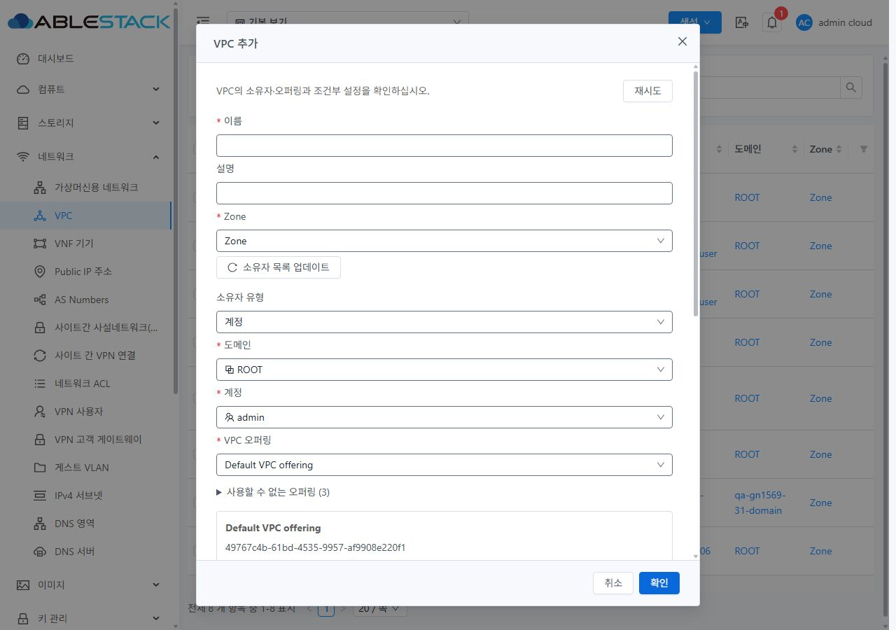
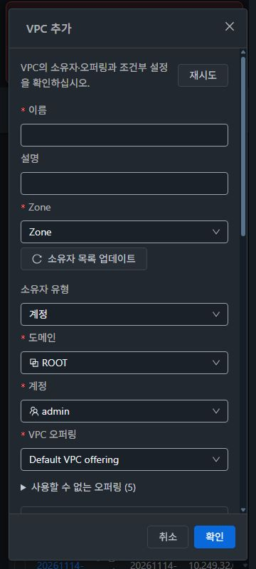

<!--
Licensed to the Apache Software Foundation (ASF) under one
or more contributor license agreements.  See the NOTICE file
distributed with this work for additional information
regarding copyright ownership.  The ASF licenses this file
to you under the Apache License, Version 2.0 (the
"License"); you may not use this file except in compliance
with the License.  You may obtain a copy of the License at

  http://www.apache.org/licenses/LICENSE-2.0

Unless required by applicable law or agreed to in writing,
software distributed under the License is distributed on an
"AS IS" BASIS, WITHOUT WARRANTIES OR CONDITIONS OF ANY
KIND, either express or implied.  See the License for the
specific language governing permissions and limitations
under the License.
-->

# #1657 VPC 생성 조건·후보·입력 보존 검증

제품 UI는 `85ca902dd1e1b93cf10b52a09c4edff79b711632`이며 기준은
`330ced29fc019185b09d25cf316f54175067adba`다. 2026-11-14에 31 GFS2/32 RBD의
실제 Mold API와 UI를 검증하고 양쪽 활성 webapp에 배포했다.
서버·DB·호스트 코드는 변경하지 않았다. [최종 집계](evidence/verification-summary.json),
[채택 정책과 실환경 설계](DESIGN.ko.md)를 함께 확인한다.

## 개선 결과와 범위

- VM 기준의 공통 `MoldDialog`/`MoldDialogActions`, 테마 토큰, 본문 스크롤과 고정 푸터를
  VPC 생성 창에 적용했다. 소유자는 기존 안전한 `OwnershipSelection`을 재사용한다.
- Zone·대상 소유 도메인·활성 오퍼링·NSX/ROUTED 조건과 기존 제공자 진단을 확인한다.
  필수 권한 없음, Zone 없음, 오퍼링 미응답/빈 후보, 조건 필터0, 제공자 부적합,
  조회 실패를 구분하고 재시도한다. 일반 사용자에게 관리자 진단 API를 강제하지 않는다.
- Zone/소유자/오퍼링 변경 시 조건부 값을 초기화하고 명시적인 whitelist로 요청을 만든다.
  DNS 미지원 오퍼링의 숨겨진 DNS, IPv4의 IPv6 DNS, NATTED의 CIDR 크기/AS,
  외부 라우터가 관리하는 Source NAT IP와 API 전용 인자를 임의로 전송하지 않는다.
- 제출 직전 최신 Zone·오퍼링·제공자·필요한 AS를 재조회한다. 로그인/역할/프로젝트/경로와
  요청 epoch를 검사하여 늦은 응답이 다른 대상의 후보를 덮어쓰지 못하게 한다.
- 동기 거부는 입력을 보존하고 명시적인 수정 재시도를 허용한다. 접수 표시 중 폼을
  재생성하지 않아 소유자 초기 조회가 CIDR·DNS·IP를 지우지 않는다. 응답 유실은 자격 증명 없는
  최소 요청/customjobid를 현재 사용자·역할·프로젝트 범위에 보존하고 같은 작업만 재조회한다.
  접수 후에는 기존 공통 job 알림을 재사용한다.
- `createVPC.bgppeerids`의 명시 생성 바인딩은 **관리자 API 전용**이다. 기존 Dynamic VPC의
  생성 후 BGP 변경 탭은 유지한다. `createPrivateGateway.networkofferingid` 고급 지정은
  **API 전용**으로 유지하고 연결 방식별 서버 시스템 기본값을 사용한다. 이 인자는
  일반 사용자 명령에도 있으므로 관리자 전용 API 인자라고 설명하지 않는다.
- 사설 게이트웨이 창에는 기본 오퍼링 정책 안내만 추가했다. 기존 #1654 기능/ACL 회귀와
  일반 네트워크·Tier·NAT/PF/LB/VPN 검증은 재사용한다. 전체 목록/상세/탭 통합은 #1658에 남긴다.

## 실환경 설계와 오류 재현

양쪽 Zone은 Advanced/Enabled, NSX false, ROUTED 플래그 true다. BGP peer/AS는 각각 0개다.
Netscaler 제공자는 없고, Netris는 구성상 Enabled일 뿐 실제 제어기/세션 준비가 확인되지 않았다.
[31 조건](evidence/31-conditions.json), [32 조건](evidence/32-conditions.json)과 API 계약 JSON을 수집했다.

| API 설계 사례 | 31 | 32 |
|---|---|---|
| 기본 IPv4 VPC, 명시 DNS | job=1 | job=1 |
| DNS 미지원 오퍼링에서 DNS 생략 | job=1 | job=1 |
| 비활성 오퍼링, No-DNS+DNS, IPv4+IPv6 DNS | 각각 접수 전 HTTP431 | 각각 접수 전 HTTP431 |
| NATTED+CIDR 크기, 미구성 BGP 참조, L2 게이트웨이 오퍼링 | 각각 접수 전 HTTP431 | 각각 접수 전 HTTP431 |

총 **16건=생성 성공4/예상 거부12**다. 모든 성공 정의는 `start=false`이고 VM·Tier·라우터를
새로 만들지 않았다. BGP/AS/기존 물리망/외부 장비를 변경하지 않았다.
[31 API 결과](evidence/31-design.json), [32 API 결과](evidence/32-design.json).

기존 UI에서는 31의 오퍼링 배열 없는 응답에서 uncaught TypeError와 재시도 안내 누락을
재현했다. 32는 DNS 입력 뒤 실제 No-DNS 오퍼링으로 전환했을 때 숨겨진 DNS가 전송되어
서버가 실제 HTTP431로 거부했다. [배열 미응답](evidence/31-before-empty.json),
[전환 요청](evidence/32-before-stale-dns-request.json), [실제 거부](evidence/32-before-stale-dns-result.json).

실환경 보완 중 미할당 범위 밖의 Source NAT IP는 Mold의 명시적인 HTTP530 거부이며
접수된 job이 없는 것을 확인했다. 최초 수정본의 미확정 잠금과 다음 수정본의 폼 재생성으로
입력이 초기화되던 문제도 이 범위에서 보완했다. [접수 전 거부 실증](evidence/31-530-rejection-oracle.json),
[중간 입력 초기화 재현](evidence/31-intermediate-rejected-inputs.json).

## UI 요청과 서버 결과

UI 생성은 **8건 모두 실제 job=1**이며 VPC UUID·소유자·프로젝트·CIDR·오퍼링·DNS와
명시한 MAC boolean을 별도 API로 대조했다. 초기 6건은 `78498bbe5cf`에서 실행했고,
마지막 두 건은 최종 제품 `85ca902dd1e`에서 실행했다. 각 기록에 소스를 구분했다.

| 클러스터 | 실제 UI 사례 | 결과 |
|---|---|---|
| 31 | Root 기본 DNS, 늦은 응답 후 선택한 사용자 소유, 일반 사용자 | 각각 job=1 |
| 31 최종 | 실제 530 거부 → CIDR/DNS/IP/이름/설명 유지 → 정상 Source NAT IP로 명시 수정 | 생성 요청1, job=1, IP의 해당 VPC Source NAT 바인딩 확인 |
| 32 | No-DNS 전환, 서버 접수 뒤 응답 유실/재열기, 일반 사용자 활성 프로젝트 | 각각 job=1 |
| 32 최종 | No-DNS 전환과 명시 MAC 유지 false | DNS 미전송, job=1, 응답 MAC=false |

[31 wire/job 목록](evidence/31-ui-jobs.json), [32 wire/job 목록](evidence/32-ui-jobs.json),
[31 서버 대조](evidence/31-ui-server-oracle.json), [32 서버 대조](evidence/32-ui-server-oracle.json).

- 실제 530 뒤 CIDR·DNS·IP가 유지됐고 Ctrl+Enter 제출과 확인 버튼의 수정 재시도를 실행했다.
  정상 IP `10.10.31.105`는 사전 미할당을 확인한 뒤 사용했다. 실패 customjobid는 존재하지 않고,
  수정 후 같은 시험 이름의 VPC는 정확히 하나다. [보존 입력](evidence/31-final-rejected-inputs.json),
  [단일 재시도](evidence/31-final-retry-wire.json), [중복 없음](evidence/31-final-rejection-oracle.json).
- 32의 응답 유실은 실제 접수된 HTTP200 응답을 클라이언트에서 끊은 시험이다. 재열기는
  같은 job ID만 조회하고 추가 생성 요청은 0건이었다. [서버 접수](evidence/32-lost-server-receipt.json),
  [같은 ID 재조회](evidence/32-reopen-proof.json). 합성 job 성공을 사용하지 않았다.
- 31의 배열 미응답/빈 배열/불완전 페이지/필터0/제공자 부적합/조회503/권한403/Zone0
  **후보 장애8건**은 각각 생성 요청0·제출 차단·같은 창 재시도 복구를 확인했다.
  조회 응답 장애 주입이며 실제 제공자/권한 설정을 변경한 것이 아니다.
  [후보 검사](evidence/candidate-checks.json). 별도 잘못된 CIDR도 UI에서 차단했다.
- 늦은 이전 소유자 빈 응답은 새 후보를 덮어쓰지 않았고, 제출 직전 오퍼링 변경은 POST 전에
  재검토를 요구했다. [소유자 경합](evidence/31-late-owner.json),
  [직전 변경](evidence/31-fresh-preflight.json). Zone/모드/로그인/역할/API 경합은 집중 단위 검사로 보완했다.
- 일반 사용자 창에는 진단 권한 미확인을 표시하고 관리자 MAC/소유자 선택을 노출하지 않았다.
  Netris 선택에서는 외부 환경 확인 동의 전 제출을 막고 직접 Source NAT 입력을 숨겼다.
  실제 외부 제공자 생성은 실행하지 않았다. 양쪽 사설 게이트웨이 기본 정책 안내도 열어 확인했으며
  게이트웨이 생성은 반복하지 않았다.

## VM 기준 스타일

[VM 목록](screenshots/vm-reference-list.jpg), [상세·탭](screenshots/vm-reference-detail.jpg),
[편집 창](screenshots/vm-reference-dialog.jpg)을 읽기 전용으로 참조했다. 공통 컴포넌트와
테마 토큰을 재사용하며 생성 내용에 맞는 md 폭을 적용했다.

최종 제품에서 **31/32 × light/dark × 360/768/1280의 12조합**을 실제 시각 확인했다.
14px 본문, 대화상자 경계·레이블·입력·선택, 본문 스크롤과 고정 푸터를 확인했다.
대화상자 가로 넘침은 0이고 푸터는 각 viewport 안에 있다.
모바일 하단4개와 후보 팝업4개도 별도 캡처로 확인했다. 긴 후보명/사유의 목록 말줄임은
기존 선택 컴포넌트의 동작이며 펼친 제외 사유로 전체 내용을 확인할 수 있다.
[측정12건](evidence/style-matrix.json), [시각 검토 집계](evidence/style-summary.json).

## 빌드·배포·보존

- **집중3 suites/89 tests**, 변경8파일 lint, 신규 코드5파일 codespell을 통과했다.
  최종 UI는 WSL ext4에서 Node20.20.2/npm10.8.2와 legacy OpenSSL 옵션으로 732.7초 빌드했다.
  [검사 집계](evidence/focused-checks.json), [빌드/해시](evidence/build-result.json).
- 최초 전체 UI 검사에서는 393 suites/6008 tests 중 387 suites/5995 tests 통과,
  6 suites/13 tests 실패였다. 수정하지 않은 스토리지·VM 파일6개에서 기준 커밋의 같은
  13개 실패를 재현했다. 이 범위는 수정하지 않았다. 마지막 보완은 집중89건으로 검증했으며
  전체 검사를 다시 실행한 것으로 합산하지 않는다. [기준 대조](evidence/ui-test-summary.json).
- 양쪽 활성 경로 `/usr/share/cloudstack-management/webapp`에 정적 **695개/31,452,868 bytes**씩
  백업 후 배포했다. 최종 app은 `app.8bc8338d.js`, index SHA256은
  `6f8dbe0f92d6acb605f99ee3a243e5d59c22f512fd2aee780f08055967ddf83f`다.
  파일 해시 차이0·HTTP200·WEB-INF/META-INF·설정·JAR·PID·대형 기존 이미지 보존과
  최종 v-show/530 guard·기존 VPC/FTCTL marker를 확인했다.
  [31 활성 검증](evidence/31-active-deployment-verification.json),
  [32 활성 검증](evidence/32-active-deployment-verification.json).
- 최종 배포 원격 백업은 양쪽 `/var/tmp/vpc1657-20261114-192246`이고 durable WSL 백업은
  `/home/ablecloud/work/vpc1657-20261114/backups/`에 보존했다. 각 배포 JSON에 백업 해시가 있다.
  webapp 전체 교체나 삭제 동기화, 관리 서비스 재시작, Maven/전체 Cloud/RPM/qemu 빌드는 없었다.
- 전용 **VPC12·오퍼링4·계정2·프로젝트1=19개**를 API로 정리했다. 숨김 시험 자원0,
  기존12종 UUID/정규화한 선택 설정/계정 사용량과 네트워크 오퍼링33/24를 보존했다.
  BGP/AS는 계속0이고 시험 IP는 같은 UUID의 원래 Free 상태로 돌아왔다.
  [31 보존](evidence/31-preservation.json), [32 보존](evidence/32-preservation.json),
  [IP 복귀](evidence/31-source-nat-preserved.json), [별도 FTCTL3파일](evidence/ftctl-preservation.json).
  DB 수동 수정이나 별도 이슈 생성은 없었다.
- 양쪽 UI에서도 시험 prefix0과 기존 VPC2/1을 확인하고 admin·기본 보기·light와 임시 화면/가로채기
  설정을 복원했다. [31 UI](evidence/31-clean-ui.json), [32 UI](evidence/32-clean-ui.json).

## CI와 미실행 한계

제품85ca902의 [충돌 검사43583951910](https://github.com/ablecloud-team/ablestack-cloud/actions/runs/43583951910)는
통과했다. 해당 제품 SHA에서 확인한 자동 검사는 이 검사1개이며 전체 License/Lint green을
주장하지 않는다. 선행330ced29의 License/Lint 실패와 이전 작업 한계는
[선행 보고서](../vpc-1656-20261114/README.ko.md)를 유지한다. 증적 커밋의 검사 상태는 PR에서 별도로 확인한다.

NSX/Netris/Netscaler/IPv6/BGP와 실제 ROUTED 주소 풀, MTU 직접 지정, 모든 역할 조합의
실행 성공은 검증하지 않았다. 옵션/제공자 Enabled만으로 지원 완료를 발표하지 않는다.
라우터 시작·패킷/무중단·기존 일반 네트워크 회귀는 이번 PASS에 합산하지 않았다.

시험 도구의 일시적인 클릭/페이지 전환·브라우저 재연결 문제가 있었다. 키보드와 실제 확인 버튼
경로를 사용했고, 렌더링이 안정된 다음 실제 화면을 다시 캡처했다. 중단된 listApis 메타데이터
주입과 끝나지 않은 지연 응답 시도는 PASS에서 제외했다. 최종 공개 이미지는 실제 검토한
25개만 선별했으며 중간 진단 이미지는 비공개 작업 폴더에 보존했다.
