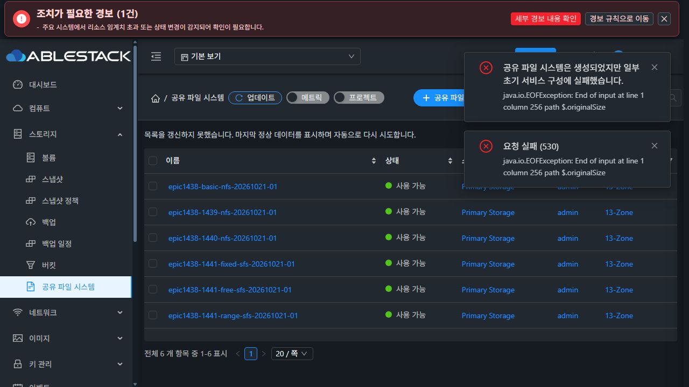
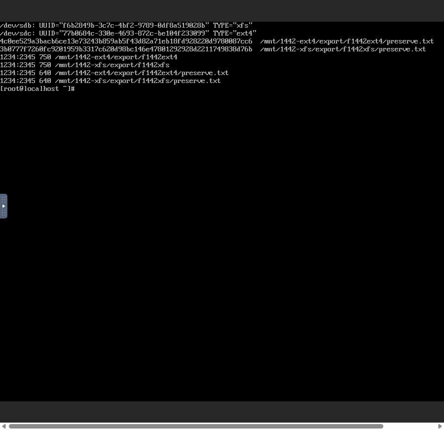

# #1442 구현·배포 및 첫 실제 UI 인수 결과

**구현과 모듈 빌드·13번 배포는 완료했으나, 첫 기존 XFS 생성의 실제 UI 인수에서 제품 결함을 발견해 중단했다. 이슈는 OPEN이다. XFS/EXT4 연결·마운트·클라이언트 데이터 보존·실환경 중복 방지의 완료를 주장하지 않는다.**

## 반영 내용과 통과한 확인

- 구현 commit: `9a5b755368daf851e7383eb04803677bb23e8936`, Epic 브랜치 `epic/1438-sharedfs`, Draft PR #1470.
- local/upstream Europa 기준 `0e6b5093d51079f0cfd9bfc88b6e37a795be55a3`, 시작 시 divergence 0 0 확인. 별도 이슈/PR을 만들지 않았다.
- 신규/기존 요청 분리, 기존 볼륨의 조건부 오퍼링 검증, 계획 UUID의 ROOT-only 할당, 포맷 없는 검사·마운트, 생성 journal·재조회·실패 보상 및 기존 DATA 보호를 구현했다.
- API/schema/server/provider 관련 **9개 시험 모음 97개**, 관련 UI **4개 시험 모음 36개**, 대상 UI lint 통과. 백엔드는 의존 모듈 포함 Maven package, UI는 production build 통과.
- 실제 Java 17에서 변경 **18개 클래스 계열**의 로딩/필드/메서드/생성자 검증 통과. 비대상 JAR **93,725개 항목**의 바이트 동일성 확인.
- 관리 서버 JAR SHA-256 `9d961ce5e6cb1aa99f08a0c246151c058be1a95eca971acc54f06db1fd34799a`, PID 3017671 active.
- UI **899개 파일** 대조 배포, index SHA-256 `528696755fc1af81de45266e674537ab747b35bd5a81e6ded935baee6255c7fb`. config 원문/실경로 및 systemvm 디렉터리 inode 보존.
- `cloud.shared_filesystem.creation_request_id VARCHAR(36) ascii/ascii_bin NULL`, `creation_context TEXT NULL`, `uk_sharedfs_creation_owner(account_id, creation_request_id)` 추가. registry `europa-sharedfs-initial-backing-v1=Complete` 확인.

## 실제 UI·콘솔에서 한 일

새 클라이언트 `b7cafa18-d952-4579-98f8-9d913d67a7fc`와 ROOT `1cc21184-9d80-4a67-a561-67739e5c6ebe`를 Mold UI로 생성했다. ROOT 100 GiB와 DATA 두 개 20 GiB는 모두 SPARSE다. 기존 시험 VM/클라이언트를 재사용하거나 MAC을 변경하지 않았다.

| 목적 | DATA UUID | 콘솔에서 한 번 만든 실제 FS UUID |
|---|---|---|
| XFS | 124a8aa7-18d6-47cb-bc7a-188ff3dc79f6 | f6b2849b-3c7c-4bf2-9789-0df8a519028b |
| EXT4 | 213c0fe3-30f4-4412-b433-52c23e416393 | 77b0684c-330e-4693-872c-be104f233099 |

실제 VM 콘솔에서 장치 serial/빈 FS/크기를 확인하고 포맷했다. `export/f1442xfs/preserve.txt`, `export/f1442ext4/preserve.txt`와 UID:GID `1234:2345`, 디렉터리 `0750`/파일 `0640`을 준비해 체크섬과 UUID를 기록했다. 정상 unmount 후 UI의 **연결 해제 후 보존**으로 분리했다. NFS 접속 도구도 새 클라이언트에 설치했다. 키보드 기호 입력과 시험 fixture 오류는 자체 교정했으며 제품 결함으로 분류하지 않았다.

배포 UI에서 XFS 기존 볼륨, AUTO, MOUNT_EXISTING, SPARSE ROOT compute, L2/고정 IP `10.10.13.245/16`, NFS `f1442xfs`, 클라이언트 CIDR `10.10.254.200/32`를 선택해 제출했다. Root Squash와 기존 권한 보호는 유지했다.

실제 `createSharedFileSystem` 요청에 `volumeid/importmode/filesystem/requestid`가 있고 **신규 diskofferingid/storageid/size/IOPS가 없음**을 관측했다. HTTP 200으로 entity/job을 받았다.

## 최초 실패와 정확한 원인

2026-10-21 **23:02:41 KST**, async job `bb904c34-ddc7-4adb-8c60-050596de8e02`가 `jobstatus=2 / jobresultcode=530`으로 실패했다.

`java.io.EOFException: End of input at line 1 column 256 path $.originalSize`

1. 이번에 추가한 `SharedFSVO.creationContext`의 `@Column(name="creation_context")`에 **length를 빠뜨렸다**. JPA annotation 기본값은 255다.
2. 현행 `GenericDaoBase.prepareAttribute`는 String을 저장할 때 DB의 TEXT 여부가 아니라 이 annotation length를 읽고, 초과하면 `substring(0,length)`로 자른다. 공통 DAO의 기존 동작이며 이번에 바꾸지 않았다.
3. 실제 DB의 생성 context는 **정확히 255자/255바이트, JSON_VALID=0**이다. TEXT DDL이 정상 적용된 사실과 별개로 JDBC에 넘기기 전에 잘렸다.
4. 생성 작업은 `SharedFSCreationContext.read → SharedFSServiceImpl.continueCreation:670`에서 실패했다. 이 읽기가 현재 inner 보상 try 이전이므로 Allocated 행이 남았다.
5. 목록 응답의 `SharedFSResponse.setCreation`도 같은 잘못된 JSON을 무조건 읽어, **이 행 때문에 SharedFS 목록 API가 함께 530으로 실패**한다.

실제 배포 JAR의 VO와 `GenericDaoBase.prepareAttribute`를 사용하고 JDBC PreparedStatement만 메모리 proxy로 바꾼 추가 진단에서 **526자 입력 → 255자 바인딩 → 잘못된 JSON**을 재현했다. **DB 쓰기 0회**다. 추측이나 네트워크 원인으로 분류하지 않는다.

### 단위 시험에서 놓친 이유

생성 흐름 시험은 DAO를 mock으로 두고 journal을 문자열 그대로 보관했다. schema 시험은 컬럼/인덱스 DDL의 존재·재진입을 검사했다. 실제 GenericDao String 바인딩을 거치는 저장·재조회 시험이 없어 **DB TEXT와 VO length의 불일치**를 검출하지 못했다. 97개 통과를 실제 인수 통과의 대체 근거로 삼지 않는다.

## 현재 영향과 보존된 상태

- 실패 SharedFS `64305194-2694-4e90-9bb2-afe487891342`, 내부 id 56, **Allocated**, vm_id NULL, volume_id 199. XFS 예약 행만 남았다.
- VM 할당 전에 실패했다. 새 SharedFS VM/ROOT/DATA는 생성되지 않았으며 vm_instance id >108 행도 없다.
- 원본 XFS/EXT4는 모두 **Ready, 미연결, removed=NULL**, 원래 pool/path/offering/20 GiB/SPARSE 그대로다. SharedFS에서 attach/포맷/마운트를 실행하지 않았다. 데이터 보존의 최종 클라이언트 검증은 아직 하지 못했다.
- 기존 6개 SharedFS는 **Ready 및 VM/DATA 관계 유지**다. 기존 서비스의 클라이언트 I/O 재검증은 아직 하지 않았다.
- 목록 조회는 현재 손상 행 때문에 차단된다. 새 UI가 보내는 requestid 기반 NEW 경로도 같은 journal 저장을 사용하므로 영향 가능성이 있다. 신규 생성 시험을 더 진행하지 않았다. context=NULL인 기존 행의 기존 실행 흐름은 유지된다.
- 손상 행·예약을 삭제하거나 context를 임의 재구성하지 않았다. 후보 런타임/DB schema도 증거 상태로 유지했다. 제품 오류 발견 후 기능 재시도·다음 프로토콜 시험·추가 수정·롤백을 하지 않았다.

## 다음 수정의 구체적 범위 — 아직 적용하지 않음

1. **SharedFS VO만** 기존 TEXT 매핑 관례에 맞춰 `@Lob + @Column(length=65535,columnDefinition="TEXT")`로 고친다. 공통 GenericDao를 수정하지 않는다.
2. journal 직렬화 시 TEXT의 UTF-8 바이트 상한을 검사해, 초과하면 저장 전에 명시적으로 거절한다. 잘린 JSON을 정상값으로 다루지 않는다.
3. 목록 response enrichment는 손상 행을 **CORRUPT/준비 실패**로 표시해 다른 서비스 조회를 막지 않도록 격리한다. 무조건 새 생성·format·cleanup으로 우회하지 않는다.
4. 생성/재개 API는 손상 journal을 명시적 오류로 구분하고, 소유권을 재구성할 수 없으면 자원 작업을 차단한다. VM id NULL 및 실제 할당 없음이 검증된 이번 시험 행/예약은 수정된 취소·복구 경로로 한정해 정리한다.
5. 실제 GenericDao 바인딩을 거치는 **255자 초과/UTF-8 한계/손상 목록 격리** 회귀 시험을 넣고 실제 DB 저장·재조회까지 확인한다. 그 뒤 같은 #1442에서 UI 인수를 처음부터 재개한다.

후속 정상 인수는 기존 XFS/EXT4 연결·mount·checksum/권한 보존, INSPECT_ONLY→동일 ID mount, 신규 XFS/EXT4 회귀, 범위 내 거절/보상/응답 유실 시 중복 방지다. **#1443으로 넘어가지 않고 #1442를 OPEN으로 유지한다.**

